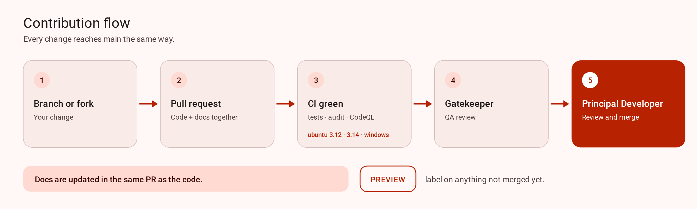

# Contributing

This is a local browser for a Serato DJ Pro library. The server binds `127.0.0.1` and has no login. Changes stay in this repository. They do not add a hosted copy of the server.

<picture>
  <source media="(prefers-color-scheme: dark)" type="image/svg+xml" srcset="docs/images/contribution-flow-dark.svg">
  <source media="(prefers-color-scheme: dark)" type="image/png" srcset="docs/images/contribution-flow-dark.png">
  <source type="image/svg+xml" srcset="docs/images/contribution-flow-light.svg">
  
</picture>

## Merge flow

1. Branch or fork.
2. Open a pull request. Code and the docs that describe it go in that same pull request.
3. Add tests and run every check locally. Paste the results in the pull request. See [Tests](#tests) and [Checks](#checks).
4. Wait until CI is green, including Windows and macOS. These checks are required ([`ci.yml`](.github/workflows/ci.yml), [`codeql.yml`](.github/workflows/codeql.yml)):
   - `tests (ubuntu-latest, Python 3.12)`
   - `tests (ubuntu-latest, Python 3.14)`
   - `tests (windows-latest, Python 3.12)`
   - `tests (macos-latest, Python 3.12)`
   - `frontend (ubuntu-latest)`
   - `frontend (windows-latest)`
   - `frontend (macos-latest)`
   - `analyze Python`

   The macOS jobs run on every pull request. Add their names to branch protection so they block a merge. Until an admin does that, the previous required set still gates `main`.

   `dependency audit` ([`ci.yml`](.github/workflows/ci.yml)) and `review dependency changes` ([`dependency-review.yml`](.github/workflows/dependency-review.yml), pull requests) also run, but are not required.
5. Gatekeeper QA (`mookiejones-qa`) reviews the pull request.
6. The team, including agents, may merge once `mookiejones-qa` approved the latest commit and all required checks are green. Only releases and tags need Charles's (@mookiejones) explicit OK. Never push to `main`.

Label work that is not merged **PREVIEW**. Do not describe it as shipped.

## Before you start

Quit Serato DJ Pro before a write against a live library. The tests never open that library. Do not commit `master.sqlite`, `root.sqlite`, a backup of either file, or an audio file. Do not attach those files to an issue or a pull request. Cue points live in the audio file.

## Dev setup

Python 3.12 or 3.14. The frozen app embeds 3.12.

```bash
python3 -m venv .venv
.venv/bin/pip install -r requirements.txt
.venv/bin/python desktop.py
```

`desktop.py` starts the local server and opens a native window titled Serato Library. The window uses the system web view (WebView2, WKWebView, or WebKitGTK / Qt WebKit) and does not bundle Chromium. On Windows, use `.venv\Scripts\python`. On macOS, also install `requirements-macos.txt`. On Linux, install WebKitGTK or Qt WebKit.

`python3 server.py` serves `http://127.0.0.1:8765`. Press F5 in VS Code to run that launch.

Page color and type tokens are in `static/tokens.css`. The page source is strict TypeScript in `src/`. Edit that, then run `npm run build` so the committed `static/app.js` stays current. Node 22 or newer matches `engines` in `package.json`. Do not hand-edit `static/app.js`.

## Tests

Every behavior change or bug fix ships with tests in the same pull request: Python `unittest` under `tests/`, page code as Vitest `*.test.ts` in `src/`. A bug fix needs a test that fails before the fix. Use only synthetic fixtures (`tests/fixtures/`), never a real `master.sqlite`, `root.sqlite`, or audio file.

QA (Gatekeeper, `mookiejones-qa`) uses this bar:

- Tests must fail if the logic is broken. QA may mutation-test; weak tests that pass anyway get blocked.
- Cover the edge cases that apply: Windows and macOS paths, symlinks and unmounted drives, Serato 4 vs Serato 5 data, and an empty or missing library.
- Never write extra files inside the Serato folder.

## Checks

Before opening a pull request, run all of these and paste the results in it. Commit the rebuilt `static/app.js` and `static/wizard.js`.

From the repository root:

```bash
python3 -m pip install -r requirements.txt
python3 -m unittest discover -s tests -t . -v
```

The install step is required because the suite imports `sentry-sdk` and `posthog`. Sharing stays off without a key and without consent. Do not commit a DSN, a PostHog project key, or a filled-in `_build_config.py`.

The page checks use Node 22 or newer:

```bash
npm ci
npx tsc --noEmit
npx eslint src
npm test
npm run build
```

GitHub Actions runs the same discovery with `python` on Ubuntu (3.12 and 3.14) and Windows (3.12). The Windows job also runs `python scripts/release_bundle.py check-tag` with `shell: bash` and `RELEASE_TAG` set to `v0.0.0`. [docs/github.md](docs/github.md) lists the workflows.

A desktop build uses `requirements-build.txt` and `python -m PyInstaller serato-library.spec`. On macOS, `requirements-macos.txt` supplies the WKWebView frameworks. Release builds are unsigned. GitHub Releases is the only download. Signing runs only when the Apple or Windows secrets in `scripts/release_sign.py` are all set.

Python has no separate linter. The page uses ESLint, which rejects `any`. The suites are `unittest` and Vitest.

## What to update in the same pull request

- `docs/architecture.md` when behavior, the API, the layout, or the run path changes.
- `CLAUDE.md` and `AGENTS.md` (identical copies) when the run command or the layout summary changes.
- `docs/github.md` when a workflow, a release check, or a GitHub setting changes.
- `docs/index.md` and `docs/guide/` when a DJ can see the change.
- `SECURITY.md` when the threat notes or the attestation commands change.
- `PRIVACY.md` and the README when sharing, local logs, or telemetry keys change.

The pull request template asks for the same list.

## Reports

Use the bug or feature template. For a vulnerability, open a [private advisory](https://github.com/mookiejones/serato-library-manager/security/advisories/new) instead of a public issue. Private vulnerability reporting is enabled for this repository.
