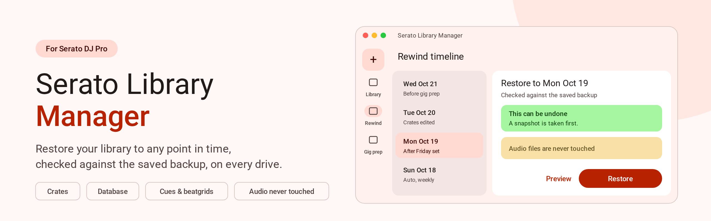
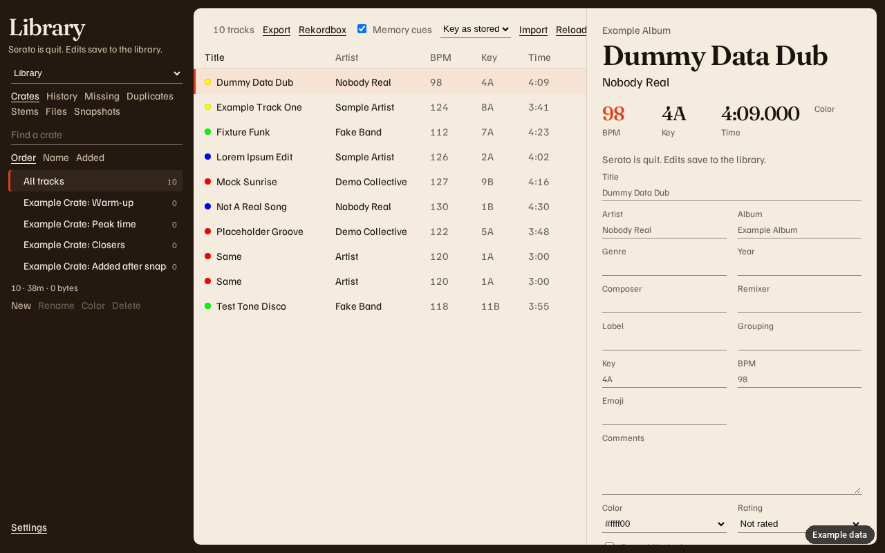
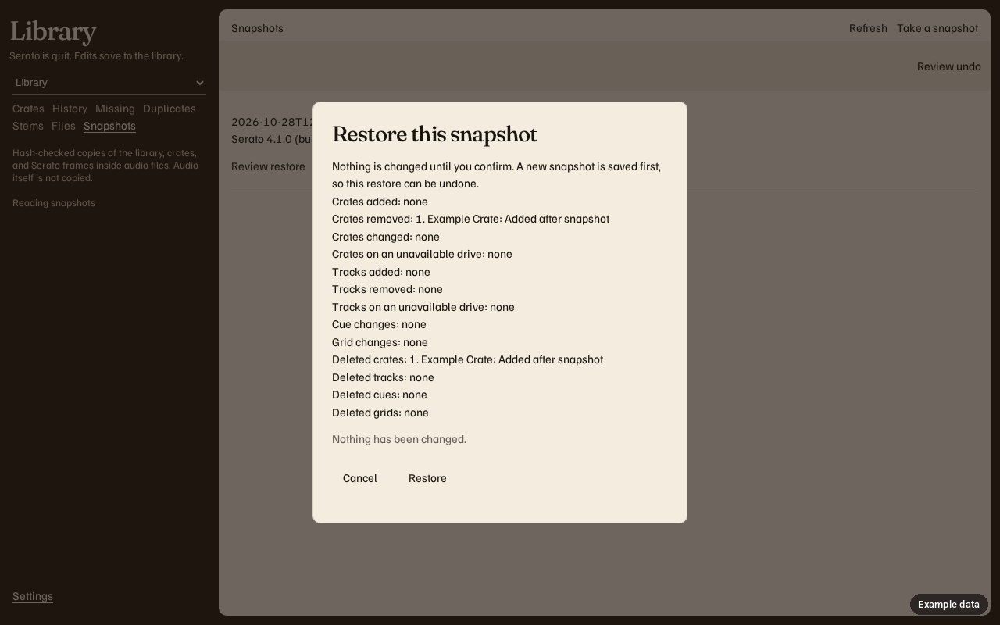
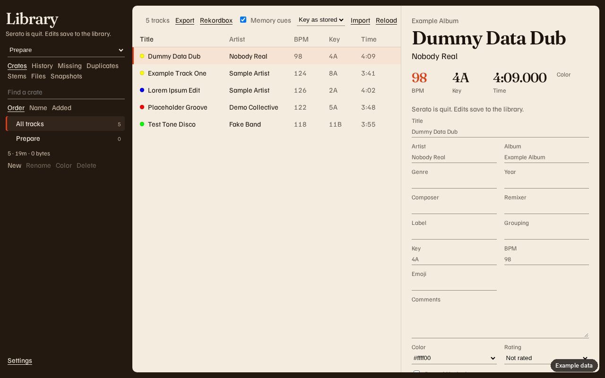
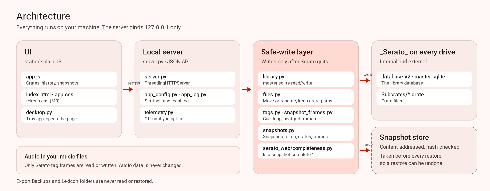

# Serato Library

[](https://github.com/mookiejones/serato-library-manager/actions/workflows/ci.yml)
[](https://github.com/mookiejones/serato-library-manager/releases/latest)
[](https://github.com/mookiejones/serato-library-manager/blob/main/.github/workflows/ci.yml)

A local window for the Serato DJ Pro library on macOS and Windows. Source on `main` is app version **1.1.0**. The page stays on this computer.

**[Quick Start](docs/wiki/Quick-Start.md).** Five steps: Download, Open, point it at your Serato library, make a Backup, start crate digging.

<picture>
  <source media="(prefers-color-scheme: dark)" type="image/svg+xml" srcset="docs/images/hero-dark.svg">
  <source media="(prefers-color-scheme: dark)" type="image/png" srcset="docs/images/hero-dark.png">
  <source type="image/svg+xml" srcset="docs/images/hero-light.svg">
  
</picture>

The hero is a product illustration. The screenshots below show example data of the crates, snapshots, and Prepare views. The app has one theme, so there is no dark variant.

## Install

Download from [GitHub Releases](https://github.com/mookiejones/serato-library-manager/releases). That is the only download. There is no Homebrew formula, winget package, or separate website.

The builds are unsigned. The Mac and Windows warnings, including Removable Volumes, are in [First install](docs/first-install.md). The published copy is [First install](https://mookiejones.github.io/serato-library-manager/first-install.html).

The release on that page today is **v0.1.1**. It attaches `Serato-Library-macos.zip` and `Serato-Library-windows.zip`.

App version **1.1.0** is in source and is not a GitHub Release yet. The [release workflow](.github/workflows/release.yml) builds these unsigned files when a `vMAJOR.MINOR.PATCH` tag is pushed. The pre-release [v1.1.0-rc2](https://github.com/mookiejones/serato-library-manager/releases/tag/v1.1.0-rc2) already attaches them, and it is not marked Latest.

| Computer | File |
| --- | --- |
| Mac, Apple silicon | `Serato-Library-macos-arm64.dmg` |
| Mac, Intel | `Serato-Library-macos-x64.dmg` |
| Windows installer | `Serato-Library-windows-setup.exe` |
| Windows, no installer | `Serato-Library-windows.zip` |

`SHA256SUMS` is on that same release. [First install](docs/first-install.md) uses these names.

## Features

These are on `main` (1.1.0).

- Browse crates, history, missing files, stems, and Prepare.
- Play a track in the window. Double-click a row, or use Play. The player bar has pause, seek, and volume. Only files already in the library are streamed, and playback does not write to them.
- Merge duplicate copies into the file you keep. Cue points stay in the audio file.
- Import and export M3U. Export `rekordbox.xml`. **Hot loops** starts off, and the app remembers that checkbox in its settings. Uses a free hot-cue pad. What that file keeps is in [docs/coming-from-rekordbox.md](docs/coming-from-rekordbox.md).
- Save related tracks in `related.sqlite` next to the app settings, not in Serato's library.
- Rename, move, replace, and trash audio, and update the library path.
- Keep hash-checked snapshots of the database, the crates on each drive, and the Serato frames inside audio files. Preview a restore, then confirm. Confirm saves a snapshot first. The music bytes are not copied into the snapshot. Restore can rewrite the Serato tags (cue points, beatgrid, autotags) inside each audio file, and removes Serato tags the snapshot didn't have. The audio stream is hash-checked before and after; if it would change, the file is left as it was.
- The first write in a session copies the database into `Library/Backups`. An unfinished copy is not offered for restore.
- Ask before sharing anonymous counts and crash reports. Setup asks on the first launch. Sharing stays off until you opt in. See [PRIVACY.md](PRIVACY.md).

The page source is strict TypeScript in `src/`. `npm run build` writes the `static/app.js` the server loads. Node is not required to run the server. Node 22 or newer is required to typecheck and rebuild that file.

### Screenshots

<figure>
  
  <figcaption>Example data. Crates.</figcaption>
</figure>

<figure>
  
  <figcaption>Example data. Snapshots, reviewing a restore before anything is written. The Serato 4.1.0 (build 4.1.0.1) line is the test fixture, not a detected install.</figcaption>
</figure>

<figure>
  
  <figcaption>Example data. Prepare.</figcaption>
</figure>

## Architecture

<picture>
  <source media="(prefers-color-scheme: dark)" type="image/svg+xml" srcset="docs/images/architecture-dark.svg">
  <source media="(prefers-color-scheme: dark)" type="image/png" srcset="docs/images/architecture-dark.png">
  <source type="image/svg+xml" srcset="docs/images/architecture-light.svg">
  
</picture>

`desktop.py` opens a native window titled Serato Library. The window uses the system web view: WebView2 on Windows, WKWebView on macOS, and WebKitGTK or Qt WebKit on Linux. Chromium is not bundled. Color and type tokens live in `static/tokens.css`. The code reference is [docs/architecture.md](docs/architecture.md).

## Run from source

Quit Serato DJ Pro before a write.

```bash
python3 server.py
```

Open `http://127.0.0.1:8765`. The server uses the Python standard library. On macOS the library is `~/Library/Application Support/Serato/Library/master.sqlite`. On Windows it is `%LOCALAPPDATA%\Serato\Library\master.sqlite`. Stop the server with Ctrl-C.

In VS Code, press F5. That launch runs `server.py`.

### Desktop app

```bash
python3 -m venv .venv
.venv/bin/pip install -r requirements.txt
.venv/bin/python desktop.py
```

The app binds `127.0.0.1` on a free port and opens a window titled Serato Library. Close the window to quit. A second launch focuses that window. On Windows, use `.venv\Scripts\python`, and install the WebView2 runtime when Windows does not already have it. On macOS, also install `requirements-macos.txt` in that environment so WKWebView can load. On Linux, install WebKitGTK (GTK 3 and WebKit2), or Qt WebKit without Qt WebEngine. `SERATO_LIBRARY_NO_WINDOW=1` or `--no-window` skips the window.

A local unsigned build of the current operating system:

```bash
.venv/bin/pip install -r requirements-build.txt
.venv/bin/python -m PyInstaller serato-library.spec
```

Release disk images and the Windows installer come from GitHub Actions, not from this command.

## Tests

```bash
python3 -m pip install -r requirements.txt
python3 -m unittest discover -s tests -t . -v
```

The suite imports `sentry-sdk` and `posthog`. It builds a temporary database. It does not open the live Serato library.

CI runs that discovery with `python` in [`.github/workflows/ci.yml`](.github/workflows/ci.yml): Ubuntu on Python 3.12 and 3.14, and Windows on Python 3.12. The Windows job also runs `python scripts/release_bundle.py check-tag` under bash with `RELEASE_TAG` set to `v0.0.0`.

## Supported versions

| | |
| --- | --- |
| App | `app_config.APP_VERSION` is the string `GET /api/version` returns. The rail footer and Settings → About show that string. A release build stamps the tag into `_version.py`. Latest GitHub Release: v0.1.1. |
| Python | 3.12 and 3.14 on Ubuntu CI. 3.12 on Windows CI. Frozen builds embed 3.12. |
| OS | macOS and Windows for the app. Linux runs the test suite and is not a published build. |
| Serato | Serato DJ Pro. Writes and restores run when the version is a dotted number below 5. Serato 5 can be snapshotted and read. Writes and restores stay off while Lucid and Flexible beatgrid storage is not verified. An unknown version blocks writes. |

## Guides

- [Panic page](docs/panic.md). Red tracks, missing crates, a drive that will not mount, or a library that looks wrong after a Serato update. Restore in the app is **Snapshots**, then **Review restore**.
- [Is my library safe?](docs/is-my-library-safe.md). Snapshots, restore, undo, and the outside-change watcher. The gig check is **PREVIEW** until [#41](https://github.com/mookiejones/serato-library-manager/issues/41) merges. The pictures are example layouts.
- [Moving between Serato and Rekordbox](docs/coming-from-rekordbox.md). What the export keeps.
- [User guide](docs/index.md). The rest of the app.

## More

The user guide is [docs/index.md](docs/index.md) and [the published site](https://mookiejones.github.io/serato-library-manager/). Contributing is [CONTRIBUTING.md](CONTRIBUTING.md). Security reports are [SECURITY.md](SECURITY.md). Actions and releases are [docs/github.md](docs/github.md). The roadmap is the [Serato Tools Roadmap](https://github.com/users/mookiejones/projects/3).

This repository has no `LICENSE` file. GitHub reports the license as not specified.
