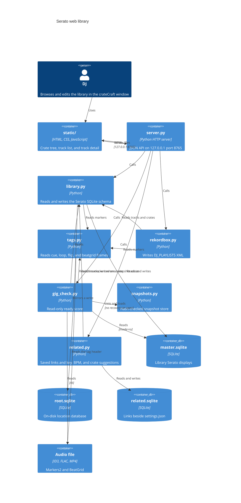
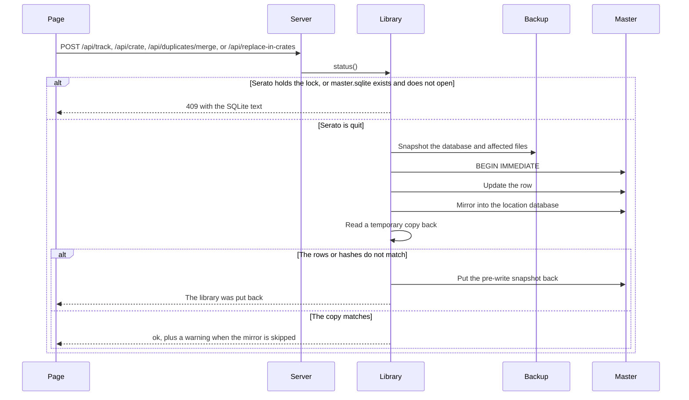

# Serato web library

A local page for the Serato DJ Pro library. The process reads `master.sqlite`. It writes only after Serato has quit. The first write in a process copies the databases into `Library/Backups`.

`docs/serato-library-tools.md` is research about other tools. It is not a description of this program.

The MUI theme shares Familjen Grotesk with the page. The navigation drawer is 200px wide when open and 56px when mini. Mini is forced at viewport widths of 980px or less so the Crates room can keep three columns at the 1120px desktop default. `layout.drawer_open` in `settings.json` remembers the last toggle; a resize does not write that flag. First launch with no saved flag opens the labelled rail when the window is wider than 980px. The crate rail prefers 240px and can shrink to 160px. The track list stays at least 360px and the detail pane at least 300px; a saved `layout.track_list_width` is clamped so it cannot hide the tree or the detail. Search and field controls sit above a wrapping action row. The Data Grid owns horizontal scrolling, without a minimum-width wrapper around the crate panes. Grid cells and headers retain visible keyboard focus. These presentation changes preserve the four colorways, 36px track rows, control ids, and server write guards.

## Run

1. Quit Serato DJ Pro.
2. From the repository root, run `python3 server.py`.
3. Open `http://127.0.0.1:8765`.
4. Press Ctrl-C to stop the server.

On macOS the process exits when `~/Library/Application Support/Serato/Library/master.sqlite` is missing. On Windows that file is `%LOCALAPPDATA%\Serato\Library\master.sqlite`. `server.py` uses the Python standard library.

The desktop app runs the same server on a free port and opens a native window:

```bash
python3 -m venv .venv
.venv/bin/pip install -r requirements.txt
.venv/bin/python desktop.py
```

The window is titled crateCraft. Close it to quit. A second launch focuses that window. On macOS, install `requirements-macos.txt` in that environment as well so WKWebView can load. On Windows, use `.venv\Scripts\python` in place of `.venv/bin/python`, and install the WebView2 runtime when it is missing. On Linux, install WebKitGTK (GTK 3 and WebKit2) or Qt WebKit. Qt WebEngine is refused because it bundles Chromium. `CRATECRAFT_NO_WINDOW=1` or `--no-window` skips the window. To build an app for the machine you are on, install `requirements-build.txt` in that environment and run `python -m PyInstaller crateCraft.spec`. The result is `dist/crateCraft.app` on macOS, or `dist/crateCraft/` on Windows. The build is unsigned. Release disk images, the Windows installer, attestations, and the GitHub settings around them are in [docs/github.md](github.md). Closing the last open item on a GitHub milestone comments on the **Next release** issue; it does not create a tag.

The first time the page opens, setup runs until `wizard_complete` is true. It confirms the library, saves a safety snapshot, and asks whether to share anonymous usage stats and crash reports. The choice stays off until you accept. Cancel does not finish setup. [PRIVACY.md](../PRIVACY.md) lists what can be sent.

## Tests

1. From the repository root, install the pinned packages with `python3 -m pip install -r requirements.txt`. The suite imports `sentry-sdk` and `posthog`.
2. Run `python3 -m unittest discover -s tests -t . -v`.
3. The suite builds a temporary database and points `library.MASTER` at that file. The fixture closes every SQLite connection before it deletes that directory. Windows cannot delete a database file that still has an open handle, and a `sqlite3` connection used as a context manager commits without closing.
4. The suite does not open the live Serato library. `tests/__init__.py` points `CRATECRAFT_CONFIG_DIR` and `CRATECRAFT_LOG_DIR` at a temporary directory for the whole run. A relative value for either variable is ignored.
5. `tests/fixtures/serato4` and `tests/fixtures/serato5` are tiny crate, `database V2`, and audio files. `python3 tests/fixtures/build_fixtures.py` rebuilds them from the published Serato notes. `tests/serato_spec.py` reads those bytes. It does not import the application. Serato 5 fixtures are marked `spec-derived, unverified` and do not invent Lucid beatgrids or Protect Library. FLAC and M4A reads go through `tags.read_serato_tags` and match the goldens. Issue #47 was fixed by pull request #55.
6. `npm test` runs Vitest on `src/tests/`, including the wizard step machine, the setup screen, and the app version in About and Help. `npm run typecheck` is `tsc --noEmit` and `tsc --noEmit -p e2e`. `npm run check` runs that typecheck, ESLint on `src` and `e2e`, the Vitest suite, and the bundle freshness check. `npm run build` runs `scripts/build_frontend.mjs`, which writes `static/app.js` and `static/wizard.js`. `npm run storybook` serves isolated React components at `http://127.0.0.1:6006` with the Vite builder; the page still bundles with esbuild. Stories live in `src/stories/`, mirrored as `*.stories.tsx` under `components/`, `pages/`, or `containers/`. Shared Storybook fixtures live in `src/lib/storybook/`. Context islands map Controls args through `src/lib/storybook/args.ts` into those fixtures and wrap the container providers. They do not call `readCrateValue` or the other live stores in `app/providers.tsx`. A push to `main` that changes those stories, `.storybook/`, or the page CSS publishes Storybook at `https://mookiejones.github.io/crateCraft/storybook/` next to the user guide. `@storybook/addon-mcp` serves MCP at `http://127.0.0.1:6006/mcp` while Storybook is running, with `features.componentsManifest` on so the docs tools can list components. `.grok/config.toml` registers that HTTP server as `storybook`. CI on Ubuntu, Windows, and macOS runs `node scripts/build_frontend.mjs --check`, which builds both bundles in memory and does not write `static/`. It fails when either bundle or its sourcemap differs from the commit, or when a sourcemap source escapes the repo (a `node_modules` symlink that points outside the tree). `tests/test_frontend_bundle.py` checks the committed maps the same way. The same jobs install Playwright's Chromium and run `npx playwright test -c e2e/playwright.config.ts`, which screenshots the waveform with cues, a loop, and the beatgrid.
## Debug in VS Code

1. Open this repository in VS Code.
2. Install the recommended Python extension when VS Code offers it.
3. Press F5.
4. The debugger runs `server.py` in the integrated terminal.

`.vscode/launch.json` names that launch "Python: Run server.py". "Python: Run desktop.py" starts the native window with `.venv` (`.venv\\Scripts\\python.exe` on Windows). "Python: Current File" debugs the open file. "Python: Debug Tests" runs `unittest` discovery for `tests/`. F5, Current File, and Debug Tests use the system Python. Format on save is on. The explorer hides `__pycache__` and `*.pyc`.

## Containers



## Modules

`server.py`, `library.py`, `files.py`, `snapshots.py`, `snapshot_frames.py`, `serato_web/completeness.py`, `related.py`, `rekordbox.py`, `gig_check.py`, `gig_snapshots.py`, `tags.py`, `audio_stream.py`, `waveform.py`, `waveform_native.py`, `desktop.py`, `telemetry.py`, `app_config.py`, `setup_flow.py`, `app_log.py`, `build_config.py`, `static_assets.py`, and `scripts/release_bundle.py` document each function with a Google-style docstring. The tests do the same. The page source under `src/` documents each function. `static/index.html`, `static/tokens.css`, and `static/app.css` open with a header comment that states the file's role.

### `server.py`

`serve` binds `ThreadingHTTPServer` to `127.0.0.1`. Called with no arguments it uses port `8765` and exits when that port is already taken. A missing master database still serves the page, so setup can say what to do next. Telemetry and the snapshot watch start only when the library file exists. `serve(port=0)` asks the operating system for a free port. `require_library=False` does not start telemetry or the snapshot watch, which is the release smoke path. When the library file exists and the library is required, `serve` starts that watch after the port is bound. `main` serves until Ctrl-C on port 8765. The handler class is `Handler`. It logs each request and answers JSON with `Cache-Control: no-store`. `shutdown_token` on the server object starts as None.

`app_root` locates `static/` and `locales/`. A PyInstaller build reads them from `sys._MEIPASS`. A source checkout reads the directory beside `server.py`.

`desktop.py` calls `serve(port=0)` and opens a pywebview window titled crateCraft on that URL. The window has a native menu (File, Music, Tools, Window, and Help, plus Settings in the Mac app menu). Music lists Crates, History, and Play stats. Tools lists Organize files, Health (Overview through Tag spellings), Backups, and Gig (Ready, Check drive, Tempo drift), then merge and backup actions. Help opens the same Help dialog as the footer, then Report a bug, Request a feature, View on GitHub, and Release notes, then Keyboard shortcuts, Open logs, and Copy version. The Mac About item in the app menu opens the About block in Settings. The footer Help button stays on the page. Item titles come from the page catalogs in `locales/`. `desktop_menu.catalog_root` reads that folder through `server.app_root`, so a frozen app uses the copy PyInstaller extracts next to `static/`. The spec copies `locales/` into the bundle and exits when `en.json` or `es.json` is missing. Release smoke does not open a window, so `release_bundle.verify_tree` and `assert_zip` also require those catalogs. A click calls `window.seratoDesktop.run` in the page. Close and Minimize stay in the shell. The Mac Edit and View menus stay the ones pywebview draws. Menu titles do not include key chords, because pywebview 6.2.1 cannot attach a shortcut. The same menu is passed to `create_window` and to `webview.start`, so GTK still shows it. `python3 server.py` has no menu. The smoke path does not build one. The window uses the system web view: WebView2 (`edgechromium`) on Windows, WKWebView (`cocoa`) on macOS, and WebKitGTK (`gtk`) or Qt WebKit (`qt`) on Linux. CEF and Qt WebEngine are not requested, so the build does not bundle Chromium. The window size and position are stored in `settings.json` under `window` (`x`, `y`, `width`, `height`) after the window has been placed. A saved position is restored when a 100 by 40 pixel strip of the title bar is on a screen. That includes a monitor to the left or above the primary screen, where `x` or `y` is negative. Otherwise the window is centered on the primary screen, the screen whose box contains the origin. Closing the window calls `_close_window`, which POSTs `/api/shutdown` with the desktop shutdown token, then the process stops telemetry. A lock file `instance.lock` in the config directory keeps a single instance. The operating system releases that lock when the process crashes. The next launch takes the lock and deletes the leftover `instance.port` before it publishes a new URL. The page URL is written to `instance.port`. A focus token is written to `instance.focus` with mode `0600`. A second launch POSTs `/api/focus` with `X-Serato-Library-Focus` when `/api/health` answers, and the running process restores and shows the window. It does not start another server. pywebview is imported only when the window is shown. `CRATECRAFT_NO_WINDOW=1` or `--no-window` skips that import and waits until shutdown. The macOS bundle does not set `LSUIElement`, so the app has a Dock icon, and it sets `NSRemovableVolumesUsageDescription` so macOS can ask before the app reads an external drive. That permission is Removable Volumes, not Full Disk Access. There is no menu-bar item and no notification-area icon.

`crateCraft.spec` bakes `packaging/app-icon.icns` into the macOS `.app` and `packaging/app-icon.ico` into the Windows `EXE()`. Those files are the 256-pixel drawing of `static/img/icons/default.svg` (brown rounded square, cream disc), not a theme colorway, and they do not include the word PLACEHOLDER. The spec exits with `Missing build inputs` when either file is absent. `packaging/crateCraft.iss` sets `SetupIconFile=app-icon.ico` so the installer wizard uses that same ICO. Source `desktop.py` passes `app_icons.default_window_icon()` to `webview.create_window` when the ICO or PNG is present, so the toolkit can show the default before the window is shown.

After the window is shown, and again when Settings saves `colorway` or `icon_follows_theme`, `app_icons.apply_saved` changes the running icon. On macOS that is `NSApplication.setApplicationIconImage_`, which changes the Dock icon of this process and does not write the bundle `.icns`, so Finder keeps the baked default. On Windows the process sets `Serato.Library` as its AppUserModelID and then sends `WM_SETICON` for both the big and small icons, which changes the window and the taskbar. The executable file is not rewritten, so the program icon stays the baked default. `icon_follows_theme` false restores the Dock default, or reads the executable's existing icon into the window. A Mac without the AppKit frameworks, a Windows process with no window yet, and every other platform return `applied` false and leave the icon alone. The choice is still saved. iOS is not a target. A later iOS build would list the four images under `CFBundleAlternateIcons` and call `UIApplication.shared.setAlternateIconName(_:)`. The system shows its own confirmation alert. The name has to be in the signed bundle, and `nil` restores the primary icon. That call is not made here.

When `CRATECRAFT_SMOKE` is an absolute file path, `smoke_main` runs and `launch` does not. The check confirms the bundled page through `server.app_root()`, binds a free port without opening the library, a window, or telemetry, writes `http://127.0.0.1:<port>` and a shutdown token to the marker, and serves until `POST /api/shutdown` presents that token in `X-Serato-Library-Shutdown`. A relative path, a symlink, a directory, or a missing parent directory stops the process. The windowed build has no console, so the marker file is the signal the release check reads. The smoke path does not import pywebview.

`static_assets.py` lists local `src` and `href` files in `static/index.html`. Remote URLs, anchors, and data URLs are skipped. `crateCraft.spec` exits before it analyzes the program when one of those files is missing, or when `locales/en.json` or `locales/es.json` is missing. The release zip check compares the same page files, byte for byte, with the source tree, and requires the locale catalogs beside each bundled `static/` directory.

A GET path under `/api/` runs a query. Any other GET path is a file in `static/`. The request is joined to that directory and passed through `os.path.realpath`. It is served only when the result starts with the directory plus a separator and the result is a file. `index.html` answers `/` and an empty path. Anything else returns 404.

`load_library` caches one payload per space. The cache key is the size and modification time of `master.sqlite` and its WAL file. A track Serato marked missing whose stored path sits on an unplugged drive is `offline` (with `offline_drive`) and `missing` is 0. Relink does not match those tracks. The same split is on `GET /api/track`. A cache miss can record `library_scanned` with a track-count bucket. A POST takes a process lock, drops that cache, then writes. Settings and log routes are answered before that lock. `serve` calls `files.recover_interrupted` after the database is known to exist. A journal that cannot be repaired is logged. The server still starts.

The HTTP banner is `SeratoLibrary/1.0`. A release tag does not change that banner. `app_config.APP_VERSION` and `__version__` are the `version` string from `version_info.resolve`, the same string `GET /api/version` returns. A stamped build reports the release tag. A development checkout reports `git describe`, or `0.0.0+dev` when git is missing. Sentry's release, PostHog's `app_version`, and `GET /api/settings` `app_version` read that string. The release workflow writes `_version.py` from the tag before PyInstaller runs. A development checkout leaves `VERSION` empty. `version_info.resolve` does not raise when git is missing.

`load_track` returns every column listed in `FIELDS`, plus the edit form, crate membership, near-duplicate copies, Prepare membership, the resolved file path, and marker data. Copies share title, artist, and length in whole seconds. The query returns at most 12 copies.

Blank display values use a dash. Dates use English month names, so the label does not follow the machine locale. Colors other than `0xFFFFFF` render as `#RRGGBB`. `third_party_type` maps `0` to Local file, `1` to iTunes, and `6` to Apple Music.

Allowed spaces are `Serato Library`, `Serato Video`, `Apple Music`, and `Prepare`. A missing space name means `Serato Library`.

### `library.py`

`default_library_path` chooses the live database: Application Support on macOS, and `%LOCALAPPDATA%\Serato\Library\master.sqlite` on Windows. `MASTER` starts as that path. Reads use a read-only SQLite URI and `PRAGMA query_only=ON`.

`status` reads the `lock` table. A row counts as open when the process image contains `serato`, and also when that check errors, times out, exits non-zero, or raises. macOS and other Unix systems ask `ps`. Windows asks `tasklist`. A locked database also counts as open. When `master.sqlite` exists, any other `sqlite3.OperationalError` from opening it or from the first query (for example `disk I/O error` or `unable to open database file`) also counts as open: `status` does not raise, and the message names the SQLite text so a damaged file is not hidden behind a plain Serato message. `open_error` holds that text, and is null for a plain lock or when the open succeeded. A missing file still raises `LibraryError` with 404, even when the open itself raised, so the setup flow sees no library rather than a running Serato. `writable` is false in all of these cases. `begin_write` and `files.execute` both go through this check, so a failed lookup refuses the write. `begin_write` also turns an `OperationalError` from opening its write connection or `BEGIN IMMEDIATE` into `SeratoOpen` with the SQLite text. Crate, track, merge, crate-replace, M3U, related-crate, and file writes reach `begin_write` or `files.execute`, and snapshot restore and its dry run read the same `status`, so each refuses in this state. `update_related_path` writes only `related.sqlite`, after a file move has already passed that check. The payload includes `file_manager`: `Finder` or `File Explorer`.

`begin_write` refuses the call when Serato is open (`SeratoOpen`, HTTP 409). It then refuses the write when `snapshots.write_block_message` is set: the Serato version is unknown, the preferences plist cannot be read, Protect Library is unknown, or Protect Library is on or unread on Serato 5. Snapshots of that library are still allowed. It then saves a content-addressed snapshot, calls `ensure_backup`, and opens `BEGIN IMMEDIATE` with a one-second timeout. Foreign keys are off for the write. The backup folder is `Library/Backups/serato-web-<YYYYMMDD-HHMMSS>/` beside `master.sqlite`. A second backup in that same second uses `-02`, then `-03`, through `-99`. The suffix is zero-padded, so sorting the folder names keeps the order the copies were made. The name is claimed with `mkdir(parents=True, exist_ok=False)`. If every name for that second exists, `FileExistsError` is raised and nothing is copied. If the copy fails, the new folder is renamed so the name ends with `-failed`, then removed. If the rename fails, an `INCOMPLETE` file is written in the folder. A failure to rename or remove it is logged and does not replace the copy error. Copies go into a hidden `.serato-web-<stamp>.partial` directory. `COMPLETE` is written last as JSON `{"version": 1, "algorithm": "sha256", "hashes": {relative POSIX path: lowercase SHA-256}}`. Those three keys are the whole object. The directory is then renamed to `serato-web-<stamp>`. `serato_web.completeness` does not import `library`. `verify_legacy_backup` there raises `CompletenessError`. `library.verify_legacy_backup` catches that and raises `LibraryError` from it, with status 400. `LibraryError` subclasses `CompletenessError`. `is_complete(backup_dir)` is the completeness check for a backup or snapshot directory. The argument is the directory itself. The parent path is ignored, so a folder beside `master.sqlite` and a snapshot directory in any other place, including an app-data folder, use the same function. It returns true only when `COMPLETE` exists and every listed hash matches, and every other file is listed. A missing marker, an extra key, or a text-line marker means incomplete, not legacy. A name ending in `-failed` or `-failed-` plus digits (any letter case, any number of digits) and a hidden `.partial` directory are never complete. `INCOMPLETE` is never complete. `list_backups` returns only directories for which `is_complete` is true. An old folder with `master.sqlite` and no `COMPLETE` file is `legacy, unverified` from `backup_status`. It is not listed as complete. `verify_legacy_backup(backup_dir)` is the check for one the user explicitly picked. It copies `master.sqlite` and any `-wal` file into a temporary directory, opens that copy read-only (`file:<path>?mode=ro`), and runs `PRAGMA integrity_check`. The backup folder is not opened and no `-shm` file is created there. The result has to be exactly `ok`. `snapshots.list_snapshots` skips a directory `is_complete` rejects. `snapshots.restore` calls `backup_status` on the snapshot directory before the pre-restore snapshot. A legacy result calls `verify_legacy_backup`. Any other incomplete directory is refused. The snapshot code does not add a second `-failed` or `INCOMPLETE` check. The file browser hides `.partial` directories, failed names, `INCOMPLETE`, and a `COMPLETE` file whose hashes do not match. The copy includes `root.sqlite` when that file sits beside the master database. One process backs up a given master path once. After that copy, `backup_made` can be recorded. The backup path is not a property of the event.

`ensure_backup` also copies each present writable drive's `_Serato_` folder into `Library/Backups/serato-web-<stamp>/drives/<id>/`. The id is one path component, so a Windows drive id cannot climb out of that folder. Each directory contains only that drive's files. The copy stays on the internal disk beside `master.sqlite`, in the operating system's application-data directory. Nothing is written on the external drive. Content-addressed snapshots stay in `Library/Backups/snapshots` beside `master.sqlite`. `Export Backups`, `Lexicon`, `Recording`, and `DJ Sessions` are excluded with the same folding as snapshots. `Recording` and `DJ Sessions` are audio, not library metadata, so a plain backup does not copy them. Before any file is copied, free space on the backup disk must be at least the source bytes plus 1 MiB. Otherwise `ensure_backup` raises `OSError` with errno `ENOSPC` and the sentence "There is not enough disk space to back up the library." `begin_write` turns that into `LibraryError` status 507 and does not open the write. The staging folder is discarded. A drive unplugged during the copy, or any copy error other than a permission refusal, fails the same way and does not publish a partial backup. An unplugged drive, a read-only drive, and a drive that cannot be read are listed in `drives.json` with status `absent`, `read-only`, or `permission`. They are not failures. One unreadable subdirectory, including `EACCES` or `EPERM` while the tree is measured or copied, removes that drive's partial copy and records `permission`. The other drives are still copied, and a later library write still opens. The record of which database and which drives this process already copied is guarded by a lock. `drives.json` records the label and whether the drive was present. It does not record a filesystem path. `COMPLETE` hashes that file with the rest. `is_complete` is the check. `drive_backup_report` returns a backup only after that check passes. A drive mounted after the first backup in a process is copied on the next `ensure_backup` call. `POST /api/snapshots` with action `backup-drives` runs that copy without changing the library. It is refused while Serato DJ is running. `GET /api/snapshots` includes `drive_backup`. The Backups view has **Back up drive crates**. The line under it names drives that were copied, unplugged, or skipped. A `safe_write` session does not call `ensure_backup`, and `begin_write` skips the snapshot and the backup while that session is open.

`safe_write.py` is the check around those writes. `save_track`, `crate_action`, `import_m3u`, `smart_presets.create`, `smart_presets.refresh`, `smart_presets.refresh_all`, `crate_trees.create`, `merge_duplicates`, `replace_in_crates`, `files.execute`, and `album_art.embed` open a session. The session refuses an unknown version, or a Serato 5 library whose Protect Library is on or unread, before it snapshots anything. Rollback uses that same gate and does not replace a file when the gate is closed. A Serato 5 library with Protect Library off uses the same verify-and-rollback path. It then saves a raw preimage of `master.sqlite`, `root.sqlite` when that file is present, their `-wal`, `-shm`, and `-journal` sidecars, and any extra file the write names. The preimage is a directory under the app data folder, `write-checks/<library hash>/write-images/`, from `app_config.config_dir`. It is not under the Serato library. `write_complete_marker` and `is_complete` are the completeness check. The session does not call `snapshot_before_write` or `ensure_backup`, and `begin_write` skips both while the session is open, so the library folder does not gain `Backups` or `snapshots`. A `write-journal.json` file is written in that app-data directory before the body changes a library file. Crash recovery reads the journal from there. Rollback compares `library.MASTER` to `library.LIVE_MASTER` file-to-file, so a live library can put the preimage back. A dest still outside the open library raises `restore_outside` with the file name only; the full dest is written to the local log. After the commit, the check copies the database and any `-wal` file into a temporary directory and opens that copy read-only. It does not open the live database. `PRAGMA quick_check` has to be `ok`, and the row checks have to match the change that was asked for (crate name, color, expanded flag, smart-crate rules, membership, Prepare membership, track fields, or the saved file path). An unchanged extra file has to keep its pre-write SHA-256. A mismatch or an exception copies the preimage back, then hashes those files again. The journal is removed only after that hash check passes. A crash after the commit and before the check leaves the journal. The next write, and opening the snapshot store, puts the preimage back unless Protect Library blocks a Serato 5 library or a running Serato DJ process refuses it. After the commit the journal is rewritten with each library file's hash as the write left it. Recovery puts the preimage back only when every file still matches either the preimage or that recorded state. If any file differs, another program (such as a Serato DJ session after the crash) changed the library, so recovery leaves every file alone, records `rollback_failed` with `rollback` `refused`, and clears the journal so later writes are not blocked. The content snapshot taken before the write can still be restored from the Snapshots view. `-shm` is not compared, because a plain read rewrites that index. No snapshot space (`ENOSPC` while the preimage is copied) refuses the write. The database is not changed. Each attempt can append one JSON object to `operations.jsonl` in that same app-data directory. A refusal does not create the directory when it is not already there. Nothing in that record is written beside `master.sqlite`. The object has `version`, `time`, `action`, `operation`, `target` (a crate name, track name, file name, or snapshot id), `files`, `hashes`, `result` (`verified`, `rolled_back`, `refused`, or `rollback_failed`), `rollback` (`not_needed`, `verified`, `failed`, `refused`, or `not_attempted`), `verified` (true only when the check passed), `rolled_back`, `snapshot_id`, `snapshot_before`, `snapshot_after`, and `content_snapshot_id`. A checked write sets `snapshot_before` to the preimage id. `snapshot_after` is that same id when the library was put back, and null when the live library is the result and no second snapshot was stored. Paths outside the library folder are stored as the file name. `GET /api/operations` returns the newest 200 lines. The Snapshots view lists them. A failed rollback is an alert on that view and an error response. It is not `ok: true`.

`register` installs `serato_str_norm` and `serato_raw_key_string_to_key_type` on a write connection. The key function maps Camelot and traditional names onto Serato's integer key.

Nested crate names in the database use `NAME_SPLIT` (`U+105E8A`). `display_name` keeps the text before that character.

Container type `0` is the space root and stays out of the crate list. Type `2` is a smart crate. Smart-crate rules are JSON in `smart_crate_rules`.

A write to a track or crate updates `master.sqlite`, then mirrors the change into the location database from the `connection` table. Location id `3` falls back to `root.sqlite` beside the master file. A test database whose path is not the live master mirrors only files in the same directory, or under `/tmp/`. A missing drive, or a database or filesystem error while mirroring, produces a warning and leaves the audio file in place. Any other mirror error propagates.

`save_track` accepts `name`, `artist`, `album`, `genre`, `year`, `composer`, `remixer`, `label`, `grouping`, `comments`, `key`, `emoji`, `bpm`, `color`, `rating`, `is_beatgrid_locked`, and `portable_id`. A new `portable_id` also sets `file_name`, clears `is_missing`, and records `file_size`. If that file's size cannot be read, the save is refused. Every save sets `time_modified`.

`crate_action` accepts `create`, `rename`, `delete`, `color`, `expanded`, `rules`, `add`, `remove`, `prepare`, and `remove_library`. Create may include `assets`, a list of unique integer track ids added in request order in the same write. A missing list creates an empty crate. A smart crate cannot take members. A track not in the space is 404. A non-list, a bool, or a non-integer is 400. The result includes `added`. Delete removes the crate and its descendants. `remove_library` removes the track from the space and its crates. It does not delete the audio file. `prepare` adds or removes the track in the Prepare space.

The page dual panes are `src/lib/crates/dual-crate.ts` and `src/lib/crates/dual-crate-view.ts`. **Split** shows two crate lists that share search and sort. Alt-click or Shift-click fills the other pane. **Save view** posts create with `assets` from the focused list. Serato must be quit for that write.

`history_sessions` and `history_entries` read `history_session` and `history_entry`. `duplicate_groups` groups tracks in one space by title, artist, and length in whole seconds. Rows with an empty title, an empty artist, or no length are skipped. Asset ids in a group are sorted.

`merge_duplicates` folds one of those groups into the copy you keep. `preview` true returns the plan and does not write. A merge requires `confirm` true. The master changes run in the `begin_write` transaction. Each location database is mirrored afterwards, in its own transaction, the same way other writes are. Serato open returns 409 before the backup. A preview still returns the plan when Serato is open, with `writable` false. That gap is intentional: the plan is readable, and the write path refuses before it copies a backup.

The kept track is added to every normal crate any duplicate was in, in any space, so a Prepare crate is included. Smart crates and the space root are left alone. If the kept track is already in a crate, it stays at its current position. Otherwise it takes the earliest duplicate's `list_order` in that crate. The location database receives the new membership with that same position when the column exists. A track that is already in the drive crate is not moved.

Empty text (album, genre, year, composer, remixer, label, grouping, comments, key, emoji, disc, track number, and the comment language fields) and an empty BPM are filled from the first duplicate, in asset-id order, that has a value. Text longer than the field limit is skipped. Play count and rating keep the highest number, treating a missing value as lower than a real one. White (`0xFFFFFF`) or a missing color is filled from the first real color. Date added keeps the earliest timestamp. Recently played is set when any copy was recently played. Filling the key also sets `key_value`. `is_beatgrid_locked` is copied only when BeatGrid frames are copied onto the kept file. Path, file name, file size, bitrate, sample rate, length, and the missing flag stay with the file you keep.

`history_entry.asset_id` is repointed when that column exists. The played name and file name on the history row stay as a snapshot of what was played. The same repoint is applied in a location database that has the column, using that database's asset ids. Duplicate rows are then removed from space membership, crate membership, and the asset table. The location database removes the same memberships and deletes the location asset row, so Serato does not recreate the duplicate from the drive. A duplicate that shares the kept track's location asset id is left in the drive database. A track whose location is not the main drive (`location_id` 3) is removed from the master library, and that other drive is left unchanged, matching `remove_library`. When several of those mirrors are skipped, `warning` says so once. A shared drive record, or a file that could not be moved to the Trash, is reported in addition to that sentence.

Cue points are read with `tags.read_serato_tags` and stored frames with `snapshot_frames.read_stored_frames`. Merge copies the richest Markers2 frame onto the kept file (most cues, then loops, then flips; the kept file wins a tie). BeatGrid stays on the kept file when it already has one. Otherwise the first duplicate that has a grid is used, preferring a locked grid. The write is `snapshot_frames.restore_stored_frames`, so Autotags on the kept file stay. Frames move only when both files use the same container. An ID3 destination with no tag is written as version 2.3, so the source tag must already be 2.3. The kept audio is named in `safe_write` `extra_files`, so a failed database write puts those bytes back. A failed rewrite leaves the file as it was, sets `cue_warning`, drops the planned `is_beatgrid_locked` update, and still merges the library rows. When the copy will run, `cue_copy` has `file`, `markers`, `beatgrid`, and `status` (`planned`, then `copied`). When it cannot run and a duplicate still has markers, `cue_warning` names that file.

`delete_files` defaults off. Turning it on also requires `confirm_delete_files` true. The move is refused, before `begin_write`, when a duplicate path is a symlink, a directory, the same file as the kept copy (including a hard link), named `master.sqlite` or `root.sqlite`, or inside the library database folder. A sibling folder whose name only starts with the library folder's name is not treated as inside it. Files that pass are moved to the Trash after the database commit: Finder on macOS, the Recycle Bin on Windows, and the FreeDesktop trash specification elsewhere. A failed move leaves the file on disk and returns a warning. The library change is already committed. A missing file is skipped. The response lists file names, not paths.

`replace_in_crates` puts `to_id` in every normal crate that holds `from_id`, at that `list_order`. Smart crates and the space root are skipped. When `to_id` is already in a crate, it stays at its current position. Duplicate `list_order` values are allowed, so both tracks can sit at the same playlist position. `retire` true then removes `from_id` from those crates only. The asset row, audio file, cues, and history stay. `preview` true returns the plan and does not write. A real update needs `confirm` true. Empty placement and removal lists are a no-op and do not open a write. Serato open returns 409 before the backup when a write would run. A preview still returns the plan when Serato is open, with `writable` false.

`export_m3u` writes an extended M3U for one crate or for the whole space. A track with no path is named in a `# omitted, no path` comment and left out of the playlist. A missing length is written as `-1`. `import_m3u` creates a normal crate and adds tracks whose `portable_id` matches a playlist path. Unmatched paths stay out of the crate. The result lists at most 50 of them.

`reveal` shows the resolved audio file in the host file manager. macOS runs `open -R`. Windows runs `explorer /select,`. `markers_for` calls `tags.read_serato_tags` when the file is on disk. A successful read can record `tags_read`. The audio path is not a property of the event. A duplicate merge reads markers through `read_serato_tags` directly and does not record `tags_read`.

`update_related_path` rewrites a path in the related-tracks sidecar after a file move. It does not open `master.sqlite`. The implementation is `related.update_path`.

### `related.py`

`related_db_path` is `related.sqlite` beside `settings.json`. The schema is version 1 (`PRAGMA user_version`) and is documented in [related-tracks.md](related-tracks.md). Reads and writes of that file do not take the Serato lock.

A track key is a normalized absolute path. `~` is expanded and `.` and `..` are collapsed. Symlinks are not followed, and the request path is not used to test whether a file exists. A track in the open library uses the path the library already resolved. Title, artist, and length in whole seconds are a fallback when exactly one stored row matches and that path is not still a different track in the library. `update_path` is what a file move calls. `add_link` stores a one-way or two-way link with an optional note and a rating from 1 to 5. `remove_link` deletes the link and keeps the identity rows. `overview` returns saved links and suggestions. `refresh_crate` creates or replaces a normal Serato crate named `Related - ` plus the track title. That call writes `master.sqlite` through `crate_action`, so Serato must be quit and the backup rules apply.

Suggestions rank other tracks in the space by Camelot key (same, relative, or one step on the wheel), BPM within 6 percent including half time and double time, and shared normal crates. Crates whose names start with `Related - ` are not counted. At most 12 suggestions are returned. They are not stored.

### `smart_presets.py`

Part 1 of #26. A preset is evaluated by the app and saved as a normal crate whose name ends in `⟳`, because Serato smart crates cannot express an OR group or a crate scope. Presets are `bpm_band` (`low` to, not including, `high`, up to 400), `key` (one key), `genre` (genre text, ignoring case and extra spaces), `harmonic` (`key`: the same key, one Camelot step either side in the same letter, or the relative key, which is `related.key_relation`), `bpm` (`bpm` above zero and `range` from 0 to 50, default 3, inclusive; a blank or zero BPM never matches), and `unplayed` (`months` from 1 to 240, default 12; no `history_entry` with `played` set in that window, so a track loaded but not played still counts). Any preset can take `crate`, which limits it to that crate and the crates nested under it.

`preview` opens the database read-only and returns the count, the default name, and at most 200 ids. `create` and `refresh` run through `safe_write.run` like a crate edit, so they are refused while Serato is running and checked after the commit: the crate must hold exactly the matching tracks. `refresh` removes tracks that no longer match, adds new matches, and leaves tracks that still match in place.

The preset is remembered in `preset-crates.json` beside `settings.json`, keyed by the resolved path of `master.sqlite` and the crate id, with the crate's `time_added`. It is never written in the Serato folder. SQLite can give a deleted crate's id to a new crate, often in the same second, so a crate delete through `POST /api/crate` calls `prune`, which forgets every record whose crate is gone or replaced. `refresh` also refuses with 404 and forgets the record when the crate is no longer a normal crate in the same space with the same added time. The name is not compared, so a renamed preset crate still refreshes. A missing or damaged file reads as empty. The record is saved only after the write is checked, so a refused write remembers nothing.

`refresh_all` prunes first, then compares every preset crate read-only. When none changed it writes nothing, so it also answers while Serato is running. Otherwise one `safe_write` session updates every crate that changed and checks each one. `for_crates` lists the preset crates of one space for `GET /api/library` (`presets`, keyed by crate id, with `preset` and `updated`). It matches each record against the payload's crate `added` time and skips smart crates.

The page (part 2) is `src/lib/crates/presets.ts` and `src/lib/crates/preset-view.ts`. **Preset** in the crate actions opens a dialog: the kind, its fields, an **Only tracks in** box when a normal crate is selected (checked by default), and the crate name. The key and BPM start from the selected track. The count comes from `preview` 250 ms after typing stops, and a late answer is ignored. The default name is in the page language, and the server adds ⟳. **Refresh** shows only on a preset crate, and the crate footer adds when it was last updated. When the page opens and edits are allowed, it calls `refresh_all` once. It reports and reloads only when a crate changed. A 409 because Serato is running stays quiet.

### `crate_trees.py`

Part 1 of #31. A crate tree is one normal parent crate with a subcrate per BPM band, key, or genre. Every subcrate is a preset crate from `smart_presets` (name ending in `⟳`), so it is remembered and refreshed like any preset crate. The parent is a plain folder. A tree does not add subcrates later for a genre or key that appears after it was made.

- `bpm`: bands from `low` (default 80) to `high` (default 140), `width` wide (1 to 50, default 10), starting every `step` (1 to `width`, default `width`). A smaller step makes overlapping bands. A band is `bpm_band`: from its low end up to, not including, its high end, so adjacent bands never share a track. At most 60 bands.
- `key`: one `key` subcrate per key that has tracks, in Camelot order 1A, 1B, 2A, 2B, and so on. A key name such as `Am` counts as its Camelot key.
- `genre`: one `genre` subcrate per genre with at least `min_tracks` (default 2) tracks, largest first, at most `limit` (1 to 100, default 40). Genres that differ only in case or spacing are one genre, named by the most common spelling (ties go to the spelling that sorts first). A blank genre is skipped.

`crate` limits every subcrate to that crate and its subcrates. Empty subcrates are not made. `preview` opens the database read-only and returns each subcrate's name and count. `create` makes the parent (top level, or inside `parent`) and every subcrate in one `safe_write` session, with a membership check per subcrate, then remembers each subcrate's preset. A tree that no track fits is refused before anything is written.

### `folder_sync.py`

Issue #210. **Sync folder** on a selected normal crate adds library tracks whose files sit in a folder. The crate already exists. Files that are not in the library are skipped and are not imported. Default is recursive add-only. Optional `subcrates` puts files that sit directly in the folder into the selected crate and makes a child crate per subfolder, reusing an existing child of the same display name. Nested files belong to the nearest subcrate. Empty subcrates are not created. Empty crates are not deleted. Optional `full` removes members whose files are not in that crate's folder. Prefix match uses path parts, case-insensitive, so `/Music/hip` does not own `/Music/hiphop`. Shortcuts are refused. The walk skips names that start with `.` and `_Serato_`, and stops after 50,000 entries. `preview` is read-only. `sync` goes through `safe_write` and skips the write when nothing would change. Smart crates and the space root are refused. `python3 folder_sync.py CRATE FOLDER` prints the preview as JSON. `--sync` writes.

The page is `src/lib/crates/folder-sync.ts` and `src/lib/crates/folder-sync-view.ts`. **Sync folder** in the crate actions opens a dialog: the folder path, **Make a subcrate for each subfolder**, **Remove tracks whose files are not in this folder**, a preview 250 ms after typing stops, and **Sync crate**. A late preview is ignored. A 409 because Serato is running closes the dialog.

### `snapshots.py`

`snapshots.py` stores hash-checked copies under `Library/Backups/snapshots/` beside `master.sqlite`. A blob's file name is the SHA-256 of its bytes. A snapshot is a directory. Its manifest names those hashes. The manifest's `sha256` field is HMAC-SHA256 of the other fields, using `manifest.key` in the store directory (mode `0o600`), not a bare hash. The key file is written in binary mode, so a newline byte stays one byte. A manifest copied without that key does not verify. Replacing the key file as well can still produce a matching digest. `COMPLETE` is written last as JSON `{version, algorithm: "sha256", hashes}` and the directory is renamed from `id.partial` to `id`. `serato_web.completeness.is_complete` is the only completeness check. A missing marker, an extra key, or a text-line marker means incomplete. `-failed` and `-failed-` plus digits, and `.partial`, match without regard to case. The file set must match the marker exactly, and only a lowercase SHA-256 digest counts. A marker path that is absolute, contains `..`, or leaves the directory is incomplete. `list_snapshots` skips a directory that check rejects. `plan` and `restore` do too. Manifests are not deleted by age. Two snapshots in the same second get different ids. Blobs are verified before the manifest directory is published, so a failed snapshot is not listed.

Each snapshot records the Serato version and build. macOS reads `CFBundleShortVersionString` and `CFBundleVersion` from `/Applications/Serato DJ Pro.app/Contents/Info.plist`. Windows reads `FileVersion` from `Serato DJ Pro.exe` or `Serato DJ.exe` under Program Files, then the Serato registry keys. A relative `.app` path is not used. On a relocated library the real app is not read unless `CRATECRAFT_APP_INFO` is set. When the version cannot be read, both fields are `unknown`, the snapshot still saves, and writes and restores stay off. The first time a version is seen, it is only recorded. A later change in either field saves one snapshot with trigger `version-change`. That snapshot is the library as it is when the new version is noticed. It is not a copy from before Serato wrote.

The manifest includes `master.sqlite` and `root.sqlite` when that file is present, copied with the SQLite backup API, plus an `integrity` of `ok` or `failed`. It includes each drive's `_Serato_` tree: `database V2`, crate files, and the other files in that folder. Serato 5.0 still uses `database V2` on macOS (`~/Music/_Serato_/database V2`), and the same chunk parser reads it and `.crate` files. `Export Backups` and `Lexicon` are not entered, hashed, or written. The match is case-insensitive, so `LEXICON` is the same folder. Each path component drops trailing dots and spaces, and text after a colon, before that comparison, so `Lexicon.`, `Lexicon `, and `Lexicon::$DATA` are the same excluded folder. A sibling such as `Export Backups-extra` is not treated as either name. Audio files referenced by those crates are stored as their Serato frames only: Markers2, BeatGrid, and Autotags for MP3, FLAC, M4A, and AIFF. Those bytes are read and written by `snapshot_frames.py`, which uses the parsers in `tags.py`. The audio bytes are not stored.

A drive that is missing keeps the crates and frame hashes from the previous snapshot and is marked not present. Those rows are not reported as removed. Restore skips a drive that is not present and does not delete its files.

`plan` compares the live library with one snapshot and returns crate, track, cue, and grid differences, including an explicit `deleted` list. It does not write a snapshot or a library file. `restore` refuses when a Serato DJ process is running (`ps` on macOS, `tasklist` on Windows; the command base name must contain both `serato` and `dj`). A process-list error, a non-zero exit, or a timeout counts as running, and the result is not cached. The version gate and the database lock are checked the same way. The message tells the person to quit Serato DJ Pro. After those checks, `backup_status` on the snapshot directory decides. `legacy, unverified` calls `verify_legacy_backup` before anything is replaced. Any other directory must pass `is_complete`. It then saves a snapshot with trigger `before-restore`, and verifies that snapshot. It writes `restore-journal.json` in the snapshot store before the first replace. Serato DJ is checked again before the database, before crates, before audio, and before a rollback. SQLite `-journal`, `-wal`, and `-shm` sidecars are removed before and after the database file is replaced. A failure, including `KeyboardInterrupt`, puts the pre-restore snapshot back unless Serato DJ is running. After `_apply`, a restore that registered no crates compares each database file by byte hash. A restore that registered crates compares row counts: the snapshot's rows plus exactly those crates. That read copies the database and its WAL and opens the copy with `mode=ro` and `query_only`, so the live file, `-wal`, and `-shm` stay unchanged. Indexes, triggers, and views must match, `PRAGMA integrity_check` must be ok, an empty table still has to have the same columns, and in the `serato` table only `revision` may change. Skipped crate files, the ones whose snapshot copy has no hash or cannot be read, are left out of the drive-file check and are listed on the plan and the restore result. Serato 4 and 5 delete a `.crate` or `.scrate` the database has never heard of. Restore registers those files through `begin_write(snapshot=False)` when the restored database has a Serato Library root crate. A file name alone is not matched to a track. Each present drive's other files and the Serato frames are hashed again and compared with the target manifest. A mismatch uses the same rollback. The restore journal is removed only after that rollback's hash check passes. A rollback that fails leaves the journal and appends one operation-log entry with `verified` false and `result` `rollback_failed`. A finished restore appends one entry with `verified` true. The log is `operations.jsonl` in the app data folder, not beside `master.sqlite`. Opening the store again rolls an unfinished journal back to that same snapshot. A crate path `Music/track.mp3` is also looked up as `audio/track.mp3` under the drive root, which is where the format fixtures keep the clips. An absolute path, including a Windows `C:/` path, is the file itself when that file stays inside the drive's music root. The music folder itself and a shortcut are not tracks. On Windows the containment check ignores case and a `\\?\` prefix: `\\?\C:\Music\track.mp3` is `C:\Music\track.mp3`, and `\\?\UNC\server\share\track.mp3` is `\\server\share\track.mp3`. The prefix comparison ends with a separator, so `C:\Music2` is not inside `C:\Music`. On a case-sensitive filesystem a case-folded prefix is not containment. The library database is opened with `file:///C:/...?mode=ro` before any other URI spelling, so a backslash in the URI does not hide the rows. A colon in the component after the drive anchor is an alternate data stream and is not opened. A colon in a relative component is refused on every platform, so a POSIX file named `set/file:stream.mp3` is not snapshotted. The gig check matches a saved frame to that path with either slash, and on Windows it ignores case. A stored id whose first component contains a colon is not matched by file name. A relative id can still match a saved path that ends with it. Two tracks that share a file name can receive the same saved frame when the stored id is only that relative tail.

A background poll, started from `serve`, watches `master.sqlite`, its WAL and SHM files, `root.sqlite`, and the `_Serato_` files above. It does not watch `Backups`, `Export Backups`, or `Lexicon`. When those watched files change and this app did not just write them, it saves a snapshot after the change, writes a log line, and keeps the previous snapshot id for undo. The log says the snapshot is from after the change. If a process name contains `Lexicon`, or the `Lexicon` directory's own timestamp is within a few seconds of the changed files, the log names Lexicon. The directory is stated, not listed, and nothing inside it is opened. Undo restores that previous snapshot. It does not claim a copy from before the other program wrote.

Session logs are a second source for that version. `serato_logs.py` reads `~/Music/_Serato_/Logs` on macOS and `%USERPROFILE%\Music\_Serato_\Logs` on Windows, and it does not create or change those files. `CRATECRAFT_LOGS` overrides the folder when the value is absolute. A relative value is ignored. A relocated library does not read the real logs. The newest of the retained logs is chosen from the date and time in the file name. A symlink to the folder, or a symlink log file, is not followed. A line marked `[Library]` names `master.sqlite` or `database V2`. A suffix after that name (`master.sqlite.in-progress-backup`) is not the library file. A Serato DJ version line names the generation, including `Product name: Serato DJ Pro, Version: 4.0.10 (4010213)` from a captured Serato 4.0.10 session log and `Version: 5.0.0 (5001251)` from a captured Serato 5.0.0 session log. `Surface Version: 4.1` is OpenGL, not Serato DJ. The older published markers still parse. Text that does not match is unknown. A missing or empty folder leaves the installed-app version in place. The log can only make the write gate stricter. An installed version that is not a dotted number stays `serato_version_unknown` even when the log says Serato 4, with or without a `[Library]` line. The `[Library]` path is read only from the newest session log. `parse_logs` caches a folder by each log file's mtime so a status poll does not read the files again. A log that does not contain a dotted version uses `serato_version_unknown`. macOS treats the logged path and `master.sqlite` as the same file when they differ only by case. Serato 5 writes when Protect Library is off, including when a newer log says 4 and an older retained log says 5, and when the installed app is Serato 5. A `[Library]` path that is not this `master.sqlite`, or that sits on a volume that is not mounted, refuses a write with `library_log_unconfirmed`. The log does not by itself mark the library open. A stale line that says the database is open is only a hint about which file. `status` adds `generation`: `kind`, `source`, `version`, `build`, `newest_version`, `database`, `log_name`, `mounted`, `downgrade`, `confirmed`, `reason`, and `install_version`. The rail button shows that generation. Its tooltip is `tooltip.libraryGeneration`, and that sentence is not the button's accessible name.

An unknown Serato version blocks writes and restores. A version that is not a dotted number, such as `v5.0`, is unknown and blocks too. Serato 5 writes and restores when Protect Library is off. Lucid and Flexible beatgrid storage stays unverified and is not parsed; crate and database writes do not touch those bytes. Protect Library is `library_protect` in `~/Library/Preferences/com.serato.seratodj.plist` (`1` on, `0` off). A missing file, a missing key, or a file that is not a plist is unknown and blocks. On and unknown refuse a Serato 5 write or restore, and the message says which one it is. The refusal does not look at a file lock. `database V2` is not treated as locked by Protect Library. `CRATECRAFT_PREFERENCES` overrides the plist path. A relocated library does not read the real preferences unless that variable is set. `status` includes `write_block`, `serato_running`, and `generation`. When the gate refuses, `writable` is false and the status line is the refusal. An unknown version also sets `code` to `serato_version_unknown` and `params.build` to the build string, and the page translates that status line.

`SnapshotReader` is the read API another check can call: `list_snapshots` and `load`. `load` returns `crates`, `cues`, `grids`, and `tags`. Tags are the Autotags bytes by hash and size. They are not parsed into a beatgrid layout. `database_bytes` returns the hash-checked `master.sqlite` copy from one snapshot, or None when it has none. `SnapshotStore(..., recover=False)` skips the rollback of an unfinished restore when the store opens; the gig check opens the store that way.

### `tags.py`

`read_serato_tags` reads. It does not rewrite the file. ID3 is taken from the first 2,000,000 bytes and, for a longer file, the last 512,000 bytes. `serato_tags_from_regions` parses those windows. The frames are `Serato Markers2` and `Serato BeatGrid`. An export that already has the file open calls `serato_tags_from_regions` with the same windows.

FLAC metadata is not limited to that window. While the file is open, every metadata block is visited from its 4-byte header. A picture or padding block is skipped with seek, so album art larger than 2 MB does not hide the markers and is not loaded. The Vorbis comment block is read in full, with no byte cap. The walk stops after `tags.FLAC_BLOCK_LIMIT` (1024) blocks and logs a warning, so a crafted file of empty blocks cannot stall a read; frames found before that are kept. `snapshot_frames` refuses to rewrite a FLAC with more blocks than that, instead of writing a copy without the blocks past the limit. The fields are `SERATO_MARKERS_V2` and `SERATO_BEATGRID`, matched without case sensitivity. An `.m4a`, `.mp4`, `.aac`, or `.alac` file, or a file whose first atom is `ftyp`, is walked by top-level atom size. An MP3 is not. The `mdat` audio is not loaded. Each `moov` body is read up to 16 MB. A larger `moov` is truncated and a warning is logged. Freeform `----` atoms whose mean is `com.serato.dj` are decoded, and the frame name inside the payload selects `Serato Markers2` or `Serato BeatGrid`. Serato names those atoms `markersv2` and `beatgrid`. Those FLAC and MP4 values are base64, without padding, of `application/octet-stream`, a null, a second null, the frame name, a null, and the same payload the GEOB frame stores. A newline may appear every 72 characters. Marker parsing ignores other `SERATO_*` blocks, including overview, so `found` stays false when an overview is the only Serato block. `read_serato_overview` reads that block and does not rewrite the file. ID3 is a GEOB named `Serato Overview`. FLAC is `SERATO_OVERVIEW`. MP4 is the `overview` freeform atom. The payload starts with `01 05` and then 16-byte columns. A short tail is dropped. At most 8192 columns are returned. Ogg Vorbis stores `serato_overview` as hex of two big-endian words, 1 and 5, then the same columns. An Ogg file is read only when it starts with `OggS` or the suffix is `.ogg` or `.oga`. Audio pages after the comment packet are not read.

`plan_serato_geob` and `copy_serato_geob` copy those Serato frames onto another file only when that is safe. A plain ID3v2.3 tag can take the frames. An `.mp3` with no tag can take a new ID3v2.3 tag in front of the existing bytes. Other frames are kept as raw bytes. The audio after the tag is streamed unchanged. A destination that already has Serato frames is left alone. A source with none is skipped. Unsynchronisation, an extended header, a compressed or encrypted Serato frame, a tag larger than 16 MB, and FLAC, RIFF, AIFF, Ogg, or MP4 containers are refused. The destination is not modified in those cases. The copy writes a temporary file beside the destination and replaces it only after the audio bytes still match.

`embed_front_cover` writes a JPEG or PNG front cover onto an MP3 or FLAC that has none. ID3 keeps other frames, including GEOB. FLAC inserts a picture block after STREAMINFO and leaves Vorbis comments. A file that already has artwork, a shortcut, and MP4 are refused. After replace, GEOB, cue, and beatgrid bytes must still match.

### `snapshot_frames.py`

`read_stored_frames` returns the exact stored Markers2, BeatGrid, and Autotags bytes. MP3 and AIFF use the raw GEOB frame. FLAC uses the Vorbis comment value (`SERATO_MARKERS_V2`, `SERATO_BEATGRID`, `SERATO_AUTOTAGS`). M4A uses the `data` atom body of a freeform atom whose mean is `com.serato.dj`. `restore_stored_frames` writes those bytes back and replaces the file only when the audio region still hashes the same. A failure leaves the previous file in place. Cue and beatgrid parsing stays in `tags.py`.

### `serato_web/completeness.py`

`is_complete`, `backup_status`, `verify_legacy_backup`, and `write_complete_marker` live in this module. `library.py` and `snapshots.py` import it. It does not import `library`. `CompletenessError` is what `verify_legacy_backup` raises, and `LibraryError` subclasses it. `COMPLETE` is JSON with exactly the keys `version`, `algorithm` set to `sha256`, and `hashes`. Hashing reads each file in chunks. A top-level `.write-lock` is ignored. The same name in a subfolder counts as a file. A snapshot directory is published by writing its files into `id.partial`, calling `write_complete_marker`, and renaming that directory to `id`.

Markers2 is base64 after a `01 01` header. Newlines and a missing `=` pad are accepted. Each parsed entry is `CUE`, `LOOP`, or `FLIP`. A cue has index, start in milliseconds, color, and name. A loop adds end time and a locked flag. A flip has index, enabled, and name. A `COLOR` or `BPMLOCK` entry in the same payload is skipped. Duplicate merge uses this read to score cue, loop, and flip counts. The write uses `snapshot_frames.restore_stored_frames`.

BeatGrid version byte `1` yields markers. Each marker has a position in seconds. That position is the stored float. It is not rounded to three decimal places. The last marker stores BPM, rounded to two decimal places. Earlier markers store a beat count. A version this parser does not know, more than 4096 markers, or a payload shorter than the declared marker count sets `beatgrid_warning` (English sentence) and `beatgrid_warning_code` (token such as `beatgrid_version`) and returns no markers. `GET /api/track` copies `position` as a three-decimal string for the panel and adds `position_seconds` as that stored float. Beat times between two markers are `(next.position_seconds - position_seconds) / beats`. After the last marker the spacing is `60 / bpm`.

### `waveform.py`

`load` returns an `SWF1` body for one real audio file. The route is `GET /api/waveform`. The id check is `audio_stream.parse_track_id` and `audio_stream.resolve_audio`: decimal digits in the raw query, no `path` parameter, `realpath`, a regular file, an audio suffix, and either inside a realpath'd music root or exactly the library file. A file symlink that leaves the stored directory is refused. Samples are read in chunks, mixed to mono, and split with FFT overlap-save (`numpy.fft`) of 1023-tap filters at 250 Hz and 4 kHz. One forward transform is shared by the three bands. Hops are reduced with a reshape, not a Python sample loop. Detail is 150 points per second. Each point is six uint8 values: low peak, low RMS, mid peak, mid RMS, high peak, high RMS. 255 is full scale. The overview is 1000 points when the detail is longer, and the same length as the detail when it is shorter. A tail shorter than one detail point is dropped. PCM is not kept. A cold 60-minute stereo 44.1 kHz WAV, mixed down to mono while it is decoded, measured 7.9 seconds, with a tracemalloc peak of 75 MB. Analyzer version 2 is part of the cache key, so an older body is not reused.

miniaudio (MIT) decodes `.wav`, `.aiff`, `.aif`, `.flac`, `.mp3`, and `.ogg`. A WAV or AIFF it cannot open falls back to the stdlib `wave` module or a pure-Python 16-bit AIFF reader. `.m4a`, `.aac`, and `.alac` are not decoded by those libraries. On macOS, `waveform_native.open_apple` runs `/usr/bin/afconvert` (AudioToolbox) with argv `-f WAVE -d LEI16@44100 -c 1`. The source argument is `os.path.realpath` of the file, so a name that starts with `-` is not an option. It writes `pcm.wav` in a `serato-waveform-` directory from `tempfile.TemporaryDirectory`. The stdlib `wave` reader then streams that file. The directory is removed when the iterator finishes, is closed, or the conversion fails, including when `afconvert` is killed after 300 seconds. On Windows, `waveform_native.open_media_foundation` uses Media Foundation (`mfplat.dll` and `mfreadwrite.dll`) through `ctypes`. Samples stay in memory. `CoUninitialize` runs only on the thread that called `CoInitializeEx` for that reader. A `.alac` name the source resolver does not open is hard-linked, or copied when the link fails, to `track.m4a` in that same kind of temp directory, and the directory is removed after the reader is released. Linux does not call either decoder. Every platform still tries `ffmpeg` when `shutil.which("ffmpeg")` finds it and an earlier opener raises `DecodeError`. A missing ffmpeg raises `DecodeError` and is not launched. ffmpeg is not bundled, `crateCraft.spec` is not changed to add it, and no Python package was added for this path. soundfile and libsndfile are not used. A temp path outside the system temp directory, in the same directory as the audio file, or inside the Serato library folder is refused before a process starts. A file that still cannot be decoded returns HTTP 200 `{"available": false, "error": "waveform unavailable"}`. That token is not painted. The bar uses `t("player.waveformUnavailable")` from `locales/en.json` and `locales/es.json` (`Waveform unavailable for this format` / `Forma de onda no disponible para este formato`). `GET /api/audio` is unchanged.

The cache directory is `<config>/waveforms`, the same app data directory as `settings.json` (`CRATECRAFT_CONFIG_DIR` when that is an absolute path). It is not `Library/Backups/snapshots`. A cache path that resolves inside the Serato library folder is not created. The file name is the SHA-256 of the real path, size, mtime in nanoseconds, and `ANALYZER_VERSION`, separated by NUL. A change to any of those misses. The temporary file name includes the process id, the thread id, and a counter, and `os.replace` publishes the final name. Failures are not cached. The audio file is opened read-only. `load_shared_waveform` runs one analysis when several requests for the same key overlap. A miniaudio `DecodeError` after the first chunk, an ffmpeg `TimeoutExpired`, and an `afconvert` timeout become `waveform unavailable` rather than HTTP 500. Closing the decoder generator kills and reaps ffmpeg and deletes the `afconvert` temp directory.

`GET /api/waveform?meta=1` returns JSON counts and `cached` instead of the body. `GET /api/waveform/overview` returns the Serato Overview columns without decoding. The binary layout, little-endian, is:

| Offset | Type | Field |
| --- | --- | --- |
| 0 | 4 bytes | `SWF1` |
| 4 | uint16 | Header size, 64 |
| 6 | uint16 | Format version, 1 |
| 8 | uint16 | Flags. Bit 0 detail, bit 1 overview, bit 2 Serato Overview |
| 10 | uint16 | Analyzer version |
| 12 | uint32 | Analysis sample rate, 44100 |
| 16 | uint32 | Detail points per second times 1000. 150000 means 150 |
| 20 | uint32 | Duration in milliseconds |
| 24 | uint32 | Detail point count `N` |
| 28 | uint32 | Overview point count `M` |
| 32 | uint32 | Serato Overview column count `S` |
| 36 | uint16 | Bands per column, 16, or 0 when `S` is 0 |
| 38 | uint16 | Reserved, zero |
| 40 | uint32 | Low/mid split in Hz times 1000, 250000 |
| 44 | uint32 | Mid/high split in Hz times 1000, 4000000 |
| 48 | 16 bytes | Reserved, zero |

Then `N * 6` detail bytes, `M * 6` overview bytes, and `S * 16` Serato Overview bytes in stored column order. The response header `X-Waveform-Format` is `SWF1`. Content-Type is `application/octet-stream`.

### `rekordbox.py`

`export_rekordbox` writes a Rekordbox `DJ_PLAYLISTS` document for one space. `crate_id` None exports every track in the space and every crate. A crate id exports that crate and its subcrates, and the collection is the tracks in that tree. The space root (container type `0`) is not a playlist. A crate with subcrates becomes a folder (`NODE Type="0"`). Its own tracks are a playlist of the same name inside that folder. A crate with no subcrates is a playlist (`NODE Type="1"`). Playlist order follows `list_order`. A track in two crates is one `COLLECTION` entry and two playlist references. `TrackID` is the asset id.

A track with no `portable_id` is omitted. `Location` is a `file://localhost` URI. A macOS path stays absolute (`file://localhost/Users/...`). A Windows path uses a forward-slash drive (`file://localhost/C:/Users/...`). Spaces, `#`, and other reserved characters are percent-encoded as UTF-8. The drive colon is not encoded. A colon later in the name is encoded. A UNC path keeps the double slash (`file://localhost//server/share/...`).

`Name`, `Artist`, `Album`, `Genre`, `AverageBpm`, `Tonality`, `TotalTime`, `BitRate`, and `Comments` come from the asset row. Control characters other than tab, newline, and carriage return, and unpaired surrogates, are removed from those text fields before the XML is written. `TotalTime` is whole seconds from `length_ms`. `BitRate` is `file_bit_rate` in bits per second, written as kilobits per second. `AverageBpm` uses the library BPM. When that value is empty and the beatgrid has a BPM, the beatgrid BPM is used. Rating is Serato's 0-to-1 value written on rekordbox's 0-to-255 scale.

Cues and loops come from `tags.read_serato_tags`. Each hot cue is a `POSITION_MARK` with `Type="0"` and `Num` equal to its Serato index when that index is 0 through 7. The same cue is also written with `Num="-1"` unless memory cues are turned off, because some CDJ screens only list memory cues. An index outside that range is only a memory cue. A saved loop is `Type="4"` and has `End`. Its `Num` is `-1`, so a loop does not replace the hot cue with the same Serato slot. `--hot-loops` uses the loop index when that pad is free. `Start` and `End` are seconds with three decimal places, which is one millisecond. `Red`, `Green`, and `Blue` are the marker color. Rekordbox may snap those values to its palette. A marker with no color is white. Flips are not written.

An MP3 is shifted only after its LAME/Xing header is read. No Xing header (case A) and a LAME tag whose CRC matches (case D) stay as stored. Xing or Info without a LAME tag (case B, including Lavc) and a LAME tag whose CRC is 0 or does not match (case C) are moved 26 milliseconds earlier, which is the published gap between Serato and Rekordbox on those files. AAC, WAV, AIFF, and FLAC are not shifted. A time that would fall before 0 is written at 0 and counted in the loss report. The path uses the directory entry's spelling when the file is on disk, so a macOS NFD name is the one Rekordbox will match. One folder is listed once per export, not once per track. Serato tags and the MP3 timing header are read in the same open. The header read seeks past the ID3 size, and past the ten-byte footer when that flag is set, then reads about 4 KB. `resolved_path`, `container_in_space`, and `descendant_ids` are the public helpers this export calls. Track color is written as `Colour="0xRRGGBB"`, the form in Rekordbox's XML list, when it is not Serato's white. Rating is one of 0, 51, 102, 153, 204, or 255. A file that cannot be opened is still exported, without cue points, and its name is in the loss report. A path containing a null character cannot be checked: `Path.is_file` raises `ValueError` on some Python versions and returns false on others. That track is exported as a missing file, without cue points, the loss report names it, and a warning is logged. The rest of the export continues. `Kind` comes from the extension. A raw `.aac` file is `AAC File`. An `.m4a` or `.mp4` file is `M4A File`.

The beatgrid is one `TEMPO` per marker, including a Serato 5.0 grid with a marker at each tempo change. An earlier marker's BPM is the beat count times 60 divided by the seconds between the stored marker positions. Those positions are the floats from the file. They are not rounded to three decimals before that division. The last marker's BPM is the BPM stored on that marker, rounded to two decimal places. `Inizio` is the marker position in seconds, on the millisecond grid. `Metro` is `4/4`. `Battito` counts from the first marker as a downbeat, so a marker every beat is 1, 2, 3, 4. A segment with no positive span uses the last marker's BPM. A beatgrid that cannot yield a positive BPM is omitted. A marker whose position is not a finite number is left out and counted in the loss report. A last marker whose BPM is not a finite number is left out and counted the same way. The other markers on that grid are still written. Those stored positions are not replaced by the three-decimal string the track panel shows. Version bytes other than 1, a truncated payload, and more than 4096 markers are left out and named in the loss report. `Tonality` is the key text Serato stores unless `--key camelot` or `--key classical` is set. `TrackID` is the asset id. Playlist `Key` values use that id and `KeyType="0"`. `COLLECTION Entries` and folder `Count` match the child counts.

`parse_rekordbox` reads that XML back into tracks, tempo, position marks, and the playlist tree. `position_ms` reads a seconds attribute back to whole milliseconds. `python3 rekordbox.py -o rekordbox.xml` writes the file and prints the loss report. `--space` selects the space. `--crate` is a crate id or `all`. `--no-memory-cues` skips the memory-cue copies. The command refuses to write `master.sqlite` or `root.sqlite`. `GET /api/export.rekordbox.xml?report=1` returns the loss report and the XML in one JSON object, so the page does not scan the library twice. The download uses that XML. An error response is JSON and is not given the rekordbox.xml filename. A crate id must be ASCII digits. `memory` and `hot_loops` accept `1`, `true`, `yes`, `0`, `false`, and `no`. Any other value is logged and the export uses the default, which is memory cues on and hot loops off. The page checkbox starts unchecked. `src/lib/ui/dialogs.ts` loads `rekordbox.hot_loops`, `rekordbox.memory_cues`, and `rekordbox.key_notation` from `GET /api/settings` when the dialogs wire, and posts the three controls when one of them changes. Those controls sit in the Rekordbox dialog, not on the track bar. Hot loops defaults to false, memory cues to true, and the key to `camelot`. A failed settings request leaves those controls as the page drew them, and the export still reads them. The checkbox sends `hot_loops=0` while it is clear and `hot_loops=1` while it is checked. A missing `hot_loops` parameter is off. A crate id that is not an integer, or that does not fit in a SQLite integer, returns 400. The page shows the report as a list in a dialog. Changing an option while the dialog is open saves settings and fetches the report again. Download starts after confirm. The loss report also names track color, beatgrid lock, replay gain, waveforms, stems, play history, smart-crate rules, and cue names a CDJ cuts short. A path that cannot be encoded is counted on its own and the file name is included.

Since Rekordbox 5.6.1, importing XML does not update a track that is already in the collection. In Rekordbox 6 and 7 the control is Preferences, Advanced, Database, rekordbox xml. Overwrite is Import to Collection, then Yes to load information from imported library. That replaces cues, the beatgrid, and tags. Device Library Plus and OneLibrary USB drives are not written. The export does not write the audio file or the database, and it does not record `tags_read`.

### `gig_check.py`

`run_gig_check` reads one space, or one crate and its subcrates, and returns a frozen `GigReport`. `python3 gig_check.py` prints the same report. `--database` selects a master file. `--space` selects the space. `--crate` is a crate id or `all`. The process exit is 0 when the report is ready, 1 when it is not or the library cannot be read, and 2 when `--crate` is not a number or `all`. The command does not write a file.

The database is opened with a SQLite URI `mode=ro` and `PRAGMA query_only=ON`. Audio is opened with `rb`. A missing database is 404. A database SQLite will not open read-only is 409. The check does not call `begin_write`, does not copy a backup, and does not record telemetry.

The score starts at 100 and is never below 0. `ready` is true when the score is at least `READY_AT` (70), including a score of exactly 70, and `hard_red` is false. Missing files remove `MISSING_POINTS` (8) each, capped at `MISSING_CAP` (40). Streaming tracks remove `STREAM_POINTS` (2) each, capped at `STREAM_CAP` (16). Empty crates remove `EMPTY_POINTS` (4) each, capped at `EMPTY_CAP` (12). An absent drive removes `DRIVE_POINTS` (20) per drive. An absent drive, or any missing file in the selected scope, sets `hard_red`. That is not ready even when the score is still at least 70. The whole space is the selected scope when no crate is given. Tracks on an absent drive are `unavailable_drives`, one row per drive name, and are not listed as missing files. A relative path whose `connection.database_uri` sits on an absent drive is not resolved under the home directory.

`holding_it_back` is the breakdown. Each line has `code`, `points`, `hard_red`, and `summary`. No snapshot in the last 7 days, measured from a timezone-aware `now`, removes `STALE_POINTS` (10) and the summary is `No snapshot in the last 7 days`. Streaming tracks, empty crates, and a non-empty diff against the latest snapshot remove points and leave the check ready when the score stays at least 70 and nothing is a hard red.

Streaming is only `third_party_type` 6, Apple Music. `server.py` maps that value to Apple Music, and Serato's streaming page says Apple Music tracks are streamed. iTunes (`1`) and any other value are not treated as streaming. A normal crate with no tracks and no subcrates is listed with `Serato may delete this crate when it closes.` Serato's clean-up note describes empty crates disappearing after quit and does not name a version. The Serato DJ 4.0 crate article does not say they are deleted. Smart crates, the space root, a parent that still has a subcrate, and a crate on an absent drive are not listed as empty.

`GET /api/gig-check` returns `report_to_dict`. `crate` uses the same rules as the M3U export. The page's Gig view reads `score`, `ready`, `holding_it_back`, `missing_files`, `unavailable_drives`, `streaming_tracks`, `empty_crates`, `snapshot_note`, and `changes`.

### `volumes.py`

`volumes.py` names the drive a stored Serato path lives on and says whether that drive is plugged in. It only reads. The gig check uses it, and relink will use the same rules, so a track on an unplugged drive is unavailable, not missing. `location_path` turns `connection.database_uri` into a path and keeps the drive letter of a Windows `file:///Z:/` URI. `volume_of` returns a `Volume` (`name`, `root`, `kind`): a drive letter on every operating system (`letter`), a `\\server\share` root with either slash style (`unc`), or a macOS `/Volumes/NAME`, Linux `/media/USER/NAME`, `/run/media/USER/NAME`, or `/mnt/NAME` mount (`posix`). A home-folder path and a relative id have no volume. `external_volume` also drops the Windows system drive from `SystemDrive`. `Mounts.mounted` answers once per root per pass: a letter from `os.listdrives` on Windows (none elsewhere), a UNC root with a 1.5 second timeout so a dead share cannot stall the check, and any other root with `is_dir`. `opens_for_read` opens a file with `rb` and closes it. `path_candidates` is where a stored id might be: an absolute id as stored, a relative id on a mounted drive under that drive, and otherwise under the home directory and then the filesystem root, the order `library.resolved_path` uses. `gig_check.py` imports these under its earlier private names.

### `gig_snapshots.py`

`gig_snapshots.py` is the shape the gig check compares. It does not open a file. `GigSnapshotReader` has `list_snapshots`, which returns id, time, and label, and `load`, which returns crates, cues, grids, and library text. `NoSnapshots` is a reader with an empty list. `diff_snapshots` compares an older snapshot with a newer one and reports added and removed crates and tracks, edited crate membership, and paths whose cues, beatgrid, or tags differ. Cue and grid comparison is skipped when either side did not read them, so a missing file is not also reported as every cue being deleted. `track_key` is the asset id, a newline, and the stored path.

`gig_check.StoreSnapshots` reads the store in `snapshots.py`. `run_gig_check` uses it when no reader is passed, through `default_reader`, which opens `SnapshotStore(master, recover=False)` so an unfinished restore is not rolled back by a read-only check. A snapshot whose database `integrity` is not `ok` is not listed. `load` takes that snapshot's `master.sqlite` copy from `SnapshotStore.database_bytes`, writes it to a temporary file, opens it with `mode=ro`, and reads the same rows the check reads from the live library. So both sides of the diff use the same crate labels, asset ids, and library text. Cues and the beatgrid on the snapshot side come from the Markers2 and BeatGrid frames the snapshot saved, matched by path. Forward and back slashes are the same path, and on Windows the match ignores case, so `C:\Music\track.mp3` and `C:/Music/track.mp3` are one file. A stored id whose first component contains a colon is not matched by file name. On Windows a relative suffix match ignores case. A relative tail can still attach the saved frame of a different track with the same file name. A track with no saved frame is unknown on that side and its cues and grid are not compared. A store that cannot be listed sets `snapshot_note` to `Snapshots could not be read.` and counts as no fresh snapshot. A snapshot that cannot be loaded keeps the note and adds `The latest snapshot could not be read.`

The live side of the diff takes cues and the beatgrid from `tags.read_serato_tags`, which opens the file with `rb`. Library text comes from the asset row. The diff is for the whole space, including when a crate was selected for the missing-file scope. With no snapshot, `snapshot_note` is `No snapshots yet` and `changes` is null.

### `crate_compare.py`

`crate_compare.py` compares two crates in one space (#113). It writes nothing; the library is opened with `gig_check.open_read_only`. Each crate's stored members are read through `location_container` and, in the test schema, `container_asset.container_id`, in crate order (`list_order`, then row id). With `subcrates` a crate also counts the crates under it (`library.descendant_ids`), the parent's tracks first. A track listed twice counts once. A crate row whose track is gone is listed with an empty name.

`compare` returns `a` and `b` (`id`, `name` without the stored suffix, `smart`, `tracks`), `subcrates`, and `both`, `only_a`, and `only_b` as `{ id, name, artist }` rows. `both` and `only_a` follow A's order and `only_b` follows B's. A smart crate is compared by the members Serato last stored, which can be out of date; `smart` lets the page say so. The same crate twice is 400 `invalid_request`, and a crate not in the space is 404 `crate_not_in_space`. `GET /api/crate-compare?space=&a=&b=&subcrates=1` returns it, and `python3 crate_compare.py A B [--subcrates]` prints it. Saving a result as a new crate, through the crate write guards, is a later change.

### `bitrate_check.py`

`bitrate_check.py` flags files that claim more quality than they have (#36). It writes nothing; files are decoded through `waveform.iter_pcm` and the library is opened with `gig_check.open_read_only`. A lossy encoder removes the top of the spectrum, leaving a cliff near 16 kHz at 128 kbps and near 20 kHz at 320 kbps, and that cliff survives re-encoding at a higher bitrate or saving as FLAC or WAV.

`spectrum_cutoff` averages the power spectrum (8192-point FFT, Hann window) of one frame in three, skipping frames whose RMS is under 1e-4, and stops after 400 frames, about 3.7 minutes of audio spread over 11, so a long mix is not decoded to the end. It compares the mean level in the 500 Hz below each frequency from 11 kHz to 21 kHz with the 500 Hz above it. The steepest drop is the cutoff when it is at least 25 dB; a master that rolls off a few dB per kHz has none. `estimate_kbps` maps the cutoff to LAME's low-pass points: up to 16.5 kHz is 128, 17.75 kHz 160, 19.25 kHz 192, 19.9 kHz 256, 20.7 kHz 320, and above that full band. `verdict` returns `lossy_source` for FLAC, WAV, or AIFF with such a cutoff and `upsampled` for any other file whose `file_bit_rate` is at least 1.5 times the estimate. 320 against 256 is too close to call. The result is a suspicion: an old recording or a lo-fi master can have a real cliff.

`scan` takes a space or a crate with its subcrates and counts `checked`, `not_found` (including an unplugged drive), `unreadable` (no decoder gave any sound), `too_quiet`, and `unchecked` (a format it does not decode). Each suspect is `{ id, name, artist, file, reason, stated_kbps, estimated_kbps, cutoff_hz }` with the file name, not the path. `GET /api/bitrate-check?space=&crate=` needs a crate (`bitrate_needs_crate`, 400), because it decodes every file; `python3 bitrate_check.py` can check the whole library. **Suspect quality** under Health shows a Community Data Grid with a Reason column. Save crate stays above that grid. `POST /api/bitrate-check` with `action` `preview` lists a crate of flagged tracks without writing. `action` `create` writes that crate through `library.crate_action` and `safe_write` with Serato closed, named `Suspect quality`, at the space root. An empty scan does not write. UI is `src/lib/health/bitrate.ts` (engine) and `src/pages/BitrateReport.tsx` (paint).

### `tempo_drift.py`

`tempo_drift.py` flags tracks whose tempo wanders or that look like live recordings (#207). It writes nothing; files are decoded through `waveform.iter_pcm` and the library is opened with `gig_check.open_read_only`. A constant click stays quiet. A click that moves by several BPM, a live-looking name or comment, or Serato's `pending_tempo_map_analysis` mark is listed so a DJ can give those tracks a flexible beatgrid before a gig. A BeatGrid whose implied BPM already spreads by `GRID_SPREAD` (2) is counted as `mapped` and is not flagged: it is already flexible. A wrong constant BPM is out of scope and is not rewritten.

Window BPM is autocorrelation of a hop RMS envelope (`HOP` 512, 8 s windows, 4 s hop), folded into `[70, 140)` so 60 vs 120 is not drift. Autocorrelation searches lags for 40–200 BPM, then folds. Decode stops after `MAX_SECONDS` (180). Live matching is word-bounded (`Live at`, `(Live)`, `bootleg`, `concert`); `Alive`, `Olive`, and `livelihood` stay quiet. Membership is `bitrate_check._crate_assets` plus `library.descendant_ids`.

`scan` takes a space or a crate with its subcrates and counts `checked`, `not_found` (including an unplugged drive), `unreadable`, `too_quiet`, `unchecked` (a format it does not decode), and `mapped`. Each flag is `{ id, name, artist, file, reasons, bpm_min, bpm_max }` with the file name, not the path. `reasons` is a list of `drifting`, `live`, and `pending_map`. A missing file is counted and not flagged. `GET /api/tempo-drift?space=&crate=` needs a crate (`tempo_needs_crate`, 400), because it decodes every file; `python3 tempo_drift.py` can check the whole library. **Tempo drift** under Gig shows the report.

### `error_codes.py`

Maps each fixed English error sentence the server sends to a stable code. `send_json` adds `code` beside `error` when the sentence is one of them. A sentence with a path or other changing part has no code. `PARAM_CODES` is the exception: the unknown Serato version notice is `serato_version_unknown` with a `{build}` param. `status`, `GET /api/snapshots`, and a blocked restore plan send that `code` and `params` beside the English sentence. The page shows `error.serato_version_unknown` in the active language. Codes never change once shipped. `tests/test_language.py` checks that each code has `error.<code>` in every locale file and that the English entry is the same sentence, or the same template for a parameterized code.

### `update_check.py`

`update_check.py` tells the page when a newer release is on GitHub (#97). It is off until the person turns it on: `state()["enabled"]` is `null` when nobody has answered, so setup can ask, and `status` makes no request while it is `null` or `false`. When it is `true`, `status` asks `https://api.github.com/repos/mookiejones/crateCraft/releases?per_page=20` with a 5 second timeout and a User-Agent of `crateCraft/<version>`, and caches the answer for 24 hours. A clock earlier than the cached time refreshes. A body over 2 MB, a body that is not a JSON list, or a failed request reports no update and is not cached, so the next launch tries again. Only each release's tag, `prerelease`, `draft`, and `html_url` are kept. `parse_version` accepts `vMAJOR.MINOR.PATCH` with an optional `-betaN` or `-rcN`; beta sorts before rc, and both before the final release. A dev build (`0.0.0+dev`) or a `git describe` string is not compared, so it never shows a banner. Drafts are never offered. A beta or rc, by tag or by GitHub's pre-release flag, is offered only when `include_prereleases` is true. A skipped tag is reported in `latest` with `update` false; a newer tag is offered again. A release URL is kept only when it is `https://github.com/<repo>/releases/tag/<tag>`; anything else becomes the releases list. `open_release` opens the offered page with `webbrowser` and refuses any URL outside the repository's releases. Choices and the cache are `updates.json` beside `settings.json`, written through a temporary file. Turning the check off drops the cache. The page controls (a setup question, a Settings switch, and the banner) are a follow-up.

### `relink.py`

`relink.py` suggests where missing tracks went (#28). It writes nothing. `plan` opens the library with `gig_check.open_read_only` and lists the space's tracks whose file does not open, with the gig check's rules through `volumes.py`: a track on a drive that is not mounted is in `unavailable_drives` and is never matched, and an Apple Music streaming track is skipped. Only an absolute path names a drive, so a Windows `Z:\` path read on macOS or Linux is missing there, which is the library-moved-from-a-PC case relink is for. A schema without `file_size` falls back to name matches. `scan` walks the search roots with `os.scandir`: it does not follow shortcuts, does not enter `_Serato_` or a hidden folder, indexes only audio suffixes, does not open audio, and stops after `SCAN_LIMIT` (200,000) entries with `truncated` true. A missing root is skipped. For each missing track, `match` returns candidates, best first: `high` for one file with the same name (case-insensitive, either slash style) and the same size; `low` for several such files, all listed; `medium` for one same-name file of another or unknown size; `low` for several same-name files; `medium` for one file of the same size and extension under another name; `low` for several. `remaps` reports a folder move (`from`, `to`, `count`) when at least two single `high` matches share it after their common tail is removed (`moved_folders`). `from` keeps the stored separators, so a PC path read on a Mac (or a Mac path read on Windows) is shown as the library wrote it; `to` is a folder on this computer. A Mac `/Volumes/...` path read on Windows is missing there, the same way a `Z:\` path is on a Mac. A missing track under the old folder whose file is at the matching place under the new folder then gets a `high` "folder moved" candidate; one whose file is not there gets none. `GET /api/relink?space=` searches the music roots from `music_roots` that are not marked missing. Optional `root=` is an extra absolute folder (`search_root`): it is normalized and must stay under its drive root before it is opened, the same way the setup folder picker is. A relative path, a file, a missing path, or a shortcut is 400. The Missing view reviews matches (confidence, reason, Accept all high, a picker when two files fit) and `POST /api/files` with `action: relink` and `matches: [{id, path}, ...]` applies them. That write is a journalled path rewrite: audio is not moved, crates and related links stay attached, a dest that is still the live file or already used by another track is refused, and dest files without Serato cue tags are warned about.

### `history_stats.py`

`history_stats.py` answers what Serato's all-time Plays column cannot (#33): the most played tracks and artists in a period, and the tracks that have not been played in a while. It writes nothing; the library is opened with `gig_check.open_read_only`. Only `history_entry` rows marked `played` count, and a period is `[from, to)` in Unix seconds on `start_time`.

A play is matched to its track by `asset_id`. A play whose track was later removed has none; it is grouped by its own title and artist, ignoring case and outer spaces, and keeps the title it was last played under. `top_tracks` rows are `{ asset_id, name, artist, plays, last_played }`. Artists are grouped the same way and shown with the spelling used most (a tie goes to the spelling that sorts first); `top_artists` rows are `{ artist, plays, tracks, last_played }`, where `tracks` counts different tracks. Both lists are most plays first, a tie going to the latest play, and hold `top` rows (1 to 500, default 25).

History is not split by space, so the period counts every space. `not_played` takes the space's tracks that were added before `now - idle_days` (1 to 3650, default 365) and have no played entry since then. A track with no stored date added counts as old. Rows are `{ id, name, artist, added, last_played, play_count }`, never played first by name, then the rest from the longest ago. `play_count` is Serato's own `dj_play_count`, so a track whose history was cleared still shows its plays.

`GET /api/history-stats?space=&from=&to=&top=&idle_days=` returns `{ from, to, plays, sessions, top_tracks, top_artists, idle_days, not_played, not_played_count }`. A value that is not ASCII digits, is out of range, or an empty period (`from` not before `to`) is 400 `invalid_request`. `GET /api/history-stats.csv` is the same report as a spreadsheet (`play-stats.csv`). `python3 history_stats.py` prints JSON; `--csv` prints that spreadsheet. **Play stats** under Music shows the report. `POST /api/history-stats` with `action` `preview` lists the idle tracks without writing. `action` `create` makes a normal crate of those tracks through `library.crate_action` (Serato must be quit). An empty idle list does not write. The page confirms create with ConfirmDialog, not `window.confirm`. UI is `src/lib/history/history-stats.ts` plus `src/pages/StatsPanel.tsx` on `StatsContext`. Accordion groups, not a Data Grid. Period, CSV, and idle days stay in the HTML bar.

### `file_scan.py`

`file_scan.py` finds audio files that are damaged or are not what their name says (#19). It writes nothing; files are opened with `"rb"` and the library with `gig_check.open_read_only`. `scan` takes a space or one crate with its subcrates (membership is read through `location_container` and, in the test schema, `container_asset.container_id`). Each track's file comes from `library.resolved_path`. A file that is not on disk, including one on an unplugged drive, is counted as `not_found` and not listed; the Missing view and the gig check cover those. An extension the check does not know is counted as `unchecked`.

The quick check (`sniff`) reads the first 64 KiB, seeking past any ID3v2 tag first so cover art does not hide the audio. Each extension must show its container: `.mp3` an MPEG audio frame (Layer I to III, reserved version bits refused), `.aac` an ADTS frame, `.flac` `fLaC`, `.wav` `RIFF`/`RF64`/`BW64` with `WAVE`, `.aif`/`.aiff` `FORM` with `AIFF`/`AIFC`, `.m4a`/`.mp4`/`.alac` `ftyp`, and `.ogg` `OggS`. Problems are `empty`, `unreadable`, and `wrong_format`, whose `detail` names what the bytes are (`html`, `zip`, `flac`, `adts`, `unknown`, and so on). Serato's own `asset.is_corrupt` is `serato_flagged` with `corrupt_description` as the detail; a file problem is reported first. A database without those columns still gets the file checks.

The full check (`decode_check`) also decodes the file through `waveform.iter_pcm`. `undecodable` means no decoder read any sound. `decode_error` means a decode failed part way; the detail is the whole seconds decoded. `short` means the decode is under 90 % of the stored `length_ms` and more than 5 seconds below it, the sign of a cut-off download; the detail is `decoded/expected` whole seconds. Details carry no words, so a page can word them in each language. A file that fails the quick check is not decoded.

`GET /api/file-scan?space=&crate=&depth=quick|full` returns `{ depth, crate, checked, not_found, unchecked, counts, problems }`; each problem is `{ id, name, artist, file, problem, detail }` with the file name, not the path. A full check from the page needs a crate (`scan_full_needs_crate`, 400), because decoding a whole library takes minutes; `python3 file_scan.py --depth full` decodes everything. Another depth is `scan_depth` (400). The Damaged files view shows a Community Data Grid with a Problem column. Quick check and Full decode stay above that grid. A "suspect files" crate is a later change.

### `library_health.py`

`library_health.py` counts library problems on one page (#29). It writes nothing. `report` opens the library with `gig_check.open_read_only`. It takes a space or one crate with its subcrates (membership is `file_scan._crate_assets` plus `library.descendant_ids`). Missing is `asset.is_missing`. No BPM is blank or zero. No key and empty genre are blank or only spaces. Not in a crate is a space asset that is not in any type-1 crate; the space root (type 0) is not a crate. That section is empty when a crate is selected. Duplicates use the same title, artist, and whole-seconds grouping as `library.duplicate_groups`. A crate filter keeps a group when any member is in the crate, and keeps the full id list. Artwork and beatgrid come from `tags.read_file_health` on files that exist on disk: ID3 `APIC`, FLAC picture block 6, or MP4 `covr`, and a Serato BeatGrid frame (an unreadable grid still counts). Missing or unplugged files are skipped. Unused files are audio under `music_roots.collapse_track_folders` of those present files that are not a library path (`os.path.normcase` of `realpath`); `_Serato_`, `.git`, `node_modules`, `Recording`, `DJ Sessions`, and hidden names are skipped. That section is empty when a crate is selected. `music_roots.music_roots()` is not called. Each track section is `{ count, tracks }` with at most 100 sample rows. `unused` is `{ count, files }` with `{ file, path }`. `GET /api/library-health?space=&crate=` returns `{ space, crate, checked, missing, no_bpm, no_key, no_beatgrid, no_artwork, empty_genre, no_crate, unused, duplicates }`. A crate not in the space is 404. **Overview** under Health shows the report as Accordion sections with counts and sample tracks, not a Data Grid. UI is `src/lib/health/health.ts` and `src/pages/HealthPanel.tsx`. The report always includes **Open Suspect quality**, which opens the bitrate check. That check is not counted here. `python3 library_health.py` prints the JSON.

### `album_art.py`

`album_art.py` finds tracks with no artwork and embeds a Cover Art Archive front cover (#32). `missing` reuses `library_health.no_artwork`. `preview` searches MusicBrainz for the title and artist, then fetches Cover Art Archive `front-250` thumbnails as data URLs. Nothing is written. `embed` with `confirm` true fetches Cover Art Archive `/release/{uuid}/front` (UUID only) and writes JPEG or PNG through `safe_write` with the audio in `extra_files`. Serato closed. `tags.embed_front_cover` keeps GEOB frames and FLAC Vorbis comments. MP4 is refused. Network goes through `fetch_url`, which tests replace. `fetch_url` opens only https URLs whose hostname is `musicbrainz.org` or `coverartarchive.org`; a substring of the whole URL is not enough. MusicBrainz is one request per second. `GET /api/album-art` lists missing tracks. `POST /api/album-art` is `preview` or `embed`. **Find art** on an Overview no-artwork row opens the dialog (`src/lib/health/album-art.ts`). `python3 album_art.py --id N preview` prints the plan.

### `tag_cleanup.py`

`tag_cleanup.py` groups spellings of one genre or artist (#27, part 3) and cleans titles (#27, part 4). `clusters` opens the library with `gig_check.open_read_only` and counts the space's tracks by `genre` or `artist`; any other field is 400, and the SQL comes from a fixed table, not from the request. Blank values and values that are only spaces are left out, and a stored trailing space is the same spelling. `normalize` folds case, removes accents (NFKD), reads `&` and `+` as "and", and drops everything that is not a letter or a digit, so "Hip Hop", "Hip-Hop", "hiphop", and "HIP HOP" share the key `hiphop`. Only a key with two or more spellings is a group. Each group has `key`, `suggested` (the spelling most tracks use; a tie goes to the spelling that sorts first), `tracks`, and `spellings` (`value`, `count`, most used first). Groups are largest first. `GET /api/tag-clusters?space=&field=` returns `{ field, values, groups }`. `preview` takes one of those stored spellings and lists `{ id, from, to }` for rows in that space whose stored value shares the key and is not already that spelling, including a stored trailing space. A spelling that is not in a group is 400. `apply` writes that spelling through `safe_write` with Serato closed, then mirrors the field on each location database the way a track save does. Audio files are not rewritten. A plan with nothing to change does not write. `POST /api/tag-clusters` uses `action` `preview` or `apply`. **Tag spellings** under Health shows a Community Data Grid of clusters for the whole space, with Suggested spelling and counts as columns. Genre and Artist switch the field. **Review** and **Apply** stay above the grid. **Review** posts a preview. **Apply** stays off until that preview matches the selected spelling, the library is writable, and at least one row would change. A 409 lock disables Apply. A reply that arrives after a newer load started is ignored. UI is `src/lib/health/tags.ts`, with copy helpers in `src/lib/health/tags-view.ts`. `clean_title` strips a leading track number (`01 - `, `01.`, `1)`), URLs, and `(Original Mix)`, moves a trailing feat./ft./featuring credit into remixer when remixer is empty, and title-cases a title that is all upper or all lower after those strips. Mixed case stays. DJ, MC, UK, US, NYC, VIP, RIP, TV, LP, EP, and BPM stay upper. An empty cleaned name leaves the stored title. `preview_titles` lists `{ id, from, to }` and optional `remixer`. `apply_titles` writes those rows through `safe_write` with Serato closed, then mirrors `name` and remixer when it moved. `POST /api/tag-clusters` `clean-preview` is read-only; `clean-apply` writes. **Titles** in the same view posts `clean-preview` on open and **Apply** posts `clean-apply`. `python3 tag_cleanup.py --clean SPACE` prints the plan; `--apply` writes. `apply` also stores the chosen spelling in `tag-spellings.json` beside `settings.json`, keyed by the resolved library path and the `normalize` key. A damaged store reads as empty. `preview_mappings` lists `{ id, from, to, field }` for rows that still use another spelling of a saved key, including a later import that is not in a 2+ spelling group. `apply_mappings` writes those rows through one `safe_write` session, mixed genre and artist together, then mirrors each field. `POST /api/tag-clusters` `refresh-preview` is read-only; `refresh-apply` writes. **Tag spellings** posts `refresh-preview` when Genre or Artist opens and shows **Apply saved mappings** when rows would change. Titles skips that preview. Opening the view does not write. `python3 tag_cleanup.py --refresh SPACE` prints the plan; `--apply` writes. A multi-select field editor and writing tags into audio files are later changes.
### `lost_tags.py`

`lost_tags.py` lists titles and artists Serato's database lost (#73). It writes nothing. `plan` opens the library with `gig_check.open_read_only` and selects the space's tracks whose `name` or `artist` is empty or only spaces. For each, `library.resolved_path` finds the file; a track whose file is not there counts in `unreadable`. `tags.read_text_tags` reads the file's own tags. A fix is proposed only for a field that is blank in the database and set in the file: a field with a value is never proposed, even when the file differs. `GET /api/lost-tags?space=` returns `{ checked, unreadable, fixes }`, each fix `{ asset_id, path, current: { name, artist }, proposed }`. Applying a fix, through `safe_write` with Serato closed, is a later change.

`tags.read_text_tags` reads ID3v2.3 and ID3v2.4 `TIT2` and `TPE1` from the first 2,000,000 bytes (which includes an `id3` chunk near the start of a WAV or AIFF), then fills anything still empty from a FLAC Vorbis comment (`TITLE`, `ARTIST`, any case; at most `tags.FLAC_BLOCK_LIMIT` (1024) metadata blocks, the same cap as the marker walk) and an MP4 `moov/udta/meta/ilst` (`©nam`, `©ART`; `mdat` is skipped). ID3 wins when both are present. Latin-1, UTF-16 with a BOM, UTF-16BE, and UTF-8 decode. A multi-value frame gives its first value, and surrounding spaces are removed. A missing or unreadable file gives empty strings. The file is opened `rb` and not changed.

### `files.py`

`files.py` renames a file, bulk-renames library files to `Artist - Title.ext` from the library row then the file tags (`rename_from_tags`), moves files, moves a folder, points a library track at a replacement file, points missing tracks at files that moved (`relink`), and moves a file to the Trash. Crates, history, and Prepare stay attached because every stored path that resolves to the old file is rewritten. Cue points travel inside the audio file. A replacement copies them with `tags.copy_serato_geob` when that is safe, and the result says so when it is not. Relink only rewrites the stored paths and warns when the dest has no Serato cue tags. The old file stays on disk. `rename_from_tags` takes `paths` or one crate and its `space`. A Smart Crate and the space root are refused. A file already named that way, a missing artist or title, a name collision, a shortcut, a missing file, and a file that is not in the library are skipped. An empty plan is `ok` false. The dest stays in the same folder. Unsafe filename characters are replaced. The page has **Rename from tags** on Files (one or more selected files) and on a writable normal crate. A crate confirm does not reload the Files folder.

`list_directory` lists one folder without following shortcuts. An empty path lists the music roots from `music_roots.music_roots`: the parent folders of tracks in `master.sqlite`, collapsed to the shared music folder on each volume. Album folders under one music folder become that folder. `~/Music` and `~/Downloads` stay separate. The collapse does not widen a root to the home directory, `/`, `/Volumes`, or a drive root. A mounted drive with a `_Serato_` directory is added only when no track folder on that drive is already a root. macOS reads `/Volumes`. Windows checks drive letters that are mounted. Each root's label is the folder or volume name. A shared name gains `(parent)` until the labels differ, for example `Music (GIGDRIVE)`, and `detail` is the display path. A folder taken from the Serato library is `music_library` even when it is not named Music. A folder on a drive that is not mounted is included with `missing` true and cannot be opened, including when `elsewhere=1` and the folder has since appeared on disk. `/`, `/Volumes`, a bare drive root, a UNC share root, and the `\\?\` form of those roots are refused the same way. A shortcut that resolves to one of them, such as a link to `/`, is refused with 403. The roots are cached until `invalidate()` or `refresh=1`. A change to `master.sqlite` or its WAL does not recompute them. The library path index is separate and still notices those file times. `GET /api/library-roots` returns that cache as `{roots, computed_at}`. Each root has `id` (SHA-256 of the real path), `path`, `label`, `detail` (the path), `kind` (`music_library`, `serato_drive`, or `user_folder`), `serato`, `removable`, and `missing`. `?refresh=1` recomputes. A browse path is normalized with `abspath` and `normpath`, then kept only when that normalized path starts with its drive. A path outside the music roots is refused with `That folder is outside the music folders.` unless `elsewhere` is true. `..` is collapsed before the folder is opened. A shortcut below the top of the disk is refused, and a shortcut between a root and the requested folder is refused, so a link cannot leave the root. The whole folder is returned. Folders are ordered before files, and files before shortcuts. `truncated` is false. A non-empty `q` does not list the folder. It searches file and folder names under the music roots, or under `path` when that folder is set, and it does not write. Shortcuts are not followed. A root with `missing` true is skipped, including when that folder is still on disk. `.` names and `_Serato_` directories are not entered. Each word must be a subsequence of the name or of the parent folder name. A prefix ranks above a later copy of the same word. The walk stops after 20,000 entries and the response keeps the best 40. `truncated` is then true. `search` is true and `query` is the collapsed text. Blank `q` is a normal listing. A null byte returns 400, "That search is not valid." More than 200 characters returns 400, "That search is too long." `elsewhere=1` without a path returns 400 so the home directory is not walked. The same scoring rules are in `src/lib/fuzzy.ts`. `parent` is null on a music root, so Up cannot climb above it. `breadcrumb` starts at the root name. `music_roots.py` is the discovery. `_list_root` remains the wizard's unrestricted folder open. A request path is normalized and must be absolute on its own drive before the folder is opened. `plan` runs the same path checks as a save and returns a preview. It does not copy the database and it does not repair an interrupted journal. The preview says when Serato is open. `execute` requires `confirm` to be the boolean true. It refuses while Serato is open, copies the database, writes `Library/Backups/file-ops-journal.json`, changes the files, then updates `master.sqlite` and the attached location databases in one transaction. A database failure puts the files back. A filesystem failure rolls the database back and puts back the files that already moved. `recover_interrupted` finishes or undoes a journal the next time a save starts, and when the server starts. It does that only while Serato is quit. A journal that matches only some rows is left in place and the next save is refused until the backup in `Library/Backups` is restored.

Path columns are `portable_id`, `video_portable_id`, `file_path`, `filepath`, `path`, and names that end in `_path` or `_portable_id`. `file_name` is updated on the row whose portable id moved. History keeps its play. A rename or a move that changes the basename updates `history_entry.file_name`. A delete removes the asset from the library and its crates and sets `history_entry.asset_id` to null when that column allows it. The same delete is applied to the mirrored asset by `external_id`.

A file name cannot contain a slash, a backslash, or a null, and it cannot be `.` or `..`. The resolved parent must be the destination folder. Shortcuts are refused, including a shortcut whose name would pass the character check. `master.sqlite`, its sidecars, `root.sqlite`, and anything inside `Library/Backups` are refused. A sibling such as `Library/Backups-extra` is not inside that folder. The library directory, its parents, the home directory, and a filesystem root cannot be moved as a folder. A folder cannot be moved into itself. A name collision refuses the whole batch. A missing file cannot be renamed or moved on its own. A folder move still updates stored paths for missing files inside it. Deleting a missing library file removes the row and does not invent a trash entry.

Cross-drive moves copy the file and remove the source only after the sizes match. A cross-drive folder becomes one copy per file, recorded in the journal before the copies start. The operating-system Trash is used for a delete: Finder's Trash on macOS, the Recycle Bin on Windows (`FOF_ALLOWUNDO`), and the FreeDesktop trash elsewhere. `CRATECRAFT_TRASH`, when it is an absolute path, receives the file instead so a test does not touch the real Trash. On Windows, a failed database commit restores the file from a safety copy. The Recycle Bin can still hold its own copy.

`files_changed` is recorded after a successful save. The properties are a file-count bucket, `change` (`rename`, `rename_from_tags`, `move`, `move_folder`, `replace`, `relink`, or `delete`), and, for a replacement, `cues` (`copied`, `kept`, `skipped`, `unsupported`, or `failed`). Paths and names are not properties. A `change` or `cues` value outside those sets drops the event.

After the database commit, each moved file is passed to `library.update_related_path`, including files inside a moved folder that are not library rows. A related-track path that already belongs to another track is reported as a warning. The file move is not undone.

### `static/`

`index.html` is one screen. The MUI shell (`src/pages/AppShell.tsx`) is an AppBar, a collapsible Drawer, and Main. The AppBar holds the menu, crateCraft wordmark, generation chip (`#library-generation`, Checking then Serato n), compact player after a track, and Help and Settings (`#open-help`, `#open-settings`) on the right. `.app-bar-actions` uses `ml: auto` so Help stays right while the player slot is hidden. The space menu (`#space`, a native select) sits in the crate rail header (`.brand`). The Drawer holds the five primaries: Music, Organize files, Health, Backups, and Gig. Children of the open parent sit in `#view-children` in the Drawer (`src/lib/ui/nav.ts`). A parent with one child (Organize files, Backups) hides that strip. Mini hides labels and nested children and leaves crate names in the Main rail. `#status` sits in `.app-bar-lock` under the AppBar; the chip stays Serato n while locked. The heading `#sheet-title` stays on the sheet. The list/detail divider stays `#track-splitter`. `#sheet-title` names the open view and the space. Overview, Ready, Tempo drift, Damaged files, and Suspect quality show `#sheet-scope` for the selected crate, with All tracks to check the whole space. The last child per parent is remembered for the session. Music is Crates, History, and Play stats, and Crates is the view the app opens on. The open space, view, and crate live in `location.hash` (`#library/crates` or `#library/crates/12`). `src/lib/ui/hash-route.ts` parses and writes it. `setMode` and `selectCrate` push the hash. `app.ts` applies it after the first `loadLibrary`, and on `hashchange` and `popstate`. An unknown hash opens Crates with All tracks. The other split pane is not stored. Health is Overview, Missing files, Duplicates, Stems, Damaged files, Suspect quality, and Tag spellings. Backups is the snapshot view. Gig is Ready, Check drive, and Tempo drift. The gig check keeps the crate list and replaces the track sheet with a ready score. Selecting a crate, **Reload**, a space change, and **Check again** run `GET /api/gig-check` for the selected crate, or for the whole space when All tracks is selected. A reply that arrives after a newer check started is ignored. Gig UI is `src/lib/gig/gig.ts` plus `src/pages/GigReport.tsx` on `GigContext`. It walks five steps — Drives, Missing files, Streaming, Empty crates, and Since last gig — then a done screen. Each step says Step N of 5, focuses its heading, and offers one verb button, Back, and Exit gig check. The done screen names the score, the crate, and the time. `#gig-ready-art` (`data-slot="gig-ready"`) is empty until the ready artwork is supplied. The score is one element showing `72/100` and ✓ Ready or ✕ Not ready, with an accessible name such as Ready score 72 out of 100, not ready. A list longer than 100 is a `details` group with the count and Show all N. `#gig-status` is the only aria-live region. The Ready tab's `aria-controls` points at the tab panel. The report stays on screen while a new check runs. If the server cannot be reached, the status says Couldn't reach the library server. Check it's running, then press Check again, and focus moves to Check again. The report is React function components. It does not post. Tempo drift keeps the crate list and replaces the track sheet with a report. Selecting a crate, **Reload**, a space change, and **Check again** run `GET /api/tempo-drift` for that crate. All tracks is refused on the page (`error.tempo_needs_crate`) and Check again stays disabled. A reply that arrives after a newer check started is ignored. Drift UI is `src/lib/gig/drift.ts` plus `src/pages/DriftReport.tsx` on the same `GigContext`. `#drift-status` is an aria-live region. The Tempo drift tab's `aria-controls` points at the tab panel. The report stays on screen while a new check runs. If the server cannot be reached, the status says Couldn't reach the library server. Check it's running, then press Check again, and focus moves to Check again. The report is React function components. It does not post. Damaged files keeps the crate list and replaces the track sheet with a report. Selecting a crate, **Reload**, a space change, **Quick check**, and **Full decode** run `GET /api/file-scan` for the selected crate, or for the whole space when All tracks is selected. Opening the view runs a quick check. A full decode without a crate is refused on the page (`error.scan_full_needs_crate`) and Full decode stays disabled. A reply that arrives after a newer check started is ignored. Scan UI is `src/lib/health/scan.ts` plus `ScanPanel` on `HealthContext`. `#scan-status` is an aria-live region. The Damaged files tab's `aria-controls` points at the tab panel. The report stays on screen while a new check runs. If the server cannot be reached, the status says Couldn't reach the library server. Check it's running, then press Quick check, and focus moves to Quick check. The report is text nodes. It does not post. Suspect quality keeps the crate list and replaces the track sheet with a report. Selecting a crate, **Reload**, a space change, and **Check again** run `GET /api/bitrate-check` for that crate. All tracks is refused on the page (`error.bitrate_needs_crate`) and Check again stays disabled. **Save crate** posts `action: preview`. **Confirm crate** posts `action: create` and then reloads the library. A 409 lock disables Confirm. A reply that arrives after a newer check started is ignored. Bitrate UI is `src/lib/health/bitrate.ts`. `#bitrate-status` is an aria-live region. The Suspect quality tab's `aria-controls` points at the tab panel. The report stays on screen while a new check runs. If the server cannot be reached, the status says Couldn't reach the library server. Check it's running, then press Check again, and focus moves to Check again. The report is text nodes. Overview keeps the crate list and replaces the track sheet with a report. Selecting a crate, **Reload**, a space change, and **Check again** run `GET /api/library-health` for the selected crate, or for the whole space when All tracks is selected. Opening the view runs the report. A reply that arrives after a newer check started is ignored. Health UI is `src/lib/health/health.ts` plus `HealthPanel` on `HealthContext`. `#health-status` is an aria-live region. The Overview tab's `aria-controls` points at the tab panel. The report stays on screen while a new check runs. If the server cannot be reached, the status says Couldn't reach the library server. Check it's running, then press Check again, and focus moves to Check again. The report is text nodes. **Find art** on a no-artwork row opens a native dialog (`src/lib/health/album-art.ts`) that posts `POST /api/album-art` `preview`, then `embed` with `confirm` true. Missing files and Duplicate groups open those views. **Open Suspect quality** opens that view. A sample row opens Crates on that track. Tag spellings hides the crate list and replaces the track sheet with the groups for the whole space. Opening the view, **Reload**, a space change, **Check again**, Genre, and Artist run `GET /api/tag-clusters`. Genre and Artist also POST `refresh-preview`. **Apply saved mappings** posts `action: refresh-apply` and then reloads the library. **Review** posts `action: preview`. **Apply** posts `action: apply` and then reloads the library. A write or rollback failure shows the coded sentence as an error Snackbar (`#app-notice`) and on `#tags-status`. A reply that arrives after a newer load started is ignored. Tags UI is `src/lib/health/tags.ts` plus `TagsPanel` on `HealthContext`. `#tags-status` is an aria-live region. The Tag spellings tab's `aria-controls` points at the tab panel. The report stays on screen while a new load runs. If the server cannot be reached, the status says Couldn't reach the library server. Check it's running, then press Check again, and focus moves to Check again. The report is text nodes. Crate tools search, sort, create, and import an M3U. **Export**, **Import**, and **Rekordbox** show on Crates. **Export** downloads an M3U. **Rekordbox** downloads `rekordbox.xml` for the selected crate, including its subcrates, or for the whole space when All tracks is selected. **Memory cues**, **Hot loops**, and the key notation sit in the Rekordbox dialog. Hot loops starts unchecked. Memory cues starts checked. The key notation starts as Camelot. The page restores those three from `settings.json`. The help line reads Uses a free hot-cue pad. A loop uses its own pad when that pad is free. A taken pad stays a memory loop even when other pads are free. The Snapshots view is a Data Grid of snapshots (when, size, and status), with Restore as a row action. Take stays above. Restore opens an MUI Dialog preview. Cue changes name each file and, for a pad that would change, the time and name before and after. Confirm is off when `restore_blocked` is set. An outside change shows **Review undo** when `pending_undo` is present. Confirming that preview calls undo. Snapshot UI is `src/lib/snapshots/restore.ts` on `SnapshotsContext`. Tests call `unmountSnapshots`, `unmountTrackList`, `unmountDrift`, `unmountPortable`, `unmountTags`, `unmountScan`, and `unmountBitrate` so the grid scheduler does not run after jsdom drops the document, so an in-flight load does not look up a host that is gone, and so a cancelled load does not leave the next mount busy. The list and restore dialog are React function components. Open state is `planOpen`; the engine does not call `showModal`. The sheet holds the track search, the virtualized list, and the detail pane. A divider between the list and the detail pane (`#track-splitter`, `role="separator"`) resizes both. Drag it, or focus it and press the arrow keys (16 px, 64 px with Shift), Home, or End. Double-click resets the default split. The crate tree stays at least 160 px, the list at least 360 px, and the detail pane at least 300 px. A narrower window clamps a saved list width so it cannot hide the tree or the detail, without overwriting the saved value. Crates, History, Missing files, Duplicates, and Stems share that sheet, so they share one width. Files, Backups, Ready, Overview, Damaged files, Suspect quality, Play stats, and Tag spellings hide the divider. The width is saved with `POST /api/settings` about 400 ms after the last change, not in browser storage, because the desktop app can bind a new port on each launch. The search row wraps when the track column is narrow, so the field stays visible and the export controls stay inside that column. Files replaces that sheet with the music roots, then a folder list. The root list comes from `GET /api/library-roots`. Each row shows the label, such as Music (GIGDRIVE), with the path underneath, and a folder or drive icon. A drive that already contains one of those folders is not listed again. A root whose drive is unmounted is greyed out, says Drive not connected, and cannot be opened. Refresh recomputes with `refresh=1`. The breadcrumb starts at the root name. Up is disabled on a root. Browse elsewhere… is a quiet link that sets `elsewhere=1`. No roots shows No music folders yet and one primary button, Run setup, which opens the wizard. The file list is virtualized at 44 pixels a row, the same as `--file-row` and `FILE_ROW`. Root rows are 64 pixels, the same as `--file-root-row` and `ROOT_ROW`. Folders are painted before files. Arrow keys, Home, and End move through every row, including a folder of more than 5000 entries. Roots are cached until the library or settings change, or until Refresh. Rename, move, replace, and delete open a dialog that previews the paths, crate names, and cue warning. Nothing is written until Confirm. Delete's confirm button is Move to Trash. Move asks for a destination folder first. Writes stay disabled while Serato is open.

`src/lib/state.ts` keeps library state in `state`. `src/lib/ui/virtual-scroll.ts` mounts one MUI X Data Grid Community island per pane (`#list`, `#list-b`). Tests call `unmountTrackList` so the grid scheduler does not run after jsdom drops the document. The grid owns headers, row virtualization, column resize, and column hide. Play is its own first column. Title is the name plus swatch, emoji, and missing/offline/stems badges. Community pagination shows a compact footer when the view has more than 100 tracks. A row has a play button, and a double-click plays the track. The non-Play cells and the detail pane (fields, cue pads, beatgrid, related) are React function components on `TrackListContext`. Play stays on `PlayerContext`. Row height is 36 pixels. `src/lib/player/player.ts` wraps one `<audio>` element. AppShell portals `#player-bar` into the AppBar between the generation chip and Help. The slot is hidden until `PlayerSnapshot.trackId` is set; pause keeps it. Help and Settings stay on the AppBar right (`ml: auto` on `.app-bar-actions`) while that slot is hidden. A write-lock banner (`.app-bar-lock`, `#status`) sits under the AppBar when `writable` is false. A dismissible MUI Alert (`#app-notice`, `NoticeBanner` on `NoticeContext`) sits under that lock slot for the last save or request notice, on every view. An error is a Snackbar at the bottom that stays until dismiss; other severities stay under the lock slot. `setNotice` writes `src/lib/ui/notice-store.ts`. Empty text or dismiss hides it. Error and warning use `role=alert`; success and info use `role=status`. Dialog and player status lines stay local. The compact bar shows Play or Pause, the title, an SWF1 overview-scale waveform, and elapsed time. Click or drag the wave to seek. Previous, Next, volume, the seek slider, and zoom stay off this row. Cue pads in the detail pane still seek. When a track ends, the next visible row starts. Enter on a focused row plays that row. Enter while the list is focused plays the selection. Double-click plays the row. The functions for the hotkeys are `play(trackId)`, `playOrToggle(trackId)`, `pause()`, `togglePlayPause()`, `next()`, `previous()`, `seek(seconds)`, `seekBy(deltaSeconds)`, `isPlaying()`, `getPlayerState()`, and `subscribe(listener)`. The list Play button, the detail Play button, and the player bar are React function components that read `PlayerContext`. That context subscribes to the engine in `src/lib/player/player.ts`, so they share one snapshot. The crate tree and crate actions are React function components that read `CrateContext`. That context subscribes to `src/lib/crates/crate-store.ts`, so the rail and the action buttons share one snapshot. The compact AppBar waveform island reads that same player snapshot for the playhead and the loaded track. `WaveformContext` still holds zoom and overview state; compact `WaveformPanel` hides zoom and shows the overview as the AppBar wave. `mountWaveform(host, hooks, true)` is the AppBar mount. Each shows Play or Pause for the loaded track. Play on another row starts that track. Track rows and the detail pane read `TrackListContext` for selection and editor fields. `playerControls` is `{ togglePlayPause, seekBy }`. `app.ts` calls `registerPlayerControls(playerControls)` immediately after `mountPlayer()`. Space is bound once, in `wireShortcuts`, and calls `togglePlayPause`. `togglePlayPause` plays the selected library track when nothing is loaded. Left calls `seekBy(-5)` and Right calls `seekBy(5)`, the `SEEK_SECONDS` value in `src/lib/ui/shortcuts.ts`. A 403 or 404 shows `Not in the library or file missing`. Copy for the bar is `src/lib/player/player-strings.ts`. `src/lib/player/waveform.ts` parses the SWF1 body from `GET /api/waveform`. `src/components/WaveformPanel.tsx` paints it on two canvases through `WaveformContext`. Playhead and the loaded track come from `PlayerContext`. `src/lib/player/waveform-view.ts` fetches and blits. The zoomed view keeps the playhead at the horizontal center. While audio is playing, `requestAnimationFrame` reads the audio element's `currentTime` and blits pre-rendered tiles, so a long track is not redrawn from the first sample on every frame. Tiles are device pixels (`devicePixelRatio`). Lows blend to red, mids to green, and highs to blue. Peak is the outer layer. RMS is the opaque inner layer. The overview is the whole track. `GET /api/waveform/overview` is drawn as soon as it returns, and the computed overview in the SWF1 body replaces it. The played portion is shaded. Click or drag on the overview seeks. Cues and loops use the colors from `GET /api/track`. A loop is a shaded span. Beat ticks are on the zoomed view only. Each tick is one CSS pixel wide, drawn at the top edge and the bottom edge, about 12 percent of the canvas height, in white at low opacity. A downbeat is about 18 percent and a little brighter. Ticks do not run the full height. Cues stay full height in their colors. Loops stay shaded regions. Spacing is `(next.position_seconds - position_seconds) / beats`, then `60 / bpm` after the last marker. The first marker is a downbeat, and every fourth beat is one. Zoom is the plus and minus buttons, and Ctrl or Command with the mouse wheel. No row is added to `SHORTCUTS`. Space, Left, and Right stay on the shortcut table. A response of `{"available": false}` shows "Waveform unavailable for this format" and does not pause playback. Zoom buttons, the overview, and every other control use the tooltip in `src/lib/ui/tooltip.ts`. It opens on hover and on keyboard focus, points at the control with `aria-describedby` while it is open, and does not animate when reduced motion is requested. Esc hides it and still closes a dialog or clears a search. The sentences live in `src/lib/ui/tooltip-strings.ts`. A control whose shortcut is in `SHORTCUTS` includes that shortcut. No shortcut is added. The detail pane has Play. That control and the list Play button share the player state. Playback reads `GET /api/audio` by id only and does not write history. Track sort keys include name, artist, album, BPM, key, energy, genre, date added, last played, plays, and length. Crate sort is custom order, name, or date added.

#### Languages

The page runs in English or Spanish. English is the default. `locales/en.json` is the source of every message the page shows, and `locales/es.json` is the Spanish copy. A message is a string or a set of plural forms (`one`, `other`, and the other `Intl.PluralRules` categories). `{name}` is a placeholder. A number placeholder is formatted for the active locale. `src/lib/i18n.ts` exposes `t(key, params)`. Keys are typed from `en.json`, and each other catalog is checked with `satisfies Catalog`, so a missing key fails `tsc`. `src/tests/i18n.test.ts` also checks that every catalog has exactly the English keys, the same placeholders, and the same plural shape. Dates, numbers, sizes, durations, lists, and the title sort use `Intl` with the active locale. Static markup in `index.html` stays in English and carries `data-i18n="key"` for its text and `data-i18n-attr="attr:key;attr:key"` for placeholders, titles, and labels. `applyStatic` translates it. The page and the wizard are separate bundles, so the active locale is `<html lang>`, and a change dispatches `serato-locale` on the document. `src/lib/ui/locale-wiring.ts` picks the first locale (`?locale=` in the URL, then the OS language), then repaints the shell, list, crates, files, history, the open detail pane, open dialogs, the snapshot plan, the player, an open shortcut sheet, an open find box, and the version line on every change. The library is not read again. Settings has a **Language** picker: Same as the system, English, or Español. The page switches at once and saves the choice with `POST /api/settings`. Null follows the OS. `GET /api/settings` returns it, and the page applies it when settings load. Nothing is kept in browser storage. `?locale=qps-ploc` turns on a pseudo-locale that accents every message and pads it by about 30 percent, so text that skipped `t()` stands out and a layout that cannot take longer strings shows it. A test renders `index.html` in that pseudo-locale and fails on any visible English. Text from the server (setup summaries, lock status, the Rekordbox loss report, merge field labels) is shown as sent. Fixed error sentences carry a `code` (see `error_codes.py`), and the page shows `error.<code>` from the active catalog, falling back to the English sentence. The unknown-version status line is the same kind of notice with a `{build}` param. History uses a wider played column so “Reproducida” is not clipped. Search and its field menu sit above crate actions. New, Rename, and Delete stay on one row; extras sit under More. Export, Import, and Reload remain available when the track pane narrows.

To add a language, copy `locales/en.json` to `locales/<code>.json` and translate every value, keeping the placeholders. Add the code to `LANGUAGES` and `LANGUAGE_NAMES` in `src/lib/i18n.ts`, to `CATALOGS` there, to `LANGUAGES` in `app_config.py`, and as an `<option>` in `#language-select`. `tests/test_language.py` fails until those agree.

`src/lib/state.ts` keeps library state in `state`. `src/lib/ui/virtual-scroll.ts` mounts the Data Grid island. Row height is 36 pixels. Track sort keys include name, artist, album, BPM, key, energy, genre, date added, last played, plays, and length. Crate sort is custom order, name, or date added.

The detail pane edits the fields `save_track` accepts, shows marker sections, and shows each beatgrid position to three decimal places so a stored float does not appear as `1.2300000190734863s`. Cue pads 1–8 always show when the audio file could be read, in the Serato DJ Pro GUI colors (Mixxx `kSeratoDJProHotcueColorPalette` assignment `{0, 2, 12, 3, 6, 15, 9, 14}`). A stored hex color on a cue wins. An unused pad shows the pad number, that color, and Empty. A missing file still says cues cannot be read and does not invent pads. Helpers live in `src/lib/ui/cue-view.ts`. The beatgrid block says it is view-only and flags a grid this parser cannot read. Helpers live in `src/lib/ui/beatgrid-view.ts`. The list is read-only. A missing file skips that block. That rounding is display only. The export still divides by the stored float. A non-finite beatgrid BPM is `null` in that payload. `send_json` replaces every non-finite number with `null` and encodes with `allow_nan` false, so a response cannot contain the token `NaN`. The pane lists near-duplicate copies, and offers crate membership, Prepare, reveal in the host file manager, remove from the library, and **Use in crates**. **Use in crates** puts another track in every normal crate this one is in, at the same position. Both can stay, or the original can then leave those crates. Smart crates and the space root stay as they are. Audio, cues, and history stay. In the Duplicates view it also offers Merge copies. It also lists saved related tracks, searches the loaded tracks to add a link, removes a link, and can write the `Related - ` crate. A successful crate write reloads the library so the new crate appears in the tree. Suggestions show the reason text from `GET /api/related` and save with one click. Notes and titles are set with `textContent`. The reveal label uses `file_manager` from the track status. Writes stay disabled while `writable` is false. Color choices are None, Red, Orange, Yellow, Green, Blue, Purple, and Pink.

Merge copies opens a dialog. The radios choose the file to keep. The dialog then shows the plan: crates, spaces, fields, history rows, and a cue warning when the kept file has no markers and another copy does. Date added in that list includes the year and the seconds. Cancel closes the dialog. Merge copies sends `confirm` true. Move the other audio files to the Trash is off until checked, and the confirm button then reads Merge and move files to Trash. The checkbox stays disabled when a file cannot be moved safely or is not on disk. The Merge copies button stays disabled while Serato has the library open. A preview request still returns the plan in that state, with `writable` false, and the confirm button stays disabled when that flag is false.

The AppBar holds Help and Settings on the right. The shortcut list is a section of Settings. `?` opens Settings on that heading. Ctrl or Command with F, or `/`, focuses the search for the current view. Ctrl or Command with K opens Find a view, crate, track, or file, which scores rail views, loaded crates, and loaded tracks at once, then asks `GET /api/files?q=` for files on disk. Enter opens the highlighted row. A view opens the same way the rail does and pushes the hash so Back works. A crate opens in Crates. Ctrl or Command with 1 through 5 opens All tracks, Crates, Organize files, History, and Backups. Esc closes the find box or Settings, and otherwise clears the search. Up, Down, and Enter move through the track list, the file list, or the snapshot list and open the row. Space, Left, and Right call the registered player's `togglePlayPause` and `seekBy`. When no player is registered, those keys do nothing. `app.ts` registers the player at startup, so Space toggles playback and Left and Right seek by 5 seconds. A shortcut does not run while the cursor is in a field, except Esc. The list is `SHORTCUTS` in `src/lib/ui/shortcuts.ts`. The cheat sheet is drawn from that list. The same chords are repeated in the tooltip for the control they operate. The version is read from `GET /api/version` (`version`, `commit`, and `source`). A release tag is shown as returned, for example `v1.4.2`. A numeric version without a leading `v`, such as `0.0.0+dev`, is shown with `v` added. A bare git hash is shown as returned. When `source` is `git` or `dev` and `commit` is hex, the first seven characters are added when they are not already in that text. When the request fails, the body is not that object, or `version` is empty, About and Help say Version unavailable. The page does not show the error text. The AppBar and Drawer do not show a version line. The first launch opens the setup wizard when `wizard_complete` is not true. The steps are Welcome, Find your library, Safety snapshot, Sharing when no choice is saved, and Done. The step line reads `Step 2 of 4` (or of 5 when sharing is still unanswered), with a row of segments beside it. A polite live region announces the same change, and focus moves to the step heading. That heading does not draw a focus ring. Buttons keep theirs. **Back** and **Cancel** sit together on the left. The primary button is alone on the right. Every step except Welcome has **Back**. **Cancel** is always available. It closes the wizard and does not write `wizard_complete`. Esc does the same, except while the folder list is open, where Esc closes that list first.

Find your library calls `GET /api/setup`. The sentence names the disk and the track count, for example "Found your Serato library on Macintosh HD, 2 tracks." **Use this library** continues. When nothing is found, the sentence is "No Serato library was found on this computer." and the next line says to open Serato DJ once, quit it, and choose **Check again**. The page still loads. `python server.py` does not exit. **Choose a folder** lists folders from `GET /api/setup?browse=`. **Use this folder** accepts that folder when it is the library directory the app already opens. When no library file is open, it also accepts a folder that already contains a Serato `master.sqlite`. That choice does not create or modify the database. The table check and the setup summary (track count and lock status) copy `master.sqlite` and any real `-wal` file into a temporary directory and read the copy. When no `-wal` file is copied, that copy is opened with `immutable=1`. The library folder gains no `-wal`, `-shm`, or journal file. A later edit still goes through the backup. A different folder is refused while a library is already open. Shortcuts are refused. The response does not include a filesystem path. The chosen path is remembered in `library.json` beside `settings.json` and is used on the next launch when that file is still a Serato library. A shortcut, or a file that is not a Serato library, is ignored, and the usual path is used. When the remembered file is missing, the usual path is used and the summary adds "The library you chose before is not on this computer. This is the library in the usual place."

Safety snapshot explains that a backup of the library data is saved before anything is changed. **Take a safety snapshot** posts `POST /api/snapshots` with `action` `create`. While that request runs, the button reads "Saving a safety copy…" and a progress bar is shown. The done state says "Safety copy saved." If Serato DJ is running, the primary button stays disabled and the step says "Close Serato DJ to continue." The lock banner under the AppBar uses the same process check and says "Serato DJ is open. Edits stay off until it quits." `GET /api/setup` includes that status message. The page applies it when setup is read and again every two seconds while setup is open, so the banner and the step change together. A copy that already finished can continue.

Sharing uses the same question as before, with **No, don't share** and **Yes, share** at equal weight. **No, don't share** is first in tab order. The choice is saved with `POST /api/settings` before the step advances. If `static/wizard.js` did not load, the older dialog still opens when no choice is saved. That dialog focuses **Don't share**, and Esc or closing it saves a decline.

Done says "Library ready. Snapshot saved." **Open my library** posts `wizard_complete` true. That post is rejected with 400 until the sharing choice is already a boolean. Settings holds the sharing choice as a checkbox, **Run setup again**, **Open logs folder**, and **Copy logs**. An About section shows the version text and **Copy version**. **Copy version** is a button. It writes that text to the clipboard, and a polite live region then reads **Copied**. When the version could not be read, About says **Version unavailable** and the live region repeats that sentence instead of copying. A clipboard failure says **Couldn't copy the version.** The page does not show the error text. **Run setup again** shows the wizard even when it is already complete, and Cancel leaves the saved flag as it was. The page does not load a third-party analytics script, and it does not insert log text with `innerHTML`.

The update-check step (#97) follows sharing. It is shown only while `GET /api/update` reports `enabled: null`; a failed request does not ask, so the check stays off. **No, don't check** is first and **Yes, check** second, at equal weight, with no primary button. The answer is posted to `/api/update` as `{ enabled }`, and the wizard fires `serato-update-choice` so the main page, a separate bundle, reloads the update status. A failed post keeps the step and says **The choice could not be saved. Try again.**

`src/lib/ui/update.ts` paints the update banner at the top of the sheet and the two Settings switches from `GET /api/update`. The banner shows only when `enabled` is true and `update` is true. **Download** posts `{ open: true }`; the page never builds or sends a release URL. **Skip this version** posts `{ skip: <version> }`. **Not now** hides the banner until the next launch and saves nothing. The pre-release switch is disabled while the check is off. A failed save puts the switch back and says so. A language change repaints the banner from the last answer without a request.

`src/lib/wizard/wizard.ts` is the step machine. `src/wizard-view.ts` talks to the local server and mounts the dialog as React function components on `WizardContext`. `src/containers/WizardContext.tsx` is that typed context (`useWizard`). `src/pages/WizardScreen.tsx` paints the step. `src/app/providers.tsx` wraps every island in MUI `ThemeProvider` (`src/app/mui-theme-root.tsx`) mapped to the four colorways, then nests Player, Crate, Waveform, Gig, Files, History, Play stats, Settings, Track list, Snapshots, and an idle `WizardProvider` so those domains are present on every island. `CssBaseline` is not used, so existing page CSS still wins on the current DOM. The wizard IIFE mounts an MUI Dialog over a dimmed empty shell; it mounts a live `WizardProvider` around the screen, not the player engine. Cancel does not write `wizard_complete`. `scripts/build_frontend.mjs` bundles that view as a second esbuild entry into `static/wizard.js`, an IIFE named `SeratoWizard`. `index.html` loads that file before `app.js`. The page calls `SeratoWizard.open` and does not import the wizard view into `app.js`. Colors, type, and spacing for the wizard come from `tokens.css`. The primary button uses `--color-primary` with `--color-card` text. While it is disabled it keeps that fill and fades, instead of switching to another button color. A 160px illustration sits above each heading. The same artwork is stored in `static/img/wizard/` (`wizard-welcome.svg`, `wizard-find-library.svg`, `wizard-safety-snapshot.svg`, `wizard-consent.svg`, and `wizard-done.svg`) and inlined in the slot, so `--illus-primary`, `--illus-surface`, `--illus-ink`, and `--illus-accent` resolve on the page. Those names are aliased in `tokens.css` and `design/tokens.css` to `--color-primary`, `--color-card`, `--color-text`, and `--color-safe`. Each graphic is decorative (`aria-hidden="true"` and `focusable="false"`). Only the current step's slot is shown. A viewport under 600px tall hides the slot. `.svg` files are served as `image/svg+xml`.

`tokens.css` is the palette, type, spacing, and radius. The page loads it before `app.css`. The values are the walnut and manila colors the screen already used. Safe and warn text on manila uses `--color-safe-text` and `--color-warn-text`. `--color-safe` and `--color-warn` are borders, fills, and icons on manila. A warn border or icon on the warn tint uses `--color-warn-border`. `design/tokens.css` is the designer's dark reference and is not linked. `app.css` aliases the old names (`--walnut`, `--manila`, `--ink`, and the rest) to those tokens and is the layout for that screen. `--row` stays 36px and matches `ROW` in `src/lib/state.ts`. The comment in `app.css` still names `app.js`, because that is the file the page loads.

The page source is TypeScript and TSX in `src/`. Root holds `app.ts`, `wizard-view.ts`, `html-raw.d.ts`, and `CLAUDE.md`, plus folders `app/`, `containers/`, `pages/`, `components/`, `lib/`, `tests/`, and `stories/`. `src/tests/layout.test.ts` fails if that root grows. Storybook config lives in `.storybook/` (`@storybook/react-vite`, `@storybook/addon-docs`, `@storybook/addon-mcp`). Stories live in `src/stories/` as `*.stories.tsx`, mirrored onto a component or page. Context islands map Controls args through `src/lib/storybook/args.ts` into fixture providers. They do not mount the live `app/providers.tsx` stores. `STORYBOOK_BASE` sets the Vite base for the GitHub Pages copy. Telemetry is off. `features.componentsManifest` is on. Vite is a Storybook-only devDependency. The addon MCP endpoint is `http://127.0.0.1:6006/mcp` while `npm run storybook` is up. `.grok/config.toml` points the Grok `storybook` MCP server at that URL. `app.ts` wires listeners and starts the load. `views.ts` paints missing tracks, duplicates, stems, suspect quality, and tempo drift. The crate tree and crate actions are React. The Files view is React. The History session list and history detail pane are React. Play stats is React Accordion groups on `StatsContext` (`src/pages/StatsPanel.tsx`), not a Data Grid. `cue-view.ts` is the eight pad slots and restore cue diffs. `gig.ts` is the gig-check engine. `scan.ts` is the damaged-file fetch. `bitrate.ts` is the suspect-quality report. `tags.ts` is the Tag spellings fetch. `src/containers/HealthContext.tsx` is the Library health group. `src/pages/HealthPanel.tsx` paints Overview as Accordion sections. `ScanPanel.tsx`, `BitrateReport.tsx`, and `TagsPanel.tsx` paint Damaged files, Suspect quality, and Tag spellings as Community Data Grids. Relink/Merge sit above the Crates Data Grid. `dialogs.ts` is the Rekordbox export, merge, crate replace, relink, and sharing dialogs, painted as centered MUI Dialogs with Find art, preset, and folder-sync. Adopted bodies stay keepMounted so field ids remain; a body still parked in `#shared-dialogs` is hidden until the MUI paper takes it. Crate new, rename, color, Save view, and relocate use that same dialog instead of `prompt()`. Delete crate, remove from library, removing a related link, and Play stats idle-crate create use a confirm dialog instead of `confirm()`. Tests call `unmountSharedDialogs` so the MUI scheduler does not run after jsdom drops the document. It loads the Rekordbox dialog options from `/api/settings` and posts `rekordbox` when Hot loops, Memory cues, or the key notation changes. `virtual-scroll.ts` mounts the MUI X Data Grid Community track list into `#list` and `#list-b`. `shortcuts.ts` is the shortcut table, the handlers, and the cheat sheet. `quick-open.ts` is the find box for views, crates, tracks, and files. `fuzzy.ts` scores names. Shortcut, find-box, and file-search sentences are in the locale catalogs. `player.ts` is the player engine. `src/containers/PlayerContext.tsx` is the React player state. `src/components/PlayButton.tsx` and `src/components/PlayerBar.tsx` are the first React slice. `src/containers/WizardContext.tsx` is the React first-run wizard state. `src/pages/WizardScreen.tsx` paints that dialog. `src/containers/TrackListContext.tsx` is the React list selection and detail fields. `src/components/TrackListWindow.tsx` is the Data Grid pane. `src/lib/ui/track-list-columns.tsx` is Play, Title, and the other column defs. `src/components/TrackRow.tsx` re-exports the title cell. `src/components/TrackDetail.tsx` is the detail pane. `src/containers/SettingsContext.tsx` is the React Settings state. `src/pages/SettingsPanel.tsx` paints Settings as a Main page (shortcut cheat sheet, language, appearance, sharing, and About). The AppBar `#open-settings` still opens it. `src/lib/ui/settings.ts` is that snapshot. `src/lib/ui/mui-theme.ts` copies the four `tokens.css` palettes into an MUI theme. Settings appearance hosts a hidden `#mui-theme-proof` span so tests can see the live primary, mode, and colorway. `app.ts` calls `mountSettings()` after `mountPlayer()`. `src/containers/CrateContext.tsx` is the crate rail state. `src/pages/CrateTree.tsx`, `src/pages/CrateActions.tsx`, and `src/pages/CrateBrowserActions.tsx` paint that view from `src/lib/crates/crate-store.ts`. CrateActions keeps New, Rename, and Delete as outlined MUI Buttons (size small). Color, Preset, Sync folder, Rename from tags, and Refresh sit under More (`src/components/CrateOverflowMenu.tsx`). Split, Save view, and Export sit under a second More on the sheet bar. Overflow items keep the desktop-menu ids (`keepMounted`). The closed menu is inert so those ids are not in the tab order. More has a distinct accessible name on each overflow (`crates.moreActions`, `crates.moreList`). Esc and a non-dialog item restore focus to More. A dialog item focuses More first so the dialog restores there. The menu portals so `.rail { overflow: hidden }` does not clip it. `#skip-to-content` is first in `body` and jumps to `#app-body`. `writeHash` uses `history` and never assigns `location.hash`, so a hash change does not smooth-scroll. `applyIncomingHash` rescues focus off a hidden view tab. Find (Ctrl/Cmd+K) closes on `hashchange` and `popstate` without restoring a hidden opener. Hash and overlay motion use `scroll-behavior: auto`; reduced-motion CSS sets animation and transition to `0.01ms`. `e2e/a11y.spec.ts` runs axe and a Tab pass on those surfaces. `#crate-list` (`.crates`) scrolls when names pile up. Collapsing the Drawer leaves crate names in Main. Import, Rekordbox, and Reload stay in the markup. `src/containers/GigContext.tsx` is the Before a gig state. `src/pages/GigReport.tsx` paints Ready as a report: Ready / Not ready score on top, MUI Accordion groups underneath. `src/pages/PortableReport.tsx` paints Check drive as a Data Grid of drive problems (Problem names the fault; the drive picker stays on top). `src/pages/DriftReport.tsx` paints Tempo drift as a Data Grid (Reason names drift or live). `src/lib/files/files.ts` is the Files store. `src/containers/FilesContext.tsx` is the React Files state. `src/pages/FilesPanel.tsx` paints the folder browser with an MUI toolbar (not a Data Grid). `src/pages/FilesDialog.tsx` is the MUI review Dialog. `src/components/PortableDialog.tsx` is Check drive on a removable Serato root. `src/containers/HistoryContext.tsx` is the React history state. `src/pages/HistorySessions.tsx` and `src/pages/HistoryDetail.tsx` paint the History session list and the history detail pane. The track list in History mode uses that same Data Grid with deck, played, and time columns. `src/containers/StatsContext.tsx` is the Play stats report. `src/pages/StatsPanel.tsx` paints Accordion groups of top tracks, top artists, and idle tracks. Period, CSV, and idle days stay in the HTML bar. Each island mounts through `mountIsland`. `waveform.ts` parses SWF1 and paints offscreen tiles. `src/containers/WaveformContext.tsx` is zoom and overview UI state. `src/components/WaveformPanel.tsx` is the scrolling waveform, the overview strip, and the zoom controls, mounted through `mountIsland`. Storybook paints that island with `seedStoryWaveform` instead of an empty dummy engine. `waveform-view.ts` fetches and blits. `player-strings.ts` holds the player copy. `tooltip.ts` shows one tooltip on hover and on keyboard focus. Those sentences are `tooltip.*` keys in the locale catalogs, read with `t()`, and a language change refreshes the open tooltip and every control that has one. `src/containers/SnapshotsContext.tsx` is the React snapshot list and restore plan. `src/pages/SnapshotsPanel.tsx` and `src/pages/RestoreDialog.tsx` paint that view. `restore.ts` is the snapshot engine. `splitter.ts` is the draggable divider between a list pane and a details pane. `layout.ts` mounts it on the track sheet and saves the width and `drawer_open`. `format.ts` is the labels and the track sort. `api.ts` is the typed fetch wrapper. `getVersion` reads `GET /api/version` and rejects a body that is not `version`, `commit`, and `source`. `version.ts` paints About and Help from that result. `api-types.ts` names the JSON the page reads. `tests/test_api_types.py` GETs those JSON routes from `server.py` and checks required fields parsed from that file; a 200 with the wrong shape fails. `state.ts` holds `state` and `ROW`. `dom.ts` looks up the elements in `index.html`. `bridge.ts` holds the calls between those modules that would otherwise cycle. `el` throws `Missing #<id>` when that element is not in the document. `package.json` sets `engines.node` to `>=22`, the same major version CI installs, and pins `@mui/material`, `@mui/icons-material`, `@emotion/react`, `@emotion/styled`, and `@mui/x-data-grid` (Community). `npm run build` runs `scripts/build_frontend.mjs`. esbuild writes an IIFE to `static/app.js` from `src/app.ts`, and a second IIFE to `static/wizard.js` from `src/wizard-view.ts`, plus a sourcemap beside each file. `process.env.NODE_ENV` is production and `minifySyntax` is on, so React's production runtime is used and React DevTools' dead-code probe (`^_^`) is stripped. Both bundles are committed, so `python3 server.py` does not need Node. `tsc --noEmit` checks the sources with `strict`, `noImplicitAny`, `noUncheckedIndexedAccess`, and `exactOptionalPropertyTypes`. `npm test` runs Vitest in jsdom. It checks the restore confirm body (`undo` or `restore`, with `confirm: true`), the dry-run plan fields, `el` on a missing id, track sorting, the Rekordbox export URL, the crates, history, missing, duplicates, stems, damaged files, tag spellings, and files views, the Files roots, breadcrumb, empty state, missing drive, and a folder of more than 5000 entries, and the version label, a failed version request, and Copy version. Those view tests import the view modules. Shortcut tests dispatch every chord in `src/lib/ui/shortcuts.ts`, including Control and Command, and a field blocks every chord except Esc. They do not import `app.ts`, which fetches when it loads. CI on Ubuntu, Windows, and macOS runs the typecheck, ESLint, that suite, the waveform screenshots, and then `node scripts/build_frontend.mjs --check`. `.storybook/` is in the `tsc` include list. The check builds both bundles in memory and does not write `static/`. It fails when `static/app.js`, `static/app.js.map`, `static/wizard.js`, or `static/wizard.js.map` differs from the committed files. The release workflow runs `npm ci` and `npm run build` before PyInstaller. Dependabot also opens a weekly pull request for the Node toolchain in `package.json`. `any` is rejected by the ESLint rule, and `@ts-expect-error` is counted in every `.ts` file under `src/`. The tracked count is 0.
#### Track search filters

`src/lib/ui/search-filters.ts` (#13, #209, #237) splits the track search into plain words and filter words. `#search-field` scopes remaining words to one field (comments, grouping, composer, title, artist, album, genre, or file). All fields is title, artist, album, genre, key, and file. Comments, grouping, and composer match through that picker or `comments:`, `grouping:`, and `composer:` (and the same prefixes for title, artist, album, genre, and file). An empty prefix (`comments:`) stays a plain word. `bpm:124` is 124 after rounding (124.5 counts as 125), `bpm:120-128` is a range (either order), `bpm:124~3` is 124 plus or minus 3, and `bpm:>120` and `bpm:<100` are open-ended. Every bound is inclusive. A blank or zero BPM never matches a range. `bpm:none` (or `bpm:no`) is no BPM. `key:8A` is that key, Camelot or a key name (`Am`). `key:none` is a blank key. `mix:8A` adds one Camelot step either way in the same letter and the relative key, the same rule as `related.key_relation`. `missing:yes` is a connected-drive missing file; an unplugged drive stays `offline` and does not match. `nokeybpm:yes` is a blank key or no BPM. `cues:none` matches a row whose `has_cues` is false, whose `markers_found` is false, or whose `cues` list is empty. GET `/api/library` does not open audio files, so list rows omit those fields and `cues:none` does not match them. The key table is a copy of `library._KEY_VALUES`. A word that cannot be read (`bpm:fast`) stays a plain word. The filters apply to the selected crate, the crate-rail counts, history, and the related-track search. The picker does not scope related-track search. Nothing is fetched or written.
## Sharing and logs

`telemetry.py` is the gate. `capture` returns false, and does not queue the event, unless the saved choice is the boolean `True` and `POSTHOG_KEY` is non-empty. `capture_exception` returns without sending unless the choice is `True` and `SENTRY_DSN` is non-empty. A missing package is the same as a missing key: that service stays off. Clients start in `activate`, which `serve` calls after the port is bound, and which `set_consent(True)` calls when the person opts in. `shutdown` runs when the server or the desktop app stops. The smoke path calls `serve` with `require_library=False`, so it does not start a client.

Keys are read from the environment first, then from `_build_config.py`. The committed file sets `SENTRY_DSN`, `POSTHOG_KEY`, and `POSTHOG_HOST` to empty strings. `scripts/write_build_config.py` overwrites that file for a release build. `POSTHOG_HOST` falls back to `https://us.i.posthog.com`. The script prints `yes` or `no`. It does not print the value.

The events are `app_opened` (once per process after consent), `library_scanned`, `crate_created` (a created crate, or a crate created by an M3U import), `backup_made`, `tags_read`, `files_changed`, `related_link_saved`, `related_link_removed`, `related_crate_written`, and `duplicates_merged` (a confirmed merge, not a preview). Properties this process adds are `app` (`crateCraft`), `app_version` (the same `app_config.APP_VERSION` string Sentry uses as its release), `os`, for a scan, `track_count_bucket`, for `files_changed`, `file_count_bucket`, `change`, and sometimes `cues`, and for `related_link_saved`, `link_direction` (`one_way` or `two_way`). Buckets are `0`, `1-9`, `10-49`, `50-99`, `100-499`, `500-999`, `1000-4999`, `5000-9999`, and `10000+`. The exact count is not sent. Paths and file names are not sent. `duplicates_merged` has no extra properties: no kept id, no removed count, no title, and no path. The PostHog client may also attach its Python and library version fields. A before-send hook drops any other property, including a title or a path, and drops the event if consent is no longer granted or if `change`, `cues`, or `link_direction` is not one of the allowed words. GeoIP is disabled. Feature-flag polling and exception autocapture are off.

Sentry uses `server_name` `local`, environment `local`, release `app_config.APP_VERSION` (the same string as `GET /api/version`), and the tag `app=crateCraft`. `send_default_pii` is false. Local variables, source context, and request bodies are off. Argv and logging integrations are disabled. Framework auto-enabling is off. `before_send` returns `None` when consent is off. Otherwise it removes request data, frame variables, and absolute paths. A path becomes `[path]`. A final component ending in `.py` is kept as the file name.

`app_config.py` stores `settings.json` with `install_id`, `telemetry_consent`, `wizard_complete` once that pair is saved, `rekordbox`, after the desktop window has been placed, `window`, after the track list divider has been moved, `layout` (`track_list_width`, an integer from 240 to 8192 CSS pixels, and `drawer_open`, a boolean omitted when never chosen), and, after a language is picked in Settings, `language` (`en` or `es`; missing means follow the OS). `colorway` is `serato-like`, `dark-club`, `light`, or `classic` (missing means Serato-like). Saved `motown`, `deep-house`, or `daisy-age` load and save as Classic. `icon_follows_theme` is a boolean (missing means true). False is stored as false. Every other save keeps both. An unknown colorway or a non-boolean flag is dropped on load with a warning. Every other save keeps `language`, and a language save keeps every other field. An unknown or wrong-typed `language` is dropped on load with a warning. The id is a random UUID, created when the choice is saved, not before. `None` means the prompt is still due. `False` is a saved decline. The telemetry pair is written only when both fields are set. `wizard_complete` is written with that pair. False, or a missing key, means setup is unfinished. True is refused until the choice exists, so a finished flag cannot hide the prompt. A later choice or a setup save keeps the window frame, and a window save keeps a completed choice and the setup flag. `window` is `x`, `y`, `width`, and `height`, all integers. `x` and `y` may be `0` or negative. A bool is rejected. A window frame or a layout may be stored before the sharing choice. A layout save keeps the other fields. Resetting the width drops `track_list_width`; `layout` stays when `drawer_open` is set. A file that has only `rekordbox` still shows the prompt. `rekordbox.hot_loops` defaults to false, `rekordbox.memory_cues` defaults to true, and `rekordbox.key_notation` is `asis`, `camelot`, or `classical` (default `camelot`). An export-bar save keeps a completed choice, the setup flag, and the window frame. Unknown keys and wrong types are dropped on load, with a warning that names the dotted path. An integer is not a boolean. A corrupt file is renamed to `settings.json.unreadable`. `setup_flow.py` builds the plain-language library summary and the folder list. It does not put a path in that summary. The directory is `~/Library/Application Support/crateCraft` on macOS, `%APPDATA%\crateCraft` on Windows, and `$XDG_CONFIG_HOME/cratecraft` (or `~/.config/cratecraft`) elsewhere. `CRATECRAFT_CONFIG_DIR` overrides it when the value is absolute. Before the crateCraft rename the folder was `Serato Library` (macOS and Windows) or `serato-library` (Linux). While only the old folder exists, `config_dir()` returns it. `migrate_legacy_config()` runs at the start of `desktop.launch` and `server.main`: it copies the old folder into a `*.migrating-<pid>` sibling and renames that into place, skips `waveforms/` and the `instance.*` lock files, never deletes the old folder, and does nothing when an override is set or the new folder exists. A failed copy is logged and the old folder keeps being read. Every `CRATECRAFT_*` variable in `app_env.py` falls back to the matching `SERATO_LIBRARY_*` name when the new one is unset or blank. `related.sqlite` is in that same directory. Its schema is in [related-tracks.md](related-tracks.md). `GET /api/settings` does not return the window frame or the install id. `library.json` beside `settings.json` remembers a library file chosen in setup when the usual `master.sqlite` is not there. The only field is `path`, an absolute path whose name is `master.sqlite`. A relative path, a shortcut, a wrong name, an unknown key, or a file that is not a Serato library is ignored. Choosing that file does not create or modify it. `GET /api/settings` and `GET /api/setup` do not return the path. The file is not a usage report.

`app_log.py` writes `cratecraft.log` with `RotatingFileHandler`: 1 MiB and three backups. The directory is `~/Library/Logs/crateCraft` on macOS, `%LOCALAPPDATA%\crateCraft\Logs` on Windows, and `$XDG_STATE_HOME/cratecraft/logs` (or `~/.local/state/cratecraft/logs`) elsewhere. `CRATECRAFT_LOG_DIR` overrides it when the value is absolute. The startup line can include the database path. That file is not uploaded. Copying the log skips a symlink and skips a file that is not inside the log directory, and it keeps the newest 200,000 characters. Opening the folder runs `open` on macOS, `xdg-open` elsewhere, and `os.startfile` on Windows. The response does not include the path.

`serato_probe.py` reports the macOS and Windows paths for Serato 3 (`database V2`) and Serato 4/5 (`master.sqlite` plus `root.sqlite`) and each external volume's `_Serato_` folder. `python3 serato_probe.py` prints JSON. It does not open or create those files. Lucid beatgrid storage stays `unconfirmed`. The note is [serato-5-macos.md](serato-5-macos.md).

## Help

`help_report.py` builds a GitHub new-issue link. It does not post, and it does not read a Serato database. `GET /api/help` returns `diagnostics`, `log`, and `log_truncated`. The diagnostics are the app version, commit, operating system, Python version, Serato version, Serato build, and Protect Library (`on`, `off`, or `unknown`). `POST /api/help` takes `kind` (`bug` or `feature`), `happened`, `expected`, `change`, `include_names`, and `open`. `include_names` and `open` must be booleans. A non-boolean is 400. An unknown kind, a non-string field, or a field longer than 8000 characters is 400. `POST /api/help` with `page` set to `repo` or `releases` opens the repository page or its release notes in the system browser through `help_report.open_page`, and any other value is 400. View on GitHub and Release notes call it instead of following the link, because the desktop window has no address bar or Back button and a followed link would replace the app.

The home directory is replaced with `~` in the user's words and in the log. Unless `include_names` is true, audio file names and `.crate` / `.scrate` names become `[track]` and `[crate]`. A link longer than 6000 characters is not opened. The response `mode` is `clipboard`, `url` is only the template, and `text` is the report to paste. `open` true asks the system browser to open a link whose host is `github.com`, whose path is `/mookiejones/crateCraft/issues/new`, and whose `template` is `bug_report.yml` or `feature_request.yml`. Any other URL is refused. The form templates are `.github/ISSUE_TEMPLATE/bug_report.yml` and `feature_request.yml`.

The AppBar **Help** button opens that screen. **Report a bug** and **Request a feature** show the diagnostics before the browser opens. **Copy log** uses the redacted log. **View on GitHub** and **Release notes** are ordinary links. About in Settings links to the repository. A failed diagnostics read says `Couldn't load the diagnostics.` and does not show the server's error text. The native Help menu calls those same controls. The Mac About item opens the Settings About block instead of the system About panel.
## Portable drive check

`drive_check.py` reads one portable drive and reports what to fix on the laptop before the gig. The drive is a folder with `_Serato_` at its root, or that `_Serato_` folder itself. `python3 drive_check.py DRIVE` prints the report. `GET /api/drive-check` returns the same JSON. Organize files shows **Check drive** on a removable Serato root. The request uses the volume that contains that folder (`/Volumes/GIGDRIVE` for `/Volumes/GIGDRIVE/Music`, `E:\` for `E:\Music`). It does not write. An unmounted drive is reported missing and is not deleted.

The check does not open `master.sqlite`. It does not write. Crate bytes are read with `O_RDONLY`. Audio files are not opened; a file size comes from `stat`. `database V2` is not a crate, so a track that appears only there is not a finding. `Export Backups` and `Lexicon` are not entered. A sibling such as `Export Backups-extra` is. A shortcut `_Serato_` folder is refused and not followed. A drive path whose leaf is a shortcut to another folder is refused too. A crate file that is a shortcut to somewhere outside `_Serato_` is not read. A directory shortcut inside `Subcrates` or `SmartCrates` is not entered. A missing drive is a report with `missing_drive` true and no per-track rows. The folder is not created.

Track paths come from `snapshots.parse_serato_bytes`. A crate entry with no path is skipped, because that parser only returns paths. A path is on the drive when it resolves to a file inside the drive, including a case-insensitive match. A Mac path with no leading slash is also tried at the filesystem root and under the home directory, which is how a laptop track is stored. A Windows drive letter or a UNC path is that absolute path. The first place the file exists off the drive is `off_drive`. A path that exists nowhere we look is `missing`. The search does not scan the disk.

A `.scrate` file is `smart_crate`. Serato's portable-library article says smart crates cannot be transferred to a portable library (https://support.serato.com/hc/en-us/articles/202304844-Using-a-USB-external-hard-drive-for-your-portable-library, read 2026-10-29). The rules are not resolved, and paths inside the file are not listed as tracks. The fix is to make a normal crate on the laptop and copy that.

`unsafe_name` is a stored component that contains `\ / : * ? " < > |`, ends with a space or a period, or uses a reserved Windows name (`CON`, `PRN`, `AUX`, `NUL`, `COM0`–`COM9`, `LPT0`–`LPT9`, including an extension such as `CON.mp3`). `path_length` is a component over 255 characters, or a Windows path `X:\` plus the stored path over 259 characters (`MAX_PATH` includes the NUL). `file_size` is a file over `2**32 - 1` bytes when `filesystem` is FAT12, FAT16, FAT32, `vfat`, or `msdos`. exFAT is not that check. When the filesystem cannot be detected, `filesystem` is null and the size check does not run. Linux reports FAT volumes as `vfat`. The request cannot supply a filesystem name.

`drive` is the drive root. `crate` may be repeated. `House` includes `House / Peak`. An unknown crate is 404. An empty `drive` is 400. A folder with no `_Serato_` directory is 404. A missing drive is 200.

`ready` is false when any finding or read error is present, or the drive is not connected. `counts.tracks` counts a track once per crate. `summary` is the sentences a DJ can read without the list. For the venue failure it is `85 of 150 tracks are not on this drive.` Each finding has `kind`, `crate`, `track`, `path`, `found`, and `fix`. `track` is empty for `smart_crate`. `found` is empty unless the file was located off the drive. `kind` is `off_drive`, `missing`, `smart_crate`, `unsafe_name`, `path_length`, or `file_size`.

```json
{
  "drive": "/Volumes/GIGDRIVE",
  "name": "GIGDRIVE",
  "filesystem": "FAT32",
  "ready": false,
  "missing_drive": false,
  "summary": "1 of 2 tracks are not on this drive.",
  "counts": {
    "tracks": 2,
    "off_drive": 1,
    "missing": 0,
    "smart_crates": 0,
    "unsafe_names": 0,
    "path_length": 0,
    "file_size": 0
  },
  "crates": [
    {
      "name": "House",
      "smart": false,
      "tracks": 2,
      "off_drive": 1,
      "missing": 0,
      "unsafe_names": 0,
      "path_length": 0,
      "file_size": 0
    }
  ],
  "findings": [
    {
      "kind": "off_drive",
      "crate": "House",
      "track": "night.mp3",
      "path": "Users/ada/Music/night.mp3",
      "found": "/Users/ada/Music/night.mp3",
      "fix": "Copy \"night.mp3\" onto this drive. It is in \"House\", and the file on the laptop is /Users/ada/Music/night.mp3."
    }
  ],
  "errors": []
}
```

A crate row has `name`, `smart`, `tracks`, `off_drive`, `missing`, `unsafe_names`, `path_length`, and `file_size`. An error row has `crate` and `message`.

## HTTP API

The server accepts JSON objects up to 2,000,000 bytes. A larger body returns 413. Invalid JSON returns 400. Serato open, a database lock, or a library file that exists but does not open returns 409 with a `serato` object: `open`, `writable`, `pid`, `process`, `message`, `open_error`, `file_manager`, and `generation`. A write route whose earlier read raises `sqlite3.OperationalError` also returns 409 when `status` then reports the library open; any other `OperationalError` is a 500. Every request is refused with 403 unless `Host` is `localhost`, `127.0.0.1`, or `[::1]`, with or without a port. An `Origin` header, when the client sends one, must name one of those hosts. That blocks a DNS rebinding page from calling this computer. The message is "This page only answers on this computer."

An error body is `{"error": "<English sentence>"}`. When the sentence is one of the fixed ones in `error_codes.py`, the body also has `code`, for example `{"error": "That request is not valid.", "code": "invalid_request"}`. The page shows that code in the active language.

| Method | Path | Query or body | Result |
|--------|------|---------------|--------|
| GET | `/api/health` | none | `{"ok": true}`. Does not open the library |
| GET | `/api/version` | none | `version`, `commit`, and `source`. Does not open the library. `version` is the release tag (`v1.2.3`, `v1.2.3-rc1`, or `v1.2.3-beta1`) when the build was stamped from that tag. A development checkout uses `git describe --tags --always --dirty`. When git is missing or fails, `version` is `0.0.0+dev`. `commit` is the first 12 hex digits of the commit, or `null`. `source` is `release`, `git`, or `dev` |
| GET | `/api/drive-check` | `drive`, optional repeated `crate` | Portable-drive report. Does not open the library and does not write. See Portable drive check. A missing drive is 200 with `missing_drive` true. No `_Serato_` folder is 404. An unknown crate is 404. An empty `drive` is 400 |
| POST | `/api/shutdown` | header `X-Serato-Library-Shutdown` | Stops the desktop server when the token matches. 404 when no token is set. 403 when it does not match |
| POST | `/api/focus` | header `X-Serato-Library-Focus` | Brings the desktop window forward when the token matches. 404 when no token is set. 403 when it does not match. The token is not in the page |
| GET | `/api/status` | none | Lock status, plus `generation` for Serato 4, Serato 5, or unknown |
| GET | `/api/library` | `space` | Tracks, crates, rules, counts. Each track includes `genre`, `comments`, `grouping`, `composer`, `time_added`, `last_played` (max played `history_entry.start_time`, or null), `rating` (0–1; the page shows Energy as 1–5), and `play_count`. A track Serato marked missing on an unplugged drive is `offline` with `offline_drive`, not `missing`. Cue flags are not scanned. A missing library returns 404, "No Serato library was found on this computer.", and no path |
| GET | `/api/track` | `id`, `space` | One track, or 404. A track Serato marked missing on an unplugged drive is `offline` with `offline_drive` and `missing` is false. Includes `cues`, `loops` (`color`, `locked`, start, end), and `beatgrid`. `position` is a three-decimal seconds string. `position_seconds` is the stored float. Earlier markers include `beats`. The last marker includes `bpm`. Beat spacing is `(next.position_seconds - position_seconds) / beats`, then `60 / bpm` after the last marker. A BeatGrid this parser cannot read adds `beatgrid_warning` and `beatgrid_warning_code` and leaves `beatgrid` empty. The file is not rewritten |
| GET, HEAD | `/api/audio` | `id`, optional `space` | Streams one library file. `id` is the only selector and must be decimal digits in the raw query. A `path` parameter is refused even when an id is also present. A `..` segment, a percent-encoded id, and a double-encoded id are refused and are not opened. The stored path is resolved with `realpath`. It must be a regular file, not a directory, with an audio suffix (`mp3`, `m4a`, `aac`, `alac`, `flac`, `wav`, `aiff`, `aif`, `ogg`). The real path must sit inside a realpath'd music root, or be exactly the resolved library file. A file symlink is refused when its real path leaves the directory the stored path names, including when that outside folder was listed as a music root. A music folder that is itself a symlink still plays, including when it points at another disk. `space`, when present, limits the id to that space. A `Range` header returns 206 with `Content-Range`. A range that cannot be satisfied returns 416. HEAD sends the same headers and no body. Bytes are read in chunks. Nothing in the Serato folder or the audio file is written. Content-Type is `audio/mpeg`, `audio/mp4`, `audio/aac`, `audio/flac`, `audio/wav`, `audio/aiff`, or `audio/ogg` |
| GET | `/api/waveform` | `id`, optional `space`, optional `meta` | `SWF1` body, or `{"available": false, "error": "waveform unavailable"}` when the file cannot be decoded. `id` uses the same raw-query check as `/api/audio`. A `path` parameter is refused. `meta=1` returns JSON counts and `cached` instead of the body. The cache is under the app data directory. Nothing in the Serato folder or the audio file is written |
| GET | `/api/waveform/overview` | `id`, optional `space` | Serato Overview columns, read-only, without decoding. `{"available": false, "columns": 0, "bands": 16, "data": []}` when the tag is missing. The id check matches `/api/waveform` |
| GET | `/api/history` | none | `{ "sessions": [...] }` |
| GET | `/api/history` | `session` | One session and its entries |
| GET | `/api/duplicates` | `space` | Groups, plus `count` |
| GET | `/api/library-roots` | optional `refresh` | `{roots, computed_at}`. Cached for the process. `refresh=1` recomputes. `id` is the SHA-256 of the real path. `kind` is `music_library`, `serato_drive`, or `user_folder` |
| GET | `/api/files` | `path`, optional `elsewhere`, optional `refresh`, optional `q` | Music roots when `path` is empty. One folder when `path` is inside a root. `elsewhere=1` lists outside the roots. `refresh=1` recomputes the roots. Shortcuts are not followed. `parent` is null at a root. `q` searches names and does not write. Blank `q` lists as before |
| POST | `/api/files` | `action`, paths, and `confirm` | A preview when `confirm` is not the boolean true. A save when it is |
| GET | `/api/related` | `path`, optional `space`, `title`, `artist`, `length_ms` | Saved links and suggestions. See [related-tracks.md](related-tracks.md) |
| POST | `/api/duplicates/merge` | `keep_id`, `space`, `preview`, `confirm`, `delete_files`, `confirm_delete_files` | Plan. `preview` true does not write. A merge needs `confirm` true. Moving files also needs `confirm_delete_files` true |
| POST | `/api/replace-in-crates` | `from_id`, `to_id`, `space`, `preview`, `confirm`, `retire` | Plan. `from_id` is the track whose crate slots are copied. `to_id` is placed at that `list_order` in each normal crate. Smart crates and the space root are skipped. `preview` true does not write. An update needs `confirm` true. `retire` true then removes `from_id` from those crates only. Both assets stay in the library. Empty crate lists are a no-op without a write |
| GET | `/api/gig-check` | `space`, `crate` | Ready score, Holding it back, missing paths, absent drives, streaming tracks, empty crates, the snapshot note, and changes since the latest snapshot. `crate=all` checks the space. Nothing is written. A crate id that is not ASCII digits returns 400. A crate that is not in the space returns 404 |
| GET | `/api/export.m3u` | `space`, `crate` | M3U file `crate.m3u`. `crate=all` exports the space |
| GET | `/api/export.rekordbox.xml` | `space`, `crate`, optional `report`, `memory`, `hot_loops`, `key` | `rekordbox.xml`. `report=1` returns JSON with the loss report and the same XML. `hot_loops` accepts `1`, `true`, `yes`, `0`, `false`, and `no`. A missing `hot_loops` is off. `crate=all` exports the space and its crates. A crate id exports that crate and its subcrates. A crate id that is not ASCII digits returns 400 |
| POST | `/api/track` | `id`, `space`, `fields` | Saves track fields |
| POST | `/api/crate` | `action` plus ids and fields | Crate or membership change |
| POST | `/api/import.m3u` | `space`, `parent`, `name`, `text` | New crate from playlist text |
| POST | `/api/crate-tree` | `action` (`preview`, `create`), `space`, `tree` (`kind` `bpm`, `key`, or `genre` and its fields, optional `crate`), `parent`, `name` | `preview` lists the subcrates and counts without writing. `create` makes the parent and every non-empty subcrate in one write. A bad tree returns 400 with a `tree_*` code. A tree no track fits returns 400 `tree_empty` |
| POST | `/api/folder-sync` | `action` (`preview`, `sync`), `space`, `crate`, `folder`, optional `subcrates`, `full` | `preview` lists adds, removes, created subcrates, and skipped files without writing. `sync` applies that plan in one write, or writes nothing when the crate already matches. A missing folder returns 400. A smart crate or the space root returns 400. A crate not in the space returns 404. Shortcuts are refused |
| POST | `/api/smart-preset` | `action` (`preview`, `create`, `refresh`, `refresh_all`, `list`), `space`, `preset`, `parent`, `name`, `id` | `preview` counts a preset without writing. `create` saves a `⟳` crate and remembers the preset. `refresh` brings that crate up to date. `refresh_all` updates every preset crate that changed, in one write, and writes nothing when none did. `list` returns the remembered preset crates for this library. A bad preset returns 400 with a `preset_*` code. An unknown or replaced crate returns 404 |
| POST | `/api/reveal` | `id` | Reveals the file in Finder or File Explorer |
| POST | `/api/related` | `action` `add`, `remove`, or `crate` | Saves or removes a sidecar link, or writes the `Related - ` crate |
| GET | `/api/settings` | none | `telemetry_consent` (`true`, `false`, or `null`), `needs_consent_prompt`, `wizard_complete`, `telemetry_configured`, `app_version`, `layout` (`track_list_width`, an integer or `null`, and `drawer_open`, a boolean omitted when never chosen), `rekordbox` (`hot_loops`, `memory_cues`, `key_notation`), `language` (`en`, `es`, or `null` to follow the OS), `colorway` (`serato-like`, `dark-club`, `light`, or `classic`), `icon_follows_theme`, and `icon_href`. `app_version` is the `version` field from `GET /api/version` (`app_config.APP_VERSION` and `__version__`). The install id and the keys are omitted |
| POST | `/api/settings` | `telemetry_consent` and/or `rekordbox` | Saves the boolean sharing choice, the Rekordbox dialog options, or both. `rekordbox.hot_loops` and `rekordbox.memory_cues` must be booleans. `rekordbox.key_notation` must be `asis`, `camelot`, or `classical`. Any other field, or a wrong type, returns 400 and leaves the file unchanged |
| POST | `/api/settings` | `wizard_complete` | Saves whether setup finished. The body must be that one boolean field. True before a sharing choice returns 400 |
| POST | `/api/settings` | `layout` | One key or both. `{"track_list_width": int}` saves the track list width. `null` resets the default split. `{"drawer_open": true}` saves the labelled rail. A missing `drawer_open` on GET means never chosen. A bool, a float, a width outside 240..8192, `"drawer_open": "yes"`, or an unknown layout key returns 400 |
| POST | `/api/settings` | `language` | `{"language": "es"}` saves the page language. `null` follows the OS. Another code, another type, or another field returns 400. A failed write returns 500 with `code` `language_not_saved` |
| POST | `/api/settings` | `colorway` and/or `icon_follows_theme` | `{"colorway": "dark-club"}` saves the theme. `{"icon_follows_theme": false}` keeps the usual running icon. The two fields may be sent together. `colorway` must be `serato-like`, `dark-club`, `light`, or `classic`. Saved `motown`, `deep-house`, or `daisy-age` store as Classic. The flag must be a boolean. Another value, or another field, returns 400 and leaves the file unchanged. A failed write returns 500 with `code` `theme_not_saved`. A saved choice returns 200 with `icon` (`applied`, `platform`, `target`, `reason`, `colorway`, `follows_theme`, `href`). `target` is `dock` on macOS, `window` on Windows, or `unsupported`. The Finder icon and the Windows program icon are not written |
| GET | `/api/setup` | none | `{ "found", "summary", "next", "volume", "track_count", "places", "serato_running", "status_message", "status_writable" }`. `status_message` is the same sentence as `/api/status`. A missing library is `found` false, `status_message` null, and does not include a path |
| GET | `/api/setup` | `browse` | Child folders. An empty value lists the home directory. Shortcuts and hidden names are skipped |
| POST | `/api/setup` | `folder` | The same object as GET when `folder` is the open library directory, or, when no library file is open, a folder that already contains a Serato library. Otherwise `found` is false. The database is not created or modified. A remembered path is not included |
| GET | `/api/crate-compare` | `space`, `a`, `b` (crate ids), optional `subcrates=1` | `{ a, b, subcrates, both, only_a, only_b }`. Read-only. A missing or repeated crate is 400 `invalid_request`; a crate not in the space is 404 |
| GET | `/api/history-stats` | `space`, optional `from` and `to` (Unix seconds), `top` (25), `idle_days` (365) | `{ from, to, plays, sessions, top_tracks, top_artists, idle_days, not_played, not_played_count }`. Read-only. A bad number or an empty period is 400 `invalid_request` |
| GET | `/api/history-stats.csv` | same as `/api/history-stats` | CSV download of that report. Read-only. Filename `play-stats.csv` |
| POST | `/api/history-stats` | `action` (`preview`, `create`), `space`, optional `idle_days` (365), optional `name` | `preview` lists idle tracks without writing. `create` makes a crate of those tracks through `crate_action`. An empty list does not write. Serato must be quit |
| GET | `/api/bitrate-check` | `space`, `crate` (required) | `{ crate, checked, not_found, unreadable, too_quiet, unchecked, suspects }`; each suspect `{ id, name, artist, file, reason, stated_kbps, estimated_kbps, cutoff_hz }`. Read-only. No crate is 400 `bitrate_needs_crate`; a crate not in the space is 404 |
| POST | `/api/bitrate-check` | `action` (`preview` or `create`), `space`, `crate` (required) | Scan plus `{ preview, written, name, added, saved }`. `preview` does not write. `create` writes a crate named Suspect quality through `safe_write` with Serato closed, or writes nothing when no tracks are flagged. `saved` is `{ id, name }` when written. Unknown action is 400 `action_unavailable`; no crate is 400 `bitrate_needs_crate` |
| GET | `/api/tempo-drift` | `space`, `crate` (required) | `{ crate, checked, not_found, unreadable, too_quiet, unchecked, mapped, flags }`; each flag `{ id, name, artist, file, reasons, bpm_min, bpm_max }`. `reasons` is `drifting`, `live`, and/or `pending_map`. Read-only. No crate is 400 `tempo_needs_crate`; a crate not in the space is 404 |
| GET | `/api/file-scan` | `space`, `crate` (`all` default), `depth` (`quick` default, or `full`) | `{ depth, crate, checked, not_found, unchecked, counts, problems }`; each problem `{ id, name, artist, file, problem, detail }`. Read-only. `full` without a crate is 400 `scan_full_needs_crate`; another depth is 400 `scan_depth`; a crate not in the space is 404 |
| GET | `/api/library-health` | `space`, `crate` (`all` default) | `{ space, crate, checked, missing, no_bpm, no_key, no_beatgrid, no_artwork, empty_genre, no_crate, unused, duplicates }`. Track sections `{ count, tracks }` with at most 100 rows; each track `{ id, name, artist, file }`. `unused` is `{ count, files }` with `{ file, path }`. `duplicates` is `{ count, groups }` with `{ name, artist, seconds, ids }`. Read-only. A crate not in the space is 404 |
| GET | `/api/album-art` | `space`, `crate` (`all` default) | `{ space, crate, checked, tracks }`. Same no-artwork sample as library health. Read-only. A crate not in the space is 404 |
| POST | `/api/album-art` | `action` (`preview` or `embed`), `space`, `id`; `embed` also takes `release_id` and `confirm` | `preview` looks up MusicBrainz and Cover Art Archive and returns `{ preview: true, written: false, id, name, artist, album, file, candidates }` without writing. Each candidate is `{ release_id, title, artist, mime, thumb }` (`thumb` is a JPEG or PNG data URL). `embed` with `confirm` not true returns the same shape for one cover. `embed` with `confirm` true writes the Cover Art Archive front cover through `safe_write` with the audio file snapshotted. Cover URLs are built from a MusicBrainz release UUID. MP3 and FLAC only. GEOB and FLAC Vorbis comments stay. MP4 is 400 `artwork_format`. Already has art is 400 `artwork_already`. Serato running is 409 |
| GET | `/api/logs` | none | `{ "text", "truncated" }` from the local log. The text can contain a path. It is not a report |
| GET | `/api/update` | none | `{ enabled, include_prereleases, current, update, latest }`. `enabled` is `null` until answered. No request goes to GitHub unless `enabled` is `true`, and then at most once a day. `latest` is `{ version, url, prerelease }` or `null`. Does not open the library |
| POST | `/api/update` | exactly one of `enabled` (bool), `include_prereleases` (bool), `skip` (release tag), or `open` (true) | Saves that choice and returns `{ enabled, include_prereleases, skipped }`, or for `open` returns `{ opened }` after opening the offered release page in the browser. Anything else is 400. Does not open the library |
| GET | `/api/relink` | `space`, optional `root` | `{ missing, unavailable_drives, matches, remaps, scanned, truncated }`. Each match is `{ asset_id, title, artist, stored, candidates }` and each candidate `{ path, confidence, reason }`. Read-only: the library is opened `mode=ro` and audio is not opened. `root` is an extra absolute folder to search. It is normalized and must stay under its drive root before it is opened, the same way the setup folder picker is. 400 for an unknown space, a relative `root`, a file, a missing path, or a shortcut |
| GET | `/api/tag-clusters` | `space`, `field` (`genre` default, or `artist`) | `{ field, values, groups }`; each group `{ key, suggested, tracks, spellings }`. 400 for another field or an unknown space |
| POST | `/api/tag-clusters` | `action` (`preview`, `apply`, `clean-preview`, `clean-apply`, `refresh-preview`, `refresh-apply`), `space`; spelling actions also take `field` (`genre` default, or `artist`) and `value` | `preview` lists `{ field, value, key, changes, written: false }` without writing. `apply` writes that stored spelling through `safe_write`, or writes nothing when every matching row already holds it, and remembers the spelling in `tag-spellings.json` beside `settings.json`. `value` must be one spelling already in a group. `clean-preview` lists title rewrites `{ field: name, value: titles, key: clean, changes, written: false }` without writing; a change may include `remixer`. `clean-apply` writes those titles through `safe_write`, or writes nothing when every title already matches. `refresh-preview` lists rows that still use another spelling of a saved key `{ field: mappings, value: saved, key: saved, changes, written: false }`; each change includes `field`. `refresh-apply` writes those rows through `safe_write`, or writes nothing when every matching row already holds the saved spelling. Audio files are not rewritten. 400 for another field, a blank value, or a spelling that is not in a group |
| GET | `/api/lost-tags` | `space` | `{ checked, unreadable, fixes }`. Each fix is `{ asset_id, path, current, proposed }`; `proposed` holds only blank fields the file fills. Read-only. 400 for an unknown space |
| POST | `/api/logs/open` | none | Opens the logs folder. `{ "ok": true }`. The path is not in the body |
| GET | `/api/legacy-library` | none | Older library (`database V2`, no `master.sqlite`), read-only: `{ "read_only", "write_blocked", "tracks", "crates", "missing", "offline", "duplicates" }`. 404 when there is none or a newer library is open |
| GET | `/api/operations` | none | `{ "operations" }`. Newest 200 lines from `operations.jsonl` in the app data folder. No file paths |
| GET | `/api/snapshots` | none | `{ "snapshots", "pending_undo", "write_block", "serato_running", "drive_backup" }`. `drive_backup` is the newest finished plain backup after `is_complete`, or null. An unknown Serato version also sends `write_block_code` `serato_version_unknown` and `write_block_params.build` |
| GET | `/api/snapshots` | `id` | Dry-run plan for that snapshot. Nothing is written |
| POST | `/api/snapshots` | `action` `create` | Saves a snapshot |
| POST | `/api/snapshots` | `action` `plan`, `id` | Same dry run as the GET. `dry_run` is true |
| POST | `/api/snapshots` | `action` `restore`, `id`, `confirm` true | Restores that snapshot after saving another. `confirm` not true returns the plan |
| POST | `/api/snapshots` | `action` `undo`, `confirm` true | Restores the snapshot from before the last outside change |
| POST | `/api/snapshots` | `action` `backup-drives` | Copies each present drive's `_Serato_` folder into `Library/Backups`. An unplugged drive is listed and skipped. Refused while Serato DJ is running. Does not change the library |

A restore plan has `crates` (`added`, `removed`, `changed`, `unavailable`), `tracks` (`added`, `removed`, `unavailable`), `cues`, `grids`, `dry_run`, and `restore_blocked`. `cues` and `grids` are one row per file that would change. An unavailable drive is not listed as removed.

`GET /api/version` and `GET /api/drive-check` are answered with health, before any library call. The drive check does not write to the drive. `GET /api/settings`, `GET /api/setup`, and `GET /api/logs` do not take the library write lock. `POST /api/settings`, `POST /api/setup`, and `POST /api/logs/open` are handled before that lock. `GET /api/related` and `POST /api/related` with `add` or `remove` write only the sidecar file and do not take that lock. `action` `crate` takes the lock, then `library.crate_action`. An unexpected handler error returns 500 with "Something went wrong. The details are in the local log." A `LibraryError` is still returned as its own JSON and is not sent as a crash report.

`GET /api/library` crate objects use `id`, `parent`, `name`, `smart`, `order`, `color`, `expanded`, `added`, `tracks`, and `rules` on smart crates. The space root crate is omitted. `root_id` is returned separately.

## Write path



1. Quit Serato DJ Pro.
2. Edit a field, a crate, a duplicate merge, or a crate replace in the page.
3. Confirm the status line says edits save to the library.
4. Leave the audio file in place. Cue data stays in the file.

A full ID3 rewrite from another program can drop Markers2 and BeatGrid. This program copies those Serato frames only in the cases `tags.py` allows, and only while replacing one library file with another. A rename or a move leaves the audio bytes to travel with the file.

File saves use the same Serato-open check and the same backup as a track edit. The preview does not take that backup. The confirm step writes a journal, changes the files, then commits `master.sqlite` and the attached location databases together. On Windows, a delete that reaches the Recycle Bin before a failed commit is restored from the safety copy. The Recycle Bin may still hold a copy.


## Older libraries (database V2 only, read-only)

Issue #126. Serato DJ before version 4 has `_Serato_/database V2` and `.crate` files but no `master.sqlite`. When `master.sqlite` is missing, `setup_flow.legacy_folder()` looks for a `_Serato_` folder with a regular `database V2` file: the folder chosen in setup for this process, then `~/Music/_Serato_` (`%USERPROFILE%\Music\_Serato_` on Windows). `CRATECRAFT_HOME_SERATO` overrides that folder when the value is absolute. A relative value is ignored. The test suite points it at an empty temporary folder, so a run never reads an older library on the host (#185). A newer `master.sqlite` always wins. Shortcuts (symlinks) to the folder, to `database V2`, or to a crate are not followed.

`GET /api/setup` then answers `found: false`, `legacy: true`, `read_only: true`, the summary "Found an older Serato library on <disk>, <n> tracks.", and a `next` sentence that says the app can show it but will not change it. The wizard shows those words in place of "No Serato library was found" and does not move on to the safety snapshot. Choosing that folder in setup is remembered for this process only; `library.json` is not written.

`legacy_library.read_library` reads `database V2` with `snapshots.parse_database_v2` (`otrk` rows, `pfil` path, `tsng`, `tart`, `talb`, `tbpm`, `ttyp`, `bmis`) and crates with `snapshots.parse_serato_bytes`. Stored paths are relative to the drive: the disk root for the home folder, `/Volumes/<name>` or `E:\` for a `_Serato_` folder at the top of an external drive. A path with `..`, a drive letter, or a stream is `invalid`. A track whose drive is not mounted is `offline`, not `missing`. Duplicates are tracks whose file names match, ignoring case. Files are opened with `"rb"` only and nothing is created inside `_Serato_`.

While only an older library is present, every `POST` except `/api/shutdown`, `/api/focus`, `/api/help`, `/api/settings`, `/api/setup`, `/api/logs/open`, `/api/related`, and `/api/reveal` answers 409 (including `/api/track`, `/api/crate`, `/api/import.m3u`, `/api/smart-preset`, `/api/crate-tree`, `/api/folder-sync`, `/api/duplicates/merge`, `/api/replace-in-crates`, `/api/files`, and `/api/snapshots`, and any write route added later) with "This library was made by an older Serato DJ. This app can show it but cannot change it yet." Writes stay blocked until snapshot and restore are verified on a real older install. The tests use the synthetic Serato 4 and 5 fixtures, not a capture from a real older install.

## database V2 tracks in snapshots

`snapshots.parse_serato_bytes` and `snapshots.parse_database_v2` read the path in each `otrk` with one helper, `_otrk_path`: `ptrk` in a crate and `pfil` in `database V2`. `parse_database_v2` accepts only `pfil`, so a crate is never read as a database. The first non-empty path is used, so a track is listed once. Tracks that appear only in `database V2` therefore reach `_audio_paths`, and their Serato frames are part of a snapshot (#128). Home-folder `database V2` paths are relative to the disk root, while `_resolve_track` resolves against `~/Music`. Those paths still resolve only through the file-name fallback.
