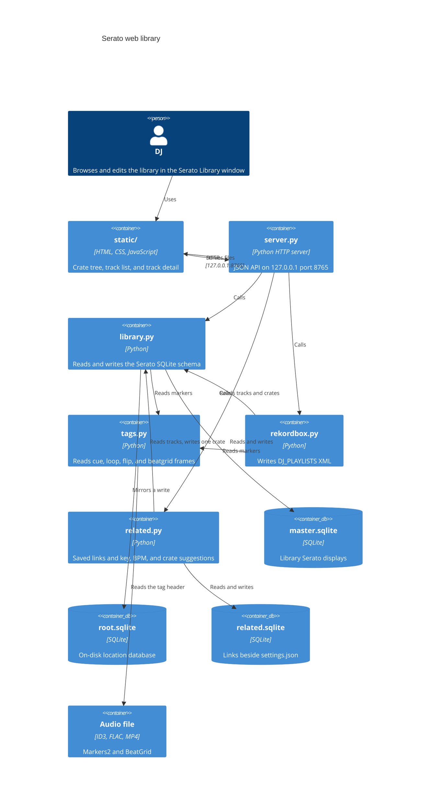
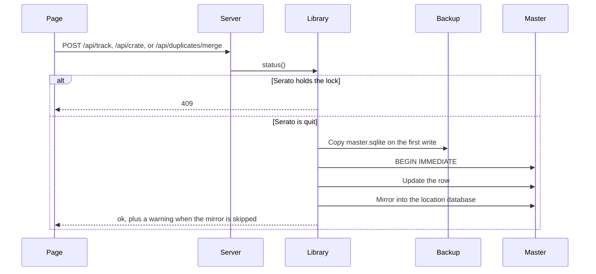

# Serato web library

A local page for the Serato DJ Pro library. The process reads `master.sqlite`. It writes only after Serato has quit. The first write in a process copies the databases into `Library/Backups`.

`docs/serato-library-tools.md` is research about other tools. It is not a description of this program.

## Run

1. Quit Serato DJ Pro.
2. From the repository root, run `python3 server.py`.
3. Open `http://127.0.0.1:8765`.
4. Press Ctrl-C to stop the server.

On macOS the process exits when `~/Library/Application Support/Serato/Library/master.sqlite` is missing. On Windows that file is `%LOCALAPPDATA%\Serato\Library\master.sqlite`. `server.py` uses the Python standard library.

The desktop app runs the same server on a free port and opens a native window:

```bash
python3 -m venv .venv
.venv/bin/pip install -r requirements.txt
.venv/bin/python desktop.py
```

The window is titled Serato Library. Close it to quit. A second launch focuses that window. On macOS, install `requirements-macos.txt` in that environment as well so WKWebView can load. On Windows, use `.venv\Scripts\python` in place of `.venv/bin/python`, and install the WebView2 runtime when it is missing. On Linux, install WebKitGTK (GTK 3 and WebKit2) or Qt WebKit. Qt WebEngine is refused because it bundles Chromium. `SERATO_LIBRARY_NO_WINDOW=1` or `--no-window` skips the window. To build an app for the machine you are on, install `requirements-build.txt` in that environment and run `python -m PyInstaller serato-library.spec`. The result is `dist/Serato Library.app` on macOS, or `dist/Serato Library/` on Windows. The build is unsigned. Release disk images, the Windows installer, attestations, and the GitHub settings around them are in [docs/github.md](github.md).

The first time the page opens, setup runs until `wizard_complete` is true. It confirms the library, saves a safety snapshot, and asks whether to share anonymous usage stats and crash reports. The choice stays off until you accept. Cancel does not finish setup. [PRIVACY.md](../PRIVACY.md) lists what can be sent.

## Tests

1. From the repository root, install the pinned packages with `python3 -m pip install -r requirements.txt`. The suite imports `sentry-sdk` and `posthog`.
2. Run `python3 -m unittest discover -s tests -t . -v`.
3. The suite builds a temporary database and points `library.MASTER` at that file. The fixture closes every SQLite connection before it deletes that directory. Windows cannot delete a database file that still has an open handle, and a `sqlite3` connection used as a context manager commits without closing.
4. The suite does not open the live Serato library. `tests/__init__.py` points `SERATO_LIBRARY_CONFIG_DIR` and `SERATO_LIBRARY_LOG_DIR` at a temporary directory for the whole run. A relative value for either variable is ignored.
5. `tests/fixtures/serato4` and `tests/fixtures/serato5` are tiny crate, `database V2`, and audio files. `python3 tests/fixtures/build_fixtures.py` rebuilds them from the published Serato notes. `tests/serato_spec.py` reads those bytes. It does not import the application. Serato 5 fixtures are marked `spec-derived, unverified` and do not invent Lucid beatgrids or Protect Library. FLAC and M4A reads go through `tags.read_serato_tags` and match the goldens. Issue #47 was fixed by pull request #55.
6. `npm test` runs Vitest on `src/`, including the wizard step machine, the setup screen, and the app version in the footer and About. `npm run typecheck` is `tsc --noEmit`. `npm run build` runs `scripts/build_frontend.mjs`, which writes `static/app.js` and `static/wizard.js`. CI on Ubuntu, Windows, and macOS runs `node scripts/build_frontend.mjs --check`, which builds both bundles in memory and does not write `static/`. It fails when either bundle or its sourcemap differs from the commit.

## Debug in VS Code

1. Open this repository in VS Code.
2. Install the recommended Python extension when VS Code offers it.
3. Press F5.
4. The debugger runs `server.py` in the integrated terminal.

`.vscode/launch.json` names that launch "Python: Run server.py". A second launch, "Python: Current File", debugs the open file. "Python: Debug Tests" runs `unittest` discovery for `tests/`. Those launches use the system Python. The desktop app uses `.venv`. Format on save is on. The explorer hides `__pycache__` and `*.pyc`.

## Containers



## Modules

`server.py`, `library.py`, `files.py`, `snapshots.py`, `snapshot_frames.py`, `serato_web/completeness.py`, `related.py`, `rekordbox.py`, `tags.py`, `audio_stream.py`, `waveform.py`, `desktop.py`, `telemetry.py`, `app_config.py`, `setup_flow.py`, `app_log.py`, `build_config.py`, `static_assets.py`, and `scripts/release_bundle.py` document each function with a Google-style docstring. The tests do the same. The page source under `src/` documents each function. `static/index.html`, `static/tokens.css`, and `static/app.css` open with a header comment that states the file's role.

### `server.py`

`serve` binds `ThreadingHTTPServer` to `127.0.0.1`. Called with no arguments it uses port `8765` and exits when that port is already taken. A missing master database still serves the page, so setup can say what to do next. Telemetry and the snapshot watch start only when the library file exists. `serve(port=0)` asks the operating system for a free port. `require_library=False` does not start telemetry or the snapshot watch, which is the release smoke path. When the library file exists and the library is required, `serve` starts that watch after the port is bound. `main` serves until Ctrl-C on port 8765. The handler class is `Handler`. It logs each request and answers JSON with `Cache-Control: no-store`. `shutdown_token` on the server object starts as None.

`app_root` locates `static/`. A PyInstaller build reads it from `sys._MEIPASS`. A source checkout reads the directory beside `server.py`.

`desktop.py` calls `serve(port=0)` and opens a pywebview window titled Serato Library on that URL. The window uses the system web view: WebView2 (`edgechromium`) on Windows, WKWebView (`cocoa`) on macOS, and WebKitGTK (`gtk`) or Qt WebKit (`qt`) on Linux. CEF and Qt WebEngine are not requested, so the build does not bundle Chromium. The window size and position are stored in `settings.json` under `window` (`x`, `y`, `width`, `height`) after the window has been placed. A saved position is restored when a 100 by 40 pixel strip of the title bar is on a screen. That includes a monitor to the left or above the primary screen, where `x` or `y` is negative. Otherwise the window is centered on the primary screen, the screen whose box contains the origin. Closing the window calls `_close_window`, which POSTs `/api/shutdown` with the desktop shutdown token, then the process stops telemetry. A lock file `instance.lock` in the config directory keeps a single instance. The operating system releases that lock when the process crashes. The next launch takes the lock and deletes the leftover `instance.port` before it publishes a new URL. The page URL is written to `instance.port`. A focus token is written to `instance.focus` with mode `0600`. A second launch POSTs `/api/focus` with `X-Serato-Library-Focus` when `/api/health` answers, and the running process restores and shows the window. It does not start another server. pywebview is imported only when the window is shown. `SERATO_LIBRARY_NO_WINDOW=1` or `--no-window` skips that import and waits until shutdown. The macOS bundle does not set `LSUIElement`, so the app has a Dock icon, and it sets `NSRemovableVolumesUsageDescription` so macOS can ask before the app reads an external drive. That permission is Removable Volumes, not Full Disk Access. There is no menu-bar item and no notification-area icon.

When `SERATO_LIBRARY_SMOKE` is an absolute file path, `smoke_main` runs and `launch` does not. The check confirms the bundled page through `server.app_root()`, binds a free port without opening the library, a window, or telemetry, writes `http://127.0.0.1:<port>` and a shutdown token to the marker, and serves until `POST /api/shutdown` presents that token in `X-Serato-Library-Shutdown`. A relative path, a symlink, a directory, or a missing parent directory stops the process. The windowed build has no console, so the marker file is the signal the release check reads. The smoke path does not import pywebview.

`static_assets.py` lists local `src` and `href` files in `static/index.html`. Remote URLs, anchors, and data URLs are skipped. `serato-library.spec` exits before it analyzes the program when one of those files is missing. The release zip check compares the same files, byte for byte, with the source tree.

A GET path under `/api/` runs a query. Any other GET path is a file in `static/`. The request is joined to that directory and passed through `os.path.realpath`. It is served only when the result starts with the directory plus a separator and the result is a file. `index.html` answers `/` and an empty path. Anything else returns 404.

`load_library` caches one payload per space. The cache key is the size and modification time of `master.sqlite` and its WAL file. A cache miss can record `library_scanned` with a track-count bucket. A POST takes a process lock, drops that cache, then writes. Settings and log routes are answered before that lock. `serve` calls `files.recover_interrupted` after the database is known to exist. A journal that cannot be repaired is logged. The server still starts.

The HTTP banner is `SeratoLibrary/1.0`. A release tag does not change that banner. `app_config.APP_VERSION` and `__version__` are the `version` string from `version_info.resolve`, the same string `GET /api/version` returns. A stamped build reports the release tag. A development checkout reports `git describe`, or `0.0.0+dev` when git is missing. Sentry's release, PostHog's `app_version`, and `GET /api/settings` `app_version` read that string. The release workflow writes `_version.py` from the tag before PyInstaller runs. A development checkout leaves `VERSION` empty. `version_info.resolve` does not raise when git is missing.

`load_track` returns every column listed in `FIELDS`, plus the edit form, crate membership, near-duplicate copies, Prepare membership, the resolved file path, and marker data. Copies share title, artist, and length in whole seconds. The query returns at most 12 copies.

Blank display values use a dash. Dates use English month names, so the label does not follow the machine locale. Colors other than `0xFFFFFF` render as `#RRGGBB`. `third_party_type` maps `0` to Local file, `1` to iTunes, and `6` to Apple Music.

Allowed spaces are `Serato Library`, `Serato Video`, `Apple Music`, and `Prepare`. A missing space name means `Serato Library`.

### `library.py`

`default_library_path` chooses the live database: Application Support on macOS, and `%LOCALAPPDATA%\Serato\Library\master.sqlite` on Windows. `MASTER` starts as that path. Reads use a read-only SQLite URI and `PRAGMA query_only=ON`.

`status` reads the `lock` table. A row counts as open when the process image contains `serato`, and also when that check errors, times out, exits non-zero, or raises. macOS and other Unix systems ask `ps`. Windows asks `tasklist`. A locked database also counts as open. `writable` is false in both cases. `begin_write` and `files.execute` both go through this check, so a failed lookup refuses the write. The payload includes `file_manager`: `Finder` or `File Explorer`.

`begin_write` refuses the call when Serato is open (`SeratoOpen`, HTTP 409). It then refuses the write when `snapshots.write_block_message` is set: the Serato version is unknown, the preferences plist cannot be read, Protect Library is unknown, or the library is Serato 5 while Lucid and Flexible beatgrid storage is unverified. Snapshots of that library are still allowed. It then saves a content-addressed snapshot, calls `ensure_backup`, and opens `BEGIN IMMEDIATE` with a one-second timeout. Foreign keys are off for the write. The backup folder is `Library/Backups/serato-web-<YYYYMMDD-HHMMSS>/` beside `master.sqlite`. A second backup in that same second uses `-02`, then `-03`, through `-99`. The suffix is zero-padded, so sorting the folder names keeps the order the copies were made. The name is claimed with `mkdir(parents=True, exist_ok=False)`. If every name for that second exists, `FileExistsError` is raised and nothing is copied. If the copy fails, the new folder is renamed so the name ends with `-failed`, then removed. If the rename fails, an `INCOMPLETE` file is written in the folder. A failure to rename or remove it is logged and does not replace the copy error. Copies go into a hidden `.serato-web-<stamp>.partial` directory. `COMPLETE` is written last as JSON `{"version": 1, "algorithm": "sha256", "hashes": {relative POSIX path: lowercase SHA-256}}`. Those three keys are the whole object. The directory is then renamed to `serato-web-<stamp>`. `serato_web.completeness` does not import `library`. `verify_legacy_backup` there raises `CompletenessError`. `library.verify_legacy_backup` catches that and raises `LibraryError` from it, with status 400. `LibraryError` subclasses `CompletenessError`. `is_complete(backup_dir)` is the completeness check for a backup or snapshot directory. The argument is the directory itself. The parent path is ignored, so a folder beside `master.sqlite` and a snapshot directory in any other place, including an app-data folder, use the same function. It returns true only when `COMPLETE` exists and every listed hash matches, and every other file is listed. A missing marker, an extra key, or a text-line marker means incomplete, not legacy. A name ending in `-failed` or `-failed-` plus digits (any letter case, any number of digits) and a hidden `.partial` directory are never complete. `INCOMPLETE` is never complete. `list_backups` returns only directories for which `is_complete` is true. An old folder with `master.sqlite` and no `COMPLETE` file is `legacy, unverified` from `backup_status`. It is not listed as complete. `verify_legacy_backup(backup_dir)` is the check for one the user explicitly picked. It copies `master.sqlite` and any `-wal` file into a temporary directory, opens that copy read-only (`file:<path>?mode=ro`), and runs `PRAGMA integrity_check`. The backup folder is not opened and no `-shm` file is created there. The result has to be exactly `ok`. `snapshots.list_snapshots` skips a directory `is_complete` rejects. `snapshots.restore` calls `backup_status` on the snapshot directory before the pre-restore snapshot. A legacy result calls `verify_legacy_backup`. Any other incomplete directory is refused. The snapshot code does not add a second `-failed` or `INCOMPLETE` check. The file browser hides `.partial` directories, failed names, `INCOMPLETE`, and a `COMPLETE` file whose hashes do not match. The copy includes `root.sqlite` when that file sits beside the master database. One process backs up a given master path once. After that copy, `backup_made` can be recorded. The backup path is not a property of the event.

`register` installs `serato_str_norm` and `serato_raw_key_string_to_key_type` on a write connection. The key function maps Camelot and traditional names onto Serato's integer key.

Nested crate names in the database use `NAME_SPLIT` (`U+105E8A`). `display_name` keeps the text before that character.

Container type `0` is the space root and stays out of the crate list. Type `2` is a smart crate. Smart-crate rules are JSON in `smart_crate_rules`.

A write to a track or crate updates `master.sqlite`, then mirrors the change into the location database from the `connection` table. Location id `3` falls back to `root.sqlite` beside the master file. A test database whose path is not the live master mirrors only files in the same directory, or under `/tmp/`. A missing drive, or a database or filesystem error while mirroring, produces a warning and leaves the audio file in place. Any other mirror error propagates.

`save_track` accepts `name`, `artist`, `album`, `genre`, `year`, `composer`, `remixer`, `label`, `grouping`, `comments`, `key`, `emoji`, `bpm`, `color`, `rating`, `is_beatgrid_locked`, and `portable_id`. A new `portable_id` also sets `file_name`, clears `is_missing`, and records `file_size`. If that file's size cannot be read, the save is refused. Every save sets `time_modified`.

`crate_action` accepts `create`, `rename`, `delete`, `color`, `expanded`, `rules`, `add`, `remove`, `prepare`, and `remove_library`. Delete removes the crate and its descendants. `remove_library` removes the track from the space and its crates. It does not delete the audio file. `prepare` adds or removes the track in the Prepare space.

`history_sessions` and `history_entries` read `history_session` and `history_entry`. `duplicate_groups` groups tracks in one space by title, artist, and length in whole seconds. Rows with an empty title, an empty artist, or no length are skipped. Asset ids in a group are sorted.

`merge_duplicates` folds one of those groups into the copy you keep. `preview` true returns the plan and does not write. A merge requires `confirm` true. The master changes run in the `begin_write` transaction. Each location database is mirrored afterwards, in its own transaction, the same way other writes are. Serato open returns 409 before the backup. A preview still returns the plan when Serato is open, with `writable` false. That gap is intentional: the plan is readable, and the write path refuses before it copies a backup.

The kept track is added to every normal crate any duplicate was in, in any space, so a Prepare crate is included. Smart crates and the space root are left alone. If the kept track is already in a crate, it stays at its current position. Otherwise it takes the earliest duplicate's `list_order` in that crate. The location database receives the new membership with that same position when the column exists. A track that is already in the drive crate is not moved.

Empty text (album, genre, year, composer, remixer, label, grouping, comments, key, emoji, disc, track number, and the comment language fields) and an empty BPM are filled from the first duplicate, in asset-id order, that has a value. Text longer than the field limit is skipped. Play count and rating keep the highest number, treating a missing value as lower than a real one. White (`0xFFFFFF`) or a missing color is filled from the first real color. Date added keeps the earliest timestamp. Recently played is set when any copy was recently played. Filling the key also sets `key_value`. `is_beatgrid_locked` is not copied, because the lock belongs to that file's beatgrid. Path, file name, file size, bitrate, sample rate, length, and the missing flag stay with the file you keep.

`history_entry.asset_id` is repointed when that column exists. The played name and file name on the history row stay as a snapshot of what was played. The same repoint is applied in a location database that has the column, using that database's asset ids. Duplicate rows are then removed from space membership, crate membership, and the asset table. The location database removes the same memberships and deletes the location asset row, so Serato does not recreate the duplicate from the drive. A duplicate that shares the kept track's location asset id is left in the drive database. A track whose location is not the main drive (`location_id` 3) is removed from the master library, and that other drive is left unchanged, matching `remove_library`. When several of those mirrors are skipped, `warning` says so once. A shared drive record, or a file that could not be moved to the Trash, is reported in addition to that sentence.

Cue points are read with `tags.read_serato_tags`. They are not written back. The read includes ID3 GEOB frames and the Serato blocks in FLAC and M4A/MP4, so a duplicate in those formats warns too. When the kept file has no cues, loops, flips, or beatgrid and a duplicate file does, the plan includes `cue_warning`. The markers stay in the other audio file. Rewriting the tag can drop Serato's frames, so there is no copy step.

`delete_files` defaults off. Turning it on also requires `confirm_delete_files` true. The move is refused, before `begin_write`, when a duplicate path is a symlink, a directory, the same file as the kept copy (including a hard link), named `master.sqlite` or `root.sqlite`, or inside the library database folder. A sibling folder whose name only starts with the library folder's name is not treated as inside it. Files that pass are moved to the Trash after the database commit: Finder on macOS, the Recycle Bin on Windows, and the FreeDesktop trash specification elsewhere. A failed move leaves the file on disk and returns a warning. The library change is already committed. A missing file is skipped. The response lists file names, not paths.

`export_m3u` writes an extended M3U for one crate or for the whole space. A track with no path is named in a `# omitted, no path` comment and left out of the playlist. A missing length is written as `-1`. `import_m3u` creates a normal crate and adds tracks whose `portable_id` matches a playlist path. Unmatched paths stay out of the crate. The result lists at most 50 of them.

`reveal` shows the resolved audio file in the host file manager. macOS runs `open -R`. Windows runs `explorer /select,`. `markers_for` calls `tags.read_serato_tags` when the file is on disk. A successful read can record `tags_read`. The audio path is not a property of the event. A duplicate merge reads markers through `read_serato_tags` directly and does not record `tags_read`.

`update_related_path` rewrites a path in the related-tracks sidecar after a file move. It does not open `master.sqlite`. The implementation is `related.update_path`.

### `related.py`

`related_db_path` is `related.sqlite` beside `settings.json`. The schema is version 1 (`PRAGMA user_version`) and is documented in [related-tracks.md](related-tracks.md). Reads and writes of that file do not take the Serato lock.

A track key is a normalized absolute path. `~` is expanded and `.` and `..` are collapsed. Symlinks are not followed, and the request path is not used to test whether a file exists. A track in the open library uses the path the library already resolved. Title, artist, and length in whole seconds are a fallback when exactly one stored row matches and that path is not still a different track in the library. `update_path` is what a file move calls. `add_link` stores a one-way or two-way link with an optional note and a rating from 1 to 5. `remove_link` deletes the link and keeps the identity rows. `overview` returns saved links and suggestions. `refresh_crate` creates or replaces a normal Serato crate named `Related - ` plus the track title. That call writes `master.sqlite` through `crate_action`, so Serato must be quit and the backup rules apply.

Suggestions rank other tracks in the space by Camelot key (same, relative, or one step on the wheel), BPM within 6 percent including half time and double time, and shared normal crates. Crates whose names start with `Related - ` are not counted. At most 12 suggestions are returned. They are not stored.

### `snapshots.py`

`snapshots.py` stores hash-checked copies under `Library/Backups/snapshots/` beside `master.sqlite`. A blob's file name is the SHA-256 of its bytes. A snapshot is a directory. Its manifest names those hashes. The manifest's `sha256` field is HMAC-SHA256 of the other fields, using `manifest.key` in the store directory (mode `0o600`), not a bare hash. The key file is written in binary mode, so a newline byte stays one byte. A manifest copied without that key does not verify. Replacing the key file as well can still produce a matching digest. `COMPLETE` is written last as JSON `{version, algorithm: "sha256", hashes}` and the directory is renamed from `id.partial` to `id`. `serato_web.completeness.is_complete` is the only completeness check. A missing marker, an extra key, or a text-line marker means incomplete. `-failed` and `-failed-` plus digits, and `.partial`, match without regard to case. The file set must match the marker exactly, and only a lowercase SHA-256 digest counts. A marker path that is absolute, contains `..`, or leaves the directory is incomplete. `list_snapshots` skips a directory that check rejects. `plan` and `restore` do too. Manifests are not deleted by age. Two snapshots in the same second get different ids. Blobs are verified before the manifest directory is published, so a failed snapshot is not listed.

Each snapshot records the Serato version and build. macOS reads `CFBundleShortVersionString` and `CFBundleVersion` from `/Applications/Serato DJ Pro.app/Contents/Info.plist`. Windows reads `FileVersion` from `Serato DJ Pro.exe` or `Serato DJ.exe` under Program Files, then the Serato registry keys. A relative `.app` path is not used. On a relocated library the real app is not read unless `SERATO_LIBRARY_APP_INFO` is set. When the version cannot be read, both fields are `unknown`, the snapshot still saves, and writes and restores stay off. The first time a version is seen, it is only recorded. A later change in either field saves one snapshot with trigger `version-change`. That snapshot is the library as it is when the new version is noticed. It is not a copy from before Serato wrote.

The manifest includes `master.sqlite` and `root.sqlite` when that file is present, copied with the SQLite backup API, plus an `integrity` of `ok` or `failed`. It includes each drive's `_Serato_` tree: `database V2`, crate files, and the other files in that folder. Serato 5.0 still uses `database V2` on macOS (`~/Music/_Serato_/database V2`), and the same chunk parser reads it and `.crate` files. `Export Backups` and `Lexicon` are not entered, hashed, or written. The match is case-insensitive, so `LEXICON` is the same folder. Each path component drops trailing dots and spaces, and text after a colon, before that comparison, so `Lexicon.`, `Lexicon `, and `Lexicon::$DATA` are the same excluded folder. A sibling such as `Export Backups-extra` is not treated as either name. Audio files referenced by those crates are stored as their Serato frames only: Markers2, BeatGrid, and Autotags for MP3, FLAC, M4A, and AIFF. Those bytes are read and written by `snapshot_frames.py`, which uses the parsers in `tags.py`. The audio bytes are not stored.

A drive that is missing keeps the crates and frame hashes from the previous snapshot and is marked not present. Those rows are not reported as removed. Restore skips a drive that is not present and does not delete its files.

`plan` compares the live library with one snapshot and returns crate, track, cue, and grid differences, including an explicit `deleted` list. It does not write a snapshot or a library file. `restore` refuses when a Serato DJ process is running (`ps` on macOS, `tasklist` on Windows; the command base name must contain both `serato` and `dj`). A process-list error, a non-zero exit, or a timeout counts as running, and the result is not cached. The version gate and the database lock are checked the same way. The message tells the person to quit Serato DJ Pro. After those checks, `backup_status` on the snapshot directory decides. `legacy, unverified` calls `verify_legacy_backup` before anything is replaced. Any other directory must pass `is_complete`. It then saves a snapshot with trigger `before-restore`, and verifies that snapshot. It writes `restore-journal.json` in the snapshot store before the first replace. Serato DJ is checked again before the database, before crates, before audio, and before a rollback. SQLite `-journal`, `-wal`, and `-shm` sidecars are removed before and after the database file is replaced. A failure, including `KeyboardInterrupt`, puts the pre-restore snapshot back unless Serato DJ is running. Opening the store again rolls an unfinished journal back to that same snapshot. A crate path `Music/track.mp3` is also looked up as `audio/track.mp3` under the drive root, which is where the format fixtures keep the clips.

A background poll, started from `serve`, watches `master.sqlite`, its WAL and SHM files, `root.sqlite`, and the `_Serato_` files above. It does not watch `Backups`, `Export Backups`, or `Lexicon`. When those watched files change and this app did not just write them, it saves a snapshot after the change, writes a log line, and keeps the previous snapshot id for undo. The log says the snapshot is from after the change. If a process name contains `Lexicon`, or the `Lexicon` directory's own timestamp is within a few seconds of the changed files, the log names Lexicon. The directory is stated, not listed, and nothing inside it is opened. Undo restores that previous snapshot. It does not claim a copy from before the other program wrote.

An unknown Serato version blocks writes and restores. A version that is not a dotted number, such as `v5.0`, is unknown and blocks too. Serato 5 also stays off while Lucid and Flexible beatgrid storage is unverified. This module does not guess that layout. Protect Library is `library_protect` in `~/Library/Preferences/com.serato.seratodj.plist` (`1` on, `0` off). A missing file, a missing key, or a file that is not a plist is unknown and blocks. On, off, and unknown all refuse a Serato 5 write or restore, and the message says which one it is. The refusal does not look at a file lock. `database V2` is not treated as locked by Protect Library. `SERATO_LIBRARY_PREFERENCES` overrides the plist path. A relocated library does not read the real preferences unless that variable is set. `status` includes `write_block` and `serato_running`. When the gate refuses, `writable` is false and the status line is the refusal.

`SnapshotReader` is the read API another check can call: `list_snapshots` and `load`. `load` returns `crates`, `cues`, `grids`, and `tags`. Tags are the Autotags bytes by hash and size. They are not parsed into a beatgrid layout.

### `tags.py`

`read_serato_tags` reads. It does not rewrite the file. ID3 is taken from the first 2,000,000 bytes and, for a longer file, the last 512,000 bytes. `serato_tags_from_regions` parses those windows. The frames are `Serato Markers2` and `Serato BeatGrid`. An export that already has the file open calls `serato_tags_from_regions` with the same windows.

FLAC metadata is not limited to that window. While the file is open, every metadata block is visited from its 4-byte header. A picture or padding block is skipped with seek, so album art larger than 2 MB does not hide the markers and is not loaded. The Vorbis comment block is read in full, with no byte cap. The fields are `SERATO_MARKERS_V2` and `SERATO_BEATGRID`, matched without case sensitivity. An `.m4a`, `.mp4`, `.aac`, or `.alac` file, or a file whose first atom is `ftyp`, is walked by top-level atom size. An MP3 is not. The `mdat` audio is not loaded. Each `moov` body is read up to 16 MB. A larger `moov` is truncated and a warning is logged. Freeform `----` atoms whose mean is `com.serato.dj` are decoded, and the frame name inside the payload selects `Serato Markers2` or `Serato BeatGrid`. Serato names those atoms `markersv2` and `beatgrid`. Those FLAC and MP4 values are base64, without padding, of `application/octet-stream`, a null, a second null, the frame name, a null, and the same payload the GEOB frame stores. A newline may appear every 72 characters. Marker parsing ignores other `SERATO_*` blocks, including overview, so `found` stays false when an overview is the only Serato block. `read_serato_overview` reads that block and does not rewrite the file. ID3 is a GEOB named `Serato Overview`. FLAC is `SERATO_OVERVIEW`. MP4 is the `overview` freeform atom. The payload starts with `01 05` and then 16-byte columns. A short tail is dropped. At most 8192 columns are returned. Ogg Vorbis stores `serato_overview` as hex of two big-endian words, 1 and 5, then the same columns. An Ogg file is read only when it starts with `OggS` or the suffix is `.ogg` or `.oga`. Audio pages after the comment packet are not read.

`plan_serato_geob` and `copy_serato_geob` copy those Serato frames onto another file only when that is safe. A plain ID3v2.3 tag can take the frames. An `.mp3` with no tag can take a new ID3v2.3 tag in front of the existing bytes. Other frames are kept as raw bytes. The audio after the tag is streamed unchanged. A destination that already has Serato frames is left alone. A source with none is skipped. Unsynchronisation, an extended header, a compressed or encrypted Serato frame, a tag larger than 16 MB, and FLAC, RIFF, AIFF, Ogg, or MP4 containers are refused. The destination is not modified in those cases. The copy writes a temporary file beside the destination and replaces it only after the audio bytes still match.

### `snapshot_frames.py`

`read_stored_frames` returns the exact stored Markers2, BeatGrid, and Autotags bytes. MP3 and AIFF use the raw GEOB frame. FLAC uses the Vorbis comment value (`SERATO_MARKERS_V2`, `SERATO_BEATGRID`, `SERATO_AUTOTAGS`). M4A uses the `data` atom body of a freeform atom whose mean is `com.serato.dj`. `restore_stored_frames` writes those bytes back and replaces the file only when the audio region still hashes the same. A failure leaves the previous file in place. Cue and beatgrid parsing stays in `tags.py`.

### `serato_web/completeness.py`

`is_complete`, `backup_status`, `verify_legacy_backup`, and `write_complete_marker` live in this module. `library.py` and `snapshots.py` import it. It does not import `library`. `CompletenessError` is what `verify_legacy_backup` raises, and `LibraryError` subclasses it. `COMPLETE` is JSON with exactly the keys `version`, `algorithm` set to `sha256`, and `hashes`. Hashing reads each file in chunks. A top-level `.write-lock` is ignored. The same name in a subfolder counts as a file. A snapshot directory is published by writing its files into `id.partial`, calling `write_complete_marker`, and renaming that directory to `id`.

Markers2 is base64 after a `01 01` header. Newlines and a missing `=` pad are accepted. Each parsed entry is `CUE`, `LOOP`, or `FLIP`. A cue has index, start in milliseconds, color, and name. A loop adds end time and a locked flag. A flip has index, enabled, and name. A `COLOR` or `BPMLOCK` entry in the same payload is skipped. Duplicate merge uses this read to decide whether to warn. It does not write a GEOB frame, a Vorbis comment, or an MP4 atom.

BeatGrid version byte `1` yields markers. Each marker has a position in seconds. That position is the stored float. It is not rounded to three decimal places. The last marker stores BPM, rounded to two decimal places. Earlier markers store a beat count. A version this parser does not know, more than 4096 markers, or a payload shorter than the declared marker count sets `beatgrid_warning` and returns no markers. `GET /api/track` copies `position` as a three-decimal string for the panel and adds `position_seconds` as that stored float. Beat times between two markers are `(next.position_seconds - position_seconds) / beats`. After the last marker the spacing is `60 / bpm`.

### `waveform.py`

`load` returns an `SWF1` body for one real audio file. The route is `GET /api/waveform`. The id check is `audio_stream.parse_track_id` and `audio_stream.resolve_audio`: decimal digits in the raw query, no `path` parameter, `realpath`, a regular file, an audio suffix, and either inside a realpath'd music root or exactly the library file. A file symlink that leaves the stored directory is refused. Samples are read in chunks, mixed to mono, and split with FFT overlap-save (`numpy.fft`) of 1023-tap filters at 250 Hz and 4 kHz. One forward transform is shared by the three bands. Hops are reduced with a reshape, not a Python sample loop. Detail is 150 points per second. Each point is six uint8 values: low peak, low RMS, mid peak, mid RMS, high peak, high RMS. 255 is full scale. The overview is 1000 points when the detail is longer, and the same length as the detail when it is shorter. A tail shorter than one detail point is dropped. PCM is not kept. A cold hour of 44.1 kHz mono WAV measured 7.6 seconds, with a tracemalloc peak of 75 MB. Analyzer version 2 is part of the cache key, so an older body is not reused.

miniaudio (MIT) decodes `.wav`, `.aiff`, `.aif`, `.flac`, `.mp3`, and `.ogg`. A WAV or AIFF it cannot open falls back to the stdlib `wave` module or a pure-Python 16-bit AIFF reader. `.m4a`, `.aac`, and `.alac` are not decoded by those libraries. They are read with `ffmpeg` only when `shutil.which("ffmpeg")` finds it. ffmpeg is not bundled, and `serato-library.spec` is not changed to add it. soundfile and libsndfile are not used. A file that still cannot be decoded returns HTTP 200 `{"available": false, "error": "waveform unavailable"}`. `GET /api/audio` is unchanged.

The cache directory is `<config>/waveforms`, the same app data directory as `settings.json` (`SERATO_LIBRARY_CONFIG_DIR` when that is an absolute path). It is not `Library/Backups/snapshots`. A cache path that resolves inside the Serato library folder is not created. The file name is the SHA-256 of the real path, size, mtime in nanoseconds, and `ANALYZER_VERSION`, separated by NUL. A change to any of those misses. The temporary file name includes the process id, the thread id, and a counter, and `os.replace` publishes the final name. Failures are not cached. The audio file is opened read-only. `load_shared_waveform` runs one analysis when several requests for the same key overlap. A miniaudio `DecodeError` after the first chunk, and an ffmpeg `TimeoutExpired`, become `waveform unavailable` rather than HTTP 500. Closing the decoder generator kills and reaps ffmpeg.

`GET /api/waveform?meta=1` returns JSON counts and `cached` instead of the body. `GET /api/waveform/overview` returns the Serato Overview columns without decoding. The binary layout, little-endian, is:

| Offset | Type | Field |
| --- | --- | --- |
| 0 | 4 bytes | `SWF1` |
| 4 | uint16 | Header size, 64 |
| 6 | uint16 | Format version, 1 |
| 8 | uint16 | Flags. Bit 0 detail, bit 1 overview, bit 2 Serato Overview |
| 10 | uint16 | Analyzer version |
| 12 | uint32 | Analysis sample rate, 44100 |
| 16 | uint32 | Detail points per second times 1000. 150000 means 150 |
| 20 | uint32 | Duration in milliseconds |
| 24 | uint32 | Detail point count `N` |
| 28 | uint32 | Overview point count `M` |
| 32 | uint32 | Serato Overview column count `S` |
| 36 | uint16 | Bands per column, 16, or 0 when `S` is 0 |
| 38 | uint16 | Reserved, zero |
| 40 | uint32 | Low/mid split in Hz times 1000, 250000 |
| 44 | uint32 | Mid/high split in Hz times 1000, 4000000 |
| 48 | 16 bytes | Reserved, zero |

Then `N * 6` detail bytes, `M * 6` overview bytes, and `S * 16` Serato Overview bytes in stored column order. The response header `X-Waveform-Format` is `SWF1`. Content-Type is `application/octet-stream`.

### `rekordbox.py`

`export_rekordbox` writes a Rekordbox `DJ_PLAYLISTS` document for one space. `crate_id` None exports every track in the space and every crate. A crate id exports that crate and its subcrates, and the collection is the tracks in that tree. The space root (container type `0`) is not a playlist. A crate with subcrates becomes a folder (`NODE Type="0"`). Its own tracks are a playlist of the same name inside that folder. A crate with no subcrates is a playlist (`NODE Type="1"`). Playlist order follows `list_order`. A track in two crates is one `COLLECTION` entry and two playlist references. `TrackID` is the asset id.

A track with no `portable_id` is omitted. `Location` is a `file://localhost` URI. A macOS path stays absolute (`file://localhost/Users/...`). A Windows path uses a forward-slash drive (`file://localhost/C:/Users/...`). Spaces, `#`, and other reserved characters are percent-encoded as UTF-8. The drive colon is not encoded. A colon later in the name is encoded. A UNC path keeps the double slash (`file://localhost//server/share/...`).

`Name`, `Artist`, `Album`, `Genre`, `AverageBpm`, `Tonality`, `TotalTime`, `BitRate`, and `Comments` come from the asset row. Control characters other than tab, newline, and carriage return, and unpaired surrogates, are removed from those text fields before the XML is written. `TotalTime` is whole seconds from `length_ms`. `BitRate` is `file_bit_rate` in bits per second, written as kilobits per second. `AverageBpm` uses the library BPM. When that value is empty and the beatgrid has a BPM, the beatgrid BPM is used. Rating is Serato's 0-to-1 value written on rekordbox's 0-to-255 scale.

Cues and loops come from `tags.read_serato_tags`. Each hot cue is a `POSITION_MARK` with `Type="0"` and `Num` equal to its Serato index when that index is 0 through 7. The same cue is also written with `Num="-1"` unless memory cues are turned off, because some CDJ screens only list memory cues. An index outside that range is only a memory cue. A saved loop is `Type="4"` and has `End`. Its `Num` is `-1`, so a loop does not replace the hot cue with the same Serato slot. `--hot-loops` uses the loop index when that pad is free. `Start` and `End` are seconds with three decimal places, which is one millisecond. `Red`, `Green`, and `Blue` are the marker color. Rekordbox may snap those values to its palette. A marker with no color is white. Flips are not written.

An MP3 is shifted only after its LAME/Xing header is read. No Xing header (case A) and a LAME tag whose CRC matches (case D) stay as stored. Xing or Info without a LAME tag (case B, including Lavc) and a LAME tag whose CRC is 0 or does not match (case C) are moved 26 milliseconds earlier, which is the published gap between Serato and Rekordbox on those files. AAC, WAV, AIFF, and FLAC are not shifted. A time that would fall before 0 is written at 0 and counted in the loss report. The path uses the directory entry's spelling when the file is on disk, so a macOS NFD name is the one Rekordbox will match. One folder is listed once per export, not once per track. Serato tags and the MP3 timing header are read in the same open. The header read seeks past the ID3 size, and past the ten-byte footer when that flag is set, then reads about 4 KB. `resolved_path`, `container_in_space`, and `descendant_ids` are the public helpers this export calls. Track color is written as `Colour="0xRRGGBB"`, the form in Rekordbox's XML list, when it is not Serato's white. Rating is one of 0, 51, 102, 153, 204, or 255. A file that cannot be opened is still exported, without cue points, and its name is in the loss report. A path containing a null character cannot be checked: `Path.is_file` raises `ValueError` on some Python versions and returns false on others. That track is exported as a missing file, without cue points, the loss report names it, and a warning is logged. The rest of the export continues. `Kind` comes from the extension. A raw `.aac` file is `AAC File`. An `.m4a` or `.mp4` file is `M4A File`.

The beatgrid is one `TEMPO` per marker, including a Serato 5.0 grid with a marker at each tempo change. An earlier marker's BPM is the beat count times 60 divided by the seconds between the stored marker positions. Those positions are the floats from the file. They are not rounded to three decimals before that division. The last marker's BPM is the BPM stored on that marker, rounded to two decimal places. `Inizio` is the marker position in seconds, on the millisecond grid. `Metro` is `4/4`. `Battito` counts from the first marker as a downbeat, so a marker every beat is 1, 2, 3, 4. A segment with no positive span uses the last marker's BPM. A beatgrid that cannot yield a positive BPM is omitted. A marker whose position is not a finite number is left out and counted in the loss report. A last marker whose BPM is not a finite number is left out and counted the same way. The other markers on that grid are still written. Those stored positions are not replaced by the three-decimal string the track panel shows. Version bytes other than 1, a truncated payload, and more than 4096 markers are left out and named in the loss report. `Tonality` is the key text Serato stores unless `--key camelot` or `--key classical` is set. `TrackID` is the asset id. Playlist `Key` values use that id and `KeyType="0"`. `COLLECTION Entries` and folder `Count` match the child counts.

`parse_rekordbox` reads that XML back into tracks, tempo, position marks, and the playlist tree. `position_ms` reads a seconds attribute back to whole milliseconds. `python3 rekordbox.py -o rekordbox.xml` writes the file and prints the loss report. `--space` selects the space. `--crate` is a crate id or `all`. `--no-memory-cues` skips the memory-cue copies. The command refuses to write `master.sqlite` or `root.sqlite`. `GET /api/export.rekordbox.xml?report=1` returns the loss report and the XML in one JSON object, so the page does not scan the library twice. The download uses that XML. An error response is JSON and is not given the rekordbox.xml filename. A crate id must be ASCII digits. `memory` and `hot_loops` accept `1`, `true`, `yes`, `0`, `false`, and `no`. Any other value is logged and the export uses the default, which is memory cues on and hot loops off. The page checkbox starts unchecked. `src/dialogs.ts` loads `rekordbox.hot_loops`, `rekordbox.memory_cues`, and `rekordbox.key_notation` from `GET /api/settings` when the dialogs wire, and posts the three controls when one of them changes. Hot loops defaults to false, memory cues to true, and the key to `asis`. A failed settings request leaves those controls as the page drew them, and the export still reads them. The checkbox sends `hot_loops=0` while it is clear and `hot_loops=1` while it is checked. A missing `hot_loops` parameter is off. A crate id that is not an integer, or that does not fit in a SQLite integer, returns 400. The page shows the report as a list in a dialog. Download starts after confirm. The loss report also names track color, beatgrid lock, replay gain, waveforms, stems, play history, smart-crate rules, and cue names a CDJ cuts short. A path that cannot be encoded is counted on its own and the file name is included.

Since Rekordbox 5.6.1, importing XML does not update a track that is already in the collection. In Rekordbox 6 and 7 the control is Preferences, Advanced, Database, rekordbox xml. Overwrite is Import to Collection, then Yes to load information from imported library. That replaces cues, the beatgrid, and tags. Device Library Plus and OneLibrary USB drives are not written. The export does not write the audio file or the database, and it does not record `tags_read`.

### `files.py`

`files.py` renames a file, moves files, moves a folder, points a library track at a replacement file, and moves a file to the Trash. Crates, history, and Prepare stay attached because every stored path that resolves to the old file is rewritten. Cue points travel inside the audio file. A replacement copies them with `tags.copy_serato_geob` when that is safe, and the result says so when it is not. The old file stays on disk.

`list_directory` lists one folder without following shortcuts. An empty path lists the music roots from `music_roots.music_roots`: the parent folders of tracks in `master.sqlite`, collapsed to the shared music folder on each volume. Album folders under one music folder become that folder. `~/Music` and `~/Downloads` stay separate. The collapse does not widen a root to the home directory, `/`, `/Volumes`, or a drive root. A mounted drive with a `_Serato_` directory is added only when no track folder on that drive is already a root. macOS reads `/Volumes`. Windows checks drive letters that are mounted. Each root's label is the folder or volume name. A shared name gains `(parent)` until the labels differ, for example `Music (GIGDRIVE)`, and `detail` is the display path. A folder taken from the Serato library is `music_library` even when it is not named Music. A folder on a drive that is not mounted is included with `missing` true and cannot be opened, including when `elsewhere=1` and the folder has since appeared on disk. `/`, `/Volumes`, a bare drive root, a UNC share root, and the `\\?\` form of those roots are refused the same way. A shortcut that resolves to one of them, such as a link to `/`, is refused with 403. The roots are cached until `invalidate()` or `refresh=1`. A change to `master.sqlite` or its WAL does not recompute them. The library path index is separate and still notices those file times. `GET /api/library-roots` returns that cache as `{roots, computed_at}`. Each root has `id` (SHA-256 of the real path), `path`, `label`, `detail` (the path), `kind` (`music_library`, `serato_drive`, or `user_folder`), `serato`, `removable`, and `missing`. `?refresh=1` recomputes. A browse path is normalized with `abspath` and `normpath`, then kept only when that normalized path starts with its drive. A path outside the music roots is refused with `That folder is outside the music folders.` unless `elsewhere` is true. `..` is collapsed before the folder is opened. A shortcut below the top of the disk is refused, and a shortcut between a root and the requested folder is refused, so a link cannot leave the root. The whole folder is returned. Folders are ordered before files, and files before shortcuts. `truncated` is false. A non-empty `q` does not list the folder. It searches file and folder names under the music roots, or under `path` when that folder is set, and it does not write. Shortcuts are not followed. A root with `missing` true is skipped, including when that folder is still on disk. `.` names and `_Serato_` directories are not entered. Each word must be a subsequence of the name or of the parent folder name. A prefix ranks above a later copy of the same word. The walk stops after 20,000 entries and the response keeps the best 40. `truncated` is then true. `search` is true and `query` is the collapsed text. Blank `q` is a normal listing. A null byte returns 400, "That search is not valid." More than 200 characters returns 400, "That search is too long." `elsewhere=1` without a path returns 400 so the home directory is not walked. The same scoring rules are in `src/fuzzy.ts`. `parent` is null on a music root, so Up cannot climb above it. `breadcrumb` starts at the root name. `music_roots.py` is the discovery. `_list_root` remains the wizard's unrestricted folder open. A request path is normalized and must be absolute on its own drive before the folder is opened. `plan` runs the same path checks as a save and returns a preview. It does not copy the database and it does not repair an interrupted journal. The preview says when Serato is open. `execute` requires `confirm` to be the boolean true. It refuses while Serato is open, copies the database, writes `Library/Backups/file-ops-journal.json`, changes the files, then updates `master.sqlite` and the attached location databases in one transaction. A database failure puts the files back. A filesystem failure rolls the database back and puts back the files that already moved. `recover_interrupted` finishes or undoes a journal the next time a save starts, and when the server starts. It does that only while Serato is quit. A journal that matches only some rows is left in place and the next save is refused until the backup in `Library/Backups` is restored.

Path columns are `portable_id`, `video_portable_id`, `file_path`, `filepath`, `path`, and names that end in `_path` or `_portable_id`. `file_name` is updated on the row whose portable id moved. History keeps its play. A rename or a move that changes the basename updates `history_entry.file_name`. A delete removes the asset from the library and its crates and sets `history_entry.asset_id` to null when that column allows it. The same delete is applied to the mirrored asset by `external_id`.

A file name cannot contain a slash, a backslash, or a null, and it cannot be `.` or `..`. The resolved parent must be the destination folder. Shortcuts are refused, including a shortcut whose name would pass the character check. `master.sqlite`, its sidecars, `root.sqlite`, and anything inside `Library/Backups` are refused. A sibling such as `Library/Backups-extra` is not inside that folder. The library directory, its parents, the home directory, and a filesystem root cannot be moved as a folder. A folder cannot be moved into itself. A name collision refuses the whole batch. A missing file cannot be renamed or moved on its own. A folder move still updates stored paths for missing files inside it. Deleting a missing library file removes the row and does not invent a trash entry.

Cross-drive moves copy the file and remove the source only after the sizes match. A cross-drive folder becomes one copy per file, recorded in the journal before the copies start. The operating-system Trash is used for a delete: Finder's Trash on macOS, the Recycle Bin on Windows (`FOF_ALLOWUNDO`), and the FreeDesktop trash elsewhere. `SERATO_LIBRARY_TRASH`, when it is an absolute path, receives the file instead so a test does not touch the real Trash. On Windows, a failed database commit restores the file from a safety copy. The Recycle Bin can still hold its own copy.

`files_changed` is recorded after a successful save. The properties are a file-count bucket, `change` (`rename`, `move`, `move_folder`, `replace`, or `delete`), and, for a replacement, `cues` (`copied`, `kept`, `skipped`, `unsupported`, or `failed`). Paths and names are not properties. A `change` or `cues` value outside those sets drops the event.

After the database commit, each moved file is passed to `library.update_related_path`, including files inside a moved folder that are not library rows. A related-track path that already belongs to another track is reported as a warning. The file move is not undone.

### `static/`

`index.html` is one screen. The rail holds the status line, the space menu, and seven views: Crates, History, Missing, Duplicates, Stems, Files, and Snapshots. Crate tools search, sort, create, and import an M3U. **Export** downloads an M3U. **Rekordbox** downloads `rekordbox.xml` for the selected crate, including its subcrates, or for the whole space when All tracks is selected. **Hot loops** sits beside **Memory cues**. It starts unchecked. Memory cues starts checked. The key notation starts as stored. The page restores those three from `settings.json`. The help line reads Uses a free hot-cue pad. A loop uses its own pad when that pad is free. A taken pad stays a memory loop even when other pads are free. The Snapshots view lists saved snapshots, can take one, and opens a restore preview. Confirm is off when `restore_blocked` is set. An outside change shows **Review undo** when `pending_undo` is present. Confirming that preview calls undo. Snapshot UI is `src/restore.ts`. Text in that list is set with `textContent`. The sheet holds the track search, the virtualized list, and the detail pane. A divider between the list and the detail pane (`#track-splitter`, `role="separator"`) resizes both. Drag it, or focus it and press the arrow keys (16 px, 64 px with Shift), Home, or End. Double-click resets the default split. The list stays at least 360 px and the detail pane at least 300 px, and a narrower window clamps the saved width without overwriting it. Crates, History, Missing, Duplicates, and Stems share that sheet, so they share one width. Files and Snapshots hide the divider. The width is saved with `POST /api/settings` about 400 ms after the last change, not in browser storage, because the desktop app can bind a new port on each launch. The search row wraps when the track column is narrow, so the field stays visible and the export controls stay inside that column. Files replaces that sheet with the music roots, then a folder list. The root list comes from `GET /api/library-roots`. Each row shows the label, such as Music (GIGDRIVE), with the path underneath, and a folder or drive icon. A drive that already contains one of those folders is not listed again. A root whose drive is unmounted is greyed out, says Drive not connected, and cannot be opened. Refresh recomputes with `refresh=1`. The breadcrumb starts at the root name. Up is disabled on a root. Browse elsewhere… is a quiet link that sets `elsewhere=1`. No roots shows No music folders yet and one primary button, Run setup, which opens the wizard. The file list is virtualized at 44 pixels a row, the same as `--file-row` and `FILE_ROW`. Root rows are 64 pixels, the same as `--file-root-row` and `ROOT_ROW`. Folders are painted before files. Arrow keys, Home, and End move through every row, including a folder of more than 5000 entries. Roots are cached until the library or settings change, or until Refresh. Rename, move, replace, and delete open a dialog that previews the paths, crate names, and cue warning. Nothing is written until Confirm. Delete's confirm button is Move to Trash. Move asks for a destination folder first. Writes stay disabled while Serato is open.

`src/state.ts` keeps library state in `state`. `src/virtual-scroll.ts` paints only the rows inside the scroll window. A row has a play button, and a double-click plays the track. Row height is 36 pixels. `src/player.ts` wraps one `<audio>` element. The bar shows the title, the artist, Previous, Play or Pause, Next, a seek bar, elapsed and total time, and volume. Cue points from `GET /api/track` are drawn on the seek bar and are not written back. A track with no cues has no marks. Clicking a mark seeks. Previous and Next follow `state.view`, the filtered and sorted list, and skip history rows. When a track ends, the next visible row starts. Enter on a focused row plays that row. Enter while the list is focused plays the selection. Double-click plays the row. The functions for the hotkeys are `play(trackId)`, `pause()`, `togglePlayPause()`, `next()`, `previous()`, `seek(seconds)`, `seekBy(deltaSeconds)`, `isPlaying()`, `getPlayerState()`, and `subscribe(listener)`. `playerControls` is `{ togglePlayPause, seekBy }`. `app.ts` calls `registerPlayerControls(playerControls)` immediately after `mountPlayer()`. Space is bound once, in `wireShortcuts`, and calls `togglePlayPause`. `togglePlayPause` plays the selected library track when nothing is loaded. Left calls `seekBy(-5)` and Right calls `seekBy(5)`, the `SEEK_SECONDS` value in `src/shortcuts.ts`. When the seek bar is focused, those arrows are handled there, and Shift moves 30 seconds. The bar stops that event so the table does not seek a second time. A 403 or 404 shows `Not in the library or file missing`. Copy for the bar is `src/player-strings.ts`. The detail pane has Play. Playback reads `GET /api/audio` by id only and does not write history. Track sort keys include name, artist, album, BPM, key, and the other columns the header exposes. Crate sort is custom order, name, or date added.

The detail pane edits the fields `save_track` accepts, shows marker sections, and shows each beatgrid position to three decimal places so a stored float does not appear as `1.2300000190734863s`. That rounding is display only. The export still divides by the stored float. A non-finite beatgrid BPM is `null` in that payload. `send_json` replaces every non-finite number with `null` and encodes with `allow_nan` false, so a response cannot contain the token `NaN`. The pane lists near-duplicate copies, and offers crate membership, Prepare, reveal in the host file manager, and remove from the library. In the Duplicates view it also offers Merge copies. It also lists saved related tracks, searches the loaded tracks to add a link, removes a link, and can write the `Related - ` crate. A successful crate write reloads the library so the new crate appears in the tree. Suggestions show the reason text from `GET /api/related` and save with one click. Notes and titles are set with `textContent`. The reveal label uses `file_manager` from the track status. Writes stay disabled while `writable` is false. Color choices are None, Red, Orange, Yellow, Green, Blue, Purple, and Pink.

Merge copies opens a dialog. The radios choose the file to keep. The dialog then shows the plan: crates, spaces, fields, history rows, and a cue warning when the kept file has no markers and another copy does. Date added in that list includes the year and the seconds. Cancel closes the dialog. Merge copies sends `confirm` true. Move the other audio files to the Trash is off until checked, and the confirm button then reads Merge and move files to Trash. The checkbox stays disabled when a file cannot be moved safely or is not on disk. The Merge copies button stays disabled while Serato has the library open. A preview request still returns the plan in that state, with `writable` false, and the confirm button stays disabled when that flag is false.

The rail ends with the app version, then Shortcuts, then Settings. Shortcuts opens the cheat sheet. The same sheet opens with `?`. Ctrl or Command with F, or `/`, focuses the search for the current view. Ctrl or Command with K opens Find a track or file, which scores the loaded tracks and asks `GET /api/files?q=` for files on disk. Enter opens the highlighted row. Ctrl or Command with 1 through 5 opens Library (all tracks), Crates, Files, History, and Snapshots. Esc closes the find box or the cheat sheet, and otherwise clears the search. Up, Down, and Enter move through the track list, the file list, or the snapshot list and open the row. Space, Left, and Right call the registered player's `togglePlayPause` and `seekBy`. When no player is registered, those keys do nothing. `app.ts` registers the player at startup, so Space toggles playback and Left and Right seek by 5 seconds. A shortcut does not run while the cursor is in a field, except Esc. The list is `SHORTCUTS` in `src/shortcuts.ts`. The cheat sheet is drawn from that list. The version is read from `GET /api/version` (`version`, `commit`, and `source`). A release tag is shown as returned, for example `v1.4.2`. A numeric version without a leading `v`, such as `0.0.0+dev`, is shown with `v` added. A bare git hash is shown as returned. When `source` is `git` or `dev` and `commit` is hex, the first seven characters are added when they are not already in that text. When the request fails, the body is not that object, or `version` is empty, the footer is empty. The page does not show the error text. The first launch opens the setup wizard when `wizard_complete` is not true. The steps are Welcome, Find your library, Safety snapshot, Sharing when no choice is saved, and Done. The step line reads `Step 2 of 4` (or of 5 when sharing is still unanswered), with a row of segments beside it. A polite live region announces the same change, and focus moves to the step heading. That heading does not draw a focus ring. Buttons keep theirs. **Back** and **Cancel** sit together on the left. The primary button is alone on the right. Every step except Welcome has **Back**. **Cancel** is always available. It closes the wizard and does not write `wizard_complete`. Esc does the same, except while the folder list is open, where Esc closes that list first.

Find your library calls `GET /api/setup`. The sentence names the disk and the track count, for example "Found your Serato library on Macintosh HD, 2 tracks." **Use this library** continues. When nothing is found, the sentence is "No Serato library was found on this computer." and the next line says to open Serato DJ once, quit it, and choose **Check again**. The page still loads. `python server.py` does not exit. **Choose a folder** lists folders from `GET /api/setup?browse=`. **Use this folder** accepts that folder when it is the library directory the app already opens. When no library file is open, it also accepts a folder that already contains a Serato `master.sqlite`. That choice does not create or modify the database. The table check and the setup summary (track count and lock status) copy `master.sqlite` and any real `-wal` file into a temporary directory and read the copy. When no `-wal` file is copied, that copy is opened with `immutable=1`. The library folder gains no `-wal`, `-shm`, or journal file. A later edit still goes through the backup. A different folder is refused while a library is already open. Shortcuts are refused. The response does not include a filesystem path. The chosen path is remembered in `library.json` beside `settings.json` and is used on the next launch when that file is still a Serato library. A shortcut, or a file that is not a Serato library, is ignored, and the usual path is used. When the remembered file is missing, the usual path is used and the summary adds "The library you chose before is not on this computer. This is the library in the usual place."

Safety snapshot explains that a backup of the library data is saved before anything is changed. **Take a safety snapshot** posts `POST /api/snapshots` with `action` `create`. While that request runs, the button reads "Saving a safety copy…" and a progress bar is shown. The done state says "Safety copy saved." If Serato DJ is running, the primary button stays disabled and the step says "Close Serato DJ to continue." The rail status uses the same process check and says "Serato DJ is open. Edits stay off until it quits." `GET /api/setup` includes that status message. The page applies it when setup is read and again every two seconds while setup is open, so the rail and the step change together. A copy that already finished can continue.

Sharing uses the same question as before, with **No, don't share** and **Yes, share** at equal weight. **No, don't share** is first in tab order. The choice is saved with `POST /api/settings` before the step advances. If `static/wizard.js` did not load, the older dialog still opens when no choice is saved. That dialog focuses **Don't share**, and Esc or closing it saves a decline.

Done says "Library ready. Snapshot saved." **Open my library** posts `wizard_complete` true. That post is rejected with 400 until the sharing choice is already a boolean. Settings holds the sharing choice as a checkbox, **Run setup again**, **Open logs folder**, and **Copy logs**. An About section shows the same version text and **Copy version**. **Copy version** is a button. It writes that text to the clipboard, and a polite live region then reads **Copied**. When the version could not be read, About says **Version unavailable** and the live region repeats that sentence instead of copying. A clipboard failure says **Couldn't copy the version.** The page does not show the error text. **Run setup again** shows the wizard even when it is already complete, and Cancel leaves the saved flag as it was. The page does not load a third-party analytics script, and it does not insert log text with `innerHTML`.

`src/wizard.ts` is the step machine. `src/wizard-view.ts` paints the dialog. `scripts/build_frontend.mjs` bundles that view as a second esbuild entry into `static/wizard.js`, an IIFE named `SeratoWizard`. `index.html` loads that file before `app.js`. The page calls `SeratoWizard.open` and does not import the wizard view into `app.js`. Colors, type, and spacing for the wizard come from `tokens.css`. The primary button uses `--color-primary` with `--color-card` text. While it is disabled it keeps that fill and fades, instead of switching to another button color. A 160px illustration sits above each heading. The same artwork is stored in `static/img/wizard/` (`wizard-welcome.svg`, `wizard-find-library.svg`, `wizard-safety-snapshot.svg`, `wizard-consent.svg`, and `wizard-done.svg`) and inlined in the slot, so `--illus-primary`, `--illus-surface`, `--illus-ink`, and `--illus-accent` resolve on the page. Those names are aliased in `tokens.css` and `design/tokens.css` to `--color-primary`, `--color-card`, `--color-text`, and `--color-safe`. Each graphic is decorative (`aria-hidden="true"` and `focusable="false"`). Only the current step's slot is shown. A viewport under 600px tall hides the slot. `.svg` files are served as `image/svg+xml`.

`tokens.css` is the palette, type, spacing, and radius. The page loads it before `app.css`. The values are the walnut and manila colors the screen already used. Safe and warn text on manila uses `--color-safe-text` and `--color-warn-text`. `--color-safe` and `--color-warn` are borders, fills, and icons on manila. A warn border or icon on the warn tint uses `--color-warn-border`. `design/tokens.css` is the designer's dark reference and is not linked. `app.css` aliases the old names (`--walnut`, `--manila`, `--ink`, and the rest) to those tokens and is the layout for that screen. `--row` stays 36px and matches `ROW` in `src/state.ts`. The comment in `app.css` still names `app.js`, because that is the file the page loads.

The page source is TypeScript in `src/`. `app.ts` wires listeners and starts the load. `views.ts` paints crates, history, missing tracks, duplicates, stems, and files. `dialogs.ts` is the Rekordbox export, merge, sharing, and file dialogs. It loads the export bar from `/api/settings` and posts `rekordbox` when Hot loops, Memory cues, or the key notation changes. `virtual-scroll.ts` paints the track rows inside the scroll window. `shortcuts.ts` is the shortcut table, the handlers, and the cheat sheet. `quick-open.ts` is the find box. `fuzzy.ts` scores names. `copy.ts` holds the English sentences for those screens. `player.ts` is the player. `player-strings.ts` holds its copy. `restore.ts` is the snapshot list and restore dialog. `splitter.ts` is the draggable divider between a list pane and a details pane. `layout.ts` mounts it on the track sheet and saves the width. `format.ts` is the labels and the track sort. `api.ts` is the typed fetch wrapper. `getVersion` reads `GET /api/version` and rejects a body that is not `version`, `commit`, and `source`. `version.ts` paints the rail footer and About from that result. `api-types.ts` names the JSON the page reads. `state.ts` holds `state` and `ROW`. `dom.ts` looks up the elements in `index.html`. `bridge.ts` holds the calls between those modules that would otherwise cycle. `el` throws `Missing #<id>` when that element is not in the document. `package.json` sets `engines.node` to `>=22`, the same major version CI installs. `npm run build` runs `scripts/build_frontend.mjs`. esbuild writes an IIFE to `static/app.js` from `src/app.ts`, and a second IIFE to `static/wizard.js` from `src/wizard-view.ts`, plus a sourcemap beside each file. Both bundles are committed, so `python3 server.py` does not need Node. `tsc --noEmit` checks the sources with `strict`, `noImplicitAny`, `noUncheckedIndexedAccess`, and `exactOptionalPropertyTypes`. `npm test` runs Vitest in jsdom. It checks the restore confirm body (`undo` or `restore`, with `confirm: true`), the dry-run plan fields, `el` on a missing id, track sorting, the Rekordbox export URL, the crates, history, missing, duplicates, stems, and files views, the Files roots, breadcrumb, empty state, missing drive, and a folder of more than 5000 entries, and the version label, a failed version request, and Copy version. Those view tests import the view modules. Shortcut tests dispatch every chord in `src/shortcuts.ts`, including Control and Command, and a field blocks every chord except Esc. They do not import `app.ts`, which fetches when it loads. CI on Ubuntu and Windows runs the typecheck, ESLint, that suite, and then `node scripts/build_frontend.mjs --check`. The check builds both bundles in memory and does not write `static/`. It fails when `static/app.js`, `static/app.js.map`, `static/wizard.js`, or `static/wizard.js.map` differs from the committed files. The release workflow runs `npm ci` and `npm run build` before PyInstaller. Dependabot also opens a weekly pull request for the Node toolchain in `package.json`. `any` is rejected by the ESLint rule, and `@ts-expect-error` is counted in every `.ts` file under `src/`. The tracked count is 0.

## Sharing and logs

`telemetry.py` is the gate. `capture` returns false, and does not queue the event, unless the saved choice is the boolean `True` and `POSTHOG_KEY` is non-empty. `capture_exception` returns without sending unless the choice is `True` and `SENTRY_DSN` is non-empty. A missing package is the same as a missing key: that service stays off. Clients start in `activate`, which `serve` calls after the port is bound, and which `set_consent(True)` calls when the person opts in. `shutdown` runs when the server or the desktop app stops. The smoke path calls `serve` with `require_library=False`, so it does not start a client.

Keys are read from the environment first, then from `_build_config.py`. The committed file sets `SENTRY_DSN`, `POSTHOG_KEY`, and `POSTHOG_HOST` to empty strings. `scripts/write_build_config.py` overwrites that file for a release build. `POSTHOG_HOST` falls back to `https://us.i.posthog.com`. The script prints `yes` or `no`. It does not print the value.

The events are `app_opened` (once per process after consent), `library_scanned`, `crate_created` (a created crate, or a crate created by an M3U import), `backup_made`, `tags_read`, `files_changed`, `related_link_saved`, `related_link_removed`, `related_crate_written`, and `duplicates_merged` (a confirmed merge, not a preview). Properties this process adds are `app` (`serato-library-manager`), `app_version` (the same `app_config.APP_VERSION` string Sentry uses as its release), `os`, for a scan, `track_count_bucket`, for `files_changed`, `file_count_bucket`, `change`, and sometimes `cues`, and for `related_link_saved`, `link_direction` (`one_way` or `two_way`). Buckets are `0`, `1-9`, `10-49`, `50-99`, `100-499`, `500-999`, `1000-4999`, `5000-9999`, and `10000+`. The exact count is not sent. Paths and file names are not sent. `duplicates_merged` has no extra properties: no kept id, no removed count, no title, and no path. The PostHog client may also attach its Python and library version fields. A before-send hook drops any other property, including a title or a path, and drops the event if consent is no longer granted or if `change`, `cues`, or `link_direction` is not one of the allowed words. GeoIP is disabled. Feature-flag polling and exception autocapture are off.

Sentry uses `server_name` `local`, environment `local`, release `app_config.APP_VERSION` (the same string as `GET /api/version`), and the tag `app=serato-library-manager`. `send_default_pii` is false. Local variables, source context, and request bodies are off. Argv and logging integrations are disabled. Framework auto-enabling is off. `before_send` returns `None` when consent is off. Otherwise it removes request data, frame variables, and absolute paths. A path becomes `[path]`. A final component ending in `.py` is kept as the file name.

`app_config.py` stores `settings.json` with `install_id`, `telemetry_consent`, `wizard_complete` once that pair is saved, `rekordbox`, after the desktop window has been placed, `window`, and, after the track list divider has been moved, `layout` (`track_list_width`, an integer from 240 to 8192 CSS pixels). The id is a random UUID, created when the choice is saved, not before. `None` means the prompt is still due. `False` is a saved decline. The telemetry pair is written only when both fields are set. `wizard_complete` is written with that pair. False, or a missing key, means setup is unfinished. True is refused until the choice exists, so a finished flag cannot hide the prompt. A later choice or a setup save keeps the window frame, and a window save keeps a completed choice and the setup flag. `window` is `x`, `y`, `width`, and `height`, all integers. `x` and `y` may be `0` or negative. A bool is rejected. A window frame or a layout may be stored before the sharing choice. A layout save keeps the other fields. Resetting the width removes `layout`. A file that has only `rekordbox` still shows the prompt. `rekordbox.hot_loops` defaults to false, `rekordbox.memory_cues` defaults to true, and `rekordbox.key_notation` is `asis`, `camelot`, or `classical` (default `asis`). An export-bar save keeps a completed choice, the setup flag, and the window frame. Unknown keys and wrong types are dropped on load, with a warning that names the dotted path. An integer is not a boolean. A corrupt file is renamed to `settings.json.unreadable`. `setup_flow.py` builds the plain-language library summary and the folder list. It does not put a path in that summary. The directory is `~/Library/Application Support/Serato Library` on macOS, `%APPDATA%\Serato Library` on Windows, and `$XDG_CONFIG_HOME/serato-library` (or `~/.config/serato-library`) elsewhere. `SERATO_LIBRARY_CONFIG_DIR` overrides it when the value is absolute. `related.sqlite` is in that same directory. Its schema is in [related-tracks.md](related-tracks.md). `GET /api/settings` does not return the window frame or the install id. `library.json` beside `settings.json` remembers a library file chosen in setup when the usual `master.sqlite` is not there. The only field is `path`, an absolute path whose name is `master.sqlite`. A relative path, a shortcut, a wrong name, an unknown key, or a file that is not a Serato library is ignored. Choosing that file does not create or modify it. `GET /api/settings` and `GET /api/setup` do not return the path. The file is not a usage report.

`app_log.py` writes `serato-library.log` with `RotatingFileHandler`: 1 MiB and three backups. The directory is `~/Library/Logs/Serato Library` on macOS, `%LOCALAPPDATA%\Serato Library\Logs` on Windows, and `$XDG_STATE_HOME/serato-library/logs` (or `~/.local/state/serato-library/logs`) elsewhere. `SERATO_LIBRARY_LOG_DIR` overrides it when the value is absolute. The startup line can include the database path. That file is not uploaded. Copying the log skips a symlink and skips a file that is not inside the log directory, and it keeps the newest 200,000 characters. Opening the folder runs `open` on macOS, `xdg-open` elsewhere, and `os.startfile` on Windows. The response does not include the path.

## Portable drive check

`drive_check.py` reads one portable drive and reports what to fix on the laptop before the gig. The drive is a folder with `_Serato_` at its root, or that `_Serato_` folder itself. `python3 drive_check.py DRIVE` prints the report. `GET /api/drive-check` returns the same JSON. The page does not show this check. The Gig view is still the open gig-check pull request, and the Files page owns the drive list.

The check does not open `master.sqlite`. It does not write. Crate bytes are read with `O_RDONLY`. Audio files are not opened; a file size comes from `stat`. `database V2` is not a crate, so a track that appears only there is not a finding. `Export Backups` and `Lexicon` are not entered. A sibling such as `Export Backups-extra` is. A shortcut `_Serato_` folder is refused and not followed. A drive path whose leaf is a shortcut to another folder is refused too. A crate file that is a shortcut to somewhere outside `_Serato_` is not read. A directory shortcut inside `Subcrates` or `SmartCrates` is not entered. A missing drive is a report with `missing_drive` true and no per-track rows. The folder is not created.

Track paths come from `snapshots.parse_serato_bytes`. A crate entry with no path is skipped, because that parser only returns paths. A path is on the drive when it resolves to a file inside the drive, including a case-insensitive match. A Mac path with no leading slash is also tried at the filesystem root and under the home directory, which is how a laptop track is stored. A Windows drive letter or a UNC path is that absolute path. The first place the file exists off the drive is `off_drive`. A path that exists nowhere we look is `missing`. The search does not scan the disk.

A `.scrate` file is `smart_crate`. Serato's portable-library article says smart crates cannot be transferred to a portable library (https://support.serato.com/hc/en-us/articles/202304844-Using-a-USB-external-hard-drive-for-your-portable-library, read 2026-10-29). The rules are not resolved, and paths inside the file are not listed as tracks. The fix is to make a normal crate on the laptop and copy that.

`unsafe_name` is a stored component that contains `\ / : * ? " < > |`, ends with a space or a period, or uses a reserved Windows name (`CON`, `PRN`, `AUX`, `NUL`, `COM0`–`COM9`, `LPT0`–`LPT9`, including an extension such as `CON.mp3`). `path_length` is a component over 255 characters, or a Windows path `X:\` plus the stored path over 259 characters (`MAX_PATH` includes the NUL). `file_size` is a file over `2**32 - 1` bytes when `filesystem` is FAT12, FAT16, FAT32, `vfat`, or `msdos`. exFAT is not that check. When the filesystem cannot be detected, `filesystem` is null and the size check does not run. Linux reports FAT volumes as `vfat`. The request cannot supply a filesystem name.

`drive` is the drive root. `crate` may be repeated. `House` includes `House / Peak`. An unknown crate is 404. An empty `drive` is 400. A folder with no `_Serato_` directory is 404. A missing drive is 200.

`ready` is false when any finding or read error is present, or the drive is not connected. `counts.tracks` counts a track once per crate. `summary` is the sentences a DJ can read without the list. For the venue failure it is `85 of 150 tracks are not on this drive.` Each finding has `kind`, `crate`, `track`, `path`, `found`, and `fix`. `track` is empty for `smart_crate`. `found` is empty unless the file was located off the drive. `kind` is `off_drive`, `missing`, `smart_crate`, `unsafe_name`, `path_length`, or `file_size`.

```json
{
  "drive": "/Volumes/GIGDRIVE",
  "name": "GIGDRIVE",
  "filesystem": "FAT32",
  "ready": false,
  "missing_drive": false,
  "summary": "1 of 2 tracks are not on this drive.",
  "counts": {
    "tracks": 2,
    "off_drive": 1,
    "missing": 0,
    "smart_crates": 0,
    "unsafe_names": 0,
    "path_length": 0,
    "file_size": 0
  },
  "crates": [
    {
      "name": "House",
      "smart": false,
      "tracks": 2,
      "off_drive": 1,
      "missing": 0,
      "unsafe_names": 0,
      "path_length": 0,
      "file_size": 0
    }
  ],
  "findings": [
    {
      "kind": "off_drive",
      "crate": "House",
      "track": "night.mp3",
      "path": "Users/ada/Music/night.mp3",
      "found": "/Users/ada/Music/night.mp3",
      "fix": "Copy \"night.mp3\" onto this drive. It is in \"House\", and the file on the laptop is /Users/ada/Music/night.mp3."
    }
  ],
  "errors": []
}
```

A crate row has `name`, `smart`, `tracks`, `off_drive`, `missing`, `unsafe_names`, `path_length`, and `file_size`. An error row has `crate` and `message`.

## HTTP API

The server accepts JSON objects up to 2,000,000 bytes. A larger body returns 413. Invalid JSON returns 400. Serato open or a database lock returns 409 with a `serato` object: `open`, `writable`, `pid`, `process`, `message`, and `file_manager`. Every request is refused with 403 unless `Host` is `localhost`, `127.0.0.1`, or `[::1]`, with or without a port. An `Origin` header, when the client sends one, must name one of those hosts. That blocks a DNS rebinding page from calling this computer. The message is "This page only answers on this computer."

| Method | Path | Query or body | Result |
|--------|------|---------------|--------|
| GET | `/api/health` | none | `{"ok": true}`. Does not open the library |
| GET | `/api/version` | none | `version`, `commit`, and `source`. Does not open the library. `version` is the release tag (`v1.2.3`, `v1.2.3-rc1`, or `v1.2.3-beta1`) when the build was stamped from that tag. A development checkout uses `git describe --tags --always --dirty`. When git is missing or fails, `version` is `0.0.0+dev`. `commit` is the first 12 hex digits of the commit, or `null`. `source` is `release`, `git`, or `dev` |
| GET | `/api/drive-check` | `drive`, optional repeated `crate` | Portable-drive report. Does not open the library and does not write. See Portable drive check. A missing drive is 200 with `missing_drive` true. No `_Serato_` folder is 404. An unknown crate is 404. An empty `drive` is 400 |
| POST | `/api/shutdown` | header `X-Serato-Library-Shutdown` | Stops the desktop server when the token matches. 404 when no token is set. 403 when it does not match |
| POST | `/api/focus` | header `X-Serato-Library-Focus` | Brings the desktop window forward when the token matches. 404 when no token is set. 403 when it does not match. The token is not in the page |
| GET | `/api/status` | none | Lock status |
| GET | `/api/library` | `space` | Tracks, crates, rules, counts. A missing library returns 404, "No Serato library was found on this computer.", and no path |
| GET | `/api/track` | `id`, `space` | One track, or 404. Includes `cues`, `loops` (`color`, `locked`, start, end), and `beatgrid`. `position` is a three-decimal seconds string. `position_seconds` is the stored float. Earlier markers include `beats`. The last marker includes `bpm`. Beat spacing is `(next.position_seconds - position_seconds) / beats`, then `60 / bpm` after the last marker. The file is not rewritten |
| GET, HEAD | `/api/audio` | `id`, optional `space` | Streams one library file. `id` is the only selector and must be decimal digits in the raw query. A `path` parameter is refused even when an id is also present. A `..` segment, a percent-encoded id, and a double-encoded id are refused and are not opened. The stored path is resolved with `realpath`. It must be a regular file, not a directory, with an audio suffix (`mp3`, `m4a`, `aac`, `alac`, `flac`, `wav`, `aiff`, `aif`, `ogg`). The real path must sit inside a realpath'd music root, or be exactly the resolved library file. A file symlink is refused when its real path leaves the directory the stored path names, including when that outside folder was listed as a music root. A music folder that is itself a symlink still plays, including when it points at another disk. `space`, when present, limits the id to that space. A `Range` header returns 206 with `Content-Range`. A range that cannot be satisfied returns 416. HEAD sends the same headers and no body. Bytes are read in chunks. Nothing in the Serato folder or the audio file is written. Content-Type is `audio/mpeg`, `audio/mp4`, `audio/aac`, `audio/flac`, `audio/wav`, `audio/aiff`, or `audio/ogg` |
| GET | `/api/waveform` | `id`, optional `space`, optional `meta` | `SWF1` body, or `{"available": false, "error": "waveform unavailable"}` when the file cannot be decoded. `id` uses the same raw-query check as `/api/audio`. A `path` parameter is refused. `meta=1` returns JSON counts and `cached` instead of the body. The cache is under the app data directory. Nothing in the Serato folder or the audio file is written |
| GET | `/api/waveform/overview` | `id`, optional `space` | Serato Overview columns, read-only, without decoding. `{"available": false, "columns": 0, "bands": 16, "data": []}` when the tag is missing. The id check matches `/api/waveform` |
| GET | `/api/history` | none | `{ "sessions": [...] }` |
| GET | `/api/history` | `session` | One session and its entries |
| GET | `/api/duplicates` | `space` | Groups, plus `count` |
| GET | `/api/library-roots` | optional `refresh` | `{roots, computed_at}`. Cached for the process. `refresh=1` recomputes. `id` is the SHA-256 of the real path. `kind` is `music_library`, `serato_drive`, or `user_folder` |
| GET | `/api/files` | `path`, optional `elsewhere`, optional `refresh`, optional `q` | Music roots when `path` is empty. One folder when `path` is inside a root. `elsewhere=1` lists outside the roots. `refresh=1` recomputes the roots. Shortcuts are not followed. `parent` is null at a root. `q` searches names and does not write. Blank `q` lists as before |
| POST | `/api/files` | `action`, paths, and `confirm` | A preview when `confirm` is not the boolean true. A save when it is |
| GET | `/api/related` | `path`, optional `space`, `title`, `artist`, `length_ms` | Saved links and suggestions. See [related-tracks.md](related-tracks.md) |
| POST | `/api/duplicates/merge` | `keep_id`, `space`, `preview`, `confirm`, `delete_files`, `confirm_delete_files` | Plan. `preview` true does not write. A merge needs `confirm` true. Moving files also needs `confirm_delete_files` true |
| GET | `/api/export.m3u` | `space`, `crate` | M3U file `crate.m3u`. `crate=all` exports the space |
| GET | `/api/export.rekordbox.xml` | `space`, `crate`, optional `report`, `memory`, `hot_loops`, `key` | `rekordbox.xml`. `report=1` returns JSON with the loss report and the same XML. `hot_loops` accepts `1`, `true`, `yes`, `0`, `false`, and `no`. A missing `hot_loops` is off. `crate=all` exports the space and its crates. A crate id exports that crate and its subcrates. A crate id that is not ASCII digits returns 400 |
| POST | `/api/track` | `id`, `space`, `fields` | Saves track fields |
| POST | `/api/crate` | `action` plus ids and fields | Crate or membership change |
| POST | `/api/import.m3u` | `space`, `parent`, `name`, `text` | New crate from playlist text |
| POST | `/api/reveal` | `id` | Reveals the file in Finder or File Explorer |
| POST | `/api/related` | `action` `add`, `remove`, or `crate` | Saves or removes a sidecar link, or writes the `Related - ` crate |
| GET | `/api/settings` | none | `telemetry_consent` (`true`, `false`, or `null`), `needs_consent_prompt`, `wizard_complete`, `telemetry_configured`, `app_version`, `layout` (`track_list_width`, an integer or `null`), and `rekordbox` (`hot_loops`, `memory_cues`, `key_notation`). `app_version` is the `version` field from `GET /api/version` (`app_config.APP_VERSION` and `__version__`). The install id and the keys are omitted |
| POST | `/api/settings` | `telemetry_consent` and/or `rekordbox` | Saves the boolean sharing choice, the export bar, or both. `rekordbox.hot_loops` and `rekordbox.memory_cues` must be booleans. `rekordbox.key_notation` must be `asis`, `camelot`, or `classical`. Any other field, or a wrong type, returns 400 and leaves the file unchanged |
| POST | `/api/settings` | `wizard_complete` | Saves whether setup finished. The body must be that one boolean field. True before a sharing choice returns 400 |
| POST | `/api/settings` | `layout` | `{"track_list_width": int}` saves the track list width. `null` resets the default split. Any other field, a bool, a float, or a width outside 240..8192 returns 400 |
| GET | `/api/setup` | none | `{ "found", "summary", "next", "volume", "track_count", "places", "serato_running", "status_message", "status_writable" }`. `status_message` is the same sentence as `/api/status`. A missing library is `found` false, `status_message` null, and does not include a path |
| GET | `/api/setup` | `browse` | Child folders. An empty value lists the home directory. Shortcuts and hidden names are skipped |
| POST | `/api/setup` | `folder` | The same object as GET when `folder` is the open library directory, or, when no library file is open, a folder that already contains a Serato library. Otherwise `found` is false. The database is not created or modified. A remembered path is not included |
| GET | `/api/logs` | none | `{ "text", "truncated" }` from the local log. The text can contain a path. It is not a report |
| POST | `/api/logs/open` | none | Opens the logs folder. `{ "ok": true }`. The path is not in the body |
| GET | `/api/legacy-library` | none | Older library (`database V2`, no `master.sqlite`), read-only: `{ "read_only", "write_blocked", "tracks", "crates", "missing", "offline", "duplicates" }`. 404 when there is none or a newer library is open |
| GET | `/api/snapshots` | none | `{ "snapshots", "pending_undo", "write_block", "serato_running" }` |
| GET | `/api/snapshots` | `id` | Dry-run plan for that snapshot. Nothing is written |
| POST | `/api/snapshots` | `action` `create` | Saves a snapshot |
| POST | `/api/snapshots` | `action` `plan`, `id` | Same dry run as the GET. `dry_run` is true |
| POST | `/api/snapshots` | `action` `restore`, `id`, `confirm` true | Restores that snapshot after saving another. `confirm` not true returns the plan |
| POST | `/api/snapshots` | `action` `undo`, `confirm` true | Restores the snapshot from before the last outside change |

A restore plan has `crates` (`added`, `removed`, `changed`, `unavailable`), `tracks` (`added`, `removed`, `unavailable`), `cues`, `grids`, `dry_run`, and `restore_blocked`. `cues` and `grids` are one row per file that would change. An unavailable drive is not listed as removed.

`GET /api/version` and `GET /api/drive-check` are answered with health, before any library call. The drive check does not write to the drive. `GET /api/settings`, `GET /api/setup`, and `GET /api/logs` do not take the library write lock. `POST /api/settings`, `POST /api/setup`, and `POST /api/logs/open` are handled before that lock. `GET /api/related` and `POST /api/related` with `add` or `remove` write only the sidecar file and do not take that lock. `action` `crate` takes the lock, then `library.crate_action`. An unexpected handler error returns 500 with "Something went wrong. The details are in the local log." A `LibraryError` is still returned as its own JSON and is not sent as a crash report.

`GET /api/library` crate objects use `id`, `parent`, `name`, `smart`, `order`, `color`, `expanded`, `added`, `tracks`, and `rules` on smart crates. The space root crate is omitted. `root_id` is returned separately.

## Write path



1. Quit Serato DJ Pro.
2. Edit a field, a crate, or a duplicate merge in the page.
3. Confirm the status line says edits save to the library.
4. Leave the audio file in place. Cue data stays in the file.

A full ID3 rewrite from another program can drop Markers2 and BeatGrid. This program copies those Serato frames only in the cases `tags.py` allows, and only while replacing one library file with another. A rename or a move leaves the audio bytes to travel with the file.

File saves use the same Serato-open check and the same backup as a track edit. The preview does not take that backup. The confirm step writes a journal, changes the files, then commits `master.sqlite` and the attached location databases together. On Windows, a delete that reaches the Recycle Bin before a failed commit is restored from the safety copy. The Recycle Bin may still hold a copy.


## Older libraries (database V2 only, read-only)

Issue #126. Serato DJ before version 4 has `_Serato_/database V2` and `.crate` files but no `master.sqlite`. When `master.sqlite` is missing, `setup_flow.legacy_folder()` looks for a `_Serato_` folder with a regular `database V2` file: the folder chosen in setup for this process, then `~/Music/_Serato_` (`%USERPROFILE%\Music\_Serato_` on Windows). A newer `master.sqlite` always wins. Shortcuts (symlinks) to the folder, to `database V2`, or to a crate are not followed.

`GET /api/setup` then answers `found: false`, `legacy: true`, `read_only: true`, the summary "Found an older Serato library on <disk>, <n> tracks.", and a `next` sentence that says the app can show it but will not change it. The wizard shows those words in place of "No Serato library was found" and does not move on to the safety snapshot. Choosing that folder in setup is remembered for this process only; `library.json` is not written.

`legacy_library.read_library` reads `database V2` with `snapshots.parse_database_v2` (`otrk` rows, `pfil` path, `tsng`, `tart`, `talb`, `tbpm`, `ttyp`, `bmis`) and crates with `snapshots.parse_serato_bytes`. Stored paths are relative to the drive: the disk root for the home folder, `/Volumes/<name>` or `E:\` for a `_Serato_` folder at the top of an external drive. A path with `..`, a drive letter, or a stream is `invalid`. A track whose drive is not mounted is `offline`, not `missing`. Duplicates are tracks whose file names match, ignoring case. Files are opened with `"rb"` only and nothing is created inside `_Serato_`.

While only an older library is present, every `POST` except `/api/shutdown`, `/api/focus`, `/api/settings`, `/api/setup`, `/api/logs/open`, `/api/related`, and `/api/reveal` answers 409 (including `/api/track`, `/api/crate`, `/api/import.m3u`, `/api/duplicates/merge`, `/api/files`, and `/api/snapshots`, and any write route added later) with "This library was made by an older Serato DJ. This app can show it but cannot change it yet." Writes stay blocked until snapshot and restore are verified on a real older install. The tests use the synthetic Serato 4 and 5 fixtures, not a capture from a real older install.

## database V2 tracks in snapshots

`snapshots.parse_serato_bytes` and `snapshots.parse_database_v2` read the path in each `otrk` with one helper, `_otrk_path`: `ptrk` in a crate and `pfil` in `database V2`. `parse_database_v2` accepts only `pfil`, so a crate is never read as a database. The first non-empty path is used, so a track is listed once. Tracks that appear only in `database V2` therefore reach `_audio_paths`, and their Serato frames are part of a snapshot (#128). Home-folder `database V2` paths are relative to the disk root, while `_resolve_track` resolves against `~/Music`. Those paths still resolve only through the file-name fallback.
