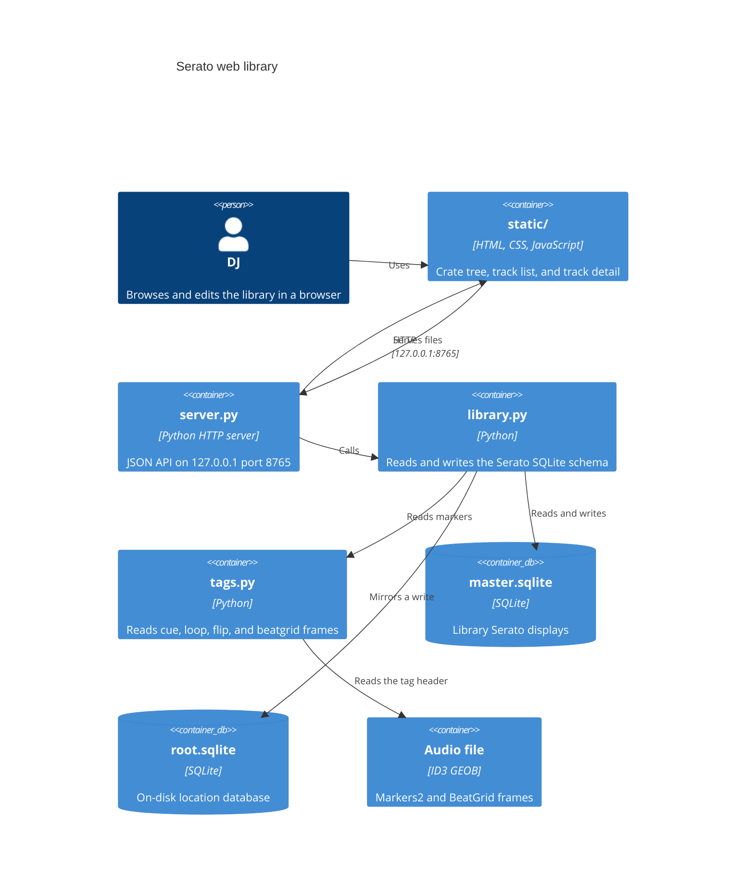
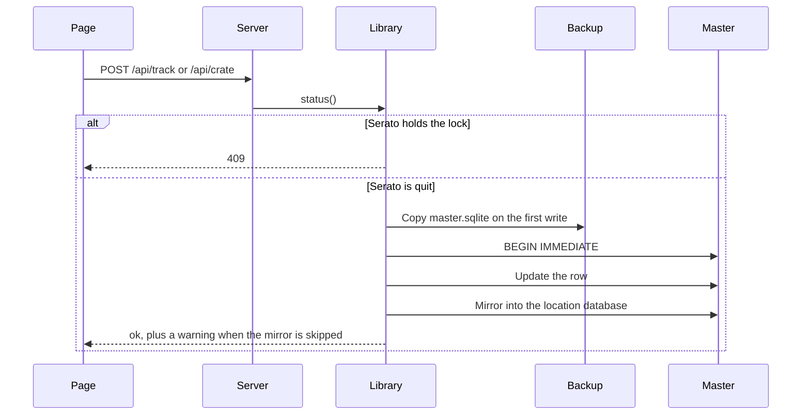

# Serato web library

A local page for the Serato DJ Pro library. The process reads `master.sqlite`. It writes only after Serato has quit. The first write in a process copies the databases into `Library/Backups`.

`docs/serato-library-tools.md` is research about other tools. It is not a description of this program.

## Run

1. Quit Serato DJ Pro.
2. From the repository root, run `python3 server.py`.
3. Open `http://127.0.0.1:8765`.
4. Press Ctrl-C to stop the server.

On macOS the process exits when `~/Library/Application Support/Serato/Library/master.sqlite` is missing. On Windows that file is `%LOCALAPPDATA%\Serato\Library\master.sqlite`. `server.py` uses the Python standard library.

A native window runs the same server:

```bash
python3 -m venv .venv
.venv/bin/pip install -r requirements.txt
.venv/bin/python desktop.py
```

Closing the window stops the server. On Windows, use `.venv\Scripts\python` in place of `.venv/bin/python`. To build an app for the machine you are on, install `requirements-build.txt` in that environment and run `python -m PyInstaller serato-library.spec`. The result is `dist/Serato Library.app` on macOS, or `dist/Serato Library/` on Windows. The build is unsigned. Release builds, attestations, and the GitHub settings around them are in [docs/github.md](github.md).

## Tests

1. From the repository root, run `python3 -m unittest discover -s tests -t . -v`.
2. The suite builds a temporary database and points `library.MASTER` at that file. The fixture closes every SQLite connection before it deletes that directory. Windows cannot delete a database file that still has an open handle, and a `sqlite3` connection used as a context manager commits without closing.
3. The suite does not open the live Serato library.

## Debug in VS Code

1. Open this repository in VS Code.
2. Install the recommended Python extension when VS Code offers it.
3. Press F5.
4. The debugger runs `server.py` in the integrated terminal.

`.vscode/launch.json` names that launch "Python: Run server.py". A second launch, "Python: Current File", debugs the open file. "Python: Debug Tests" runs `unittest` discovery for `tests/`. Those launches use the system Python. The desktop window uses `.venv`. Format on save is on. The explorer hides `__pycache__` and `*.pyc`.

## Containers



## Modules

`server.py`, `library.py`, `tags.py`, `desktop.py`, `static_assets.py`, and `scripts/release_bundle.py` document each function with a Google-style docstring. The tests do the same. `static/app.js` documents each function. `static/index.html` and `static/app.css` open with a header comment that states the file's role.

### `server.py`

`serve` binds `ThreadingHTTPServer` to `127.0.0.1` port `8765` and exits when that port is already taken. `main` serves until Ctrl-C. The handler class is `Handler`. It logs each request and answers JSON with `Cache-Control: no-store`.

`app_root` locates `static/`. A PyInstaller build reads it from `sys._MEIPASS`. A source checkout reads the directory beside `server.py`.

`desktop.py` imports `webview` (pywebview 6.2.1), calls `serve`, and opens `http://127.0.0.1:8765` in a native window. The window allows text selection. pywebview uses WKWebView on macOS and WebView2, through the WinForms backend, on Windows. The import stays in `desktop.py`, so the server and the tests do not require the package.

When `SERATO_LIBRARY_SMOKE` is an absolute file path, `smoke_check` runs first and `main` returns. The check confirms the bundled page through `server.app_root()`, writes `ok\n` to that path, and does not import pywebview, bind a port, or open the library. A relative path, a symlink, a directory, or a missing parent directory stops the process. The windowed build has no console, so the marker file is the signal the release check reads.

`static_assets.py` lists local `src` and `href` files in `static/index.html`. Remote URLs, anchors, and data URLs are skipped. `serato-library.spec` exits before it analyzes the program when one of those files is missing. The release zip check compares the same files, byte for byte, with the source tree.

A GET path under `/api/` runs a query. Any other GET path is a file in `static/`. `index.html` answers `/` and an empty path. A path that leaves `static/` returns 404.

`load_library` caches one payload per space. The cache key is the size and modification time of `master.sqlite` and its WAL file. A POST takes a process lock, drops that cache, then writes.

`load_track` returns every column listed in `FIELDS`, plus the edit form, crate membership, near-duplicate copies, Prepare membership, the resolved file path, and marker data. Copies share title, artist, and length in whole seconds. The query returns at most 12 copies.

Blank display values use a dash. Dates use English month names, so the label does not follow the machine locale. Colors other than `0xFFFFFF` render as `#RRGGBB`. `third_party_type` maps `0` to Local file, `1` to iTunes, and `6` to Apple Music.

Allowed spaces are `Serato Library`, `Serato Video`, `Apple Music`, and `Prepare`. A missing space name means `Serato Library`.

### `library.py`

`default_library_path` chooses the live database: Application Support on macOS, and `%LOCALAPPDATA%\Serato\Library\master.sqlite` on Windows. `MASTER` starts as that path. Reads use a read-only SQLite URI and `PRAGMA query_only=ON`.

`status` reads the `lock` table. A row counts as open only when the process image contains `serato`. macOS and other Unix systems ask `ps`. Windows asks `tasklist`. A locked database also counts as open. `writable` is false in both cases. The payload includes `file_manager`: `Finder` or `File Explorer`.

`begin_write` refuses the call when Serato is open (`SeratoOpen`, HTTP 409). It then calls `ensure_backup` and opens `BEGIN IMMEDIATE` with a one-second timeout. Foreign keys are off for the write. The backup folder is `Library/Backups/serato-web-<timestamp>/` beside `master.sqlite`. The copy includes `root.sqlite` when that file sits beside the master database. One process backs up a given master path once.

`register` installs `serato_str_norm` and `serato_raw_key_string_to_key_type` on a write connection. The key function maps Camelot and traditional names onto Serato's integer key.

Nested crate names in the database use `NAME_SPLIT` (`U+105E8A`). `display_name` keeps the text before that character.

Container type `0` is the space root and stays out of the crate list. Type `2` is a smart crate. Smart-crate rules are JSON in `smart_crate_rules`.

A write to a track or crate updates `master.sqlite`, then mirrors the change into the location database from the `connection` table. Location id `3` falls back to `root.sqlite` beside the master file. A test database whose path is not the live master mirrors only files in the same directory, or under `/tmp/`. A missing drive, or a database or filesystem error while mirroring, produces a warning and leaves the audio file in place. Any other mirror error propagates.

`save_track` accepts `name`, `artist`, `album`, `genre`, `year`, `composer`, `remixer`, `label`, `grouping`, `comments`, `key`, `emoji`, `bpm`, `color`, `rating`, `is_beatgrid_locked`, and `portable_id`. A new `portable_id` also sets `file_name`, clears `is_missing`, and records `file_size`. If that file's size cannot be read, the save is refused. Every save sets `time_modified`.

`crate_action` accepts `create`, `rename`, `delete`, `color`, `expanded`, `rules`, `add`, `remove`, `prepare`, and `remove_library`. Delete removes the crate and its descendants. `remove_library` removes the track from the space and its crates. It does not delete the audio file. `prepare` adds or removes the track in the Prepare space.

`history_sessions` and `history_entries` read `history_session` and `history_entry`. `duplicate_groups` groups tracks in one space by title, artist, and length in whole seconds. Rows with an empty title, an empty artist, or no length are skipped. Asset ids in a group are sorted.

`export_m3u` writes an extended M3U for one crate or for the whole space. A track with no path is named in a `# omitted, no path` comment and left out of the playlist. A missing length is written as `-1`. `import_m3u` creates a normal crate and adds tracks whose `portable_id` matches a playlist path. Unmatched paths stay out of the crate. The result lists at most 50 of them.

`reveal` shows the resolved audio file in the host file manager. macOS runs `open -R`. Windows runs `explorer /select,`. `markers_for` calls `tags.read_serato_tags` when the file is on disk.

### `tags.py`

`read_serato_tags` reads. It does not write audio. It scans the first 2,000,000 bytes and, for a longer file, the last 512,000 bytes. It collects ID3 GEOB frames named `Serato Markers2` and `Serato BeatGrid`.

Markers2 is base64 after a `01 01` header. Each entry is `CUE`, `LOOP`, or `FLIP`. A cue has index, start in milliseconds, color, and name. A loop adds end time and a locked flag. A flip has index, enabled, and name.

BeatGrid version byte `1` yields markers. Each marker has a position in seconds. The last marker stores BPM. Earlier markers store a beat count. More than 4096 markers, or a payload shorter than the declared marker count, returns an empty list.

### `static/`

`index.html` is one screen. The rail holds the status line, the space menu, and five views: Crates, History, Missing, Duplicates, and Stems. Crate tools search, sort, create, and import an M3U. The sheet holds the track search, the virtualized list, and the detail pane.

`app.js` keeps library state in `state`. The list paints only the rows inside the scroll window. Row height is 36 pixels. Track sort keys include name, artist, album, BPM, key, and the other columns the header exposes. Crate sort is custom order, name, or date added.

The detail pane edits the fields `save_track` accepts, shows marker sections, lists near-duplicate copies, and offers crate membership, Prepare, reveal in the host file manager, and remove from the library. The reveal label uses `file_manager` from the track status. Writes stay disabled while `writable` is false. Color choices are None, Red, Orange, Yellow, Green, Blue, Purple, and Pink.

`app.css` is the layout and color for that screen.

## HTTP API

The server accepts JSON objects up to 2,000,000 bytes. A larger body returns 413. Invalid JSON returns 400. Serato open or a database lock returns 409 with a `serato` object: `open`, `writable`, `pid`, `process`, `message`, and `file_manager`.

| Method | Path | Query or body | Result |
|--------|------|---------------|--------|
| GET | `/api/status` | none | Lock status |
| GET | `/api/library` | `space` | Tracks, crates, rules, counts |
| GET | `/api/track` | `id`, `space` | One track, or 404 |
| GET | `/api/history` | none | `{ "sessions": [...] }` |
| GET | `/api/history` | `session` | One session and its entries |
| GET | `/api/duplicates` | `space` | Groups, plus `count` |
| GET | `/api/export.m3u` | `space`, `crate` | M3U file `crate.m3u`. `crate=all` exports the space |
| POST | `/api/track` | `id`, `space`, `fields` | Saves track fields |
| POST | `/api/crate` | `action` plus ids and fields | Crate or membership change |
| POST | `/api/import.m3u` | `space`, `parent`, `name`, `text` | New crate from playlist text |
| POST | `/api/reveal` | `id` | Reveals the file in Finder or File Explorer |

`GET /api/library` crate objects use `id`, `parent`, `name`, `smart`, `order`, `color`, `expanded`, `added`, `tracks`, and `rules` on smart crates. The space root crate is omitted. `root_id` is returned separately.

## Write path



1. Quit Serato DJ Pro.
2. Edit a field or a crate in the page.
3. Confirm the status line says edits save to the library.
4. Leave the audio file in place. Cue data stays in the file.

A full ID3 rewrite from another program can drop Markers2 and BeatGrid. This program does not rewrite those frames.
