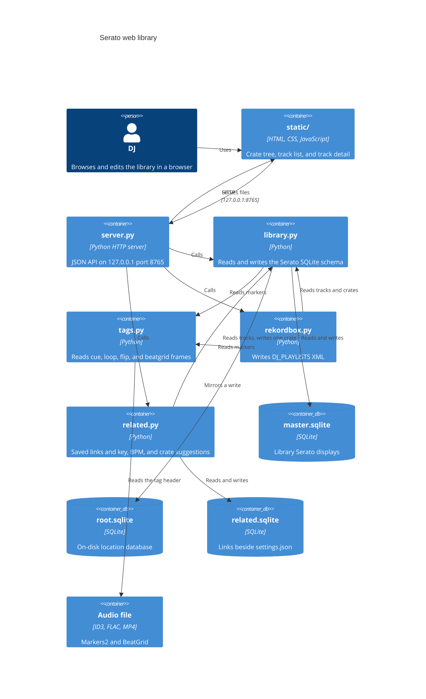
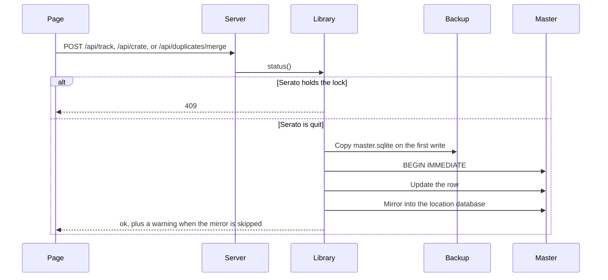

# Serato web library

A local page for the Serato DJ Pro library. The process reads `master.sqlite`. It writes only after Serato has quit. The first write in a process copies the databases into `Library/Backups`.

`docs/serato-library-tools.md` is research about other tools. It is not a description of this program.

## Run

1. Quit Serato DJ Pro.
2. From the repository root, run `python3 server.py`.
3. Open `http://127.0.0.1:8765`.
4. Press Ctrl-C to stop the server.

On macOS the process exits when `~/Library/Application Support/Serato/Library/master.sqlite` is missing. On Windows that file is `%LOCALAPPDATA%\Serato\Library\master.sqlite`. `server.py` uses the Python standard library.

The desktop app runs the same server on a free port and opens the browser:

```bash
python3 -m venv .venv
.venv/bin/pip install -r requirements.txt
.venv/bin/python desktop.py
```

Quit from the menu bar on macOS or the notification-area icon on Windows. Closing the browser does not stop the server. A second launch opens the same page. On macOS, install `requirements-macos.txt` in that environment as well. On Windows, use `.venv\Scripts\python` in place of `.venv/bin/python`. To build an app for the machine you are on, install `requirements-build.txt` in that environment and run `python -m PyInstaller serato-library.spec`. The result is `dist/Serato Library.app` on macOS, or `dist/Serato Library/` on Windows. The build is unsigned. Release disk images, the Windows installer, attestations, and the GitHub settings around them are in [docs/github.md](github.md).

The first time the page opens, it asks whether to share anonymous usage stats and crash reports. The choice stays off until you accept. [PRIVACY.md](../PRIVACY.md) lists what can be sent.

## Tests

1. From the repository root, install the pinned packages with `python3 -m pip install -r requirements.txt`. The suite imports `sentry-sdk` and `posthog`.
2. Run `python3 -m unittest discover -s tests -t . -v`.
3. The suite builds a temporary database and points `library.MASTER` at that file. The fixture closes every SQLite connection before it deletes that directory. Windows cannot delete a database file that still has an open handle, and a `sqlite3` connection used as a context manager commits without closing.
4. The suite does not open the live Serato library. `tests/__init__.py` points `SERATO_LIBRARY_CONFIG_DIR` and `SERATO_LIBRARY_LOG_DIR` at a temporary directory for the whole run. A relative value for either variable is ignored.

## Debug in VS Code

1. Open this repository in VS Code.
2. Install the recommended Python extension when VS Code offers it.
3. Press F5.
4. The debugger runs `server.py` in the integrated terminal.

`.vscode/launch.json` names that launch "Python: Run server.py". A second launch, "Python: Current File", debugs the open file. "Python: Debug Tests" runs `unittest` discovery for `tests/`. Those launches use the system Python. The desktop app uses `.venv`. Format on save is on. The explorer hides `__pycache__` and `*.pyc`.

## Containers



## Modules

`server.py`, `library.py`, `files.py`, `related.py`, `rekordbox.py`, `tags.py`, `desktop.py`, `telemetry.py`, `app_config.py`, `app_log.py`, `build_config.py`, `static_assets.py`, and `scripts/release_bundle.py` document each function with a Google-style docstring. The tests do the same. `static/app.js` documents each function. `static/index.html` and `static/app.css` open with a header comment that states the file's role.

### `server.py`

`serve` binds `ThreadingHTTPServer` to `127.0.0.1`. Called with no arguments it uses port `8765` and exits when that port is already taken or the master database is missing. `serve(port=0)` asks the operating system for a free port. `require_library=False` skips the database check and does not start telemetry, which is the release smoke path. `main` serves until Ctrl-C on port 8765. The handler class is `Handler`. It logs each request and answers JSON with `Cache-Control: no-store`. `shutdown_token` on the server object starts as None.

`app_root` locates `static/`. A PyInstaller build reads it from `sys._MEIPASS`. A source checkout reads the directory beside `server.py`. The menu icon is `packaging/menu-icon.png` beside that root.

`desktop.py` calls `serve(port=0)`, opens the default browser, and shows a pystray icon: a menu-bar item on macOS and a notification-area icon on Windows. The menu is Open and Quit. Quit shuts the server down and then stops telemetry. A lock file `instance.lock` in the config directory keeps a single instance. The page URL is written to `instance.port`. A second launch opens that URL when `/api/health` answers. pystray is imported only when the icon is shown. The macOS bundle sets `LSUIElement` so there is no Dock icon, and `NSRemovableVolumesUsageDescription` so macOS can ask before the app reads an external drive. That permission is Removable Volumes, not Full Disk Access.

When `SERATO_LIBRARY_SMOKE` is an absolute file path, `smoke_main` runs and `launch` does not. The check confirms the bundled page through `server.app_root()`, binds a free port without opening the library or telemetry, writes `http://127.0.0.1:<port>` and a shutdown token to the marker, and serves until `POST /api/shutdown` presents that token in `X-Serato-Library-Shutdown`. A relative path, a symlink, a directory, or a missing parent directory stops the process. The windowed build has no console, so the marker file is the signal the release check reads.

`static_assets.py` lists local `src` and `href` files in `static/index.html`. Remote URLs, anchors, and data URLs are skipped. `serato-library.spec` exits before it analyzes the program when one of those files is missing. The release zip check compares the same files, byte for byte, with the source tree.

A GET path under `/api/` runs a query. Any other GET path is a file in `static/`. The request is joined to that directory and passed through `os.path.realpath`. It is served only when the result starts with the directory plus a separator and the result is a file. `index.html` answers `/` and an empty path. Anything else returns 404.

`load_library` caches one payload per space. The cache key is the size and modification time of `master.sqlite` and its WAL file. A cache miss can record `library_scanned` with a track-count bucket. A POST takes a process lock, drops that cache, then writes. Settings and log routes are answered before that lock. `serve` calls `files.recover_interrupted` after the database is known to exist. A journal that cannot be repaired is logged. The server still starts.

The HTTP banner is `SeratoLibrary/1.0`. A release tag does not change that banner. The app version is `app_config.APP_VERSION` (`0.1.1`). `__version__` is that same string. Sentry's release and PostHog's `app_version` read the constant.

`load_track` returns every column listed in `FIELDS`, plus the edit form, crate membership, near-duplicate copies, Prepare membership, the resolved file path, and marker data. Copies share title, artist, and length in whole seconds. The query returns at most 12 copies.

Blank display values use a dash. Dates use English month names, so the label does not follow the machine locale. Colors other than `0xFFFFFF` render as `#RRGGBB`. `third_party_type` maps `0` to Local file, `1` to iTunes, and `6` to Apple Music.

Allowed spaces are `Serato Library`, `Serato Video`, `Apple Music`, and `Prepare`. A missing space name means `Serato Library`.

### `library.py`

`default_library_path` chooses the live database: Application Support on macOS, and `%LOCALAPPDATA%\Serato\Library\master.sqlite` on Windows. `MASTER` starts as that path. Reads use a read-only SQLite URI and `PRAGMA query_only=ON`.

`status` reads the `lock` table. A row counts as open only when the process image contains `serato`. macOS and other Unix systems ask `ps`. Windows asks `tasklist`. A locked database also counts as open. `writable` is false in both cases. The payload includes `file_manager`: `Finder` or `File Explorer`.

`begin_write` refuses the call when Serato is open (`SeratoOpen`, HTTP 409). It then calls `ensure_backup` and opens `BEGIN IMMEDIATE` with a one-second timeout. Foreign keys are off for the write. The backup folder is `Library/Backups/serato-web-<YYYYMMDD-HHMMSS>/` beside `master.sqlite`. A second backup in that same second uses `-02`, then `-03`, through `-99`. The suffix is zero-padded, so sorting the folder names keeps the order the copies were made. The name is claimed with `mkdir(parents=True, exist_ok=False)`. If every name for that second exists, `FileExistsError` is raised and nothing is copied. If the copy fails, the new folder is renamed so the name ends with `-failed`, then removed. If the rename fails, an `INCOMPLETE` file is written in the folder. A failure to rename or remove it is logged and does not replace the copy error. Copies go into a hidden `.serato-web-<stamp>.partial` directory. `COMPLETE` is written last. Each line is a lowercase SHA-256, two spaces, and a relative POSIX path. The directory is then renamed to `serato-web-<stamp>`. `is_complete(backup_dir)` is the only completeness check a restore or a snapshot list uses. The argument is the directory itself. The parent path is ignored, so a folder beside `master.sqlite` and a snapshot directory in any other place, including an app-data folder, use the same function. It returns true only when `COMPLETE` exists and every listed hash matches, and every other file is listed. A missing marker means incomplete. A name ending in `-failed` or `-failed-NN` (any letter case) and a hidden `.partial` directory are never complete. `INCOMPLETE` is never complete. `list_backups` returns only directories for which `is_complete` is true. An old folder with `master.sqlite` and no `COMPLETE` file is `legacy, unverified` from `backup_status`. It is not listed as complete. `verify_legacy_backup(backup_dir)` is the check for one the user explicitly picked. It opens `master.sqlite` read-only (`file:<path>?mode=ro`) and runs `PRAGMA integrity_check`. The restore must stop unless the only row is exactly `ok`, and it must stop before the pre-restore snapshot. The file browser hides `.partial` directories, failed names, `INCOMPLETE`, and a `COMPLETE` file whose hashes do not match. The copy includes `root.sqlite` when that file sits beside the master database. One process backs up a given master path once. After that copy, `backup_made` can be recorded. The backup path is not a property of the event.

`register` installs `serato_str_norm` and `serato_raw_key_string_to_key_type` on a write connection. The key function maps Camelot and traditional names onto Serato's integer key.

Nested crate names in the database use `NAME_SPLIT` (`U+105E8A`). `display_name` keeps the text before that character.

Container type `0` is the space root and stays out of the crate list. Type `2` is a smart crate. Smart-crate rules are JSON in `smart_crate_rules`.

A write to a track or crate updates `master.sqlite`, then mirrors the change into the location database from the `connection` table. Location id `3` falls back to `root.sqlite` beside the master file. A test database whose path is not the live master mirrors only files in the same directory, or under `/tmp/`. A missing drive, or a database or filesystem error while mirroring, produces a warning and leaves the audio file in place. Any other mirror error propagates.

`save_track` accepts `name`, `artist`, `album`, `genre`, `year`, `composer`, `remixer`, `label`, `grouping`, `comments`, `key`, `emoji`, `bpm`, `color`, `rating`, `is_beatgrid_locked`, and `portable_id`. A new `portable_id` also sets `file_name`, clears `is_missing`, and records `file_size`. If that file's size cannot be read, the save is refused. Every save sets `time_modified`.

`crate_action` accepts `create`, `rename`, `delete`, `color`, `expanded`, `rules`, `add`, `remove`, `prepare`, and `remove_library`. Delete removes the crate and its descendants. `remove_library` removes the track from the space and its crates. It does not delete the audio file. `prepare` adds or removes the track in the Prepare space.

`history_sessions` and `history_entries` read `history_session` and `history_entry`. `duplicate_groups` groups tracks in one space by title, artist, and length in whole seconds. Rows with an empty title, an empty artist, or no length are skipped. Asset ids in a group are sorted.

`merge_duplicates` folds one of those groups into the copy you keep. `preview` true returns the plan and does not write. A merge requires `confirm` true. The master changes run in the `begin_write` transaction. Each location database is mirrored afterwards, in its own transaction, the same way other writes are. Serato open returns 409 before the backup. A preview still returns the plan when Serato is open, with `writable` false. That gap is intentional: the plan is readable, and the write path refuses before it copies a backup.

The kept track is added to every normal crate any duplicate was in, in any space, so a Prepare crate is included. Smart crates and the space root are left alone. If the kept track is already in a crate, it stays at its current position. Otherwise it takes the earliest duplicate's `list_order` in that crate. The location database receives the new membership with that same position when the column exists. A track that is already in the drive crate is not moved.

Empty text (album, genre, year, composer, remixer, label, grouping, comments, key, emoji, disc, track number, and the comment language fields) and an empty BPM are filled from the first duplicate, in asset-id order, that has a value. Text longer than the field limit is skipped. Play count and rating keep the highest number, treating a missing value as lower than a real one. White (`0xFFFFFF`) or a missing color is filled from the first real color. Date added keeps the earliest timestamp. Recently played is set when any copy was recently played. Filling the key also sets `key_value`. `is_beatgrid_locked` is not copied, because the lock belongs to that file's beatgrid. Path, file name, file size, bitrate, sample rate, length, and the missing flag stay with the file you keep.

`history_entry.asset_id` is repointed when that column exists. The played name and file name on the history row stay as a snapshot of what was played. The same repoint is applied in a location database that has the column, using that database's asset ids. Duplicate rows are then removed from space membership, crate membership, and the asset table. The location database removes the same memberships and deletes the location asset row, so Serato does not recreate the duplicate from the drive. A duplicate that shares the kept track's location asset id is left in the drive database. A track whose location is not the main drive (`location_id` 3) is removed from the master library, and that other drive is left unchanged, matching `remove_library`. When several of those mirrors are skipped, `warning` says so once. A shared drive record, or a file that could not be moved to the Trash, is reported in addition to that sentence.

Cue points are read with `tags.read_serato_tags`. They are not written back. The read includes ID3 GEOB frames and the Serato blocks in FLAC and M4A/MP4, so a duplicate in those formats warns too. When the kept file has no cues, loops, flips, or beatgrid and a duplicate file does, the plan includes `cue_warning`. The markers stay in the other audio file. Rewriting the tag can drop Serato's frames, so there is no copy step.

`delete_files` defaults off. Turning it on also requires `confirm_delete_files` true. The move is refused, before `begin_write`, when a duplicate path is a symlink, a directory, the same file as the kept copy (including a hard link), named `master.sqlite` or `root.sqlite`, or inside the library database folder. A sibling folder whose name only starts with the library folder's name is not treated as inside it. Files that pass are moved to the Trash after the database commit: Finder on macOS, the Recycle Bin on Windows, and the FreeDesktop trash specification elsewhere. A failed move leaves the file on disk and returns a warning. The library change is already committed. A missing file is skipped. The response lists file names, not paths.

`export_m3u` writes an extended M3U for one crate or for the whole space. A track with no path is named in a `# omitted, no path` comment and left out of the playlist. A missing length is written as `-1`. `import_m3u` creates a normal crate and adds tracks whose `portable_id` matches a playlist path. Unmatched paths stay out of the crate. The result lists at most 50 of them.

`reveal` shows the resolved audio file in the host file manager. macOS runs `open -R`. Windows runs `explorer /select,`. `markers_for` calls `tags.read_serato_tags` when the file is on disk. A successful read can record `tags_read`. The audio path is not a property of the event. A duplicate merge reads markers through `read_serato_tags` directly and does not record `tags_read`.

`update_related_path` rewrites a path in the related-tracks sidecar after a file move. It does not open `master.sqlite`. The implementation is `related.update_path`.

### `related.py`

`related_db_path` is `related.sqlite` beside `settings.json`. The schema is version 1 (`PRAGMA user_version`) and is documented in [related-tracks.md](related-tracks.md). Reads and writes of that file do not take the Serato lock.

A track key is a normalized absolute path. `~` is expanded and `.` and `..` are collapsed. Symlinks are not followed, and the request path is not used to test whether a file exists. A track in the open library uses the path the library already resolved. Title, artist, and length in whole seconds are a fallback when exactly one stored row matches and that path is not still a different track in the library. `update_path` is what a file move calls. `add_link` stores a one-way or two-way link with an optional note and a rating from 1 to 5. `remove_link` deletes the link and keeps the identity rows. `overview` returns saved links and suggestions. `refresh_crate` creates or replaces a normal Serato crate named `Related - ` plus the track title. That call writes `master.sqlite` through `crate_action`, so Serato must be quit and the backup rules apply.

Suggestions rank other tracks in the space by Camelot key (same, relative, or one step on the wheel), BPM within 6 percent including half time and double time, and shared normal crates. Crates whose names start with `Related - ` are not counted. At most 12 suggestions are returned. They are not stored.

### `tags.py`

`read_serato_tags` reads. It does not rewrite the file. ID3 is taken from the first 2,000,000 bytes and, for a longer file, the last 512,000 bytes. `serato_tags_from_regions` parses those windows. The frames are `Serato Markers2` and `Serato BeatGrid`. An export that already has the file open calls `serato_tags_from_regions` with the same windows.

FLAC metadata is not limited to that window. While the file is open, every metadata block is visited from its 4-byte header. A picture or padding block is skipped with seek, so album art larger than 2 MB does not hide the markers and is not loaded. The Vorbis comment block is read in full, with no byte cap. The fields are `SERATO_MARKERS_V2` and `SERATO_BEATGRID`, matched without case sensitivity. An `.m4a`, `.mp4`, `.aac`, or `.alac` file, or a file whose first atom is `ftyp`, is walked by top-level atom size. An MP3 is not. The `mdat` audio is not loaded. Each `moov` body is read up to 16 MB. A larger `moov` is truncated and a warning is logged. Freeform `----` atoms whose mean is `com.serato.dj` are decoded, and the frame name inside the payload selects `Serato Markers2` or `Serato BeatGrid`. Serato names those atoms `markersv2` and `beatgrid`. Those FLAC and MP4 values are base64, without padding, of `application/octet-stream`, a null, a second null, the frame name, a null, and the same payload the GEOB frame stores. A newline may appear every 72 characters. Other `SERATO_*` blocks, including overview, are ignored.

`plan_serato_geob` and `copy_serato_geob` copy those Serato frames onto another file only when that is safe. A plain ID3v2.3 tag can take the frames. An `.mp3` with no tag can take a new ID3v2.3 tag in front of the existing bytes. Other frames are kept as raw bytes. The audio after the tag is streamed unchanged. A destination that already has Serato frames is left alone. A source with none is skipped. Unsynchronisation, an extended header, a compressed or encrypted Serato frame, a tag larger than 16 MB, and FLAC, RIFF, AIFF, Ogg, or MP4 containers are refused. The destination is not modified in those cases. The copy writes a temporary file beside the destination and replaces it only after the audio bytes still match.

Markers2 is base64 after a `01 01` header. Newlines and a missing `=` pad are accepted. Each parsed entry is `CUE`, `LOOP`, or `FLIP`. A cue has index, start in milliseconds, color, and name. A loop adds end time and a locked flag. A flip has index, enabled, and name. A `COLOR` or `BPMLOCK` entry in the same payload is skipped. Duplicate merge uses this read to decide whether to warn. It does not write a GEOB frame, a Vorbis comment, or an MP4 atom.

BeatGrid version byte `1` yields markers. Each marker has a position in seconds. That position is the stored float. It is not rounded to three decimal places. The last marker stores BPM, rounded to two decimal places. Earlier markers store a beat count. A version this parser does not know, more than 4096 markers, or a payload shorter than the declared marker count sets `beatgrid_warning` and returns no markers.

### `rekordbox.py`

`export_rekordbox` writes a Rekordbox `DJ_PLAYLISTS` document for one space. `crate_id` None exports every track in the space and every crate. A crate id exports that crate and its subcrates, and the collection is the tracks in that tree. The space root (container type `0`) is not a playlist. A crate with subcrates becomes a folder (`NODE Type="0"`). Its own tracks are a playlist of the same name inside that folder. A crate with no subcrates is a playlist (`NODE Type="1"`). Playlist order follows `list_order`. A track in two crates is one `COLLECTION` entry and two playlist references. `TrackID` is the asset id.

A track with no `portable_id` is omitted. `Location` is a `file://localhost` URI. A macOS path stays absolute (`file://localhost/Users/...`). A Windows path uses a forward-slash drive (`file://localhost/C:/Users/...`). Spaces, `#`, and other reserved characters are percent-encoded as UTF-8. The drive colon is not encoded. A colon later in the name is encoded. A UNC path keeps the double slash (`file://localhost//server/share/...`).

`Name`, `Artist`, `Album`, `Genre`, `AverageBpm`, `Tonality`, `TotalTime`, `BitRate`, and `Comments` come from the asset row. Control characters other than tab, newline, and carriage return, and unpaired surrogates, are removed from those text fields before the XML is written. `TotalTime` is whole seconds from `length_ms`. `BitRate` is `file_bit_rate` in bits per second, written as kilobits per second. `AverageBpm` uses the library BPM. When that value is empty and the beatgrid has a BPM, the beatgrid BPM is used. Rating is Serato's 0-to-1 value written on rekordbox's 0-to-255 scale.

Cues and loops come from `tags.read_serato_tags`. Each hot cue is a `POSITION_MARK` with `Type="0"` and `Num` equal to its Serato index when that index is 0 through 7. The same cue is also written with `Num="-1"` unless memory cues are turned off, because some CDJ screens only list memory cues. An index outside that range is only a memory cue. A saved loop is `Type="4"` and has `End`. Its `Num` is `-1`, so a loop does not replace the hot cue with the same Serato slot. `--hot-loops` uses the loop index when that pad is free. `Start` and `End` are seconds with three decimal places, which is one millisecond. `Red`, `Green`, and `Blue` are the marker color. Rekordbox may snap those values to its palette. A marker with no color is white. Flips are not written.

An MP3 is shifted only after its LAME/Xing header is read. No Xing header (case A) and a LAME tag whose CRC matches (case D) stay as stored. Xing or Info without a LAME tag (case B, including Lavc) and a LAME tag whose CRC is 0 or does not match (case C) are moved 26 milliseconds earlier, which is the published gap between Serato and Rekordbox on those files. AAC, WAV, AIFF, and FLAC are not shifted. A time that would fall before 0 is written at 0 and counted in the loss report. The path uses the directory entry's spelling when the file is on disk, so a macOS NFD name is the one Rekordbox will match. One folder is listed once per export, not once per track. Serato tags and the MP3 timing header are read in the same open. The header read seeks past the ID3 size, and past the ten-byte footer when that flag is set, then reads about 4 KB. `resolved_path`, `container_in_space`, and `descendant_ids` are the public helpers this export calls. Track color is written as `Colour="0xRRGGBB"`, the form in Rekordbox's XML list, when it is not Serato's white. Rating is one of 0, 51, 102, 153, 204, or 255. A file that cannot be opened is still exported, without cue points, and its name is in the loss report. A path containing a null character cannot be checked: `Path.is_file` raises `ValueError` on some Python versions and returns false on others. That track is exported as a missing file, without cue points, the loss report names it, and a warning is logged. The rest of the export continues. `Kind` comes from the extension. A raw `.aac` file is `AAC File`. An `.m4a` or `.mp4` file is `M4A File`.

The beatgrid is one `TEMPO` per marker, including a Serato 5.0 grid with a marker at each tempo change. An earlier marker's BPM is the beat count times 60 divided by the seconds between the stored marker positions. Those positions are the floats from the file. They are not rounded to three decimals before that division. The last marker's BPM is the BPM stored on that marker, rounded to two decimal places. `Inizio` is the marker position in seconds, on the millisecond grid. `Metro` is `4/4`. `Battito` counts from the first marker as a downbeat, so a marker every beat is 1, 2, 3, 4. A segment with no positive span uses the last marker's BPM. A beatgrid that cannot yield a positive BPM is omitted. A marker whose position is not a finite number is left out and counted in the loss report. A last marker whose BPM is not a finite number is left out and counted the same way. The other markers on that grid are still written. Those stored positions are not replaced by the three-decimal string the track panel shows. Version bytes other than 1, a truncated payload, and more than 4096 markers are left out and named in the loss report. `Tonality` is the key text Serato stores unless `--key camelot` or `--key classical` is set. `TrackID` is the asset id. Playlist `Key` values use that id and `KeyType="0"`. `COLLECTION Entries` and folder `Count` match the child counts.

`parse_rekordbox` reads that XML back into tracks, tempo, position marks, and the playlist tree. `position_ms` reads a seconds attribute back to whole milliseconds. `python3 rekordbox.py -o rekordbox.xml` writes the file and prints the loss report. `--space` selects the space. `--crate` is a crate id or `all`. `--no-memory-cues` skips the memory-cue copies. The command refuses to write `master.sqlite` or `root.sqlite`. `GET /api/export.rekordbox.xml?report=1` returns the loss report and the XML in one JSON object, so the page does not scan the library twice. The download uses that XML. An error response is JSON and is not given the rekordbox.xml filename. A crate id must be ASCII digits. `memory` and `hot_loops` accept `1`, `true`, `yes`, `0`, `false`, and `no`. Any other value is logged and the export uses the default, which is memory cues on and hot loops off. A crate id that is not an integer, or that does not fit in a SQLite integer, returns 400. The page shows the report as a list in a dialog. Download starts after confirm. The loss report also names track color, beatgrid lock, replay gain, waveforms, stems, play history, smart-crate rules, and cue names a CDJ cuts short. A path that cannot be encoded is counted on its own and the file name is included.

Since Rekordbox 5.6.1, importing XML does not update a track that is already in the collection. In Rekordbox 6 and 7 the control is Preferences, Advanced, Database, rekordbox xml. Overwrite is Import to Collection, then Yes to load information from imported library. That replaces cues, the beatgrid, and tags. Device Library Plus and OneLibrary USB drives are not written. The export does not write the audio file or the database, and it does not record `tags_read`.

### `files.py`

`files.py` renames a file, moves files, moves a folder, points a library track at a replacement file, and moves a file to the Trash. Crates, history, and Prepare stay attached because every stored path that resolves to the old file is rewritten. Cue points travel inside the audio file. A replacement copies them with `tags.copy_serato_geob` when that is safe, and the result says so when it is not. The old file stays on disk.

`list_directory` lists one folder without following shortcuts. An empty path lists the home directory. A request path is normalized and must be absolute on its own drive before the folder is opened. `plan` runs the same path checks as a save and returns a preview. It does not copy the database and it does not repair an interrupted journal. The preview says when Serato is open. `execute` requires `confirm` to be the boolean true. It refuses while Serato is open, copies the database, writes `Library/Backups/file-ops-journal.json`, changes the files, then updates `master.sqlite` and the attached location databases in one transaction. A database failure puts the files back. A filesystem failure rolls the database back and puts back the files that already moved. `recover_interrupted` finishes or undoes a journal the next time a save starts, and when the server starts. It does that only while Serato is quit. A journal that matches only some rows is left in place and the next save is refused until the backup in `Library/Backups` is restored.

Path columns are `portable_id`, `video_portable_id`, `file_path`, `filepath`, `path`, and names that end in `_path` or `_portable_id`. `file_name` is updated on the row whose portable id moved. History keeps its play. A rename or a move that changes the basename updates `history_entry.file_name`. A delete removes the asset from the library and its crates and sets `history_entry.asset_id` to null when that column allows it. The same delete is applied to the mirrored asset by `external_id`.

A file name cannot contain a slash, a backslash, or a null, and it cannot be `.` or `..`. The resolved parent must be the destination folder. Shortcuts are refused, including a shortcut whose name would pass the character check. `master.sqlite`, its sidecars, `root.sqlite`, and anything inside `Library/Backups` are refused. A sibling such as `Library/Backups-extra` is not inside that folder. The library directory, its parents, the home directory, and a filesystem root cannot be moved as a folder. A folder cannot be moved into itself. A name collision refuses the whole batch. A missing file cannot be renamed or moved on its own. A folder move still updates stored paths for missing files inside it. Deleting a missing library file removes the row and does not invent a trash entry.

Cross-drive moves copy the file and remove the source only after the sizes match. A cross-drive folder becomes one copy per file, recorded in the journal before the copies start. The operating-system Trash is used for a delete: Finder's Trash on macOS, the Recycle Bin on Windows (`FOF_ALLOWUNDO`), and the FreeDesktop trash elsewhere. `SERATO_LIBRARY_TRASH`, when it is an absolute path, receives the file instead so a test does not touch the real Trash. On Windows, a failed database commit restores the file from a safety copy. The Recycle Bin can still hold its own copy.

`files_changed` is recorded after a successful save. The properties are a file-count bucket, `change` (`rename`, `move`, `move_folder`, `replace`, or `delete`), and, for a replacement, `cues` (`copied`, `kept`, `skipped`, `unsupported`, or `failed`). Paths and names are not properties. A `change` or `cues` value outside those sets drops the event.

After the database commit, each moved file is passed to `library.update_related_path`, including files inside a moved folder that are not library rows. A related-track path that already belongs to another track is reported as a warning. The file move is not undone.

### `static/`

`index.html` is one screen. The rail holds the status line, the space menu, and six views: Crates, History, Missing, Duplicates, Stems, and Files. Crate tools search, sort, create, and import an M3U. **Export** downloads an M3U. **Rekordbox** downloads `rekordbox.xml` for the selected crate, including its subcrates, or for the whole space when All tracks is selected. The sheet holds the track search, the virtualized list, and the detail pane. Files replaces that sheet with a folder list. Rename, move, replace, and delete open a dialog that previews the paths, crate names, and cue warning. Nothing is written until Confirm. Delete's confirm button is Move to Trash. Move asks for a destination folder first. Writes stay disabled while Serato is open.

`app.js` keeps library state in `state`. The list paints only the rows inside the scroll window. Row height is 36 pixels. Track sort keys include name, artist, album, BPM, key, and the other columns the header exposes. Crate sort is custom order, name, or date added.

The detail pane edits the fields `save_track` accepts, shows marker sections, and shows each beatgrid position to three decimal places so a stored float does not appear as `1.2300000190734863s`. That rounding is display only. The export still divides by the stored float. A non-finite beatgrid BPM is `null` in that payload. `send_json` replaces every non-finite number with `null` and encodes with `allow_nan` false, so a response cannot contain the token `NaN`. The pane lists near-duplicate copies, and offers crate membership, Prepare, reveal in the host file manager, and remove from the library. In the Duplicates view it also offers Merge copies. It also lists saved related tracks, searches the loaded tracks to add a link, removes a link, and can write the `Related - ` crate. A successful crate write reloads the library so the new crate appears in the tree. Suggestions show the reason text from `GET /api/related` and save with one click. Notes and titles are set with `textContent`. The reveal label uses `file_manager` from the track status. Writes stay disabled while `writable` is false. Color choices are None, Red, Orange, Yellow, Green, Blue, Purple, and Pink.

Merge copies opens a dialog. The radios choose the file to keep. The dialog then shows the plan: crates, spaces, fields, history rows, and a cue warning when the kept file has no markers and another copy does. Date added in that list includes the year and the seconds. Cancel closes the dialog. Merge copies sends `confirm` true. Move the other audio files to the Trash is off until checked, and the confirm button then reads Merge and move files to Trash. The checkbox stays disabled when a file cannot be moved safely or is not on disk. The Merge copies button stays disabled while Serato has the library open. A preview request still returns the plan in that state, with `writable` false, and the confirm button stays disabled when that flag is false.

The rail ends with Settings. The first launch opens a dialog whose heading is "Share anonymous usage stats and crash reports?" **Don't share** is focused. Esc or closing the dialog saves a decline. Settings holds the same choice as a checkbox, plus **Open logs folder** and **Copy logs**. The page does not load a third-party analytics script, and it does not insert log text with `innerHTML`.

`app.css` is the layout and color for that screen.

## Sharing and logs

`telemetry.py` is the gate. `capture` returns false, and does not queue the event, unless the saved choice is the boolean `True` and `POSTHOG_KEY` is non-empty. `capture_exception` returns without sending unless the choice is `True` and `SENTRY_DSN` is non-empty. A missing package is the same as a missing key: that service stays off. Clients start in `activate`, which `serve` calls after the port is bound, and which `set_consent(True)` calls when the person opts in. `shutdown` runs when the server or the desktop app stops. The smoke path calls `serve` with `require_library=False`, so it does not start a client.

Keys are read from the environment first, then from `_build_config.py`. The committed file sets `SENTRY_DSN`, `POSTHOG_KEY`, and `POSTHOG_HOST` to empty strings. `scripts/write_build_config.py` overwrites that file for a release build. `POSTHOG_HOST` falls back to `https://us.i.posthog.com`. The script prints `yes` or `no`. It does not print the value.

The events are `app_opened` (once per process after consent), `library_scanned`, `crate_created` (a created crate, or a crate created by an M3U import), `backup_made`, `tags_read`, `files_changed`, `related_link_saved`, `related_link_removed`, `related_crate_written`, and `duplicates_merged` (a confirmed merge, not a preview). Properties this process adds are `app` (`serato-library-manager`), `app_version` (the same `app_config.APP_VERSION` string Sentry uses as its release), `os`, for a scan, `track_count_bucket`, for `files_changed`, `file_count_bucket`, `change`, and sometimes `cues`, and for `related_link_saved`, `link_direction` (`one_way` or `two_way`). Buckets are `0`, `1-9`, `10-49`, `50-99`, `100-499`, `500-999`, `1000-4999`, `5000-9999`, and `10000+`. The exact count is not sent. Paths and file names are not sent. `duplicates_merged` has no extra properties: no kept id, no removed count, no title, and no path. The PostHog client may also attach its Python and library version fields. A before-send hook drops any other property, including a title or a path, and drops the event if consent is no longer granted or if `change`, `cues`, or `link_direction` is not one of the allowed words. GeoIP is disabled. Feature-flag polling and exception autocapture are off.

Sentry uses `server_name` `local`, environment `local`, release `app_config.APP_VERSION` (`0.1.1`), and the tag `app=serato-library-manager`. `send_default_pii` is false. Local variables, source context, and request bodies are off. Argv and logging integrations are disabled. Framework auto-enabling is off. `before_send` returns `None` when consent is off. Otherwise it removes request data, frame variables, and absolute paths. A path becomes `[path]`. A final component ending in `.py` is kept as the file name.

`app_config.py` stores `settings.json` with `install_id` and `telemetry_consent`. The id is a random UUID, created when the choice is saved, not before. `None` means the prompt is still due. `False` is a saved decline. The file is written only when both fields are set. A corrupt file is renamed to `settings.json.unreadable`. The directory is `~/Library/Application Support/Serato Library` on macOS, `%APPDATA%\Serato Library` on Windows, and `$XDG_CONFIG_HOME/serato-library` (or `~/.config/serato-library`) elsewhere. `SERATO_LIBRARY_CONFIG_DIR` overrides it when the value is absolute. `related.sqlite` is in that same directory. Its schema is in [related-tracks.md](related-tracks.md).

`app_log.py` writes `serato-library.log` with `RotatingFileHandler`: 1 MiB and three backups. The directory is `~/Library/Logs/Serato Library` on macOS, `%LOCALAPPDATA%\Serato Library\Logs` on Windows, and `$XDG_STATE_HOME/serato-library/logs` (or `~/.local/state/serato-library/logs`) elsewhere. `SERATO_LIBRARY_LOG_DIR` overrides it when the value is absolute. The startup line can include the database path. That file is not uploaded. Copying the log skips a symlink and skips a file that is not inside the log directory, and it keeps the newest 200,000 characters. Opening the folder runs `open` on macOS, `xdg-open` elsewhere, and `os.startfile` on Windows. The response does not include the path.

## HTTP API

The server accepts JSON objects up to 2,000,000 bytes. A larger body returns 413. Invalid JSON returns 400. Serato open or a database lock returns 409 with a `serato` object: `open`, `writable`, `pid`, `process`, `message`, and `file_manager`.

| Method | Path | Query or body | Result |
|--------|------|---------------|--------|
| GET | `/api/health` | none | `{"ok": true}`. Does not open the library |
| POST | `/api/shutdown` | header `X-Serato-Library-Shutdown` | Stops the desktop server when the token matches. 404 when no token is set. 403 when it does not match |
| GET | `/api/status` | none | Lock status |
| GET | `/api/library` | `space` | Tracks, crates, rules, counts |
| GET | `/api/track` | `id`, `space` | One track, or 404 |
| GET | `/api/history` | none | `{ "sessions": [...] }` |
| GET | `/api/history` | `session` | One session and its entries |
| GET | `/api/duplicates` | `space` | Groups, plus `count` |
| GET | `/api/files` | `path` | One folder. An empty path lists the home directory. Shortcuts are not followed |
| POST | `/api/files` | `action`, paths, and `confirm` | A preview when `confirm` is not the boolean true. A save when it is |
| GET | `/api/related` | `path`, optional `space`, `title`, `artist`, `length_ms` | Saved links and suggestions. See [related-tracks.md](related-tracks.md) |
| POST | `/api/duplicates/merge` | `keep_id`, `space`, `preview`, `confirm`, `delete_files`, `confirm_delete_files` | Plan. `preview` true does not write. A merge needs `confirm` true. Moving files also needs `confirm_delete_files` true |
| GET | `/api/export.m3u` | `space`, `crate` | M3U file `crate.m3u`. `crate=all` exports the space |
| GET | `/api/export.rekordbox.xml` | `space`, `crate`, optional `report`, `memory`, `key` | `rekordbox.xml`. `report=1` returns JSON with the loss report and the same XML. `crate=all` exports the space and its crates. A crate id exports that crate and its subcrates. A crate id that is not ASCII digits returns 400 |
| POST | `/api/track` | `id`, `space`, `fields` | Saves track fields |
| POST | `/api/crate` | `action` plus ids and fields | Crate or membership change |
| POST | `/api/import.m3u` | `space`, `parent`, `name`, `text` | New crate from playlist text |
| POST | `/api/reveal` | `id` | Reveals the file in Finder or File Explorer |
| POST | `/api/related` | `action` `add`, `remove`, or `crate` | Saves or removes a sidecar link, or writes the `Related - ` crate |
| GET | `/api/settings` | none | `telemetry_consent` (`true`, `false`, or `null`), `needs_consent_prompt`, `telemetry_configured`, `app_version`. The install id and the keys are omitted |
| POST | `/api/settings` | `telemetry_consent` | Saves the boolean choice. Any other field, or a non-boolean, returns 400 |
| GET | `/api/logs` | none | `{ "text", "truncated" }` from the local log. The text can contain a path. It is not a report |
| POST | `/api/logs/open` | none | Opens the logs folder. `{ "ok": true }`. The path is not in the body |

`GET /api/settings` and `GET /api/logs` do not take the library write lock. `POST /api/settings` and `POST /api/logs/open` are handled before that lock. `GET /api/related` and `POST /api/related` with `add` or `remove` write only the sidecar file and do not take that lock. `action` `crate` takes the lock, then `library.crate_action`. An unexpected handler error returns 500 with "Something went wrong. The details are in the local log." A `LibraryError` is still returned as its own JSON and is not sent as a crash report.

`GET /api/library` crate objects use `id`, `parent`, `name`, `smart`, `order`, `color`, `expanded`, `added`, `tracks`, and `rules` on smart crates. The space root crate is omitted. `root_id` is returned separately.

## Write path



1. Quit Serato DJ Pro.
2. Edit a field, a crate, or a duplicate merge in the page.
3. Confirm the status line says edits save to the library.
4. Leave the audio file in place. Cue data stays in the file.

A full ID3 rewrite from another program can drop Markers2 and BeatGrid. This program copies those Serato frames only in the cases `tags.py` allows, and only while replacing one library file with another. A rename or a move leaves the audio bytes to travel with the file.

File saves use the same Serato-open check and the same backup as a track edit. The preview does not take that backup. The confirm step writes a journal, changes the files, then commits `master.sqlite` and the attached location databases together. On Windows, a delete that reaches the Recycle Bin before a failed commit is restored from the safety copy. The Recycle Bin may still hold a copy.
