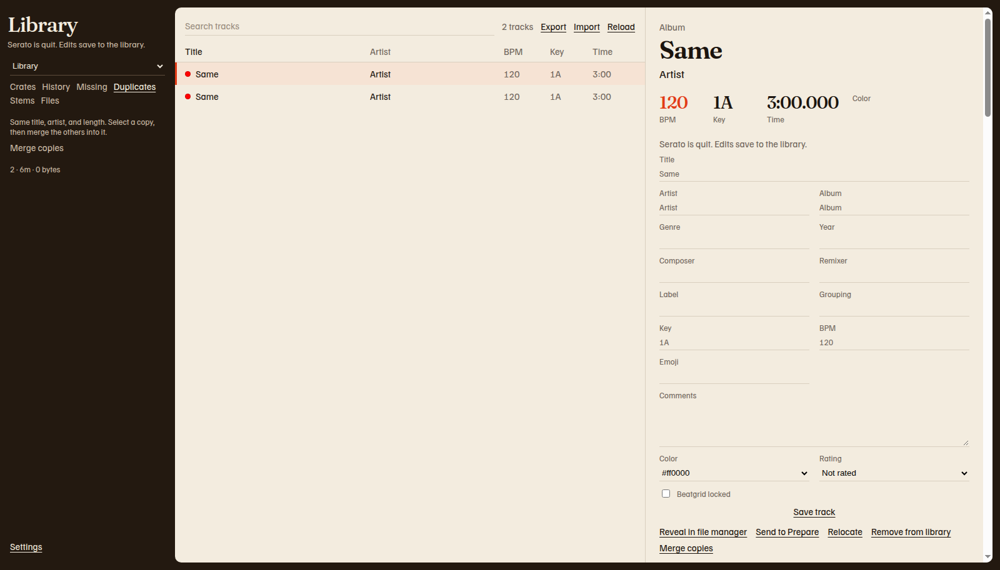
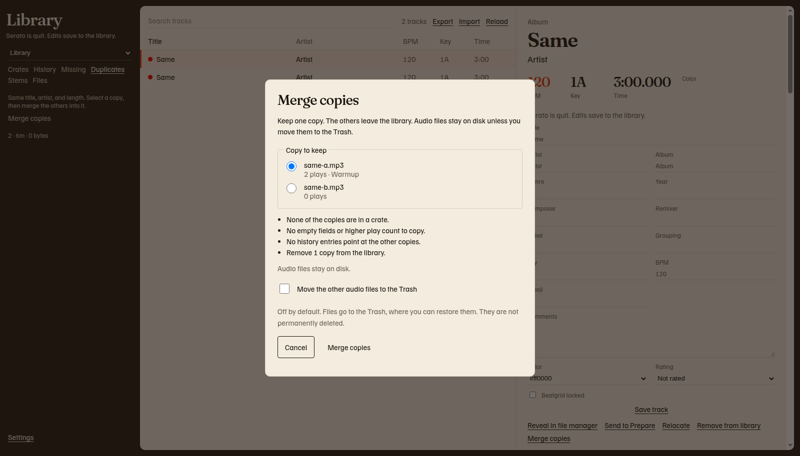

# Duplicates

**Duplicates** lists tracks that share a title, artist, and length in whole seconds. The note says **Same title, artist, and length. Select a copy, then merge the others into it.**

Empty titles and empty artists are left out of the groups. A track with a different length, counted in whole seconds, is not a duplicate.

Open a track to see **Other copies**. Each line shows the file, the bitrate, the play count, and the crates. A missing copy says **missing**. Click a file name to open that copy.

While the scan is running, the list says **Reading duplicates**.

!!! note "Merge copies and version 0.1.1"
    The Duplicates list is in release v0.1.1. The **Merge copies** button was added after that release. [Install](install.md) explains which download includes it.

## Watch a merge

The recording has no sound. It is about 28 seconds. It shows three copies of one track, the plan for keeping `same-a.mp3`, and the library after the other two copies leave. The Trash box stays off, so the audio files stay on disk.

<video controls preload="metadata" playsinline width="960" poster="../media/duplicate-merge-poster.jpg">
  <source src="../media/duplicate-merge.mp4" type="video/mp4">
  <a href="../media/duplicate-merge.mp4">Play the duplicate merge recording</a>.
</video>

[Play the recording](../media/duplicate-merge.mp4) if the player above does not start.

## Merge copies

Quit Serato first. The **Merge copies** button stays off while Serato has the library. You can still open the dialog from a track only when edits are allowed.

1. Click **Duplicates**.
2. Select the copy you want to keep.
3. Click **Merge copies** in the track pane, or the **Merge copies** button in the rail.
4. Under **Copy to keep**, select the file to keep. Each choice shows the file name, the play count, and the crates.
5. Read the plan. It lists crates the kept copy will join, fields that will be filled, history rows that will point at the kept copy, and how many copies will leave the library.
6. Leave **Move the other audio files to the Trash** off unless you want those files in the Trash.
7. Click **Merge copies**. If the Trash box is on, the button reads **Merge and move files to Trash**.

**Cancel** closes the dialog. Nothing is written.

The bar then names the file you kept. One example shape is **Merged 2 copies into same-a.mp3.** A warning can follow when a drive database was not updated. Plug that drive in and open Serato so it can catch up. The sentence starts with **Saved in the main library.**

## What the plan keeps

The kept file stays the kept file. Its path, size, bitrate, sample rate, and length do not change.

| Item | Rule |
| --- | --- |
| Crates | The kept track is added to every normal crate any copy was in. A crate it is already in stays in its current position. Smart crates are left to their rules. |
| Empty text and an empty BPM | Filled from the first other copy that has a value. |
| Play count and rating | The higher value is kept. |
| Color | White is filled from the first colored copy. |
| Date added | The earliest time is kept. |
| Beatgrid lock | Stays with the kept track. It is not copied. |
| History | Plays that pointed at a removed copy now point at the kept copy. The played name stored on the history row is left as it was. |

## Cue points

Cue points live in the audio file. The merge reads them and does not copy them onto another file. Rewriting the tag can drop Serato's markers.

If the file you are keeping has no markers and another copy does, the plan warns you. The warning names the other file and says the markers stay there. It ends with **Keep that copy instead if you need its cues.**

1. Click **Cancel** if you need the cues on the other file.
2. Select that file under **Copy to keep**.
3. Read the new plan.
4. Click **Merge copies** only when the kept file is the one with the cues you need.

## Trash

**Move the other audio files to the Trash** is off by default. The note says **Off by default. Files go to the Trash, where you can restore them. They are not permanently deleted.**

The box stays off, and stays disabled, when a duplicate file is missing, is the same file as the one you are keeping, or cannot be moved safely. The line **Audio files stay on disk.** means the merge will not touch the files.

On a Mac, a file that is moved goes to the Trash. On Windows, it goes to the Recycle Bin. The button still says Trash. Put the file back from there if you need it. The library row for that copy is already gone.
