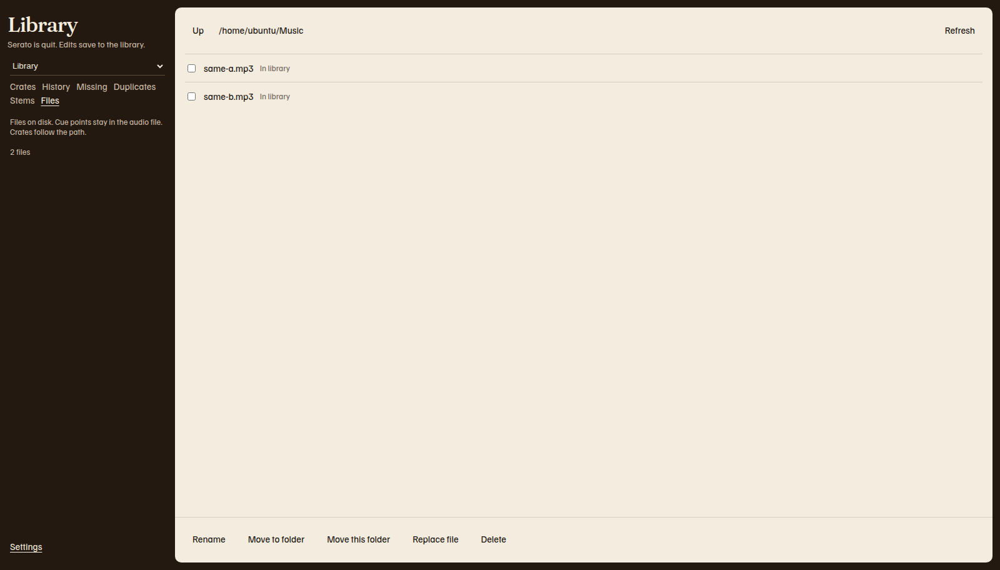

# Files

**Files** browses folders on this computer. Rename, move, replace, and delete update Serato's library so crates, history, and Prepare stay on the track. Cue points stay inside the audio file.

The note under the view buttons says **Files on disk. Cue points stay in the audio file. Crates follow the path.**

The path in the picture is the sample computer's Music folder. Yours will be a folder on your computer. The buttons stay off until you tick a file. **Move this folder** moves the folder in the path line, so it does not need a tick.

!!! note "Files and version 0.1.1"
    Files was added after release v0.1.1. [Install](install.md) explains which download includes it.

Quit Serato DJ Pro before any of these actions. The buttons stay off while Serato has the library. [Safety and backups](safety.md) covers the backup that runs before the first write. A file change copies the database again before it touches a file.

## Browse

1. Click **Files**.
2. The path line shows the folder. The first folder is your home folder, labeled **Home** when the path is empty.
3. Click a folder name to open it. The button reads **Open** plus the folder name.
4. Click **Up** to go to the parent folder.
5. Click **Refresh** to read the folder again.

Files have a checkbox. A file that is in the library shows **In library**. A shortcut is labeled **shortcut** and cannot be selected. Folders are listed before files.

The line at the bottom of the rail counts the files in the folder. If the folder is large, the status can say **Some files are not listed.**

## Read the review first

Every change opens **Review this change**. The dialog says **Nothing is changed until you confirm.**

The list shows the old path, an arrow, and the new path or **Trash**. Library tracks also name their crates.

| Action | How the review starts | Button that writes |
| --- | --- | --- |
| Rename | Type the name, then click **Review** | **Confirm** |
| Replace | Type the new path, then click **Review** | **Confirm** |
| Move | The plan loads by itself | **Confirm** |
| Delete | The plan loads by itself | **Move to Trash** |

**Confirm** stays off until the plan is accepted. **Cancel** closes the dialog and writes nothing.

If Serato is open, the dialog shows the same status line as the rail and does not save.

## Rename one file

1. Tick one file.
2. Click **Rename**.
3. Edit **New name**. Keep the extension, such as `.mp3`, unless you mean to change it.
4. Click **Review**.
5. Read the plan. It says how many files will be renamed and that library tracks keep their crates.
6. Click **Confirm**.

Rename one file at a time. The new name stays in the same folder. A name cannot contain a slash or a backslash. The names `.` and `..` are refused. If another file already has that name, nothing is renamed.

A missing file cannot be renamed on its own.

## Move files to a folder

1. Tick one or more files.
2. Click **Move to folder**.
3. The page says **Choose the destination folder. Then confirm the move.**
4. Open the destination folder.
5. Click **Move here**.
6. Read the plan.
7. Click **Confirm**.

**Cancel** next to **Move here** leaves the files where they are.

A move to another drive copies the file, checks the size, then removes the original. Crates stay on the library track. Saved related-track links follow the new path. [Related tracks](related.md) explains those links.

A missing file cannot be moved on its own.

## Move the folder you are in

**Move this folder** moves the folder in the path line, not a ticked file.

1. Open the folder you want to move.
2. Click **Move this folder**.
3. Browse to the destination. Do not open a folder inside the one you are moving.
4. Click **Move here**.
5. Read the plan. It counts the library tracks that keep their crates.
6. Click **Confirm**.

The home folder, a whole drive, the library folder, and a folder of backups cannot be moved. A folder cannot be moved into itself. Paths for missing tracks inside the folder are still updated.

## Replace a file

Replace points one library track at a different audio file. Crates, history, and the other library fields stay on that track. The old file stays on disk.

1. Tick one file that is **In library**.
2. Click **Replace file**.
3. In **New file**, type the full path of the replacement.
4. Click **Review**.
5. Read the plan and the cue note.
6. Click **Confirm**.

Cue points are copied only when that is safe. The dialog tells you which case you are in.

| What the dialog says | What it means |
| --- | --- |
| **Cue points will be copied onto the new file.** | The new file can take Serato's markers. After you confirm, they are copied. |
| **Cue points were copied onto the new file.** | The copy finished. |
| **The new file already has Serato cue points, so they were left as they are.** | The new file keeps its own cues. |
| **The old file has no Serato cue points to copy.** | There was nothing to copy. |
| **The old file is not on disk, so its cue points were not copied.** | The old path has no file to read. |
| **Cue points stay on the old file. This file type cannot take a Serato tag safely.** | The new file was not rewritten. Your cues are still on the old file, which is still on disk. |
| **Cue points could not be copied. The new file was left unchanged.** | The copy failed. The new file was not given a partial tag. |

A plain MP3 can take the markers. Many other kinds of file cannot. When the dialog says the cues stay on the old file, keep that file until you have checked the new one in Serato.

## Delete

Delete removes the track from the library and its crates, and moves the audio file to the Trash.

1. Tick one or more files. Do not tick a folder. Folders stay.
2. Click **Delete**.
3. Read the plan. It says the file will move to the Trash and leave the library and its crates.
4. Click **Move to Trash**.

On a Mac, the file goes to the Trash. On Windows, it goes to the Recycle Bin. The button still says **Move to Trash**. Open the Trash or the Recycle Bin to put the file back. The library row is already removed. Restore a [backup](safety.md#restore-a-backup) if you need the library row back as well.

A missing library file can be removed from the library. Nothing is put in the Trash, because the file is not on disk.

Shortcuts are left alone.

## What the app will not change

These are refused before anything is written:

- `master.sqlite`, `root.sqlite`, and the files beside the database that Serato uses while it is open.
- Anything inside `Library/Backups`.
- A shortcut.
- A rename or a move onto a name that is already taken. The whole batch is refused.
- The library folder, your home folder, or a disk root, when the action is **Move this folder**.

## If a change is interrupted

Closing the app in the middle of a file change leaves a journal at `Library/Backups/file-ops-journal.json`.

1. Quit Serato DJ Pro.
2. Open Serato Library again.

The app finishes the change or puts the files back. If the journal and the library do not match, the next save is refused. The message is **An interrupted file change does not match the library. Restore the copy in Library/Backups.** Follow [Restore a backup](safety.md#restore-a-backup). Do not delete the journal by hand before you restore.
