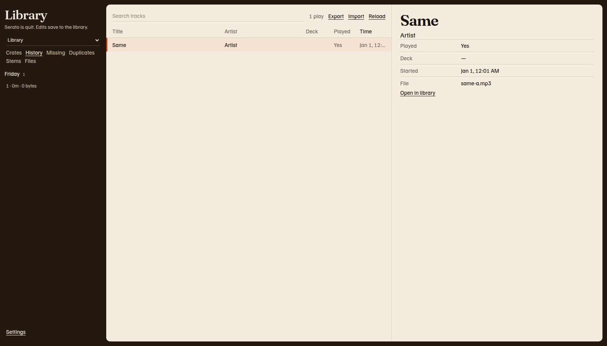

# History

History is the record of tracks Serato has played. This view reads that record. It does not edit it.

1. Click **History**.
2. Click a session in the list. The name is the session name, or **Session** when Serato stored no name. The number is how many tracks were played.
3. Read the rows. The columns are **Title**, **Artist**, **Deck**, **Played**, and **Time**. Time is when the play started. The list starts with the latest play.

The count above the list says **plays**, not tracks.

## Open the library track

1. Click a history row.
2. Read **Played**, **Deck**, **Started**, and **File**. **Notes** appears when the entry has notes.
3. Click **Open in library** when the button is there.

**Open in library** switches to the Library space, selects **Crates** and **All tracks**, and opens that track. A history row with no library track has no **Open in library** button.

If the sessions cannot be read, the page says **Could not read history.** If one session fails, it says **Could not read that session.** With no session selected, the list says **Choose a session.**
