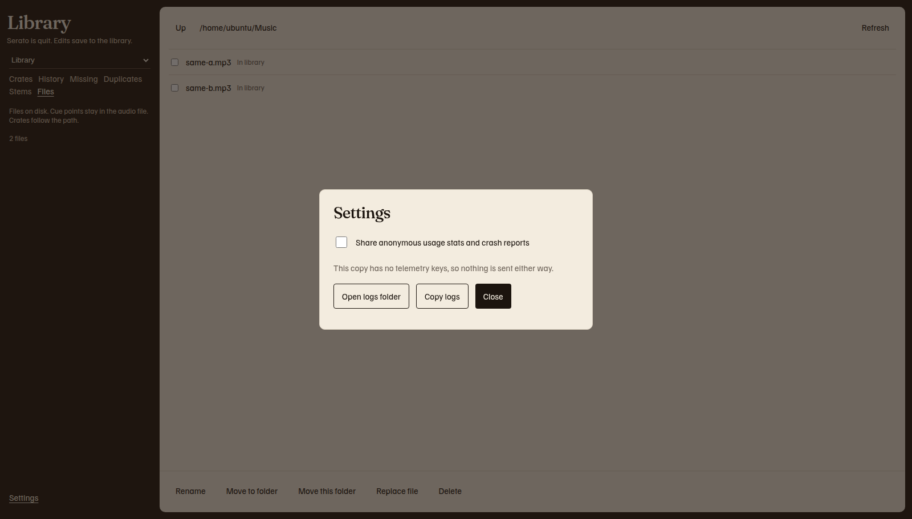

# Settings and privacy

Sharing is off until you turn it on. Track titles, crate names, file paths, and the rows in the library are not usage reports.

## The first question

Setup asks **Share anonymous usage stats and crash reports?** on its own step, after the safety snapshot. The step is skipped when a choice is already saved.

The text under the heading says counts and actions only, plus the app name, the app version, and the operating system. Track titles, crate names, file paths, and library contents stay on this computer. Sharing stays off unless you turn it on.

| Choice | What is saved |
| --- | --- |
| **No, don't share** | Sharing stays off. This button is first. |
| **Yes, share** | Anonymous counts and crash reports can be sent, and only when this copy of the app has a key for that service. |
| Esc, or **Cancel** | Setup closes. The sharing choice is not saved. Setup shows again next time. |

The two buttons have the same weight. The line **Saving…** means the choice is being written. **Couldn't save that choice. Try again.** means it was not written. You stay on the step so you can choose again.

## Settings later

1. Click **Settings** at the bottom of the left rail.
2. Tick **Share anonymous usage stats and crash reports** to turn sharing on. Clear the tick to turn it off.
3. Read the line under the tick.
4. Choose **Run setup again** to see the first-run steps another time. **Cancel** on that run leaves the library as it is and does not forget that you already finished setup.
5. Click **Close**.

| Line under the tick | Meaning |
| --- | --- |
| **This copy has no telemetry keys, so nothing is sent either way.** | The choice is saved, and this copy has nothing to send. A release build can have keys. A copy you run from source often does not. |
| **Anonymous counts and crash reports can be sent.** | Sharing is on, and a key is present. |
| **Nothing is sent.** | Sharing is off. |

## What can leave the computer

Only after you choose Share, and only when the app has a key:

- A count of an action, such as opening the app, scanning the library, creating a crate, making a backup, reading cues, saving a related link, writing a related crate, merging duplicates, or changing files.
- A track-count range, not the exact number of tracks.
- For a file change, a file-count range and the kind of change, such as rename or move. The file name and the path are not included. A replacement can also say whether cue points were copied, without naming the file.
- For a related link, whether it was one-way or two-way. The note, the rating, and the title are not included.
- For a duplicate merge, only the fact that a merge finished.
- The app name, the app version, and the operating system.
- A random install id that is not your name and not a Serato account.
- A crash report, which is the error type and a stack trace. A file path in that report is replaced.

The full list is [PRIVACY.md](https://github.com/mookiejones/serato-library-manager/blob/main/PRIVACY.md).

## What stays here

Titles, artists, crate names, playlist text, notes, ratings, file paths, and the library database are not sent as usage properties. The page does not load a third-party script. Logs are not uploaded.

`related.sqlite` stays on this computer. It is your links, not a report. The path is in [Related tracks](related.md).

## Logs

The log is `serato-library.log`. It can include the path of the library database. It rotates when it reaches 1 MiB and keeps three older files.

| System | Folder |
| --- | --- |
| macOS | `~/Library/Logs/Serato Library/` |
| Windows | `%LOCALAPPDATA%\Serato Library\Logs\` |

1. Click **Settings**.
2. Click **Open logs folder** to open that folder. The line says **Opened the logs folder.** or **Couldn't open the logs folder.**
3. Click **Copy logs** to put the log on the clipboard. The line says **Copied the logs.** A long log says **Copied the latest log entries. Older entries were left out.** An empty log says **No log entries yet.**

If the copy fails, a box of log text appears. The line says **Couldn't copy automatically. Select the log text and copy it.**

## Where the choice is stored

| System | Settings file |
| --- | --- |
| macOS | `~/Library/Application Support/Serato Library/settings.json` |
| Windows | `%APPDATA%\Serato Library\settings.json` |

This folder is **Serato Library**, with a space. It is separate from `Serato/Library`, which holds `master.sqlite`. The same file records whether setup has finished, the window size, and the width of the track list. A new install runs setup until you choose **Open my library**. It also stores the Rekordbox export bar: Memory cues, Hot loops, and the key notation. Those choices stay on this computer. If setup was pointed at a library that is not in the usual folder, `library.json` in this same folder remembers that file. The path stays on this computer. It is not a usage report.
