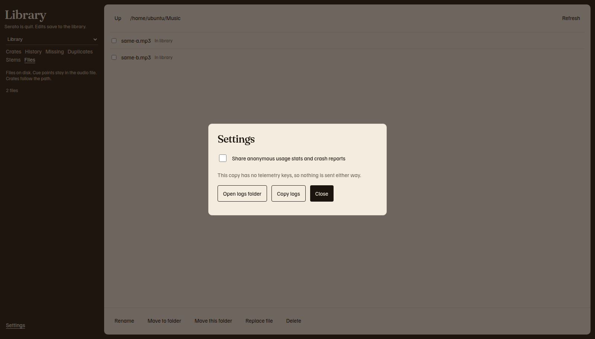

# Settings and privacy

Sharing is off until you turn it on. Track titles, crate names, file paths, and the rows in the library are not usage reports.

## The first question

Setup asks **Share anonymous usage stats and crash reports?** on its own step, after the safety snapshot. The step is skipped when a choice is already saved.

The text under the heading says counts and actions only, plus the app name, the app version, and the operating system. Track titles, crate names, file paths, and library contents stay on this computer. Sharing stays off unless you turn it on.

| Choice | What is saved |
| --- | --- |
| **No, don't share** | Sharing stays off. This button is first. |
| **Yes, share** | Anonymous counts and crash reports can be sent, and only when this copy of the app has a key for that service. |
| Esc, or **Cancel** | Setup closes. The sharing choice is not saved. Setup shows again next time. |

The two buttons have the same weight. The line **Saving…** means the choice is being written. **Couldn't save that choice. Try again.** means it was not written. You stay on the step so you can choose again.

## Checking for new versions

Setup then asks **Check for new versions?** on its own step, when you have not answered before. Once a day, the app can ask GitHub whether a newer version is out. GitHub sees your IP address and this app's version. Nothing about your library is sent.

| Choice | What happens |
| --- | --- |
| **No, don't check** | The app never contacts GitHub. This button is first. |
| **Yes, check** | Once a day the app asks GitHub. When a newer version is out, a strip at the top of the page says so. |

The strip has **Download**, which opens that version's page on GitHub in your browser (the app does not download or install anything itself), **Skip this version**, which stops telling you about that version but not a later one, and **Not now**, which hides the strip until the app opens again. Test versions (beta and release candidates) are only shown if you tick **Include test versions** in Settings.

## Settings later

1. Click **Settings** at the bottom of the left rail. Settings opens as a page in the main area, not a popup.
2. Tick **Share anonymous usage stats and crash reports** to turn sharing on. Clear the tick to turn it off.
3. Read the line under the tick.
4. Tick **Check GitHub for a newer version once a day** to turn the update check on, and **Include test versions (beta and release candidates)** to hear about those too. The second tick is greyed out while the first is off. If a choice cannot be saved, the line under them says **The update choice could not be saved.** and the tick goes back.
5. Pick a **Theme**: **Serato-like** (the default), **Dark Club**, **Light**, or **Classic**. The whole page uses that token set. A stripe on the sidebar and the icon preview follow it. **App icon follows the theme** is on unless you clear it. On a Mac the Dock icon of the running app changes. On Windows the window and taskbar icon change. The Finder icon and the Windows program icon stay the baked default from launch. On another system the line under the checkbox says the choice is saved for Mac and Windows. If the choice cannot be saved, that line says so, and the theme stays for this session.

   
   
   
   
6. Read **Keyboard shortcuts**. **?** opens Settings on that heading.
7. Pick a **Language**: **Same as the system** follows your computer's language, or choose **English** or **Español**. The whole page changes at once, without reloading the library. If the choice cannot be saved, the line under the picker says so, and the page keeps that language until you close the app.
8. Choose **Run setup again** to see the first-run steps another time. **Cancel** on that run leaves the library as it is and does not forget that you already finished setup.
9. Read **About**. The line is the version of this copy, such as **v1.4.2**. A development copy can also show a short commit. Click **Copy version** to put that line on the clipboard. The next line says **Copied**. When the version cannot be read, About says **Version unavailable**. The sidebar does not repeat the version. The page does not show an error code.
10. Click **Close**.

| Line under the tick | Meaning |
| --- | --- |
| **This copy has no telemetry keys, so nothing is sent either way.** | The choice is saved, and this copy has nothing to send. A release build can have keys. A copy you run from source often does not. |
| **Anonymous counts and crash reports can be sent.** | Sharing is on, and a key is present. |
| **Nothing is sent.** | Sharing is off. |

## What can leave the computer

Only after you choose Share, and only when the app has a key:

- A count of an action, such as opening the app, scanning the library, creating a crate, making a backup, reading cues, saving a related link, writing a related crate, merging duplicates, or changing files.
- A track-count range, not the exact number of tracks.
- For a file change, a file-count range and the kind of change, such as rename or move. The file name and the path are not included. A replacement can also say whether cue points were copied, without naming the file.
- For a related link, whether it was one-way or two-way. The note, the rating, and the title are not included.
- For a duplicate merge, only the fact that a merge finished.
- The app name, the app version, and the operating system.
- A random install id that is not your name and not a Serato account.
- A crash report, which is the error type and a stack trace. A file path in that report is replaced.

The full list is [PRIVACY.md](https://github.com/mookiejones/crateCraft/blob/main/PRIVACY.md).

## What stays here

Titles, artists, crate names, playlist text, notes, ratings, file paths, and the library database are not sent as usage properties. The page does not load a third-party script. Logs are not uploaded.

`related.sqlite` stays on this computer. It is your links, not a report. The path is in [Related tracks](related.md).

## Logs

The log is `cratecraft.log`. It can include the path of the library database. It rotates when it reaches 1 MiB and keeps three older files.

| System | Folder |
| --- | --- |
| macOS | `~/Library/Logs/crateCraft/` |
| Windows | `%LOCALAPPDATA%\crateCraft\Logs\` |

1. Click **Settings**.
2. Click **Open logs folder** to open that folder. The line says **Opened the logs folder.** or **Couldn't open the logs folder.**
3. Click **Copy logs** to put the log on the clipboard. The line says **Copied the logs.** A long log says **Copied the latest log entries. Older entries were left out.** An empty log says **No log entries yet.**

If the copy fails, a box of log text appears. The line says **Couldn't copy automatically. Select the log text and copy it.**

A snackbar that names a file and says to open the local log from Settings is pointing at this folder. The full path of that file is in the log. The snackbar does not ask you to delete a journal file.

## Help

**Help** is at the bottom of the left rail, between **Shortcuts** and **Settings**. It does not change the library. Nothing is sent until you submit it on GitHub.

1. Click **Help**.
2. The line under the title is the version of this copy, the same line as **About**. When the version cannot be read, it says **Version unavailable**.
3. The note says **Nothing is sent until you submit it on GitHub.**
4. Click **Report a bug** or **Request a feature**. **View on GitHub** opens the repository in your browser. **Release notes** opens the releases page in your browser. Neither one replaces this window. **Close** leaves the dialog.

**Report a bug** asks **What happened** and **What you expected**. **Request a feature** asks **What should change** and does not ask what you expected. The note on that screen says **You will see this on GitHub before it is submitted. The app does not post it.**

**What will be included** is shown before the browser opens:

| Line | Meaning |
| --- | --- |
| **App version** | This copy of crateCraft. |
| **Commit** | The short commit, when this copy has one. |
| **Operating system** | The computer's system. |
| **Python** | The Python version this copy is running. |
| **Serato version** | The Serato DJ Pro version this computer reports. |
| **Serato build** | The Serato build. It can change when the version number does not. |
| **Protect Library** | **on**, **off**, or **unknown**. **unknown** means this is not Serato 5, or the setting could not be read. |

Your home folder, in the words you typed and in the log, is shown as `~`. Track names and crate names from the log are left out unless you tick **Include track and crate names from the log**.

1. Read **What will be included**.
2. Click **Copy log** to put the redacted log on the clipboard. The line says **Log copied.** A long log says **Copied the latest log entries. Older entries were left out.** An empty log says **The log is empty.**
3. Click **Open on GitHub**.

While the link is being built, the line says **Opening…**. When the browser opens, it says **Opened in your browser. Review it, then submit it on GitHub.** If the report is too long for a link, the app copies it instead and says **The report is too long for a link. It was copied. Paste it into the GitHub issue.** A report that was copied but still has a link says **Copied. Paste it into the GitHub issue.**

If the copy fails, a box of the report appears. The line says **Couldn't copy the report.** or **Couldn't copy automatically. Select the log text and copy it.** If the diagnostics cannot be read, the line says **Couldn't load the diagnostics.** The page does not show the server's error text.

**About** in **Settings** also has **View on GitHub**. It opens the same repository in your browser, so this window stays on the library.

## Where the choice is stored

| System | Settings file |
| --- | --- |
| macOS | `~/Library/Application Support/crateCraft/settings.json` |
| Windows | `%APPDATA%\crateCraft\settings.json` |

This folder is **crateCraft**. Before the rename it was **Serato Library**; the first launch of crateCraft copies that folder here and leaves the original. It is separate from `Serato/Library`, which holds `master.sqlite`. The same file records whether setup has finished, the window size, the width of the track list, the language you picked, the theme, and whether the app icon follows that theme. A new install runs setup until you choose **Open my library**. It also stores the Rekordbox dialog choices: Memory cues, Hot loops, and the key notation. Those choices stay on this computer. If setup was pointed at a library that is not in the usual folder, `library.json` in this same folder remembers that file. The path stays on this computer. It is not a usage report.
