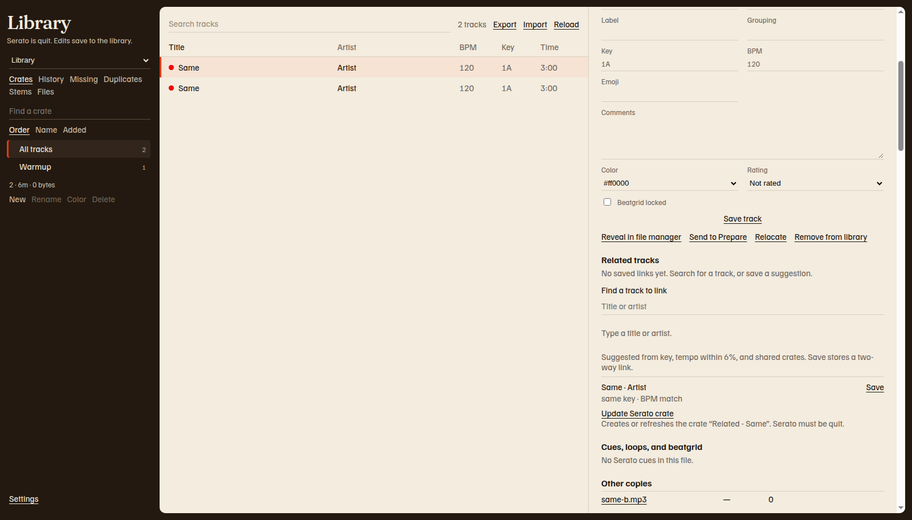

# Track details

Open a track from any list except History. The right side shows the title, the artist, BPM, key, and length. A blank value shows a dash.

The picture was taken on the sample computer, so reveal reads **Reveal in file manager**. On a Mac it reads **Reveal in Finder**. On Windows it reads **Reveal in File Explorer**. A color Serato stored outside the named list shows as a hex value, such as `#ff0000` in this sample.

The lock line repeats the status under **Library**. When it says Serato is quit, the form can be saved. [Safety and backups](safety.md) is the full rule.

## What Save track writes

**Save track** writes the library database. It does not rewrite the audio file. Finder, File Explorer, and other tag editors are separate. Cue points stay in the file. The section **Cues, loops, and beatgrid** says **Read from the audio file. These are not written back.**

If the file is missing, that section says **The file is not on disk, so cues cannot be read.** If the file has no Serato markers, it says **No Serato cues in this file.**

## Fields you can edit

| Field | Notes |
| --- | --- |
| Title, Artist, Album, Genre, Year | Song text stored by Serato |
| Composer, Remixer, Label, Grouping | Song text stored by Serato |
| Key, BPM, Emoji, Comments | BPM has to be a number from 0 to 999 |
| Color | None, Red, Orange, Yellow, Green, Blue, Purple, Pink, or Custom when Serato stored another color |
| Rating | Not rated, or 1 to 5 stars |
| Beatgrid locked | A tick locks the beatgrid flag in the library |

1. Change the fields you want.
2. Click **Save track**.

The bar says **Saved.** If BPM is not a number, the page says **BPM needs a number.** A value outside 0 to 999 says **BPM needs to be between 0 and 999.**

Other groups under the form, such as **Song**, **File**, and **Status**, are for reading. **Search copies** is closed until you open it. Those lines are copies Serato keeps for search. They are not a second set of fields to type into.

## Buttons under the form

| Button | Action |
| --- | --- |
| **Reveal in Finder** on a Mac, **Reveal in File Explorer** on Windows | Shows the audio file. The button stays off when the file is not on disk. |
| **Send to Prepare** or **Remove from Prepare** | Adds or removes the track in Prepare. See [Prepare](prepare.md). |
| **Relocate** | Asks **Path to the audio file**. Saves that path on the library row. The page says **File location saved.** |
| **Remove from library** | Asks you to confirm. The audio file stays on disk. The track leaves the library and its crates. |

**Relocate** updates the path Serato has stored. It does not move the file. To move the file and update the path together, use [Files](files.md).

## Other copies

When another track has the same title, artist, and length in whole seconds, **Other copies** lists it. Click a file name to open that copy. [Duplicates](duplicates.md) is the view for merging them.

## Related tracks

The **Related tracks** section is on every track that has a file path. [Related tracks](related.md) explains links, suggestions, and the live view.
