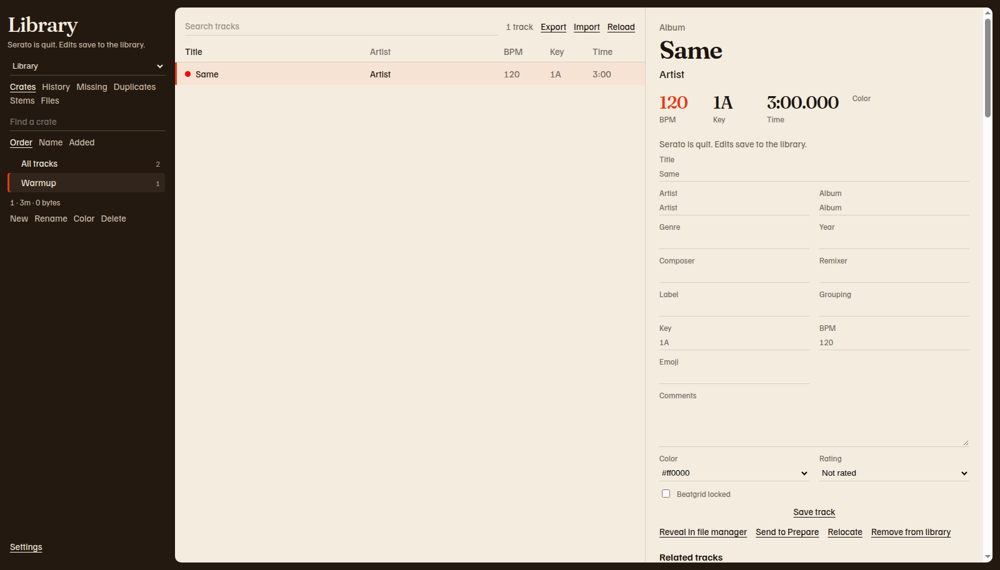
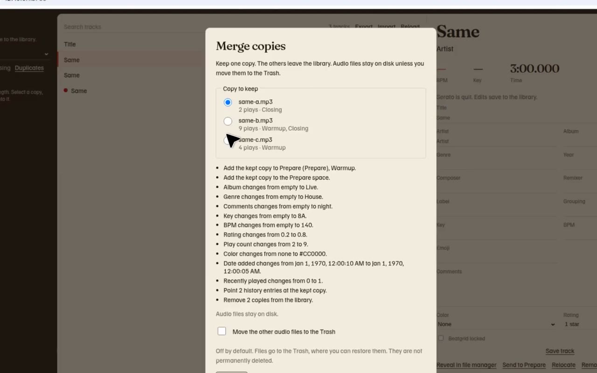

# Serato Library

Serato Library is a window on your computer for the Serato DJ Pro library. Browse crates, fix track details, clean up duplicate copies, and move files without sending your music anywhere.

The app talks only to this computer. It is not a website you log in to. Your tracks, crate names, and file paths stay here.

The first time you open it, setup finds your library and saves a safety copy before anything can change.

[Quick Start](quick-start.md) is five short steps. [Install the app](first-install.md). Read [Safety and backups](guide/safety.md) before the first edit.

## What you can do

- [Browse crates and tracks](guide/crates.md), and make, rename, color, and delete crates.
- [Play a track](guide/playback.md) in the window before you crate or tag it. Playback does not change the file.
- [Edit track details](guide/tags.md) that Serato stores in the library. Cue points stay in the audio file.
- Read [History](guide/history.md), find [missing files](guide/missing.md), and see [stems](guide/stems.md).
- [Merge duplicate copies](guide/duplicates.md) into the file you want to keep.
- Send tracks to [Prepare](guide/prepare.md).
- [Import and export M3U playlists](guide/playlists.md), and export rekordbox.xml for CDJs. [Moving between Serato and Rekordbox](coming-from-rekordbox.md) lists what that file keeps.
- [Save related tracks](guide/related.md), and open the live view in the separate listener app while you play.
- [Rename, move, replace, and trash files](guide/files.md) so crates and history follow the file.
- [Keep hash-checked snapshots and restore one](guide/safety.md#snapshots), including crates on each drive and the cue data stored in audio files. The music itself is not copied into the snapshot. Restore can rewrite the Serato tags (cue points, beatgrid, autotags) inside each audio file, and removes Serato tags the snapshot didn't have. The audio stream is hash-checked before and after; if it would change, the file is left as it was.
- Change [sharing, and open the log](guide/settings.md).
- Use [keyboard shortcuts](guide/shortcuts.md) to search, switch views, and move through a list. **Shortcuts** is at the bottom of the sidebar.

Pictures in this guide use a small sample library, not your collection.

## Duplicate merge

The recording below is also on the [Duplicates](guide/duplicates.md) page, where it plays in the page. Select the picture to open the video file.

## If something looks wrong

Start with [Troubleshooting](guide/troubleshooting.md).

The [Panic page](panic.md) covers red tracks, empty crates, a drive that will not mount, and a library that looks different after an update. Restore from the app is **Snapshots**, then **Review restore**.

[Is my library safe?](is-my-library-safe.md) describes restore, undo, snapshots, and the outside-change watcher. Those work. The gig check on that page is **PREVIEW** until [#41](https://github.com/mookiejones/serato-library-manager/issues/41) merges. It is not in the app.

## For developers

The pages above are the user guide. The code reference, the GitHub setup, and the related-tracks file format stay in the repository and are linked from the **For developers** section of this site. They are not part of the DJ guide.
