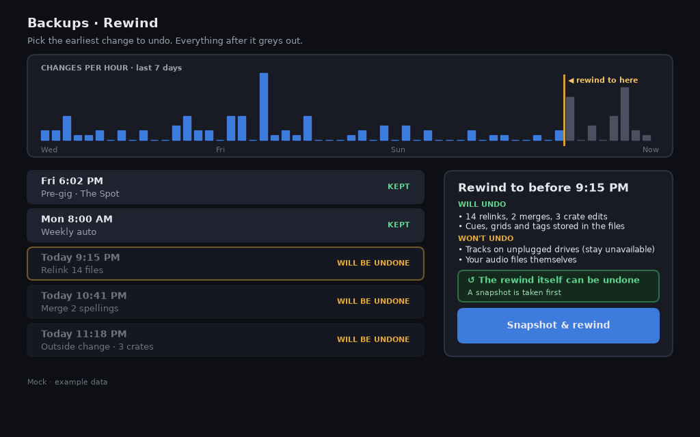
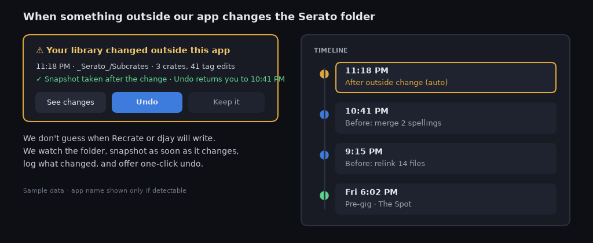

# Is my library safe?

Restore, undo, snapshots, and the outside-change watcher are in the app. Open **Snapshots**. The sidebar views include **Crates** and **Snapshots**. **Prepare** is a space in the space menu. [Safety and backups](guide/safety.md#snapshots) is the step-by-step page.

!!! warning "PREVIEW"

    The gig check is **PREVIEW** until [#41](https://github.com/mookiejones/serato-library-manager/issues/41) merges. It is not in the app. The Rekordbox export in the first rule is already shipped. See [Coming from Rekordbox](coming-from-rekordbox.md).

## The rules we follow
- **Read first.** Checks, reports and the Rekordbox export only read your Serato files. The export writes a separate XML file and never writes back (see [Coming from Rekordbox](coming-from-rekordbox.md)).
- **No write while unsure.** If we can't confirm Protect Library and Lucid Beatgrid status, we won't write at all.
- **Snapshot first.** Before any change, we save a snapshot and check it against what's on disk.
- **Check the write.** After a save, the app reads a copy of the database, including a live `-wal` file, and checks the rows and file hashes. If they do not match, it puts that snapshot back and checks the hashes again. Serato 5 stays read-only. Rollback does not write a Serato 5 library. If there is no room for the snapshot, the save does not run.
- **Every restore can be undone.** A restore takes its own snapshot first.
- **A missing drive is never a deletion.** Its tracks and crates are marked unavailable, never removed.
- **Empty crates.** Serato deletes empty crates when it closes. The gig check that would flag them first is **PREVIEW** until [#41](https://github.com/mookiejones/serato-library-manager/issues/41) merges. It is not in the app.
- **Outside changes get caught.** If another app changes your Serato folder, we take a snapshot, show what changed and offer an undo. We can't catch the moment *before* an outside app writes, so undo returns you to our last snapshot. In the app that button is **Review undo**.
- **Restore is free.**

## What a restore covers

| Restores | Doesn't restore |
|---|---|
| Crates and subcrates, on every drive | The audio stream. It is hash-checked before and after. If it would change, the file is left as it was. |
| Serato's library database | Tracks on drives that aren't plugged in (marked unavailable, never deleted) |
| Serato tags in each audio file: cue points, the beatgrid, and autotags. Tags the snapshot lacked are removed. | A move, rename, or trash you make in **Files**. That view can move, rename, and trash audio files. |

Restore can rewrite the Serato tags (cue points, beatgrid, autotags) inside each audio file, and removes Serato tags the snapshot didn't have. The audio stream is hash-checked before and after; if it would change, the file is left as it was.

## Common myths
| Myth | Reality |
|---|---|
| "Protect Library is a backup." | It only blocks removing tracks. It doesn't snapshot or restore. |
| "Serato keeps a history of backups." | Serato keeps one backup and overwrites it each time. |
| "Serato can restore for me." | Serato has no in-app restore; it's a manual file swap. |
| "Backing up `~/Music/_Serato_` is enough." | Each external drive has its own `_Serato_`, and Serato 4+ also uses a database elsewhere. |
| "Missing crates means deleted crates." | Usually the drive isn't mounted or access is blocked. See the [Panic page](panic.md). |

*Example layout, not the current window. The picture lists audio files under what a rewind will not undo. That line is not how restore works. Restore can rewrite the Serato tags (cue points, beatgrid, autotags) inside each audio file, and removes Serato tags the snapshot didn't have. The audio stream is hash-checked before and after; if it would change, the file is left as it was. **Files** can move, rename, and trash audio files. The current control is **Snapshots**, then **Review restore**.*

*Example layout, not the current window. The outside-change watcher is in the app. **Snapshots** shows **Review undo** after another program changes the Serato folder. Undo puts back the previous snapshot.*
