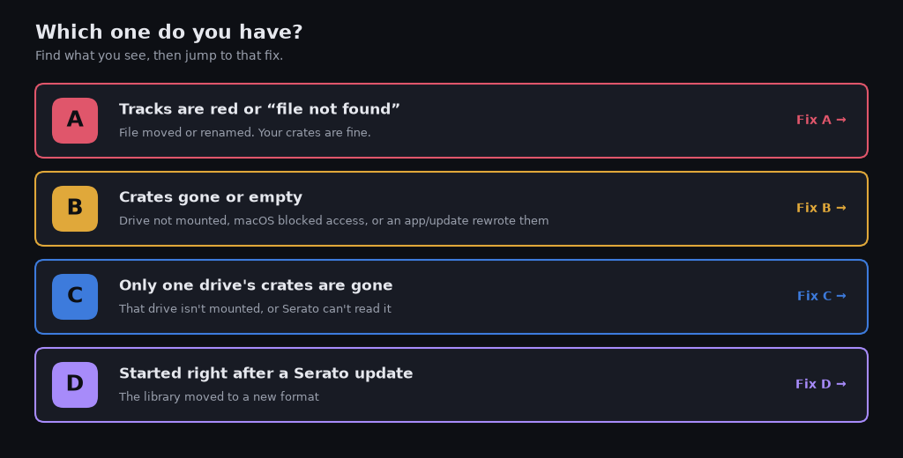
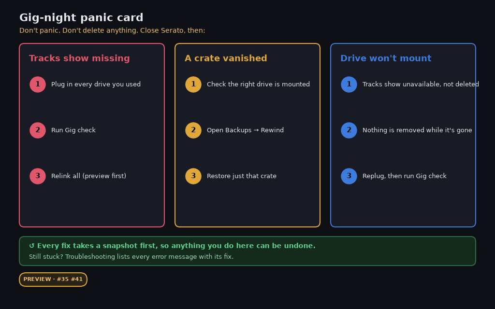

# Panic page: something's wrong before a gig

!!! warning "PREVIEW"

    One-click restore, undo, snapshots, the outside-change watcher, and the gig check are PREVIEW until [#35](https://github.com/mookiejones/serato-library-manager/issues/35) and [#41](https://github.com/mookiejones/serato-library-manager/issues/41) merge. They are not in this app. The steps below use Serato's own tools. The panic card is an example layout, not the current window.

> **Do this first.** Don't delete, re-import or "rebuild" anything yet. Most crates that look gone are only hidden.
> Close Serato, then copy the whole `_Serato_` folder (on every drive) somewhere safe. That way every step below can be undone.

## Which one do you have?

| What you see | Most likely cause | Go to |
|---|---|---|
| Tracks are **red** or "file not found" | The file moved or was renamed. Your crates are fine. | [A](#a-red-or-missing-tracks) |
| Crates **gone** or **empty** | A drive isn't mounted, macOS blocked access, or an outside app or update rewrote them | [B](#b-crates-gone-or-empty) |
| Only **one drive's** crates are gone | That drive isn't mounted, or Serato can't read it | [C](#c-drive-wont-mount) |
| Started right after a **Serato update** | The library moved to a new format | [D](#d-after-a-serato-update) |

*Example data. PREVIEW until #35 and #41 merge. Gig check, rewind, and one-click restore are not in the app.*

## A. Red or missing tracks
1. Plug in every drive your music lives on.
2. In Serato, drag the folder that holds the music onto **Relocate Lost Files** (in the Files panel).
3. Don't restore a backup for this. A restore fixes crates, not file paths.

## B. Crates gone or empty
1. Check that every drive is plugged in and shows up in Finder or Explorer.
2. On a Mac, for an external drive, macOS asks for the **Files and Folders › Removable Volumes** permission under **System Settings, Privacy & Security**. Check that Serato has it. **Full Disk Access** is a secondary thing to check. Unsigned builds may ask for it again after each update.
3. Restart Serato.
4. Still gone? Restore from a backup, either Serato's `_Serato_Backup` folder or a Library Manager snapshot (PREVIEW, see the note at the top).

## C. Drive won't mount
1. Try another cable and port, and check that the drive appears in Disk Utility or Disk Management.
2. Every external drive keeps its own `_Serato_` folder, so its crates come back once it mounts.
3. FAT32 or read-only drives can stop crates from saving.

## D. After a Serato update
- On Serato 4 and later, the live library is a database in Application Support (Mac) or AppData (Windows), not just `_Serato_`.
- Serato 5.0 came out **Oct 19, 2026**. If you updated without a backup, stop and copy both locations before trying anything else.

---

!!! warning "PREVIEW"

    **About Library Manager:** one-click restore, undo, snapshots, the outside-change watcher, and the gig check are PREVIEW until [#35](https://github.com/mookiejones/serato-library-manager/issues/35) and [#41](https://github.com/mookiejones/serato-library-manager/issues/41) merge. Until then, this page only uses Serato's own tools.

Sources: Serato support articles and DJ reports collected in `faq-top20.md` and `docs-references.md`.
