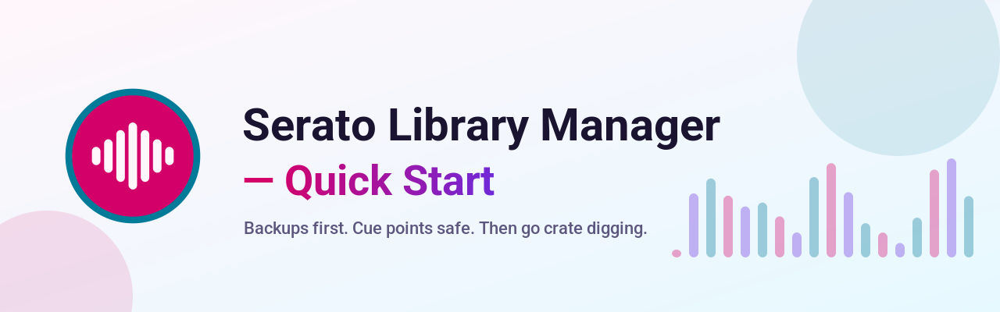
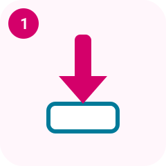
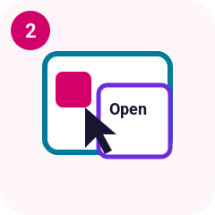

# Quick Start

<!-- The logo on the banner is not approved yet. It may change. -->

<picture>
  <source media="(prefers-color-scheme: dark)" type="image/svg+xml" srcset="wiki/images/quickstart-banner-dark.svg">
  <source media="(prefers-color-scheme: dark)" type="image/png" srcset="wiki/images/quickstart-banner-dark.png">
  <source type="image/svg+xml" srcset="wiki/images/quickstart-banner-light.svg">
  
</picture>

Five moves. Backups first. Cue points safe. Then go crate digging.

GitHub Releases is the only download.

## 1 Download

<figure>
  <picture>
    <source media="(prefers-color-scheme: dark)" type="image/svg+xml" srcset="wiki/images/step-1-dark.svg">
    <source media="(prefers-color-scheme: dark)" type="image/png" srcset="wiki/images/step-1-dark.png">
    <source type="image/svg+xml" srcset="wiki/images/step-1-light.svg">
    
  </picture>
  <figcaption>1 Download</figcaption>
</figure>

Grab the build for your machine from [GitHub Releases](https://github.com/mookiejones/serato-library-manager/releases). No store, no Homebrew, and no winget.

| Your deck | File |
| --- | --- |
| Mac, Apple silicon (arm64) | `Serato-Library-macos-arm64.dmg` |
| Mac, Intel (x64) | `Serato-Library-macos-x64.dmg` |
| Windows installer | `Serato-Library-windows-setup.exe` |
| Windows, no installer | `Serato-Library-windows.zip` |

`SHA256SUMS` sits on that same release.

The release marked Latest is **v0.1.1**. It attaches `Serato-Library-macos.zip` (Apple silicon) and `Serato-Library-windows.zip`. The pre-release **v1.1.0-rc2** has the disk images, the installer, the portable zip, and `SHA256SUMS`.

The unsigned-app warnings, including Removable Volumes, are in [First install](first-install.md).

## 2 Open

<figure>
  <picture>
    <source media="(prefers-color-scheme: dark)" type="image/svg+xml" srcset="wiki/images/step-2-dark.svg">
    <source media="(prefers-color-scheme: dark)" type="image/png" srcset="wiki/images/step-2-dark.png">
    <source type="image/svg+xml" srcset="wiki/images/step-2-light.svg">
    
  </picture>
  <figcaption>2 Open (right-click > Open)</figcaption>
</figure>

The builds are unsigned, so the computer complains once. The warning is expected.

On macOS 14 and earlier, right-click the app and choose **Open**.

On macOS 15 and later, open the app once. Then go to **System Settings > Privacy & Security > Open Anyway**.

On Windows, SmartScreen says it protected your PC. Choose **More info**, then **Run anyway**.

A window titled **Serato Library** opens. It stays on this computer. Close the window to quit.

## 3 Point it at your Serato library

<figure>
  <picture>
    <source media="(prefers-color-scheme: dark)" type="image/svg+xml" srcset="wiki/images/step-3-dark.svg">
    <source media="(prefers-color-scheme: dark)" type="image/png" srcset="wiki/images/step-3-dark.png">
    <source type="image/svg+xml" srcset="wiki/images/step-3-light.svg">
    
  </picture>
  <figcaption>3 Point it at your Serato library</figcaption>
</figure>

Choose **Get started**. When the page names your library, choose **Use this library**.

Nothing there yet? Open Serato DJ once, quit it, and choose **Check again**. If the library is already in another folder, choose **Choose a folder**.

**Cancel** leaves the library alone. Setup comes back until you choose **Open my library**.

**Get started**, **Use this library**, and **Take a safety snapshot** are in the app on `main`. They are not in the v0.1.1 download or the v1.1.0-rc2 pre-release.

## 4 Make a Backup

<figure>
  <picture>
    <source media="(prefers-color-scheme: dark)" type="image/svg+xml" srcset="wiki/images/step-4-dark.svg">
    <source media="(prefers-color-scheme: dark)" type="image/png" srcset="wiki/images/step-4-dark.png">
    <source type="image/svg+xml" srcset="wiki/images/step-4-light.svg">
    
  </picture>
  <figcaption>4 Make a Backup</figcaption>
</figure>

Quit Serato DJ Pro if it is open. Choose **Take a safety snapshot**. This copy is your first Backup.

Cue points live in the audio file. The snapshot keeps those frames with the library and the crates on each drive.

If Serato is still open, the page says **Close Serato DJ to continue**.

**No, don't share** leaves anonymous stats off. **Yes, share** is the other choice. Then choose **Open my library**.

Later, open **Snapshots**. **Review restore** shows the plan before anything is written. Restore can rewrite the Serato tags (cue points, beatgrid, autotags) inside each audio file, and removes Serato tags the snapshot didn't have. The audio stream is hash-checked before and after; if it would change, the file is left as it was.

## 5 Start crate digging

<figure>
  <picture>
    <source media="(prefers-color-scheme: dark)" type="image/svg+xml" srcset="wiki/images/step-5-dark.svg">
    <source media="(prefers-color-scheme: dark)" type="image/png" srcset="wiki/images/step-5-dark.png">
    <source type="image/svg+xml" srcset="wiki/images/step-5-light.svg">
    
  </picture>
  <figcaption>5 Start crate digging</figcaption>
</figure>

You land in **Crates**. The space menu reads **Library**, **Video**, **Apple Music**, or **Prepare**.

Use **Search tracks**, then click a tune. Cue points show on the right. They are read from the audio file. Press `/` to jump to that search. Press Ctrl+K (Command+K on a Mac) to find a track or a file on disk. **Shortcuts**, at the bottom of the sidebar, lists the other keys.

Double-click a row, press **Enter**, or click **Play**, to hear it. **Space** plays or pauses. **Left** and **Right** move 5 seconds. The bar under the list shows the title, the artist, previous and next, pause, a seek bar with the file's cue points, and volume. Playback does not write to the audio file and does not add a history row.

The other views are **History**, **Missing**, **Duplicates**, **Stems**, **Files**, and **Snapshots**.

**Hot loops** sits beside **Memory cues**. It starts off, and it uses a free hot-cue pad.
