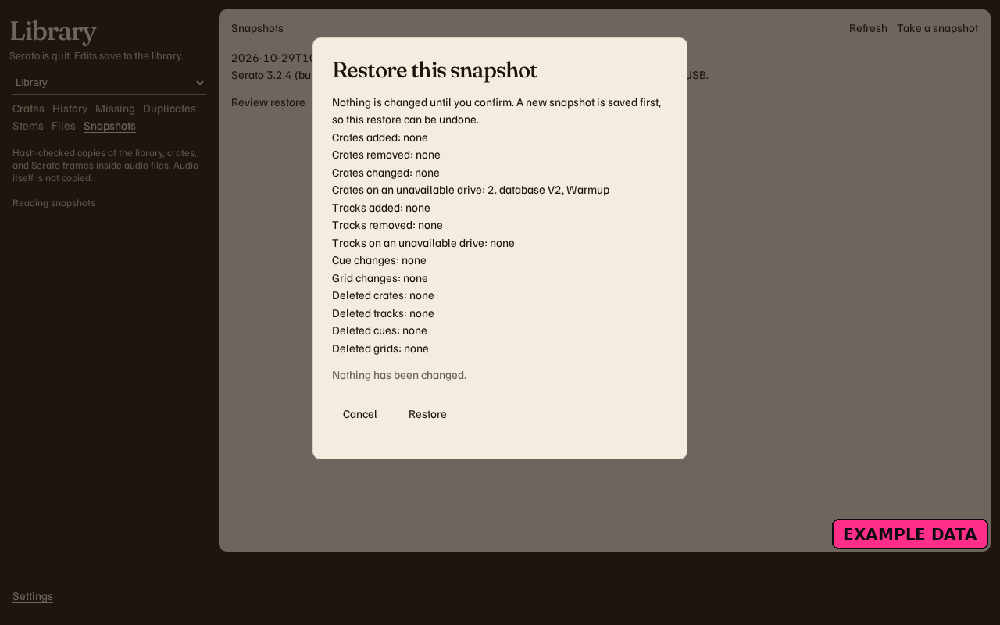
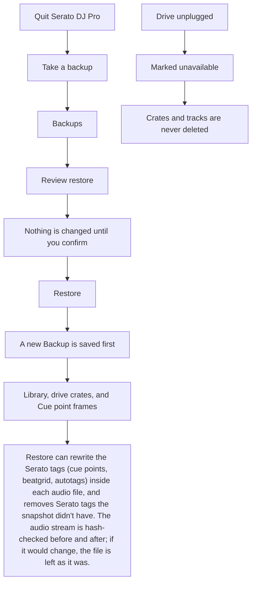

# Backups and restore

Backups in the sidebar are the snapshots you restore. That flow is in the app.

**Backups** keeps each drive's crates. The first save in a session also copies those `_Serato_` folders into `Library/Backups/serato-web-…/drives`. An unplugged drive is listed and skipped.

<figure>
  
  <figcaption>Example data. Review restore is open. The outside-change banner that setup left above the list was cropped off.</figcaption>
</figure>

Open **Backups**. **Take a backup** sits above a table of snapshots with **When**, **Size**, and **Status**. **Take a backup** saves a hash-checked Backup of the library database, the crates on each drive (the `_Serato_` folder and `database V2`), and the Cue point, beatgrid, and autotag frames inside the audio files. The music itself is not copied. Snapshots are kept. This page does not delete old ones.

**Review restore** on a row shows crates, tracks, Cue changes, and grid changes. It also lists crate files the library has not heard of. Serato 4 and 5 delete those files the next time Serato opens, so restore writes them into the library as well as putting the files back. If the library has no Serato Library space, those files are put back but not registered, and the plan says Serato may remove them on the next launch. The rest of the restore still finishes. **Nothing is changed until you confirm.** **Restore** saves a new snapshot first, so the list can undo it. If the app stops in the middle, the next open puts that saved snapshot back.

Restore can rewrite the Serato tags (cue points, beatgrid, autotags) inside each audio file, and removes Serato tags the snapshot didn't have. The audio stream is hash-checked before and after; if it would change, the file is left as it was.

An unplugged drive is marked unavailable, never deleted. Its crates and tracks stay in the Backup, and a restore does not remove them. The plan lines are **Crates on an unavailable drive** and **Tracks on an unavailable drive**.

Quit Serato DJ Pro before you restore. If Serato is still running, restore stops. On Serato 5, writes and restores run when Protect Library is off. If Protect Library is on or cannot be read, the note names the version and that preference. Lucid beatgrid storage is not parsed. Snapshots can still be taken and read. The newest session log in `_Serato_/Logs` can name Serato 4 or Serato 5. A log that does not name a dotted version is unknown. If the installed version cannot be read, that log does not turn writes back on. An unreadable version does the same: writes and restores stay off until a version can be read.

If something else changes the Serato folder, including Lexicon, the app saves a snapshot after that change and offers **Review undo**. That puts back the previous snapshot. The app does not read or restore `_Serato_/Lexicon/` or `_Serato_/Export Backups/`.

The first save in a session also copies `master.sqlite`, `root.sqlite`, and each connected drive's `_Serato_` folder into `Library/Backups/serato-web-` plus the date and time. Each drive's files stay in their own `drives` directory. An unplugged drive is listed and not copied. A drive whose folder cannot be read is listed and not copied, and the other drives are still saved. The folder does not hold your music. `Recording` and `DJ Sessions` are not copied. If the disk does not have room, the copy is refused. The hash-checked Backups live in `Library/Backups/snapshots`, beside `master.sqlite`. **Back up drive crates**, on Backups, copies connected drives without changing the library.

After a save, the app reads a copy of the database back. If the rows or file hashes do not match, it puts the pre-write copy back. That copy is kept in the app's data folder, not in Serato's library folder. Serato 5 uses that same rollback when Protect Library is off. After a restore writes the files, it checks their hashes. A mismatch puts the snapshot from before the restore back. **Backups** lists each edit and each restore. A change that could not be put back stays in that list and is not shown as finished. A snackbar that names a file (for example `master.sqlite`) and points at this list, or at the local log in Settings, is that same failure. The full path stays in the local log.

On a Mac, external drives need **Files and Folders > Removable Volumes**. The steps are on [Install on a Mac](Install-macOS).
