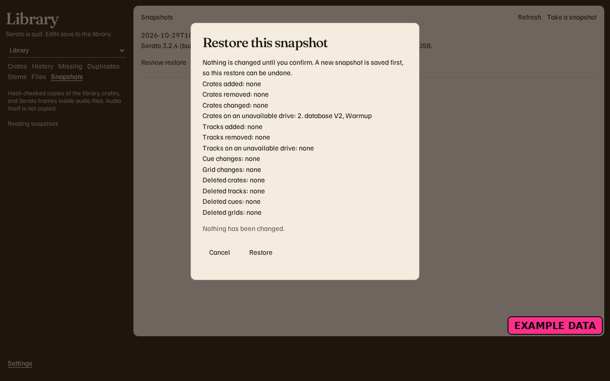
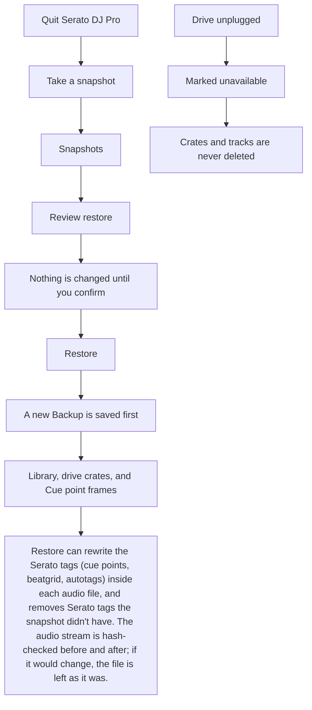

# Backups and restore

Backups you restore are **Snapshots**. That flow is in the app.

> **PREVIEW.** A plain copy of each drive's `_Serato_` folder inside `Library/Backups/serato-web-` is not in the app. [Issue #91](https://github.com/mookiejones/serato-library-manager/issues/91). **Snapshots** already keeps those drive crates.

<figure>
  
  <figcaption>Example data. Review restore is open. The outside-change banner that setup left above the list was cropped off.</figcaption>
</figure>

Open **Snapshots**. **Take a snapshot** saves a hash-checked Backup of the library database, the crates on each drive (the `_Serato_` folder and `database V2`), and the Cue point, beatgrid, and autotag frames inside the audio files. The music itself is not copied. Snapshots are kept. This page does not delete old ones.

**Review restore** shows crates, tracks, Cue changes, and grid changes. **Nothing is changed until you confirm.** **Restore** saves a new snapshot first, so the list can undo it. If the app stops in the middle, the next open puts that saved snapshot back.

Restore can rewrite the Serato tags (cue points, beatgrid, autotags) inside each audio file, and removes Serato tags the snapshot didn't have. The audio stream is hash-checked before and after; if it would change, the file is left as it was.

An unplugged drive is marked unavailable, never deleted. Its crates and tracks stay in the Backup, and a restore does not remove them. The plan lines are **Crates on an unavailable drive** and **Tracks on an unavailable drive**.

Quit Serato DJ Pro before you restore. If Serato is still running, restore stops. On Serato 5, writes and restores stay off. The note names the version, Protect Library, and that Lucid and Flexible beatgrid storage is not verified. Snapshots can still be taken and read. An unreadable version does the same: writes and restores stay off until a version can be read.

If something else changes the Serato folder, including Lexicon, the app saves a snapshot after that change and offers **Review undo**. That puts back the previous snapshot. The app does not read or restore `_Serato_/Lexicon/` or `_Serato_/Export Backups/`.

The first save in a session also copies `master.sqlite` and `root.sqlite` into `Library/Backups/serato-web-` plus the date and time. That folder is the database only. It does not hold your music. The hash-checked Backups live in `Library/Backups/snapshots`, beside `master.sqlite`.

On a Mac, external drives need **Files and Folders > Removable Volumes**. The steps are on [Install on a Mac](Install-macOS).
