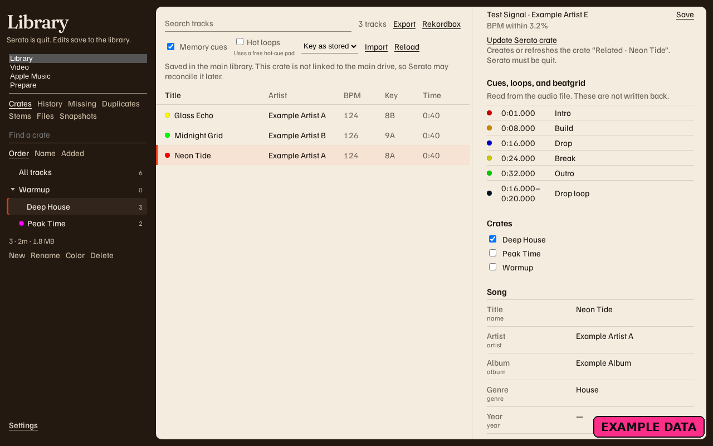
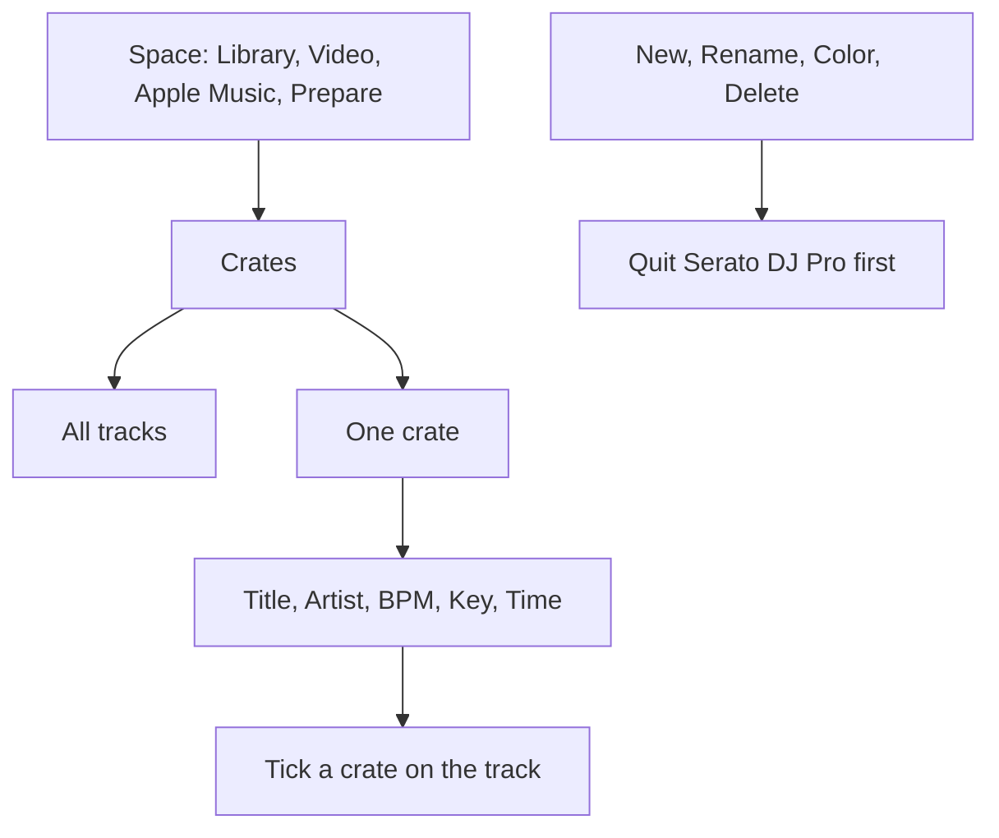

# Crates

<figure>
  
  <figcaption>Example data. Deep House is open, and the track's crate checkboxes are on the right. The space menu is drawn here as an expanded list. In the app it is the native dropdown.</figcaption>
</figure>

**Crates** is the list on the left. The first row is **All tracks**. That row is the whole space. It is not a crate you can rename.

The space menu shows **Library**, **Video**, **Apple Music**, and **Prepare**. Each space has its own crates. Switching space returns you to **All tracks**.

**Find a crate** keeps a parent visible when a nested name matches. **Order** is Serato's own order. **Name** is alphabetical. **Added** is the date the crate was created.

Quit Serato DJ Pro before **New**, **Rename**, **Color**, or **Delete**. The status line under **Library** says when edits can save.

| Button | What you do |
| --- | --- |
| **New** | Type **New crate name**. The crate is created inside the one you had selected. **All tracks** puts it at the top. |
| **Rename** | Type **Rename crate**. The tracks stay. |
| **Color** | Type one of `none`, `red`, `orange`, `yellow`, `green`, `blue`, `purple`, `pink`. |
| **Delete** | Confirm. Nested crates go too. The tracks stay in the library. |

There is no drag and drop. This app does not move an existing crate to a new parent. **New** does not make a smart crate. Make that in Serato, then edit the rules here.

A smart crate shows **smart**. You cannot tick it in the track's crate list. Putting a crate inside it says **A smart crate cannot contain another crate.** Adding a track by hand says **Smart crates choose their tracks from rules.**

To put a song in a crate, open the track, find **Crates**, and tick a normal crate. The audio file stays where it is. Moving, renaming, or trashing the file is [Organizing files](Organizing-Files).
