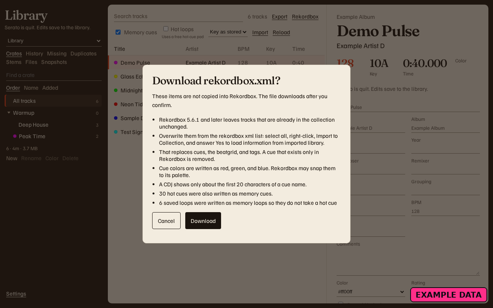
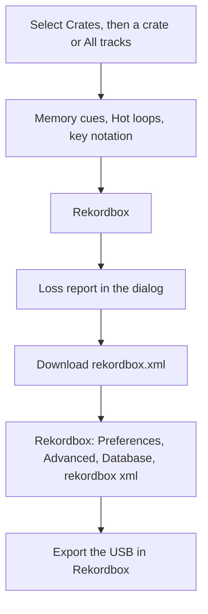

# Export to Rekordbox

> **Status: preview.** Rekordbox XML export is in the app ([PR #39](https://github.com/mookiejones/serato-library-manager/pull/39) is merged). The export is one-way. It does not write the Serato library back.

<figure>
  
  <figcaption>Example data. Memory cues is on, Hot loops is off, and the loss report is in the dialog.</figcaption>
</figure>



**Rekordbox** reads the library and the Cue points in the audio files. It writes `rekordbox.xml`. It does not change the library or the audio files. It does not write a USB, Device Library Plus, or OneLibrary.

1. Select **Crates**.
2. Select the crate, or **All tracks** for the whole space.
3. Leave **Memory cues** on if CDJ screens should see those cues. **Hot loops** starts off. The help line reads **Uses a free hot-cue pad.**
4. Leave **Key as stored**, or choose **Camelot key** or **Classical key**.
5. Click **Rekordbox**.
6. Read the dialog **Download rekordbox.xml?**
7. Click **Download**. **Cancel** writes nothing.

Subcrates become nested playlist folders. A crate that has tracks and subcrates becomes a folder, and its own tracks are a playlist of the same name inside that folder. Smart crates become ordinary playlists. Their rules are not copied.

In Rekordbox 6 and 7 the import is **Preferences**, **Advanced**, **Database**, **rekordbox xml**. A track already in the collection stays as it is until you select the tracks in that list, choose **Import to Collection**, and answer **Yes** to **load information from imported library**. That replaces cues, the beatgrid, and tags in Rekordbox.

The same sentences are in [Moving between Serato and Rekordbox](https://github.com/mookiejones/serato-library-manager/blob/main/docs/coming-from-rekordbox.md). That page keeps **Status: preview.**

From the project folder, the same file and the same report:

```bash
python3 rekordbox.py -o rekordbox.xml
```
