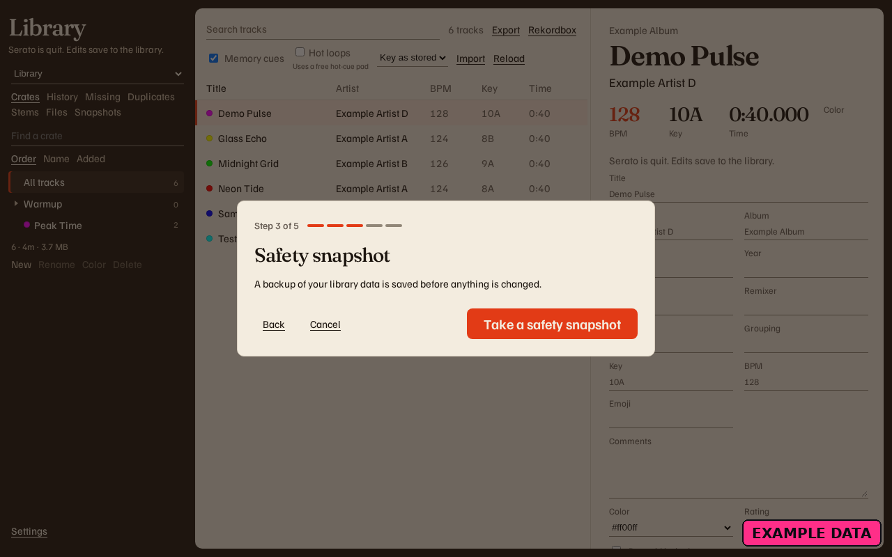
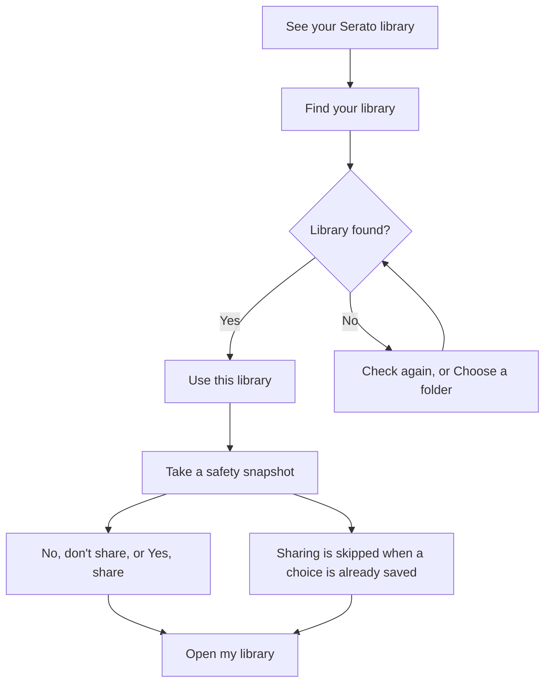

# First-run setup

<figure>
  
  <figcaption>Example data. Step 3 of 5, Safety snapshot.</figcaption>
</figure>

The first open runs setup until you choose **Open my library**. **Cancel** closes setup and does not change the library. Setup shows again next time. Esc cancels too. It does not answer the sharing question.

| Step | Heading | Button |
| --- | --- | --- |
| Welcome | **See your Serato library** | **Get started** |
| Find your library | **Find your library** | **Use this library** when it names the disk and the tracks. **Check again** when it found nothing. **Choose a folder** opens a library already in that folder when the usual one is not there. It does not create a library. |
| Safety snapshot | **Safety snapshot** | **Take a safety snapshot**, then **Continue**. The body says a backup of your library data is saved before anything is changed. |
| Sharing | **Share anonymous usage stats and crash reports?** | **No, don't share** is first. **Yes, share** is the other choice. This step is skipped when a choice is already saved. |
| Done | **Library ready. Snapshot saved.** | **Open my library** |

If Serato DJ is open on the snapshot step, the page says **Close Serato DJ to continue** and checks again on its own. When the copy is saved, the line says **Safety copy saved.**

**Back** is on every step except Welcome. **Run setup again** in **Settings** shows these steps another time. **Cancel** on that run leaves the library as it is and does not forget that you already finished setup.

The safety copy is the first Backup. Later copies are under **Snapshots**. [Backups and restore](Backups-and-Restore). Sharing is [Settings](Settings).
