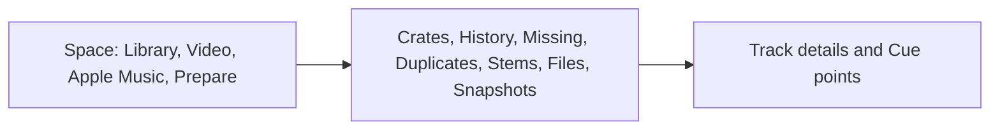

# Serato Library

A window on your computer for the Serato DJ Pro library. Crates, Cue points, and Backups stay on this machine.

- [Quick Start](Quick-Start)
- [Install on a Mac](Install-macOS)
- [Install on Windows](Install-Windows)

The long guide is published at <https://mookiejones.github.io/serato-library-manager/>.

## What you click

**Library** sits at the top of the sidebar. The status line under it starts as **Checking Serato**.

The views are **Crates**, **History**, **Missing**, **Duplicates**, **Stems**, **Files**, and **Snapshots**.

Double-click a track to play it. The bar under the list has pause, seek, and volume. Playback does not change the file.

The space menu shows **Library**, **Video**, **Apple Music**, and **Prepare**.

**Shortcuts** and **Settings** are at the bottom of that sidebar. **Shortcuts** lists the keys. Ctrl+K or Command+K finds a track or a file.

## Cue points and Backups

Cue points live in the audio file. A normal save does not rewrite them.

**Snapshots** keeps hash-checked copies of the library, the crates on each drive, and the Cue point frames stored in the audio files. The music itself is not copied.

Open **Snapshots**, choose **Review restore**, then **Restore**. Restore can rewrite the Serato tags (cue points, beatgrid, autotags) inside each audio file, and removes Serato tags the snapshot didn't have. The audio stream is hash-checked before and after; if it would change, the file is left as it was.

Quit Serato DJ Pro before a write. On Serato 5, writes and restores stay off.

## One download

GitHub Releases is the only download. There is no Homebrew formula, no winget package, and no other website.

**Rekordbox** can export `rekordbox.xml`. The guide marks that export **PREVIEW**.
