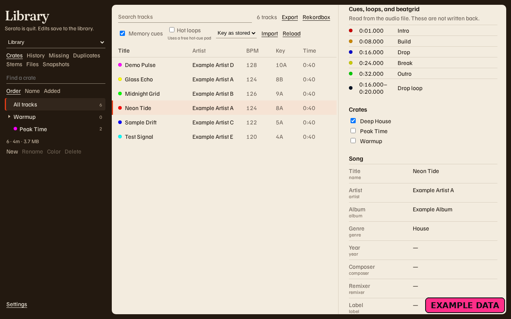
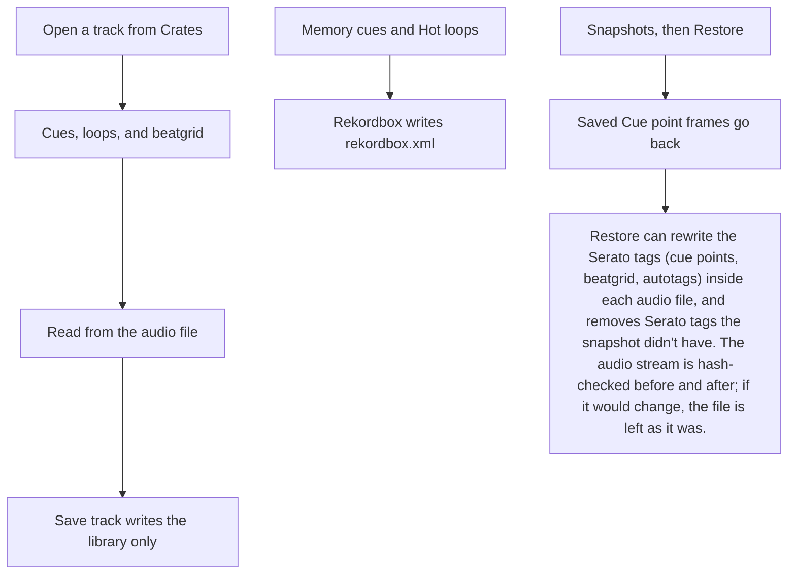

# Hot loops and Cue points

<figure>
  
  <figcaption>Example data. Memory cues is on, Hot loops is off, and the open track lists Cue points and a loop.</figcaption>
</figure>

Cue points, loops, and the beatgrid live in the audio file. Open a track from **Crates**. The section is **Cues, loops, and beatgrid**. The line under it reads **Read from the audio file. These are not written back.**

**Save track** writes the library. It does not rewrite the audio file. A missing file says **The file is not on disk, so cues cannot be read.** A file with no Serato markers says **No Serato cues in this file.**

**Hot loops** sits beside **Memory cues** in the bar above the list. **Memory cues** starts on. **Hot loops** starts off. The help line reads **Uses a free hot-cue pad.** The app remembers Memory cues, Hot loops, and the key notation (**Key as stored**, **Camelot key**, or **Classical key**) in `settings.json`.

Those boxes change the Rekordbox file only. They do not move pads inside Serato. With **Hot loops** on, a saved loop takes its own pad when that pad is free and it is one of the first eight. A loop whose pad is already taken stays a memory loop. A loop past those eight pads stays a memory loop too. With the box clear, every saved loop stays a memory loop.

Putting Cue points back is a restore from **Snapshots**. Restore can rewrite the Serato tags (cue points, beatgrid, autotags) inside each audio file, and removes Serato tags the snapshot didn't have. The audio stream is hash-checked before and after; if it would change, the file is left as it was. [Backups and restore](Backups-and-Restore) is that flow. The export keeps **Status: preview** on [Export to Rekordbox](Export-to-Rekordbox).
