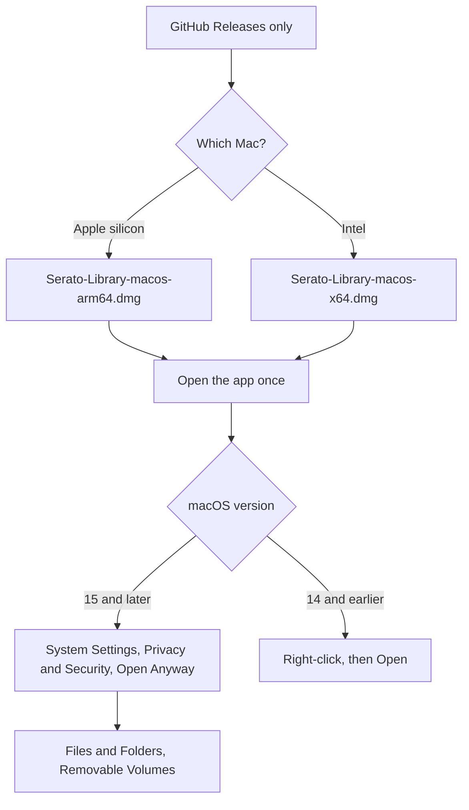

# Install on a Mac

GitHub Releases is the only download. Current releases may be unsigned. If macOS blocks the app, use the steps below.



## Pick the disk image

| Mac | File |
| --- | --- |
| Apple silicon (arm64) | `Serato-Library-macos-arm64.dmg` |
| Intel (x64) | `Serato-Library-macos-x64.dmg` |

`SHA256SUMS` lists the SHA-256 of each file on that release.

The pre-release **v1.1.0-rc2** attaches both disk images. The release marked Latest is **v0.1.1**. v0.1.1 attaches `Serato-Library-macos.zip`, an Apple silicon zip, and no Intel disk image.

## Put the app in Applications

1. Open the [releases page](https://github.com/mookiejones/serato-library-manager/releases).
2. Download the disk image for your Mac.
3. Double-click the disk image.
4. Drag **Serato Library** onto **Applications**.
5. Open **Serato Library** from Applications.

## macOS 15 and later

1. Open the app once.
2. Go to **System Settings > Privacy & Security**.
3. Choose **Open Anyway**.
4. Confirm, and enter your password if macOS asks.

## macOS 14 and earlier

1. Right-click the app.
2. Choose **Open**.
3. Choose **Open** again.

## If macOS still blocks the app

Clear the quarantine flag, then open **Serato Library** from Applications:

```bash
xattr -dr com.apple.quarantine "/Applications/Serato Library.app"
```

## External drives

Music on an external drive needs **Files and Folders > Removable Volumes**. Removable Volumes is not Full Disk Access.

1. Open **System Settings**.
2. Go to **Privacy & Security**.
3. Go to **Files and Folders**.
4. Select **Serato Library**.
5. Turn on **Removable Volumes**.

A current release may be unsigned, so macOS may ask again after an update. Turn **Removable Volumes** back on for the new copy.

## You are in

A window titled **Serato Library** opens. The page is served on `127.0.0.1`. Close the window to quit. A second open focuses that window.

Next: [Quick Start](Quick-Start).
