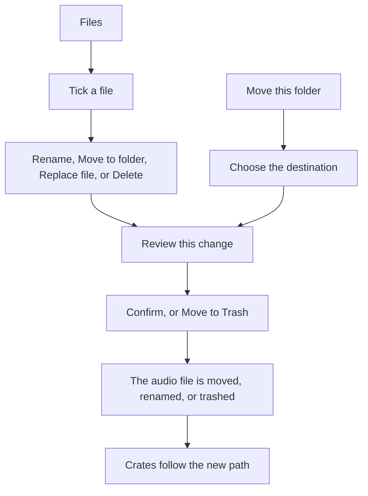

# Organizing files

> **TODO-SCREENSHOT:** The **Files** view in a music folder. One audio file is ticked and marked **In library**. The path line shows the folder. **Rename**, **Move to folder**, **Move this folder**, **Replace file**, and **Delete** are along the bottom. The dialog **Review this change** is open and says **Nothing is changed until you confirm.**

**Files** browses folders on this computer. The first folder is **Home**. These actions can move, rename, and trash audio files. Cue points stay inside the file that moves. Crates, history, and **Prepare** follow the new path.

Quit Serato DJ Pro first. Every change opens **Review this change**. The dialog says **Nothing is changed until you confirm.**

| Action | What happens to the audio file |
| --- | --- |
| **Rename** | One file gets a new name in the same folder. Click **Review**, then **Confirm**. |
| **Move to folder** | The ticked files move. Pick the folder, click **Move here**, then **Confirm**. A move to another drive copies, checks the size, then removes the original. |
| **Move this folder** | The folder in the path line moves. Home, a whole drive, the library folder, and a backup folder are refused. |
| **Replace file** | One library track points at a different file. The old file stays on disk. Cue points are copied only when the dialog says that is safe. |
| **Delete** | The track leaves the library and its crates. **Move to Trash** puts the audio file in the Trash on a Mac, or the Recycle Bin on Windows. |

**Cancel** writes nothing. A shortcut cannot be selected. A missing library file can leave the library, and nothing goes to the Trash, because the file is not on disk.

A successful move also updates related-track links. [Related tracks](Related-Tracks.md).

On a Mac, external drives need **Files and Folders > Removable Volumes**. The steps are on [Install on a Mac](Install-macOS.md). An unplugged drive is not in the folder list. It is not deleted from the library. [Backups and restore](Backups-and-Restore.md) marks that drive unavailable.
