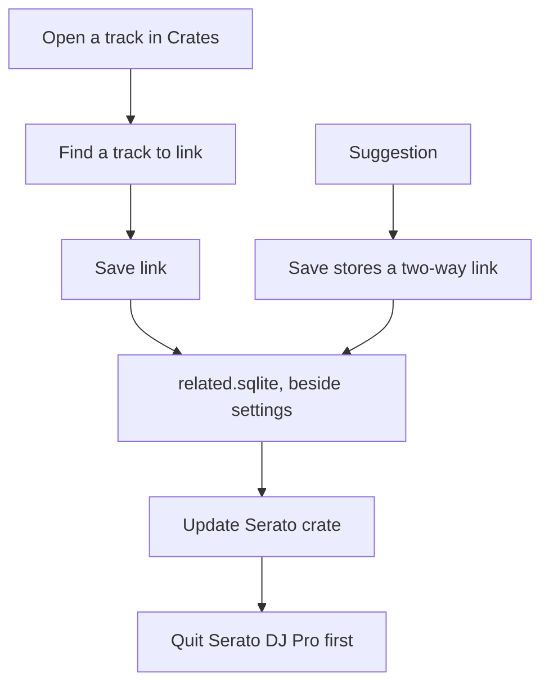

# Related tracks

> **TODO-SCREENSHOT:** A track open on the right. The **Related tracks** section shows one saved row marked **Two-way**, a note, and **Remove**. Under it, **Find a track to link**, **Note**, **Link rating**, **Two-way link**, and **Save link**. A suggestion row has **Save**. **Update Serato crate** is under the list.

Related tracks are songs you want to remember together. The links live in `related.sqlite`, next to this app's settings, not in Serato's library. Saving or removing a link works while Serato DJ Pro is open.

1. Open a track that has a file path. A track with no path says **This track has no file path, so it cannot be linked.**
2. Find **Related tracks**.
3. In **Find a track to link**, type a title or an artist.
4. Add a **Note** if you want one. The hint is **blend out of**. The box holds 500 characters.
5. Choose a **Link rating** from **Not rated** through **5**.
6. Leave **Two-way link** ticked, or clear it for a one-way link.
7. Click **Save link**.

The bar says **Link saved.** A two-way link reads **Two-way**. A one-way link reads **One-way**. **Remove** asks you to confirm. The audio file and the Serato library do not change.

Suggestions use the same key, a neighbor on the Camelot wheel, a tempo within 6 percent, or a shared normal crate. The line says **Suggested from key, tempo within 6%, and shared crates. Save stores a two-way link.** That save has no note and no rating.

**Update Serato crate** writes a normal crate named `Related - ` plus the track title. Quit Serato first. While Serato is open the button stays off and the note says **Quit Serato before writing the crate.**

The live view while a deck is playing is a different app, [serato-listener](https://github.com/mookiejones/serato-listener). It reads `related.sqlite` and does not change it.

| System | File |
| --- | --- |
| Mac | `~/Library/Application Support/Serato Library/related.sqlite` |
| Windows | `%APPDATA%\Serato Library\related.sqlite` |

That folder is **Serato Library**, with a space. It is not `Serato/Library`, which holds `master.sqlite`. A move in **Files** updates these paths. [Where Serato data lives](Where-Serato-Data-Lives.md).
