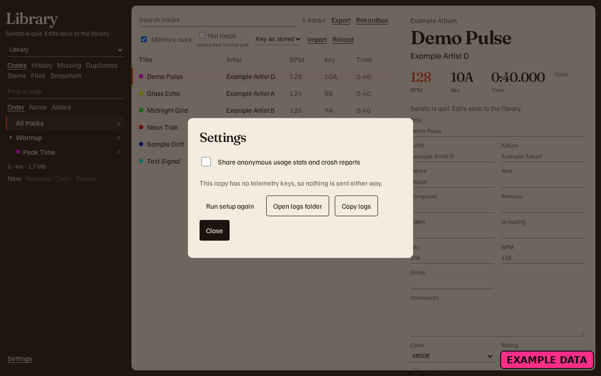
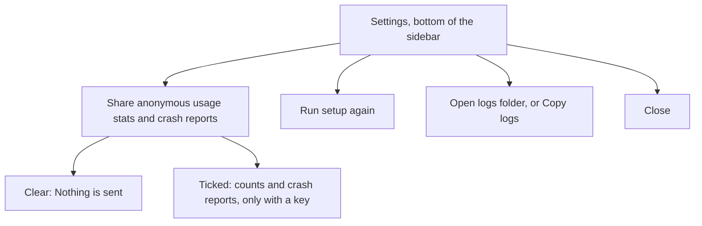

# Settings

<figure>
  
  <figcaption>Example data. Sharing is off. This copy has no telemetry keys.</figcaption>
</figure>

**Settings** is at the bottom of the left sidebar. Sharing is off until you turn it on. Track titles, crate names, file paths, and the rows in the library are not usage reports.

Tick **Share anonymous usage stats and crash reports** to turn sharing on. Clear it to turn sharing off.

| Line under the tick | Meaning |
| --- | --- |
| **This copy has no telemetry keys, so nothing is sent either way.** | The choice is saved. This copy has nothing to send. |
| **Anonymous counts and crash reports can be sent.** | Sharing is on, and a key is present. |
| **Nothing is sent.** | Sharing is off. |

What can leave, and only after you choose share and only when a key is present, is a count of an action, a track-count range, the app name, the app version, the operating system, a random install id, and a crash report with file paths removed. Titles, artists, crate names, notes, and paths stay on this computer. The full list is [PRIVACY.md](https://github.com/mookiejones/serato-library-manager/blob/main/PRIVACY.md).

**Run setup again** opens [first-run setup](First-Run-Wizard). **Cancel** there does not forget that setup already finished.

**Open logs folder** says **Opened the logs folder.** or **Couldn't open the logs folder.** **Copy logs** says **Copied the logs.** A long log says **Copied the latest log entries. Older entries were left out.** An empty log says **No log entries yet.**

The same settings file remembers the window, the track-list width, that setup finished, and the Rekordbox bar: Memory cues, Hot loops, and the key notation.

| System | Settings | Logs |
| --- | --- | --- |
| Mac | `~/Library/Application Support/Serato Library/settings.json` | `~/Library/Logs/Serato Library/` |
| Windows | `%APPDATA%\Serato Library\settings.json` | `%LOCALAPPDATA%\Serato Library\Logs\` |

**Serato Library** (with a space) is this app. `Serato/Library` is Serato's database. [Where Serato data lives](Where-Serato-Data-Lives).
