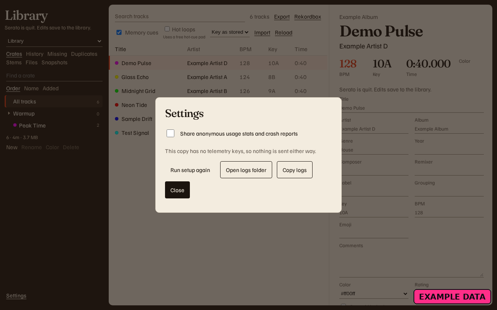
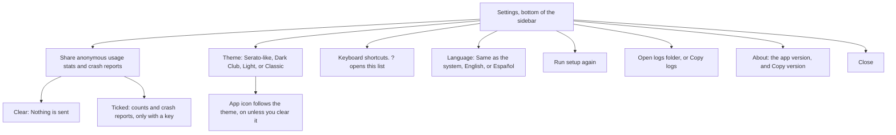

# Settings

<figure>
  
  <figcaption>Example data. Sharing is off. This copy has no telemetry keys.</figcaption>
</figure>

**Settings** is at the bottom of the left sidebar. It opens as a page in the main area, not a popup. Sharing is off until you turn it on. Track titles, crate names, file paths, and the rows in the library are not usage reports.

Tick **Share anonymous usage stats and crash reports** to turn sharing on. Clear it to turn sharing off.

| Line under the tick | Meaning |
| --- | --- |
| **This copy has no telemetry keys, so nothing is sent either way.** | The choice is saved. This copy has nothing to send. |
| **Anonymous counts and crash reports can be sent.** | Sharing is on, and a key is present. |
| **Nothing is sent.** | Sharing is off. |

What can leave, and only after you choose share and only when a key is present, is a count of an action, a track-count range, the app name, the app version, the operating system, a random install id, and a crash report with file paths removed. Titles, artists, crate names, notes, and paths stay on this computer. The full list is [PRIVACY.md](https://github.com/mookiejones/crateCraft/blob/main/PRIVACY.md).

**Theme** is Serato-like (the default), Dark Club, Light, or Classic. The whole page uses that token set. The sidebar stripe and the icon preview follow it. **App icon follows the theme** is on unless you clear it. On a Mac the Dock icon of the running app changes. On Windows the window and taskbar icon change. The Finder icon and the Windows program icon stay the baked default from launch. On another system the line says the choice is saved for Mac and Windows.

**Language** switches the whole page at once. **Same as the system** follows your computer's language. English and Spanish are included.

**Run setup again** opens [first-run setup](First-Run-Wizard). **Cancel** there does not forget that setup already finished.

**Open logs folder** says **Opened the logs folder.** or **Couldn't open the logs folder.** **Copy logs** says **Copied the logs.** A long log says **Copied the latest log entries. Older entries were left out.** An empty log says **No log entries yet.** A snackbar that names a file and points at this log is a write that could not put that file back. The full path stays in the log.

**About** shows the version of this copy, such as **v1.4.2**. **Copy version** puts that line on the clipboard and the next line says **Copied**. When the version cannot be read, About says **Version unavailable**. The sidebar does not repeat the version.

The same settings file remembers the window, the track-list width, the language, the theme, whether the app icon follows that theme, that setup finished, and the Rekordbox dialog: Memory cues, Hot loops, and the key notation. If setup was pointed at a library that is not in the usual folder, `library.json` in that same folder remembers the file. The path stays on this computer.

| System | Settings | Logs |
| --- | --- | --- |
| Mac | `~/Library/Application Support/crateCraft/settings.json` | `~/Library/Logs/crateCraft/` |
| Windows | `%APPDATA%\crateCraft\settings.json` | `%LOCALAPPDATA%\crateCraft\Logs\` |

**crateCraft** is this app's folder. `Serato/Library` is Serato's database. An install from before the rename keeps its old **Serato Library** folder; crateCraft copies it once and leaves the original in place. [Where Serato data lives](Where-Serato-Data-Lives).
