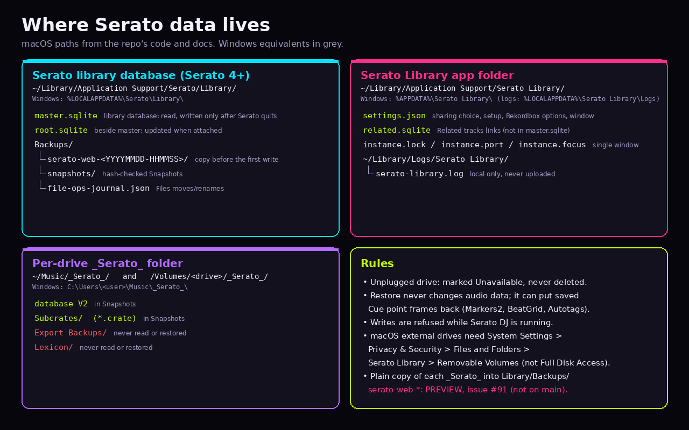
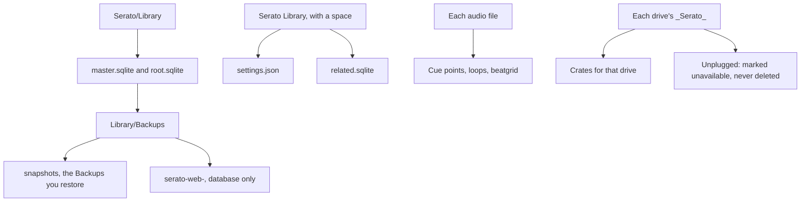

# Where Serato data lives

<figure>
  
  <figcaption>Example data. This is a diagram, not a screenshot. The paths in it are examples. The Rules box uses older wording for restore. The paragraph under the diagram is what restore does.</figcaption>
</figure>

Serato DJ Pro keeps the library in `master.sqlite`. `root.sqlite` often sits beside it. This app reads both and updates `root.sqlite` when that file is there.

| System | Serato library |
| --- | --- |
| Mac | `~/Library/Application Support/Serato/Library/master.sqlite` |
| Windows | `%LOCALAPPDATA%\Serato\Library\master.sqlite` |

On a Mac: Finder, **Go**, **Go to Folder**, paste `~/Library/Application Support/Serato/Library`.

On Windows: Windows key and R, paste `%LOCALAPPDATA%\Serato\Library`.

Cue points, loops, and the beatgrid live in the audio file, not in the crate row. A normal save does not rewrite that file. **Files** can move, rename, and trash the audio file. Restore can rewrite the Serato tags (cue points, beatgrid, autotags) inside each audio file, and removes Serato tags the snapshot didn't have. The audio stream is hash-checked before and after; if it would change, the file is left as it was.

Each drive with a Serato folder has `_Serato_` at its root, including `database V2`. **Snapshots** keeps those crates. An unplugged drive is marked unavailable, never deleted.

On a Mac, external drives need **Files and Folders > Removable Volumes**. That is not Full Disk Access.

1. Open **System Settings**.
2. Go to **Privacy & Security**.
3. Go to **Files and Folders**.
4. Select **Serato Library**.
5. Turn on **Removable Volumes**.

The steps, including the unsigned-app warning, are on [Install on a Mac](Install-macOS).

This app's own files use a different folder, **Serato Library**, with a space.

| System | This app |
| --- | --- |
| Mac | `~/Library/Application Support/Serato Library/` (`settings.json`, `related.sqlite`) |
| Windows | `%APPDATA%\Serato Library\` |

Hash-checked Backups are `Library/Backups/snapshots` next to `master.sqlite`. The first save in a session also writes `Library/Backups/serato-web-` plus the date and time. That folder is `master.sqlite` and `root.sqlite` only.

Logs are `~/Library/Logs/Serato Library/` on a Mac and `%LOCALAPPDATA%\Serato Library\Logs\` on Windows. [Settings](Settings) opens that folder.
